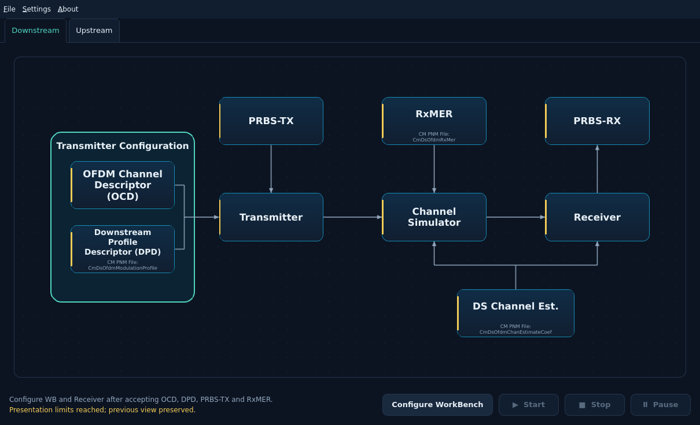
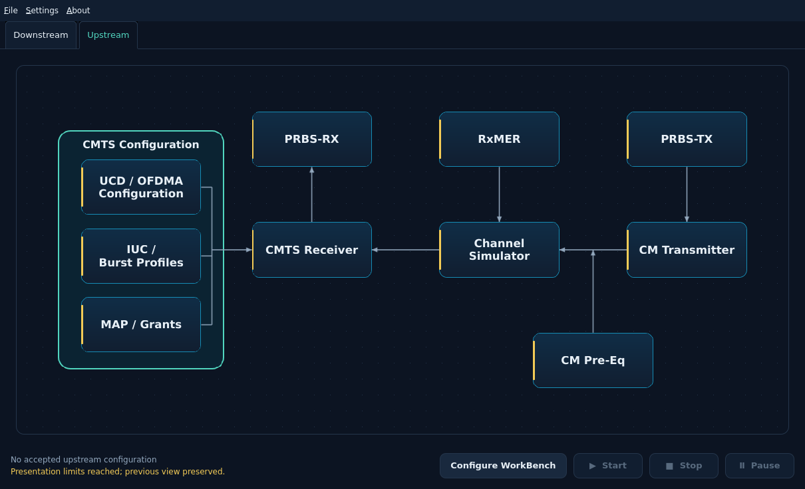
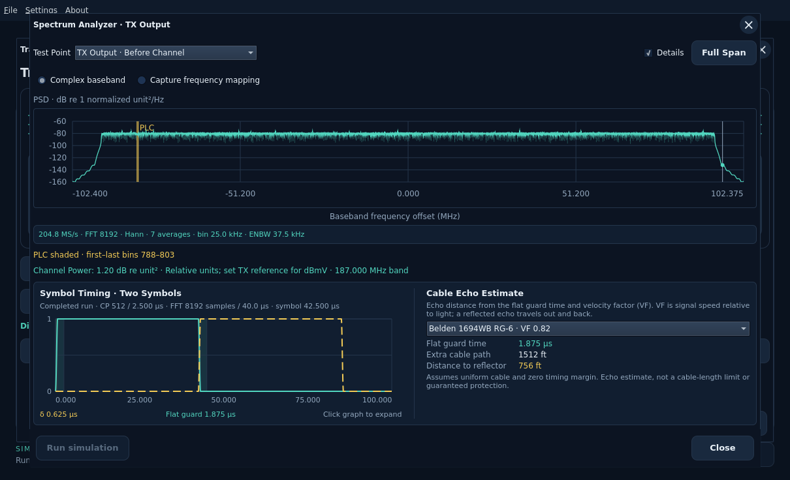
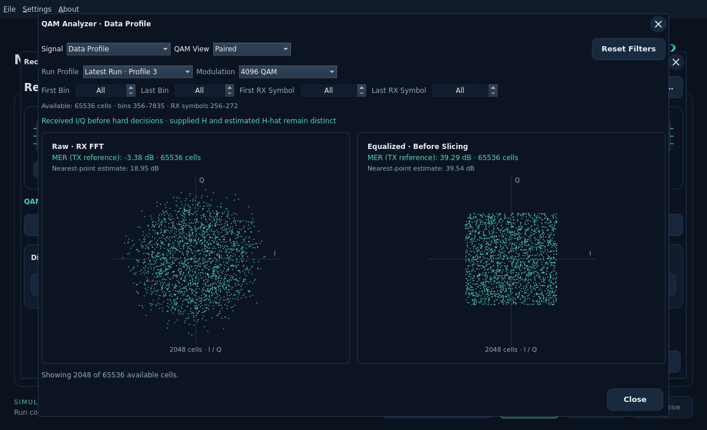
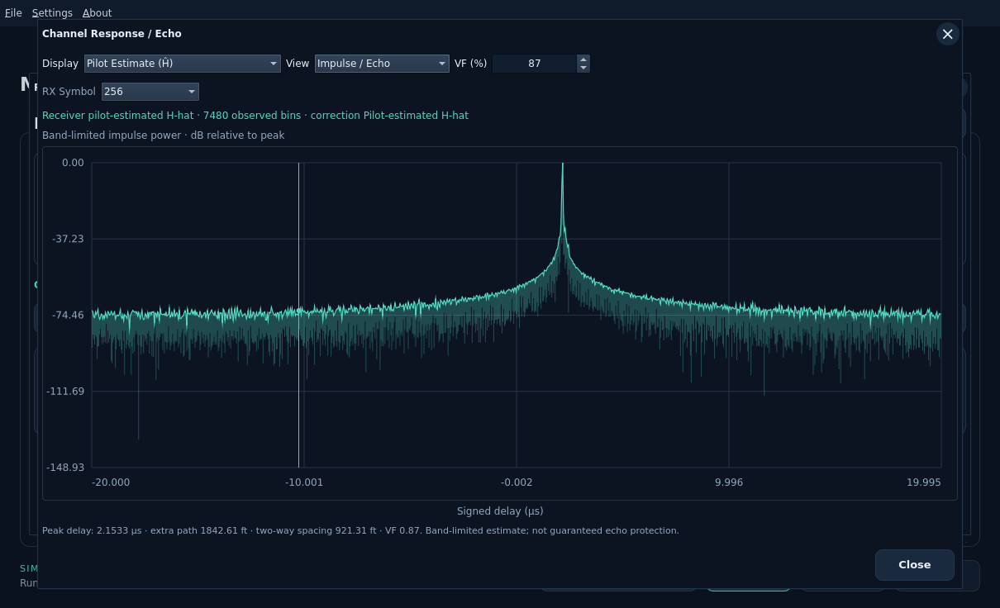
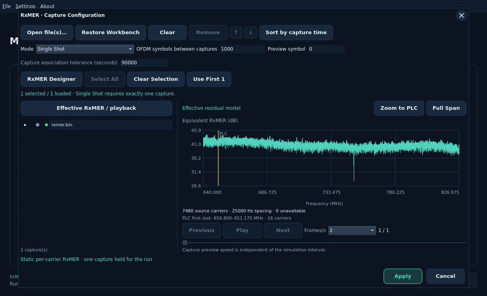
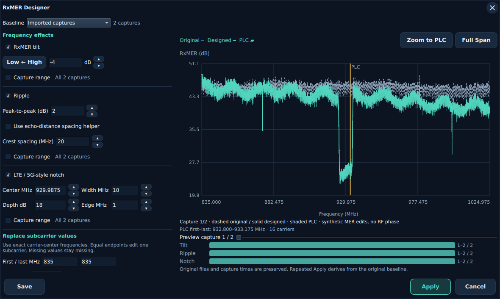

  <picture>
    <source media="(prefers-color-scheme: dark)" srcset="docs/images/logo/merlin-logo-dark-rounded.svg">
    <source media="(prefers-color-scheme: light)" srcset="docs/images/logo/merlin-logo-light-rounded.svg">
    
  </picture>

# MERLIN — DOCSIS OFDM/OFDMA Simulation Toolkit

*Modulation, Encoding, Reception, Link Impairments & Noise*

MERLIN is a Rust toolkit for **DOCSIS downstream OFDM and upstream OFDMA PHY
simulation**. Two independent engines share DSP and FEC infrastructure, with one
public Rust facade, one native Python distribution and one command-line executable.
The native Qt workbench provides downstream configuration and instruments.

Application source, including the licensed PNM decoder and its tests, lives in
this checkout. Builds do not require another project repository or private source
credentials; normal locked registry dependencies and toolchain downloads remain.

Run a synthetic reference or an admitted measurement-driven experiment, then
compare recovered data with the original source. Inspect actual bit errors,
decoder decisions, corrections and iteration counts. All signal processing,
FEC and simulation orchestration run in Rust.

## Supported scope

| Direction | Signal path | Configuration and observations |
| --- | --- | --- |
| [Downstream OFDM](docs/user/channel-runner/README.md) | CMTS transmitter → channel → CM receiver | BCH/LDPC, profile-based QAM, interleaving, PLC/NCP and pilots; ideal references or captured RxMER/channel estimates with an applied modulation profile. |
| [Upstream OFDMA](docs/user/upstream/README.md) | CM transmitter → channel → CMTS receiver | Typed channel, burst-profile and grant configuration; synthetic runs or explicitly associated UCD, RxMER and CM Pre-Eq captures. Normal receiver processing uses received observations. |

The unified backend has passed its
[local integration acceptance](docs/development/features/unified-backend/validation.md#int-accept-01-final-backend-acceptance).
Direction-specific configurations, limits and reports remain distinct. See the
[downstream support matrix](docs/reference/ofdm-support.md) and
[upstream measurement contracts](docs/user/upstream/measurements.md) before
selecting operating modes or combining captures.

Full CMTS MAC services, channel bonding, multi-channel simulation and wider
upstream acquisition/ranging are outside the accepted scope. Closed-loop results
describe MERLIN's modeled experiment; they do not establish external modem
interoperability. The Qt workbench on `master` presents downstream OFDM only;
the unified upstream UI remains separate development work.

## Get started

**Desktop:** follow the [Ubuntu DEB](docs/user/install/ubuntu-desktop.md) or
[Windows MSI](docs/user/install/windows.md) guide and choose the matching
[release assets](https://github.com/mgarcia01752/merlin/releases).

**CLI, Rust and Python:** the [getting-started guide](docs/user/getting-started.md)
contains runnable commands, namespace imports and links to the detailed API guides.
Browse the [CLI examples](examples/cli/README.md) and
[paired Rust/Python examples](examples/api/README.md) for complete workflows.

## Workspaces

| Downstream | Upstream |
| :---: | :---: |
|  |  |

Native previews from the
[`feature/unified-qt-workbench` branch](https://github.com/mgarcia01752/merlin/tree/feature/unified-qt-workbench).
Select either image to view it full size. See the [workbench guide](docs/user/workbench.md)
and [saved examples](examples/workbench/README.md) for the released downstream UI.

## Signal analyzers and RxMER Designer

Native downstream UI captures. Select an image to open its guide.

| Spectrum Analyzer | QAM Analyzer |
| :---: | :---: |
|  |  |
| **Channel Response / Echo** | **RxMER** |
|  |  |

<h3 align="center">RxMER Designer</h3>

  

## Measurements and demos

- [File payloads](docs/user/simulation/file-source/README.md): send exact text/binary bytes, optionally append finite PRBS15 fill, and export recovered bytes.
- [PNM input guide](docs/user/measurement-inputs/README.md): supported capture types, decoded JSON and file limits.
- [Impairment experiments](docs/user/impairments/experiments.md): reproduce the RxMER sweeps and inspect FEC outcomes.
- [Paired constellations](docs/user/impairments/paired-constellation.md): export matched payload I/Q before and after equalization; includes an actual measured-response plot.
- [Receiver Channel Estimation](docs/user/receiver-estimation/README.md): independent pilot estimation, protected analyzers and bounded timing search.
- [Temporal measurements](docs/user/impairments/measurement-timeline.md) and [mixed profiles](docs/user/payload-transport/applied-profiles.md): explicit playback and variable-width coding.
- [Binary RxMER demos](examples/measurements/rxmer-fec-stress/README.md): baseline plus 12, 11, 10 and 9 dB stress cases for external viewing.

## Documentation

- [Getting Started](docs/user/getting-started.md): installation, CLI commands and Rust/Python imports.
- [UI Guide](docs/user/workbench.md): configure and run the Qt workbench.
- [Upstream OFDMA Guide](docs/user/upstream/README.md): configuration, stages, captures, sessions and CLI.
- [Rust API Guide](docs/reference/public-api.md): use both simulation engines directly.
- [Python Guide](docs/user/python/README.md): native bindings, local wheel setup and examples.
- [Architecture](docs/architecture.md), [requirements](docs/requirements.md) and [checklist](docs/development/checklist.md): canonical ownership, contracts and acceptance evidence.

See the [documentation index](docs/README.md) for CLI usage, simulation models,
reference material and development guides. The [examples index](examples/README.md)
separates CLI requests, saved workbenches and measurement fixtures. The checkout's
canonical version is [VERSION](VERSION).

Apache-2.0 signal-processing libraries and tooling; the Qt application is
[GPL-3.0-only](apps/qt/LICENSE). With MIT/Apache dependencies and a Rust-adapted MIT BCH
implementation. See [LICENSE](LICENSE), [NOTICE](NOTICE) and the
[AFF3CT notice](crates/fec-codec/LICENSE-MIT).
