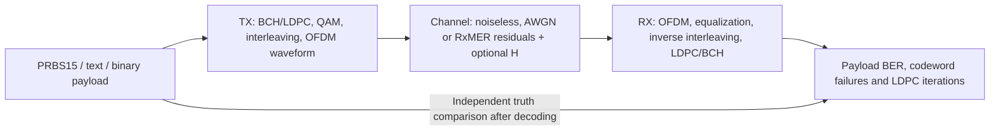

# MERLIN — DOCSIS OFDM Simulation Toolkit

*Modulation, Encoding, Reception, Link Impairments & Noise*

**Under development — standalone Rust simulation core and CLI.**

Simulate a single downstream DOCSIS OFDM channel, recover its payload through
actual BCH/LDPC decoding, and measure how impairments affect bit errors and decoder
work. Run an ideal reference or use decoded RxMER, downstream channel estimates
and an applied modulation profile. All signal processing and FEC run in Rust.

MERLIN models a **CMTS-like transmit path for a single downstream OFDM channel**,
including profile-based modulation, FEC, PLC/NCP signaling, pilots and waveform
generation. A simulated channel and receiver complete the experiment so you can
measure payload recovery and decoder behavior. Its scope is the supported PHY
path; full CMTS MAC services and multi-channel operation are outside that scope.

## Where development stands

The waveform engine supports all ten uniform data orders through16384-QAM and frozen mixed ProfileA loading,
with continuous runs, pilot-derived channel correction and explicit measurement
epochs. Experiments demonstrate both error-free recovery and post-FEC bit errors
as RxMER worsens. External DOCSIS interoperability is not established.

| Area | Current implementation |
| --- | --- |
| Transmission | Single channel up to 192 MHz; 25/50 kHz spacing; configurable prefix, roll-off and time interleaving |
| Coding and signaling | BCH + short rate-8/9 LDPC; data randomization; actual PLC/NCP signaling and received configuration |
| Waveform TX/RX | Frequency/time interleaving, pilots, IFFT, prefix, windowing, sample transport and matched receiver |
| Continuous runs | PRBS15, configurable duration, startup/drain accounting, cancellation and partial results |
| Impairments | Seeded sample AWGN or per-carrier RxMER residuals; supplied channel response, reference or pilot-derived equalization |
| Measurements | Current `pnm-decode` JSON import for RxMER, channel estimation and modulation profiles; explicit temporal epochs and frozen applied mixed profiles |
| Paired constellation | Bounded raw/corrected payload I/Q pairs with exact carrier/time coordinates and CLI JSON |
| Results | Recovered-payload BER, codeword failures, actual LDPC iterations, BCH corrections and bounded stage probes |
| Modulation coverage | Mapping, hard/soft decisions and full uniform coding through16384-QAM; mixed profiles and explicit shortened waveform reference |

Use the [development workspace](docs/development/README.md) for ongoing work
and linked feature records. See the [development status](docs/development/status.md) for completed milestones,
remaining work and validation limits. The [implementation checklist](docs/development/checklist.md)
is the detailed source of progress; the [architecture](docs/architecture.md)
describes component ownership.

## Simulation flow



PLC/NCP signaling, pilots and receiver configuration are part of the implemented
path. The [component guides](docs/user/simulation/README.md) explain each subsystem.

## Try it locally

Prerequisite: Rust 1.85.1. The Cargo wrapper uses an existing project-local
toolchain when available and installs nothing. Run from the repository root,
using a new output filename:

```bash
scripts/cargo-local.sh run -p ofdm-fec-cli --release --locked -- channel \
  --input examples/channel-awgn.json --output awgn-channel-result.json
```

For the isolated codec before involving QAM or a channel:

```bash
scripts/cargo-local.sh run -p fec-codec --example codec_loop --locked
```

## Measurements and demos

- [File payloads](docs/user/simulation/file-source/README.md): send exact text/binary bytes, optionally append finite PRBS15 fill, and export recovered bytes.
- [PNM input guide](docs/user/measurement-inputs/README.md): import the three decoded capture types; binary decoding stays external.
- [Impairment experiments](docs/user/impairments/experiments.md): reproduce the RxMER sweeps and inspect FEC outcomes.
- [Paired constellations](docs/user/impairments/paired-constellation.md): export matched payload I/Q before and after equalization; includes an actual measured-response plot.
- [Receiver Channel Estimation (CH-EST-RX)](docs/user/receiver-estimation/README.md): independent pilot estimation, protected analyzers and bounded timing search.
- [Temporal measurements](docs/user/impairments/measurement-timeline.md) and [mixed profiles](docs/user/payload-transport/applied-profiles.md): explicit playback and variable-width coding.
- [Binary RxMER demos](examples/measurements/rxmer-fec-stress/README.md): baseline plus 12, 11, 10 and 9 dB stress cases for external viewing.

## Documentation

[Channel CLI](docs/user/channel-runner/cli.md) ·
[Other CLI experiments](docs/cli.md) ·
[FEC codec and equations](docs/user/fec-codec.md) ·
[Codeword shortening](docs/user/fec-shortening/README.md) ·
[QAM processing and decisions](docs/user/qam-processing/README.md) ·
[Transmission settings](docs/user/transmission.md) ·
[Modulation support](docs/reference/ofdm-support.md) ·
[Public Rust API](docs/reference/public-api.md) ·
[JSON contracts](docs/reference/documents.md) ·
[Build and test](docs/development/build.md) ·
[Logging](docs/development/logging.md) ·
[Git and releases](docs/development/git.md)

OFDMA, dynamic profile activation, broader blind receiver acquisition, Python
bindings, a Qt interface and native installers remain future work. Current runtime
validation is Linux; Windows/macOS and external interoperability remain open.
The [QAM-04 external-vector requirements](docs/development/features/qam-completion/external-vectors.md)
record the deferred evidence needed to validate interoperability.

Apache-2.0 project code, with MIT/Apache dependencies and a Rust-adapted MIT BCH
implementation. See [LICENSE](LICENSE), [NOTICE](NOTICE) and the
[AFF3CT notice](crates/fec-codec/LICENSE-MIT).
