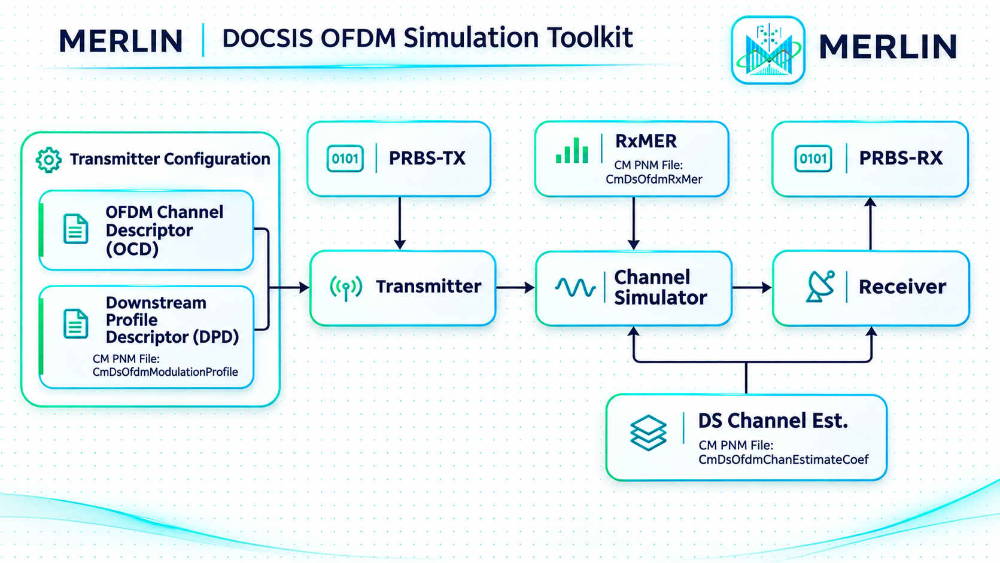
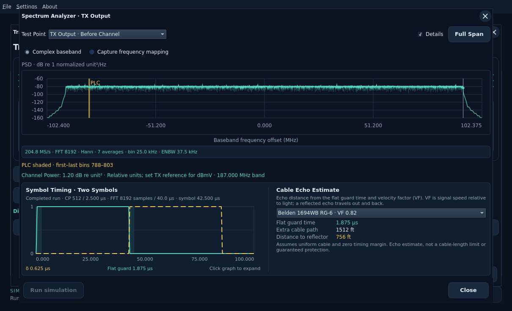
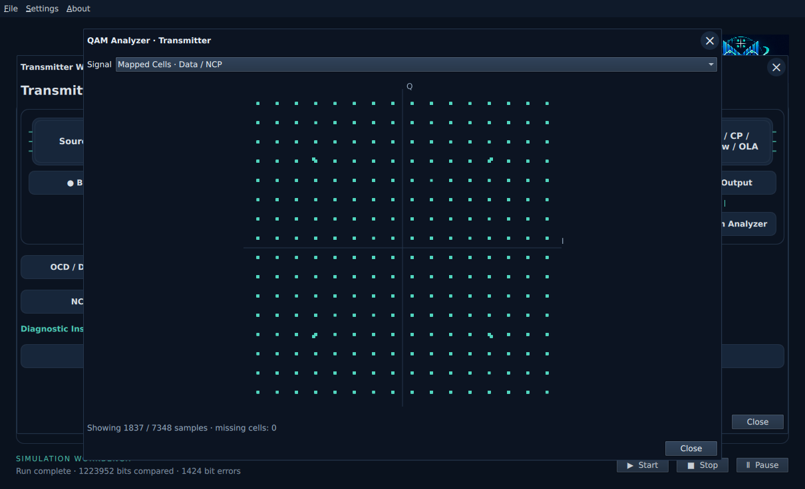
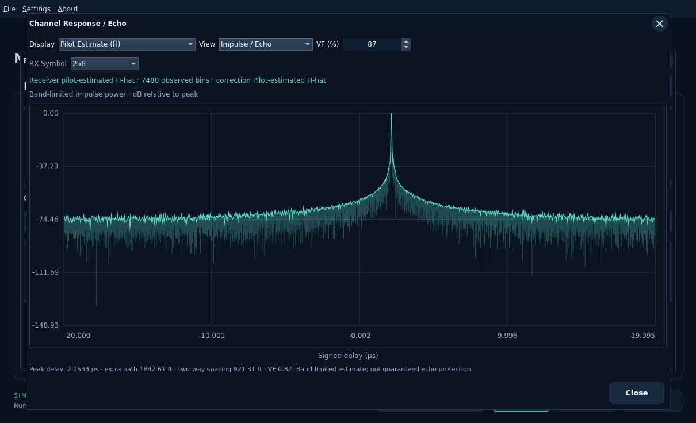
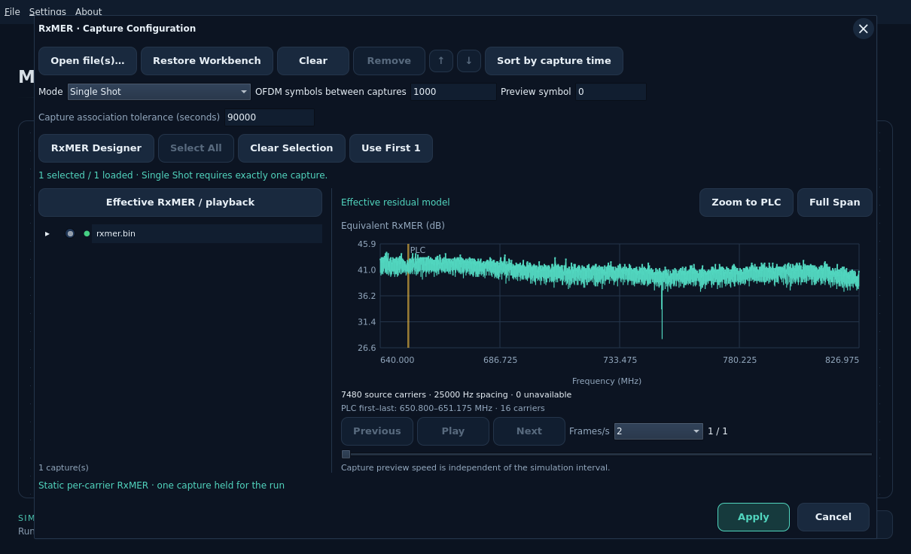

  <picture>
    <source media="(prefers-color-scheme: dark)" srcset="docs/images/logo/merlin-logo-dark-rounded.svg">
    <source media="(prefers-color-scheme: light)" srcset="docs/images/logo/merlin-logo-light-rounded.svg">
    
  </picture>

# MERLIN — DOCSIS OFDM Simulation Toolkit

*Modulation, Encoding, Reception, Link Impairments & Noise*

MERLIN simulates the **downstream PHY of a CMTS for a single DOCSIS OFDM
channel**, from payload encoding to waveform generation and receiver recovery.
It combines BCH/LDPC coding, profile-based QAM modulation, interleaving,
PLC/NCP signaling and pilots with configurable channel impairments.

Run an ideal reference or use captured RxMER, downstream channel estimates and
an applied modulation profile. Compare recovered data with the original source
to measure bit errors, decoding failures, corrections and iteration counts.
All signal processing and FEC run in Rust. Full CMTS MAC services and
multi-channel operation are outside the simulator's scope.

Install the desktop workbench: [Ubuntu DEB](docs/user/install/ubuntu-desktop.md) ·
[Windows MSI](docs/user/install/windows.md). Windows native validation is pending;
macOS is deferred.

Example inputs: [CLI requests and use cases](examples/cli/README.md) ·
[UI workbenches](examples/workbench/README.md) · [Example folder guide](examples/README.md).

## Workbench overview

  <picture>
    <source media="(prefers-color-scheme: dark)" srcset="docs/images/logo/merlin-toolkit-diagram-dark.png">
    <source media="(prefers-color-scheme: light)" srcset="docs/images/logo/merlin-toolkit-diagram-light.png">
    
  </picture>

Illustrated system overview. See the [workbench guide](docs/user/workbench.md)
for native UI screenshots, configuration and test-point instruments.

## Signal analyzers

Actual native UI captures. Select an image to open its guide.

| Spectrum Analyzer | QAM Analyzer |
| --- | --- |
|  |  |
| **Channel Response / Echo** | **RxMER** |
|  |  |

## Measurements and demos

- [File payloads](docs/user/simulation/file-source/README.md): send exact text/binary bytes, optionally append finite PRBS15 fill, and export recovered bytes.
- [PNM input guide](docs/user/measurement-inputs/README.md): supported capture types, decoded JSON and file limits.
- [Impairment experiments](docs/user/impairments/experiments.md): reproduce the RxMER sweeps and inspect FEC outcomes.
- [Paired constellations](docs/user/impairments/paired-constellation.md): export matched payload I/Q before and after equalization; includes an actual measured-response plot.
- [Receiver Channel Estimation (CH-EST-RX)](docs/user/receiver-estimation/README.md): independent pilot estimation, protected analyzers and bounded timing search.
- [Temporal measurements](docs/user/impairments/measurement-timeline.md) and [mixed profiles](docs/user/payload-transport/applied-profiles.md): explicit playback and variable-width coding.
- [Binary RxMER demos](examples/measurements/rxmer-fec-stress/README.md): baseline plus 12, 11, 10 and 9 dB stress cases for external viewing.

## Documentation

- [UI Guide](docs/user/workbench.md): configure and run the Qt workbench.
- [Rust API Guide](docs/reference/public-api.md): use the simulation engine directly.
- [Python Guide](docs/user/python/README.md): planned bindings and current status.

See the [documentation index](docs/README.md) for CLI usage, simulation models,
reference material and development guides.

Apache-2.0 signal-processing libraries and tooling; the Qt application is
[GPL-3.0-only](apps/qt/LICENSE). With MIT/Apache dependencies and a Rust-adapted MIT BCH
implementation. See [LICENSE](LICENSE), [NOTICE](NOTICE) and the
[AFF3CT notice](crates/fec-codec/LICENSE-MIT).
