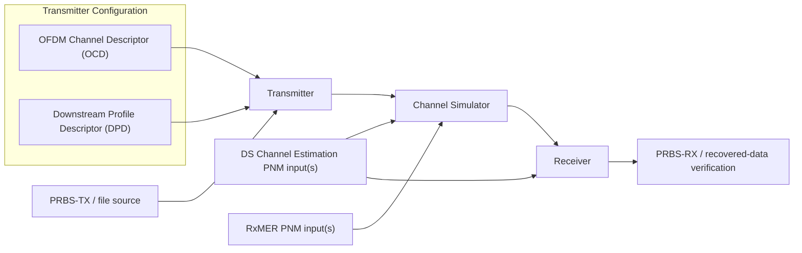
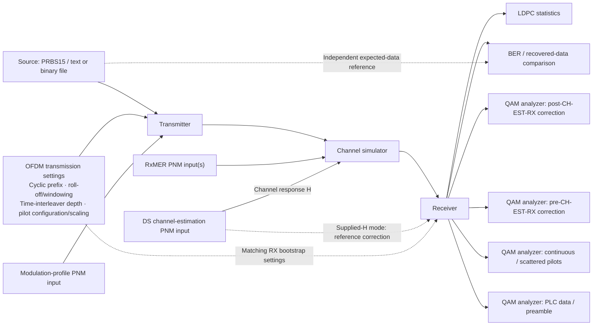
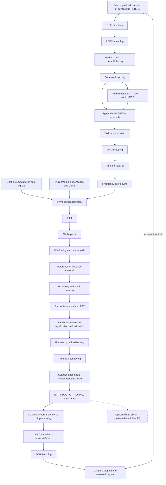

# DOCSIS OFDM Channel Sim architecture

This is the maintained architecture for this repository. The
[implementation checklist](development/checklist.md) records completed work,
remaining requirements and the next implementation step.
The [development status](development/status.md) summarizes the current milestone,
recent evidence and remaining product scope.
The [simulation design index](user/simulation/README.md) links a separate
Mermaid-based user guide for each simulation component. Detailed equations and
examples live in the linked stage guides. The [development workspace](development/README.md)
links tracked [feature records](development/features/README.md). Private evidence
and generated artifacts live under ignored `docs/development/local/`.

Status describes the **current source checkout**, including work awaiting commit.
It does not imply a published release or external DOCSIS interoperability.
Review this document and the checklist at feature completion and each commit-message
request. Update affected design/status before supplying the command; partial work
remains unchecked until its implementation and validation are complete.
Checklist IDs use stable component/work-area prefixes, such as PLC, WAVE-TX, WAVE-RX and
RX-CONFIG, rather than temporary NEXT labels. Local numbering identifies work;
dependencies and current priority determine the next item to implement.

## Minimum acceptance: MERLIN closed loop

The user clarified on2026-11-09 that this project validates its own single-channel
transmitter, channel simulator and receiver. Compare decoded PRBS15/file data
against the original source, retain actual LDPC/BCH outcomes and iterations, and
verify control/configuration recovery, bounded work and partial results.
Another DOCSIS implementation or external reference dataset is not required.

WAVE-RX-05, QAM-04 and QA-05 are complete within their documented supported
closed-loop configurations. Existing normative/source-table checks remain in
place. These results do not claim external modem/CMTS interoperability. The
[closed-loop design](development/features/closed-loop-validation/design.md) and
[evidence](development/features/closed-loop-validation/validation.md) define the
minimum; Qt, Python, native delivery, OFDMA and multiple channels remain later work.

## Terminology: cell and symbol

**Cell = QAM symbol** in the data path: one complex I/Q point carried by one
subcarrier during one OFDM symbol period. For example, a256-QAM cell represents
eight coded bits. The term **OFDM symbol** means the complete set of subcarrier
points transmitted together during that period, rather than one QAM symbol.

Use **QAM symbol (cell)** when introducing the term. Existing cell-interleaving,
cell-word and cell-index names retain the DOCSIS PHY terminology. Pilot/control
cells may use BPSK or QPSK instead of a data-QAM constellation. Bit interleaving
reorders coded bits; cell interleaving reorders modulation symbols across
frequency and time.

## Purpose and scope

MERLIN (Modulation, Encoding, Reception, Link Impairments & Noise) is the
DOCSIS OFDM Simulation Toolkit. Its transmitter simulates the downstream PHY
transmit functions of a CMTS for one OFDM channel, paired with a simulated channel
and receiver. Actual waveform generation and payload recovery exercise the
supported PHY path. Full CMTS MAC
services and multi-channel operation are outside the current scope.

Build a standalone, DOCSIS-focused Rust simulation core with two modes:

- **Ideal/reference:** known payload, fixed single downstream OFDM channel up to
  192 MHz, initially uniform 256-QAM, noiseless recovery first, then controlled
  impairments. The initial observation default is one second, with configurable longer
  durations and separate acquisition, completion and drain in the channel stepper.
- **Measurement-driven:** condition a simulation on supplied RxMER, downstream
  channel estimates and an applied modulation profile. Preserve exact grids,
  missing readings, timestamps and provenance. Establish reference planes before
  combining impairments so measured residual noise is not counted twice.

The configurable-duration waveform stepper supports noiseless, seeded sample
AWGN and per-carrier RxMER residuals with optional supplied diagonal response H.
The measurement path admits captured data profiles ID0..15 as independent
bootstrap ProfileA (wire ID0) experiments, with uniform data orders through16384-QAM or verified
non-shortened mixed loading, and explicit same-grid temporal measurement epochs.
Pilot-derived receiver correction is selectable alongside supplied-H reception. The channel job and CLI expose
cancellation, runtime limits, partial results and versioned probe export.
The existing CLI also retains the earlier16-QAM coding experiment;
Uniform/mixed packing/interleaving is exercised by the shared library, channel
CLI, examples and tests. Separate seeded, continuous PRBS15 and finite exact-byte file sources are implemented.
File traffic supports explicit PRBS15 fill and separate meaningful-data verification;
see the [PRBS design](user/simulation/prbs.md) and [file-source guide](user/simulation/file-source/README.md).

Downstream mapping and reference soft demapping cover constellations through
16384-QAM. Complete coding support must be tracked separately for each order;
current short8/9 bit processing supports all ten downstream data orders. See
[modulation coverage](reference/ofdm-support.md). DOCSIS4.0 FDD delegation does
not establish FDX behavior. OFDMA is a later scope.

All FEC, DSP, channel models and numerical calculations are Rust, including
algorithm dependencies. Simulation crates forbid unsafe code. The Qt
presentation shell and future Python bindings use the public Rust APIs; neither
owns numerical calculations. The Qt shell integrates bounded closed-loop jobs
and receiver instruments; Python bindings remain pending. There is no
device capture/control or network-service dependency.

## Downstream FEC shortening (FEC-03)

`fec-codec/src/shortening/` implements variable original-length coding around the
existing BCH/LDPC mother stages. `parameters` owns validated K, `encoding` the
six-stage TX coordinates, `decoding` known-zero RX restoration and consistency,
and `codec` their reusable composition. Each stage returns direct bounded test
points, with independently measured K-bit payload comparison and actual decoder
flags/iterations. Existing full-block constructors remain unchanged.

Local PHY3.1 I20 §7.5.4, PDF112–115 specifies only the16200-bit rate8/9 mother
code and shortening with all168 BCH/1800 LDPC parity retained. Normal64800-bit
frames are not used. Original PDF Figures46–47 were visually verified; PHY4.0
I07 FDX/FDD §7.2.5.4/§7.3.5.4 delegates FEC to these3.1 requirements. No additional
mother family or broader FDX simulation follows from that delegation.

For original K bits, prepend S=14232-K zeros before BCH, remove that prefix,
append S zeros before LDPC and omit those systematic zeros from the transmitted
word. Its length is K+1968. RX reconstructs finite positive known-zero evidence,
uses the existing mother decoder, restores the BCH prefix and checks omitted
coordinate consistency. Numerical LLR saturation is an explicit receiver policy;
failed decisions and actual statuses remain available for independent truth BER.

The [task design](development/features/fec-shortening/design.md) and
[component guides](user/fec-shortening/README.md) document diagrams, equations,
module contracts and validation. QAM-03 now connects explicit shortened words through
bit interleaving, cell packing, received NCP length discovery and waveform samples.
The file source still uses its full-word padding policy; no automatic EOF shortening
or measurement-JSON contract change is introduced.

## QAM coding and diagnostic decisions (QAM-02/03)

`signal_processing/modulation/slicing/` owns the standalone nearest-symbol decision.
It returns label/reference/error/squared distance, chooses the lowest label on exact
computed ties and never replaces soft LDPC input. Results are direct API values;
registered slicer JSONL producers remain separate instrumentation work.

Full uniform bit processing uses PHY I20 Tables24–37 and ETSI EN302769 V1.2.1
Table10(a), including explicit5/3/11/12-bit extensions for128/2048/8192/16384-QAM.
Permutation indices >=16200 expose these known padding positions. RX removes them
after inverse routing, retaining all actual mother-code likelihoods. Full uniform
profile packing/collection now uses the selected padded count rather than16200
for every constellation.

`modulation/interleaving/shortened.rs` owns24-column shortened ordering and skipped
unused holes; parity ordering is shared with the full mother path. The profile-aware
TX explicitly accepts valid odd-byte shortened words. `packing/shortening.rs` owns
transport admission and the received-span length rule from PHY I20 §8.3.2 PDF178–179.
The opt-in `receiver/payload/variable.rs` waits for CRC-accepted received start/filler
boundaries and classifies full/shortened words without TX sizes or identities.
It retains at most16213 soft values; incomplete history/EOF is not completion.
Original-length decisions, mother stages, actual statuses and consistency are exposed.

`simulation/payload/shortened/` composes these owners through actual PLC acquisition,
NCP, interleavers and waveform samples in a bounded reference experiment. It accepts
explicit original words, supplies a real following filler boundary, then drains.
It adds no noise, MAC framing, automatic file shortening or new general channel schema.
See [component guides](user/qam-processing/README.md) and the
[task design](development/features/qam-completion/design.md). QAM-04 validates this closed loop alongside the pinned source-table checks.
[External interoperability](development/features/qam-completion/external-vectors.md)
is optional future scope.

## UI: MERLIN Simulation Workbench

The CLI functional MVP is complete for its documented closed-loop configurations.
The next major phase is the native Qt Quick/QML workbench, initially targeting
Ubuntu 22.04, 24.04 and 26.04 x64. Python bindings follow UI-01 through UI-04.
The initial UI-01 shell now exists under apps/qt: the clickable diagram, section
preview dialogs, theme switching, embedded icons and a tree-based OFDM editor.
The DPD capture importer, PRBS-TX editor and reusable SA with TX sample generation
also exist. Channel Estimate/RxMER share native capture viewers and Rust-backed
configuration/playback previews. Bounded full-loop Rust jobs now drive run
controls and actual receiver QAM, spectrum, response/echo, slicer/LLR and FEC
instruments. Receiver selectors query one immutable result; unsupported transport
modes remain explicit. See the [workbench guide](user/workbench.md) and
[Qt build/VM instructions](development/qt.md). Other target validation is pending.

The user's high-level diagram defines a clickable workbench, with focused pop-up
dialogs for editing each section, selecting an applicable file, and inspecting
purpose, status and available stage observations. Keep the signal path visible
behind the dialogs. Develop left to right, beginning with **OFDM Channel Descriptor (OCD)**:
then PRBS-TX / Transmitter and modulation-profile input, Channel Simulator and
its measurement inputs, and finally Receiver / PRBS-RX and results.



PRBS-TX and PRBS-RX represent source generation and independent recovered-data
verification. The workbench omits the original/recovered comparison connector;
verification remains independent and does not feed back or reseed the source.
RxMER sits above Channel Simulator with a downward arrow. DS Channel Estimate
sits below the gap between Channel Simulator and Receiver, splitting its input
connection to both blocks. File sources retain their own exact-byte verification. Measurement
inputs use supported decoded PNM JSON. The DPD input additionally accepts binary
modulation-profile PNM through a pinned Rust decoder dependency.
The detailed diagram below retains analyzer and receiver-reference ownership.

OCD and DPD are stacked inside the left-hand Transmitter Configuration panel,
with a merged visual connector into Transmitter. This is a presentation group;
each block retains its own dialog, readiness and validation. The top-row source/
measurement/verification blocks align above their processing stages. Rounded
cards and a branded header with the existing theme-specific logo follow the
approved reference graphic (UI-SHELL-09); light-mode support remains available.

UI-SHELL-10 centers the OCD/DPD merge on their midpoint and centers the supplied
channel-estimate split between Channel Simulator and Receiver. The external
supplied-H caption is removed. In-card PNM labels use the CM-OSSI I27 object names
`CmDsOfdmModulationProfile`, `CmDsOfdmRxMer` and `CmDsOfdmChanEstimateCoef`;
these document capture families and do not change optional flat/unity behavior.
The header pulse continues beside the toolkit title toward the logo, with a
separate fine underline below. Source evidence is recorded in the
[design](development/features/visual-workspace/design.md#ui-shell-10-centered-connections-and-in-card-pnm-types).

### Workbench block readiness rules

UI-COPY-01 keeps normal application wording focused on user tasks: no language,
framework or adapter ownership commentary in About, accessibility text or routine
help. Persistent notes are concise and limited to actionable errors, missing/
partial data, import identity/compatibility, display limits and essential
measurement assumptions. Detailed explanations stay in guides/field help;
original legal notices and capture names remain intact. See the
[design](development/features/ui-copy/design.md).

The left icon/WB gutter is removed (UI-SHELL-11). The diagram and header use
equal side margins; application branding stays in the top header and window icon.

PRBS-RX (UI-VERIFY-02) presents comparison acceptance, distinct run status and
summary cards plus payload recovery and retained per-payload error charts.
The existing Rust FEC query supplies at most 64 normalized word bars and explicit
omitted/uncompared counts. No-comparison BER remains unavailable; running/paused
states hide old final totals. These are aggregate recovery and sequence-index
charts, not BER history. Opening the panel never starts a job or changes DSP.
See the [design](development/features/verification-panel/design.md).

Each diagram block displays its heading, with a small in-card `CM PNM File:`
type footnote on DPD, RxMER and DS Channel Estimate. No generic status/subtitle
text is added inside cards. The left stripe communicates
readiness; the tooltip and accessible description provide a status and reason.
These are MERLIN workflow rules, not DOCSIS specification requirements.

| Status | Stripe | Meaning |
| --- | --- | --- |
| Complete | Green | The block's applicable requirements are satisfied by accepted, validated state. Before a run this means configured/ready, including receiver/comparison setup; results are not a prerequisite to starting. |
| Needs attention | Yellow | Required input, configuration, integration or results are missing or pending. |
| Error | Red | An actual selected-input, accepted-configuration or processing failure is present, with a concrete diagnostic. |

**WB-RULE-01:** OFDM Channel Descriptor (OCD) remains yellow until its accepted settings are valid
and a compatible modulation-profile PNM input has been successfully accepted by
Rust. Selecting a filename, opening a dialog or applying default settings does
not satisfy the profile requirement. Committing removal/replacement recalculates
readiness from the new accepted state. An accepted profile that
becomes incompatible is red; a missing profile is yellow. Rejected draft files
show their diagnostic in the dialog and preserve accepted readiness. Error takes precedence over missing
prerequisites; otherwise complete requires every applicable prerequisite.

**WB-RULE-02:** Keep each rule with its owning block and dependencies. Rust owns
simulation input/configuration validation and processing outcomes; Qt maps their
status and reason to presentation. A rejected draft shows its diagnostic inside
the editor and preserves the previously accepted block state. Do not invent red
errors for missing inputs, cancelled dialogs or unimplemented UI. Expected noisy
FEC outcomes belong to simulation results and are not automatically UI failures.
Optional inputs do not become mandatory through this display policy; future
explicit bypass/default modes must be evaluated by their owning Rust request.

**WB-RULE-03:** Start requires all nine workbench blocks to be green. Any yellow
or red block disables Start. Green means readiness to participate in the next run,
not the presence of results from that run; PRBS-RX must be ready to compare before
Start. Optional measurement blocks can be green through an explicit validated
bypass/default mode. Rust must still validate/freeze the complete request before
dispatch. Run availability and lifecycle are additional gates. The current shell
checks all block statuses and dispatches a validated frozen request through the
Rust worker only when idle. Receiver/PRBS-RX acceptance is configuration, not a
requirement to have prior results.

Current implementation: accepted OCD-compatible DPD turns DPD and OCD green;
accepted PRBS-TX configuration also makes Transmitter ready. Default unity response
becomes ready on the valid DPD/OCD grid. Accepted compatible RxMER makes RxMER
and Channel Simulator green. Removing/replacing inputs revalidates dependencies;
Cancel preserves accepted state. Applying supported receiver options validates
the complete accepted input set; enabling independent source comparison configures
PRBS-RX. Both become green before the first run. Start/Stop and Pause/Resume use
the same bounded Rust closed-loop worker; missing or incompatible inputs block it.
Optional measurements are not required for every future run.

### OFDM editor, registry and application navigation

Clicking OFDM Channel Descriptor (OCD) opens an editable pop-up with an expandable
Parameter/Value tree, dropdowns for supported values, and a description panel
below the selected field. Symbol timing contains cyclic prefix/roll-off, and
Interleaving contains time-interleaver depth. A Modulation Profile branch shows
blank Profile ID, Source file and Subcarrier assignments values until a profile
is selected; accepted DPD input supplies that summary. There is no Channel context branch.
The OCD describes common channel parameters; the DPD describes downstream
profiles (MULPI I25 §§6.4.40–6.4.41; PHY I20 §7.5.13.4). Bandwidth and spacing
remain in the Rust configuration, outside this editor; future input integration
must reconcile them separately rather than treating DPD as channel numerology.
Apply validates a staged configuration through the core Rust API and retains it in memory; Cancel
discards staged edits. Accepted settings feed the closed-loop worker and
self-contained workbench persistence.
The diagram block and popup use the full name OFDM Channel Descriptor (OCD).
This editor label does not imply complete OCD message import/export support.
Each dialog has its own QML file and focused Rust adapter where needed.
Draft editors share `components/ApplyCancelFooter.qml`: equally sized Apply then
Cancel buttons in one lower-right row with matching margins. Explicit layout
preserves this order across platforms. Secondary actions stay left; validation
and draft ownership remain with each editor. Cancel rejects without applying.
See [UI design skill](../skills/ui-design/SKILL.md).

All MERLIN popup dialogs inherit a shared title header with an upper-right
circular X, while retaining footer Close/Cancel controls. X rejects the current
popup without applying drafts or closing its parent; native file pickers retain
OS controls. See [UI-SHELL-06](development/features/popup-close-controls/design.md).
The Qt adapter reuses core simulation APIs for TX snapshots and measurement
configuration previews; QML implements no DSP.

Use an OSCAR-style metadata registry concept without importing its TLV protocol
model. Canonical location: `resources/registry/ofdm-settings.json`,
bundled with the application and loaded through Rust. Each entry records a stable
field ID, group, label, supported choices with display units, description,
application default where applicable, and pinned specification/version/section/
table references. Label paraphrases and any short exact quotations explicitly;
do not represent MERLIN defaults as normative requirements. PHY is authoritative
for these waveform fields; cite MULPI only for fields with actual pinned MULPI
evidence. Rust remains authoritative for numerical validation and derivation;
registry consistency checks must detect divergence from supported Rust values.

Workbench persistence uses a separate versioned `*.merlin.json` document
containing all accepted block settings and all associated PNM inputs, not a copy
of the registry. Input paths alone do not satisfy the restoration contract.
The registry describes fields; the workbench file stores accepted user choices.
Schema version 1 embeds original inputs as bounded base64 with byte counts and
SHA-256, including PNM and payload files. Load fully validates before replacing
accepted state; cross-input incompatibilities remain editable readiness diagnostics.
Save uses a temporary sibling and atomic replacement; imported original paths are
protected. Results, drafts and transient instrument viewports are not persisted.

The application has a standard top **File | Settings | About** menu bar above
workbench branding, rather than content-area navigation buttons. Settings →
Global opens appearance preferences; About → About MERLIN opens project details.
The instruction banner and standalone theme button are removed.
**File → Open**, **Save** and **Save As** use standard labels and shortcuts
and operate through the OS-native file chooser and Rust persistence adapter; individual capture inputs remain in
their corresponding block dialogs. **Settings → Global → Light/Dark mode**
applies the shared theme immediately to all windows; explicit workbench saves
also retain that choice.
Settings is separate from OFDM transmission configuration. About presents
MERLIN's expanded name, concise purpose, active icon and compiled version.
Matching project, issue-report and manual-update buttons route through Main.
About omits the standalone sentence and license/acknowledgement lists; all
required license and NOTICE texts remain bundled with distributions.
Each dialog owns its own QML file. See UI-SHELL-02 in the
[workbench design](development/features/visual-workspace/design.md).

### Workbench JSON configuration contract (version 1)

File → Open, Save and Save As use a versioned JSON workbench document. It contains every block's accepted settings
and all PNM inputs associated with those blocks, including selected profiles,
channel-estimation and RxMER inputs. Do not reduce the saved document to OCD
settings or filenames alone. Preserve input identity/provenance and enough input
content to restore the same configuration. Version 1 embeds exact originals as
base64 with byte counts/SHA-256 and caps the document at 144 MiB; original input
limits remain in force. Unsupported schema versions are rejected.
Rust owns serialization, file I/O and validation. OS-native pickers choose paths;
opening validates the whole document before replacing accepted state, invalidates
old results, and never starts a simulation automatically. Rejected loads preserve
the current workbench. Saving does not overwrite original PNM captures. Generated
results, caches and worker state are not configuration.

Channel Simulator power controls extend this same contract:
Save/Save As/Open restore accepted launch gain, receiver-side attenuation,
tilt/cable mode and parameters, and any exposed level/calibration/reference-band
choices with explicit units. New workbenches and supported legacy files missing
the new controls default to0 dB gain,0 dB attenuation and Tilt Off, while preserving
existing accepted additional-loss settings. The frozen run request must use those
restored values, rather than QML defaults. Version and migrate the affected
section explicitly; validate before atomic adoption and preserve state on failure.
Computed Channel Power and transient TP/SA/QAM navigation are not configuration.
UI-RF-01 implements this extension in `sections.channel_power` schema1 while
preserving `sections.channel_model` schema1. Legacy missing power sections select
unity gain/attenuation and relative units. Restored settings feed the run request.

### Curated workbench examples and Open location

`examples/workbench/manifest.json` inventories three runnable bundles: `single`
(one DPD, one RxMER, one supplied DS channel estimate) and `multi-rxmer` (one DPD,
five compatible RxMER inputs, one estimate), plus `multi-rxmer-2` (channel 193,
132 pre-collected RxMER files, companion DPD, flat/unity response because no
matching DS channel estimate is available). Each contains original files and a
self-contained WB with hashes, provenance and licenses. Each bundle matches modem,
channel, frequency grid and DPD coverage internally; production Rust project/request
validation checks compatibility. Original epochs remain unchanged; multi-RxMER
uses average residual power by default. The channel 193 source has irregular
acquisition intervals and a long gap; fixed-symbol hold/interpolation playback
is an explicit simulation clock. Selection/restore/playback permit 256 files,
while retaining 64 MiB original bytes and 4,000,000 decoded carrier values.

All native Open dialogs start in this examples root. Rust locates it relative
to installed resources or the marked source checkout; the isolated native picker
receives that directory only for Open. Save destinations keep OS behavior.
Linux shared-resource, portable and macOS resource layouts are recognized;
installed desktop delivery and per-OS runtime validation remain pending.

INSTALL-EXAMPLES-01 requires future desktop installers to include the runnable
manifest/bundles and verify hashes, offline restore and default Open from an
unrelated working directory. Existing CLI staging copies the examples already;
that is not desktop installer acceptance. `multi-rxmer-dschan` is a reserved,
non-runnable scenario: channel-estimate collection ordering, interpolation,
cadence, receiver interaction and WB schema remain CH-EST-PLAYBACK-01 work.
See the [design](development/features/workbench-examples/design.md) and
[user guide](user/workbench-examples.md).

### RxMER capture actions (UI-RXMER-04)

The RxMER capture toolbar uses native Open file(s) and collection controls;
demo/notch actions are removed (UI-RXMER-04). The shared Channel Estimate dialog
retains its own demo action. Existing Rust fixture/import APIs and WB restores
are unchanged. See the [design](development/features/rxmer-workbench/design.md#ui-rxmer-04-remove-demo-actions-from-rxmer).

### Chart zoom interaction (UI-ZOOM-01)

Workbench-wide zoom policy (UI-ZOOM-01): existing zoomable charts use wheel/
trackpad zoom anchored at the pointer and horizontal left-drag range selection.
Keep Full Span to reset the retained view; omit Zoom In/Out and +/- buttons.
Shared `ChartNavigation.qml` owns transient index selection only; existing Rust
viewport APIs retain sample ownership, bounds, units and decimation. Gestures
never rerun simulation or edit inputs. Keyboard +/- and Home remain available.
The shared TX/RX SA and RxMER/Channel Estimate viewer use this policy; diagnostic
plots without zoom remain unchanged. See the
[design](development/features/mouse-zoom/design.md).

### SA symbol-timing and cable panel (UI-SA-04)

The SA lower panel shows a CP-start zoom of actual TransmitWindow coefficients,
with symbol/FFT timing, prefix and roll-off boundaries from the completed
snapshot's frozen settings. It is explicitly a dimensionless window view, not
signal amplitude. Full time-domain IQ trace inspection remains future work.

Cable selection offers Belden 1694WB (nominal VF 0.82), CommScope P3 500 (0.87)
and custom VF. Rust derives the ideal flat guard budget `(Ncp-Nrp)/Fs` as extra
path length and, for the explicitly labeled two-way reflection assumption, half
that length as reflector spacing. Zero reserved timing margin is explicit.
These are timing estimates, not guaranteed echo immunity or maximum plant reach.
Unknown custom VF gives no distance; invalid VF is rejected. Cable changes only
query bounded display data and never rerun DSP or alter results. Applied input
changes clear old timing with the old spectrum. Simulation crates own calculations
and window coefficients; Qt owns layout/drawing. See the
[design and evidence](development/features/transmitter-spectrum/design.md#ui-sa-04-symbol-timing-and-cable-echo-budget).

### Shared Spectrum Analyzer (SA) and transmitter readiness

UI-SA-06 uses mutually exclusive Complex baseband / Capture frequency mapping
radio buttons in the shared TX/RX SA. The Frequency axis caption and raw Tap ID
line are removed; named test-point selection stays. Fixed FFT-bin grids hide the
axis choices. Changing axis preserves the current bin window and never reruns
the simulation. See the [control design](development/features/transmitter-spectrum/design.md#ui-sa-06-concise-frequency-axis-controls).

UI-SA-07 places FFT/window/sample-rate metadata in a compact plot overlay and
Run simulation at the lower left. Cancel preview appears only during local TX
preview generation; it never controls the main run. The cable panel uses a labeled
grid for flat guard time, extra cable path and distance to a reflector, explaining
VF and the out-and-back assumption. Uniform-cable/zero-margin limitations remain;
no signal calculations change. See the
[layout design](development/features/transmitter-spectrum/design.md#ui-sa-07-plot-metadata-footer-actions-and-cable-context).

UI-CH-01 implements Channel Input → Channel Model → Channel Output in its own
Qt dialog. RxMER and DS Channel Estimate open existing input frames directly.
Input/output open a Spectrum/QAM chooser; no separate SA block exists. Input uses
retained TX samples/physical bins; output uses RX-input samples/raw received FFT
cells before equalization. Missing observations remain unavailable. Input QAM
retains one physical symbol with bin filters; output retains existing received
role/profile/bin/symbol selectors. Main execution/readiness rules remain unchanged.
See the [staging design](development/features/channel-workbench/design.md).

WAVE-CH-TILT-01 adds optional Additional Loss under Channel Model, default Off.
The shared Rust impairment planner composes signed manual slope or full additional
cable attenuation with H. The initial versioned Belden 1694A preset uses pinned
manufacturer attenuation, explicit additional length and ft/m, without extrapolation.
VF-only echo presets remain separate. Measurements and provenance stay unchanged.
The existing Y = H_effective (X + E) model preserves post-EQ RxMER; reference RX
uses effective H, while pilot RX estimates received pilots. Cable distance does
not introduce a receiver noise floor or automatically worsen BER. No physical
cable delay/convolution or calibrated RF power is implied. The versioned optional
WB `channel_model` section defaults to Off when absent. See the
[model, limits and evidence](development/features/channel-tilt/design.md) and
[user guide](user/impairments/additional-loss.md).

UI-RF-01 implements the Channel Simulator amplifier/attenuator and inline TP
layout. Click the right-pointing amplifier triangle or variable-resistor/diagonal-
arrow attenuator to edit a draft. Apply accepts; X/Close cancel. Defaults are0 dB
gain,0 dB attenuation and Tilt Off. TP circles before/after amplification open the
shared SA/QAM instrument chooser; output instruments follow receiver attenuation.
UI-RF-02 expands this diagram with the available application client area, using
24 px dialog edge insets and32 px balanced inner drawing margins. Matching blocks
retain readable dimensions; remaining width is distributed evenly among the six
connector gaps. Matching RxMER/DS-estimate branches stay centered over/below the
model, with equal vertical clearances. Larger/maximized windows provide more
spacing rather than centering a fixed narrow canvas.
No dedicated SA block or branch exists. All three channel taps use one QAM window;
output selectors expose actual raw RX cells, while input taps use retained TX
physical bins. Post-amplifier data uses the exact core scalar gain at that boundary.

The Rust PowerConditioning model owns scalar gain/attenuation, optional TX DATA
reference in dBmV/6 MHz, alternative amplifier output target and optional independent
receiver noise density after attenuation. Calibration is opt-in; legacy normalized
runs remain relative. The reference maps unit-power DATA FFT cells through the
unitary204.8 MS/s waveform convention to rms mV², without a hidden factor of two.
Imported H remains a relative multiplier. RxMER remains post-EQ residual; an
explicit independent receiver floor is additional, never automatically enabled.
Noise/response playback preserves both settings and correct LLR variances. Gain,
cable loss and attenuation affect actual synthesized RX samples and decoding.

Time-domain channel and completed-run TX/RX SA routes calculate Channel Power by
integrating full-resolution linear PSD over a fixed occupied channel band. Actual
pilot energy, internal gaps and noise remain included. Total dBmV, band-average
6 MHz equivalent level and bandwidth are separate; zoom never changes integration.
Relative runs report normalized power. Calibrated channel output warns outside
the user's±12 dBmV/6 MHz band-average operating target without fabricating FEC
failure. See the [implementation and model assumptions](development/features/rf-power-budget/design.md#ui-rf-01-implemented-scalar-conditioning-and-channel-instruments).

RF-POWER-01 remains partial: detailed RF-port loading/capability, per-subband
limits, ADC overload/clipping, receiver AGC and wideband composite input are not
modeled. The proposed60 dBmV is not treated as a universal normative CMTS ceiling.

UI layouts and diagrams follow visual symmetry, centerline alignment and a shared
spacing scale. Adjacent visible block/icon edges have equal clearance; matching
branch blocks have equal dimensions and connector lengths. Center labels and the
complete group, preserve balanced margins and prefer straight connections. These
rules are maintained in the coding-style skill and apply to future UI work.

UI-ORG-01 groups QML under `shell`, `theme`, `components`, `about`, `inputs`,
`workbenches` and `instruments`; Main.qml remains the embedded bootstrap.
Instrument windows/charts are grouped by spectrum, QAM, response, slicer, FEC,
messages and stages. Input directories use the corresponding Rust owner names.
Qt-facing instrument providers now live under `apps/qt/src/instruments/`, with
cohesive transmitter/receiver and shared spectrum modules. Existing root Rust
paths are retained through re-exports or the existing QObject bridges. Pinned
CXX-Qt requires those bridge files to stay together for this QML module.
UI-ORG-02 moves all ten into `src/bridge/`, with independent input models and
restoration under `src/inputs/`, accepted state/persistence under `src/workbench/`,
run admission/worker under `src/simulation/`, and filesystem/desktop interop under
`src/platform/`. Saved-project validation calls the input models directly, without
a QObject dependency. Main remains bootstrap/module wiring; native interop headers
live beside their platform adapter. This changes ownership paths, not UI behavior
or the workbench JSON contract.
File moves preserve registered QML type names, imports, embedded resources and
visible behavior. See the [organization design](development/features/qt-source-organization/design.md).

UI-INSTR-01 now supplies one channel TP QAM window and provider routing for all
three channel boundaries. The SA is shared. Dedicated TX and paired receiver QAM
workbench tools retain their existing specialized wrappers. Core
numerical algorithms stay in their existing Rust modules. RF power extensions
remain in the [power-budget plan](development/features/rf-power-budget/design.md).

UI-DOC-02 adds About → Terminology linking the maintained
`docs/user/terminology.md` on the repository's GitHub master branch. The menu emits
an explicit URL and the desktop shell opens the system browser; this optional
online documentation does not affect offline simulation or bundled licenses.
The online page requires the documentation to be pushed before it is available.
UI-TX-06 labels Source / PRBS-TX and Source Bits · PRBS-TX to identify the owning
input block without implying that file-based sources are always PRBS.

UI-TX-05 identifies mixed TX QAM roles with green Data squares, red NCP circles
and a visible legend; filler and unavailable classifications remain separate.
The mapped TX probe retains a bounded source-role vector from actual PackedCell
variants, never from I/Q values. The Qt Rust adapter transports the first aligned
interleaved snapshot's roles through the existing SymbolInterleaver; unavailable
history remains unknown. Role-stratified reduction preserves rare controls within
the shared2048-point cap. These TX-only diagnostics never enter receiver inputs.
Theme colors and marker shapes apply to future mixed-role instruments. See the
[role-color design](development/features/transmitter-workbench/design.md#ui-tx-05-qam-symbol-role-colors-and-legend).

UI-TX-04 presents OCD/DPD messages through a shared folding TLV tree grid with
Field/Value/Type/Length/Offset columns, keyboard expansion and raw-byte inspection.
Rust interprets only the existing fixed descriptor subset; the bundled
`resources/registry/plc-descriptor-tlvs.json` supplies display metadata traced to
that implementation. QML owns visible-row projection, folding and selection,
never binary interpretation. Child fields retain absolute packet-byte ranges;
unknown/reserved values stay raw and marked unsupported. This is a bounded JSON
tree grid, not a native QAbstractItemModel TreeView. Reuse the component for
compatible structured inspectors. See the
[tree-grid design](development/features/transmitter-workbench/design.md#ui-tx-04-folding-descriptor-tree-grid).

UI-TX-03 opens a Transmitter workbench matching Receiver stage/test-point
navigation, with bounded source/LDPC/bit/cell pages, QAM and waveform inspection.
The shared SA is attached directly below TX Output, before channel impairments;
IFFT, prefix and window taps are selectable inside it. Without a completed run,
TX Output retains the existing transmit-only preview; other inspectors read main
Start results. Opening the workbench does not automatically run a preview.
Separate PLC/NCP/pilot paths feed frame assembly. The message inspector
reassembles observed PLC bytes through existing decoders and shows actual OCD,
Profile A DPD and NCP DPD headers, expandable TLVs and original packet bytes.
Completed TX PLC frames are distinguished from incomplete scheduled frames using
actual transmitted-sample totals; capture limits and incomplete packets remain
visible. Imported modulation-profile PNM bytes are never presented as MAC packets.
The adapter retains64 PLC frames, at most32 displayed packets, one snapshot per
bit/cell/bin boundary and32768 contiguous output samples. Per-stage phase filters
admit acquisition PLC while keeping other TX/RX snapshots observation-only.
The coding view exposes LDPC, not a separately retained BCH word; mixed mapped
Data/NCP cells are explicitly grouped. NCP/pilot physical-bin inspection is shared.
The redundant small MERLIN eyebrow is removed from the main header.
See the [design](development/features/transmitter-workbench/design.md).

**WB-RULE-04:** accepted OCD, DPD and PRBS-TX inputs jointly configure Transmitter.
When they are green and form a supported Rust transmitter request, Transmitter
is green without a separate acceptance dialog. Missing inputs are yellow; actual
unsupported/inconsistent accepted input or generation failure is red with a reason.
Applied input changes invalidate the old spectrum and cancel any stale preview.
Rejected drafts/Cancel preserve accepted state. Captured data profile IDs0..15
can drive independent previews/runs; their assignments become the fresh run's
bootstrap Profile A (wire ID0), preserving captured identity in provenance. Full-loop Start still requires all
blocks plus dispatch readiness; SA generation is independent of that gate.

SpectrumAnalyzerDialog and SpectrumPlot are shared presentation components, not
TX-specific analysis implementations. A Rust adapter supplies the selected tap,
sample identity, progress and bounded viewport. The first connected tap is
`tx.overlap_add.samples`, before channel impairments. Future channel/RX sample
taps reuse the same estimator and dialog while preserving their reference plane.
The analyzer accepts actual contiguous complex I/Q samples, never bit arrays or
already-transformed bins mislabeled as a time waveform.

The signal remains **complex baseband**: no RF upconversion occurs. Default axes
show frequency offset from DC (−102.4 to +102.375 MHz for the 8192-point case).
Optional capture-frequency mapping adds the captured physical-bin origin to
axis labels only; samples and PSD remain identical. Power is normalized PSD in
dB re one sample unit squared/Hz, with no dBm/dBmV calibration assumed.

The Rust transmit-only preview reuses accepted source configuration, captured
carrier layout/loading and existing BCH/LDPC/NCP/PLC/pilot/IFFT/CP/window/overlap
APIs. Idle priming fills interleaver history before consuming source bits. The
bounded estimator averages 32 periodic-Hann FFT windows with 50% overlap in
linear power, retaining full PSD/samples in Rust and returning at most 2048
min/max display buckets. Zero power stays explicit; a plotting floor does not
change retained density. Hover, keyboard selection, zoom and full-span rendering
are presentation operations. The SA lower panel shows frozen symbol timing, actual transmit-window
coefficients and a nominal cable echo budget. Sample bookkeeping and selection
text remain omitted from the panel. The **Run simulation** button, when enabled
for the transmit-only preview fallback, reruns that preview and its FFT;
it does not dispatch the full channel/receiver loop. Diagnostics use its tooltip.
At most one cancellable worker runs; stale results
cannot replace results for newer accepted input.

See the [SA design](development/features/transmitter-spectrum/design.md) and
[user guide](user/spectrum-analyzer.md). Main Start owns the full loop and RX
instruments; this separate TX preview does not establish RF compliance or file recovery.

### PRBS-TX source configuration

PRBS-TX now has its own workbench editor. Its block name is retained, but the dialog
title is **Transmit source (PRBS-TX)** because the existing Rust source API also
accepts files. Use a separate Parameter/Value tree dialog with field descriptions,
mode-dependent controls and Apply/Cancel, consistent with OCD and DPD.

| User option | Configuration and validation |
| --- | --- |
| Source mode | Continuous PRBS15 (initial draft default), or File (text/binary). The user must Apply before the block becomes ready. |
| PRBS15 seed | Decimal integer 1–32767; initial value 32767 (`0x7fff`), matching the runner. Show the fixed polynomial and period as read-only descriptions. |
| File | Open through the OS-native picker; retain exact original bytes in Rust. No text conversion or extension-based rejection; text and binary use the same source path. |
| File summary | Read-only filename, original byte/bit count and original-byte SHA-256, supplied by Rust. Limit original bytes to 16 MiB. |
| Append PRBS15 | File mode only, off initially. Disabled means send the original file once, then idle/filler. |
| Total meaningful bits | Enabled only with append; includes original file plus fill. Require original bits ≤ target ≤ 134217728. Do not auto-size from duration/profile or silently add fill. |
| Fill seed | Enabled only with append; independent seed 1–32767, initially 32767. Fill starts after the original file and continues without codeword reseeding. |
| Fill summary | Rust-derived original bits, target bits and additional PRBS bits. Keep final-codeword padding separate. |

Allow empty files as the core does: no-fill sends no payload; a positive target
produces finite fill. Equal target/original length appends nothing; partial-byte
fill is supported. Duration belongs to run configuration, not a source bit-count
estimate. Finishing a run does not guarantee all file bits were generated/recovered.
Other PRBS polynomials, repeat-file, editable payload text and automatic targets
are outside this first editor; do not expose unimplemented choices.

Rust owns bounded file reads, immutable bytes, provenance, validation and the
accepted source snapshot. Reuse `Prbs15::new`, `FilePayload::new`, `PrbsFill` and
`PayloadSourceConfig`; do not duplicate generators or fill math in QML. Loading
and editing stage a draft; Apply validates and commits, Cancel preserves the
accepted source. Rejected drafts report locally without changing accepted readiness.
PRBS-TX is yellow until a valid source is explicitly accepted, then green; an
accepted source that becomes invalid is red. Clearing a file requires replacing
it with a valid source before Apply. Independent PRBS-RX truth uses the accepted
source/seed, with its own state; source acceptance alone does not complete PRBS-RX
or enable Start. Edits affect the next frozen job, never an active stream.

Accepted source settings feed the frozen request and explicit WB persistence. The
optional `source-input` feature exposes existing source validation without FEC or
runner dependencies. `FilePayload::with_fill` shares immutable bytes while
revalidating a policy, avoiding payload copies during edits. See the
[source configuration plan](development/features/visual-workspace/design.md#ui-02-prbs-tx-source-editor)
and [source UI guide](user/source-input.md).

### Downstream profile input dialog

File and folder selection must use the operating system's native picker, without
a Qt-rendered fallback or custom file explorer. Qt platform integration may invoke
the OS picker. PRBS-TX and DPD now use a shared GTK native chooser on Ubuntu,
in an isolated presentation-only process of the same executable, before Qt
initialization. It exchanges only a URI/cancellation/error and prevents GTK and
Qt from consuming each other's UI events. An explicit error is returned if
GTK/display initialization is unavailable. No
Qt file browser is instantiated; application-owned editors remain Qt dialogs.

The Downstream Profile Descriptor (DPD) input block opens its own Qt tree dialog
with Open File, Load demo, detected representation, File/Channel information,
Profiles with numbered Range rows, profile selection and staged removal.
These are downstream OFDM modulation-profile PNM captures or supported decoded
JSON, not raw DPD MAC messages. Supported captures are type 10, format 1.0 with
range schemes; skip/unsupported encodings reject explicitly. Tree queries retain
compact schemes in Rust and show at most 256 scheme rows for the selected profile.

`input_format` is a separate safe Rust content detector. Extensions are picker
hints; JSON text (including optional UTF-8 BOM), recognized binary PNM, unsupported
text/binary and empty content are distinguished before decoding. Files are bounded
to 16 MiB. The Qt Rust adapter retains original bytes/hashes and draft/accepted
input; QML presents bounded rows. Binary conversion uses pnm 0.3.6 fetched from
PNM Viewer Toolkit at Git revision 5fbd5561f3e06b73486546b5ffa520279080a5eb.
Sources live in ignored Cargo cache, not a vendored viewer copy. Runtime needs no
viewer checkout, Python, network or decoder subprocess. Preserve dependency notices.

The core's `scenario::pnm_json::import_profiles` shares validation with the CLI's
three-capture importer. The optional `pnm-input` feature enables it without FEC or
simulation in Qt. Apply checks spacing and carrier span against accepted OCD
settings before committing a selection; Cancel and rejected loads preserve input.
WB persistence and simulation-job integration are implemented; bandwidth/spacing
editing and skip-scheme import remain outside this editor. See the [profile input guide](user/measurement-inputs/modulation-profile.md)
and [development setup](development/setup.md).

### Reuse of the PNM Viewer Qt framework

UI-WB-OPEN-01 gives main File → Open / Ctrl+O a distinct OS-native chooser mode
with an active `*.merlin.json` filter. The examples-root resolver and directory
navigation remain; individual measurement/source input pickers are unaffected.
Filename filtering is only presentation: Rust still validates complete WB
contents before adoption and preserves the current session on Cancel/error.
See the [workbench-file design](development/features/qt-closed-loop/design.md#ui-wb-open-01-main-open-file-filter).

UI-WB-OPEN-02 runs the main native chooser, bounded read, decoding, embedded
original validation and editor/run preparation in one background worker. Qt
polls a bounded completion channel and shows the current phase, an animated
activity bar, Time since Open and Cancel without waiting. The timer includes
file selection; the activity bar does not claim measured completion or time
remaining (UI-WB-OPEN-03). Success publishes the complete accepted snapshot and
transfers already prepared editor/request models on the GUI thread; it does not repeat capture
imports or start a run. Errors and cooperative cancellation preserve the current
session and Save destination; one worker stays tracked until completion.
Update recovery uses the same loader. See the
[responsive Open design](development/features/responsive-workbench-open/design.md).

UI-RXMER-SELECT-01 retains all imported originals while optional SHA-256
identities select Single Shot, Average or ordered Replay inputs. Missing
selection retains legacy all-capture behavior; empty, unknown and duplicate
explicit selections are rejected. Rust applies selection consistently to
published inputs, effective preview and accepted run requests. The bounded
selection query uses accepted CWB duration per profile and core OCD timing to
report replay capacity `1 + floor((complete_symbols - 1) / interval_symbols)`.
The measurement option/viewport IPC limit is 24 KiB for up to 256 identities;
scalar OCD/power/run documents retain 4096-byte limits. Selected identities
persist in the measurement options in WB JSON, with original bytes unchanged.
See the [selection design](development/features/rxmer-selection/design.md).

UI-RXMER-ANIM-01 adapts PNM Viewer's capture-preview transport with preserved
GPL attribution. QML owns Play/Pause/step/slider and 1/2/4/8 display frames/s;
Rust resolves the selected originals and returns at most 1024 chart buckets
for one frame, with source index/time and selected position/count. Each tick
avoids capture decoding and full playback-plan preparation. This original-frame
preview preserves the frequency viewport and never applies configuration or
starts a simulation. Its wall-clock speed is separate from synthetic OFDM
playback timing. Editing, closing or reaching the last frame pauses animation.

UI-DPD-VIEW-02 replaces the initial single-trace profile plot with the PNM
Viewer modulation layout: independent multi-profile overlays, dB/bit-loading
selection, carrier filters, channel/MAC chips, gross Profile BW and role lanes.
Rust owns checked coordinates, shared ideal Shannon math, data-only gross-rate
arithmetic and bounded extrema; QML owns transient filters and rendering.
Missing/filtered carriers break trace joins. Special roles retain separate lanes.
Viewing is independent of Apply/readiness and WB persistence; originals retain
filenames and provenance while the editor hides filenames. Each popup keeps
X/Close and the plot supports mouse navigation and Full Span. See the
[design](development/features/pnm-measurement-inputs/profile-view.md) and
[user guide](user/measurement-inputs/modulation-profile.md).

Reuse suitable Qt shell, theme, dialog, navigation, Rust/Qt adapter and build
patterns from `/home/dev01/Projects/PNM-Viewer-Toolkit`. The user authorized
read-only reference inspection; all modifications stay in MERLIN. Select and
adapt components to this simulator rather than copying the viewer's product
workflows. MERLIN remains standalone, with no runtime dependency on the viewer
checkout. All simulation, DSP, modulation and FEC remain in MERLIN's Rust engine.

The user accepted GPL reuse: the Qt application incorporating viewer desktop/UI
code uses GPL-3.0-only, preserving source copyrights, licenses and applicable
NOTICE content. Independent signal-processing libraries remain Apache-2.0. Check the
actual license of each selected file and retain third-party terms. Record source
paths, revision and adaptations in the UI task design when copying occurs.
The shell now adapts the viewer bootstrap, palette and icon wrapper; exact source
hashes and adaptations are recorded in the UI design. The coding-style and
public-API skills carry these reuse and ownership rules into implementation.

### UI iteration and VM handoff

The VM is the rendering and interactive review target. Preserve compiled Qt and
Rust dependency artifacts between iterations and leave the current Qt executable
ready to run. Rebuild changed modules and relink as needed; do not routinely clean
build outputs. UI-only work uses Qt-focused checks, with non-Qt compilation/tests
only when affected shared code or integration makes them necessary. Required
release/push gates remain intact.

The proposed [build/test cache](development/features/build-cache/design.md)
adds SHA-256 task fingerprints and affected-test selection above Cargo. It is
planning-only; see BUILD-01 through BUILD-04 in the main checklist.

Every workbench UI or graphic change includes a corresponding user-guide update.
Use dark-theme screenshots and graphics in those guides, capturing implemented
UI changes on the VM and clearly labeling planned mockups.

### Workbench run controls

Persistent **Start (▶), Stop (■), and Pause/Resume (⏸/▶)** icons sit in the
lower-right corner, with accessible names, tooltips and state-dependent availability.
Start validates and freezes settings before beginning a bounded Rust job. Stop
requests cooperative cancellation and retains completed results with explicit
partial status. Pause must suspend advancement while retaining source, RNG,
interleaver, receiver and observation state; Resume continues the same run.
Opening or editing a dialog must not change active simulation state. Settings
changes apply to the next run.

Pause is a new Rust lifecycle requirement, not an existing `run_channel` feature.
Before implementing it, define safe pause boundaries, whether paused time counts
toward the host-runtime budget, Stop/close behavior while paused, and worker cleanup.
Do not implement Pause by restarting a run or merely freezing the display.
Jobs run away from the UI thread. Rust owns all DSP, modulation, FEC, validation,
numerical calculations and bounded results; Qt owns presentation and transient
interaction. Existing Rust APIs and test points remain the source of truth.

The [UI checklist](development/ui-checklist.md) tracks the detailed work beneath
UI-01 through UI-04 in the [main checklist](development/checklist.md).
The [task design](development/features/visual-workspace/design.md) and
[earlier workspace plan](development/features/visual-workspace/plan.md) record
interaction, ownership and validation. UI-01 remains partially implemented; this shell does not complete the milestone.

### Updated workspace diagram guide

The updated user sketch adds a separate **OFDM transmission settings** panel.
Use this as the workspace navigation guide, not a final screen layout. Each
processing block and analyzer opens its own focused panel; the settings panel
configures the transmitter and the matching receiver bootstrap for the next run.



The settings panel explains the purpose and trade-offs of each control:

| Setting | Purpose and ownership |
| --- | --- |
| Cyclic prefix | Protection against channel delay spread, with a capacity cost; applied by WAVE-TX and removed by matching WAVE-RX. |
| Roll-off/windowing | Symbol-edge shaping and spectral behavior; matched waveform geometry owns taper and overlap processing. |
| Time-interleaver depth | Spreads coded cells across symbols, affecting burst robustness, latency and startup/drain state. |
| Pilot configuration/scaling | Applicable continuous/scattered pilot references and boost; TX generation and CH-EST-RX must use consistent PHY settings. |

Use supported PHY choices and existing Rust validation; do not expose arbitrary
pilot patterns or a second Qt implementation of the settings math. Settings are
fixed during a run. A change is validated before starting a new run, preserving
active source, interleaver and receiver state. The settings panel links to the
[transmission guide](user/transmission.md), [waveform components](user/waveform/README.md)
and [pilot design](user/pilot-signals.md).

Receiver analyzer arrows represent read-only test points, including the raw FFT
before correction and matched points after correction. Supplied H and independently
pilot-estimated H-hat remain separate receiver modes. The source comparison path
is verification, not receiver feedback or PRBS reseeding. PNM labels describe input
roles; current files enter through decoded JSON or validated typed scenarios.

The Rust API and CLI implement **PRBS15 or user-supplied text/binary file bytes**.
The planned Qt Source block will open editable settings and an OS file picker.
The source preserves exact bytes, MSB-first file bit order, original length and
independent recovered-data comparison; text needs no encoding conversion.

Before a run, Rust validates the16MiB input bound and optional explicit total-bit
target/PRBS seed. Appending PRBS15 is opt-in and finite; never silently append,
repeat or truncate input. The future source panel shows original size, target
and remaining fill count from the same Rust contract. A minimum/alignment or
automatic target based on coding/profile/duration remains **TODO for later
definition**; fixed-size FEC blocks do not require fixed-size user files.

Keep original-file bits, appended PRBS15 bits and final-codeword padding distinct.
Recovered-file output contains only the original bytes; compare file and PRBS15
segments separately, excluding coding padding from BER. Without optional fill,
send once and then use idle/filler. Duration completion does not imply full file
completion: explicit generated/compared flags and recovered-prefix metadata
retain partial results. Source/CLI integration now precedes the planned Qt
control; continuous PRBS behavior is unchanged. SRC-04..06 track this extension.
See the [file source design](user/simulation/file-source/README.md) and
[implementation record](development/features/file-payload-source/implementation.md).

The file panel associates inputs with their processing stages. Measurement files
continue through the current decoded-PNM JSON importer; listing multiple RxMER
files does not itself activate playback; explicit validated epoch schedules
control temporal transitions. Supplied CE provides H to the
channel and1/H to reference RX correction. The expected-data connection to BER is
a verification path, not receiver feedback into the source.

## PNM measurement input direction

Use the current `pnm-decode` JSON output from PNM Viewer Toolkit as the starting
external measurement format for RxMER, downstream channel estimates and applied
modulation profiles. A future Rust import adapter will translate those decoded
documents into this repository's typed scenario inputs. Rust applications may
also supply the same validated scenario types directly through the public API.
Binary PNM decoding remains outside the simulation engine; the engine does not
launch `pnm-decode` or depend on the viewer application.

The `import-pnm` CLI and shared `scenario::pnm_json` API implement this direction
for the current range-scheme decoder output. The waveform command accepts the
converted scenario with explicit source/profile/epoch selection. Raw decoder
documents are inputs to import-pnm, not direct channel requests. Ideal/reference
runs require no PNM captures. Explicit temporal epochs and frozen mixed ProfileA
loading now use this same importer/engine; dynamic profile activation remains NCP-03.

Start the importer against representative current decoder output. Formal schema
versioning, a supported-toolkit-version table and compatibility enforcement are
deferred under INPUT-02 in the [checklist](development/checklist.md). Existing
scenario validation for grids, missing readings, timestamps and provenance
continues to apply.

The [PNM input guide](user/measurement-inputs/README.md) links current decoder
fixtures and Rust-generated RxMER alternatives. The sanitized originals are kept
locally under ignored development storage. The three demo captures share a spatial
grid but have different timestamps; they are not contemporaneous observations.
The importer and current fixed-profile waveform integration now consume these
fixtures; their different timestamps still require explicit tolerance.

The [LTE ingress approximation](user/measurement-inputs/lte-ingress.md) is a shared
Rust frequency-domain residual-power helper under `signal_processing::noise`.
Fixture preparation checks exact spatial alignment and emits a synthetic RxMER
document plus settings/alignment sidecar. It does not synthesize an LTE waveform.
The implemented measurement-driven mode starts noiseless and uses RxMER as its total
residual-error budget; no extra thermal/system floor is enabled. Derived LTE MER
already includes baseline plus added interference and must be applied once, not
combined with a second baseline or LTE injection in the waveform model.

See the [impairment component guides](user/impairments/README.md). Sample AWGN owns
an independent contiguous seeded stream. The measured channel synthesizes Gaussian
bin residuals plus supplied H through its own IFFT/CP/window/overlap stream. It is
a synchronized symbol-diagonal model, not arbitrary continuous-time convolution.
The receiver uses explicit known H; blind estimation remains open. Variances follow
the same inverse cell interleaver as received I/Q before per-cell LLR calculation.
Existing channel input/output and RX FFT/equalized probes expose the actual stages.
The protected LTE sweep starts narrow and rejects overlap with the PLC6MHz neighborhood.
The same Rust fixture generator offers a separate700–727MHz data-only RxMER
stress cap to observe actual post-FEC errors. It preserves pilots, PLC, nulls and
source identity; it is not modeled as a single LTE carrier. See the
[experiment commands and results](user/impairments/experiments.md).
An offline Rust fixture exporter preserves the original RxMER PNM header and
encodes exactly representable scenario readings for external viewing. It does
not change the decoded-JSON production input contract.

## Paired pre/post equalization constellation

**CONST-01..05** add bounded paired observations using the supplied-response
path before independent pilot estimation. Standard DS channel-estimation PNM
supplies H; the channel applies H and RX applies1/H. No correction-coefficient
input mode is inferred or added.

`simulation/channel/constellation/` separates selection, typed results and bounded
collection. The collector pairs `ReceivedSymbol.bins` and `equalized` at the same
physical bin/time, then carries diagnostic coordinates through an independent
instance of the existing receive interleaver. Actual received NCP payload ranks
select eligible points and the existing source window excludes acquisition,
filler and outside-observation cells. Failed payload codewords remain eligible.
No transmitter truth is passed into classification, equalization or decoding.

The default target is8192 total QAM pairs for a supported profile/carrier interval.
A bounded NI*M reorder map delays emission until receive-time order is known;
neither inverse history nor result storage grows with run duration. Collection
stops at its requested cap, with explicit partial/unavailable status when too few
points exist. Confirmed pairs survive cancellation and terminal stage/probe
failure. FEC results and RNG streams remain independent of capture settings.

`ChannelRun` exposes borrowed and owned partial capture access. `run_channel`
returns the same typed result through optional `constellation` JSON, reusing the
existing channel command and16MiB output policy. Default requests omit the new
result/settings field when collection is disabled. Existing raw/equalized generic
probe stages remain separate and available. No new noise/QAM/equalizer math or
Qt UI is introduced. See the [accepted plan](development/features/paired-constellation/plan.md),
[implementation](development/features/paired-constellation/implementation.md) and
[user guide](user/impairments/paired-constellation.md). MODEL-05 now adds the supported pilot-estimated receiver below; bounded
bootstrap acquisition is implemented by WAVE-RX-05. Arbitrary blind RF acquisition
is outside the minimum model.

## Receiver Channel Estimation (CH-EST-RX) and pilot/PLC analyzers

Channel Estimation (CH-EST) names the processing function; the RX or TX suffix
identifies its direction. Receiver Channel Estimation (CH-EST-RX) estimates H
from received pilots; CH-EST-TX is reserved for transmitter-side work.

**CH-EST-RX-01..06 are implemented for the documented bootstrap scope.**
`signal_processing/receiver/channel_estimation/` owns receiver-generated pilot
references, per-pilot LS estimates, bounded128-symbol history, delay-aware complex
interpolation and bounded cyclic-prefix timing search. It accepts received samples
and independent references, never the simulated H. `receiver_mode=pilot_estimated`
uses1/H-hat; omission preserves the supplied-H baseline.

The CLI keeps known sample timing/PLC phase. A separate public acquisition operation
composes an observed CP boundary with pilot reception while retaining known
numerology and PLC phase. The newer WAVE-RX-05 search selects bootstrap numerology and total CFO;
absolute PLC-frame acquisition and arbitrary RF discovery remain separate.
Neither API claims a production CM receiver.

The first bounded raw PLC frame is corrected using the completed pilot pattern
before FEC/admission. Independent source/receiver owners continue beyond startup.
Raw noise calibration is converted through the actual applied inverse; it does
not add noise or claim a complete posterior model of estimator uncertainty.
History aging, edge/gap interpolation, near-zero rejection and prior pilot
predictions are explicit. A ready flag is not a guarantee of estimate accuracy.

`simulation/channel/protected_constellation/` owns opt-in separate continuous
pilot, scattered pilot, PLC16-QAM and BPSK-preamble pairs, including acquisition
and failed-frame observations. Targets/windows and combined retention are bounded;
current-fit pilots are labeled separately from pre-update predictions. Public
Rust access and the CLI expose identical simulation results. Existing payload
capture reports each selected cell's actual modulation order and correction mode.
`rx.channel_estimation.response` adds a dimensionless-gain test point; the final
job carries the latest bounded receiver estimate, not unlimited FFT history.

See the [subsystem user guides](user/receiver-estimation/README.md) and
[implementation/validation record](development/features/pilot-channel-estimation/implementation.md).

### Channel-input readiness (WB-RULE-05 / UI-CHANNEL-01)

Channel Simulator requires valid RxMER configuration and valid channel-response
configuration, plus supported channel settings. The response defaults to an
explicit **Flat / unity** configuration: linear H=1+0i per carrier on the accepted
DPD/OCD grid, equivalent to 0 dB gain and 0° phase. Linear H=0+0i is not a flat
channel; it suppresses the signal. This synthetic default is not a measured PNM
estimate or receiver H-hat. Unity counts as configured once the grid is valid;
a response capture is optional in this mode. Imported responses must pass the
existing exact compatibility and active-gain checks. RxMER needs accepted
compatible inputs and a valid combination/schedule before Channel Simulator is
green. Dependency changes revalidate and invalidate old results. This rule is
implemented for configuration and reused for frozen closed-loop requests. See
[the design](development/features/rxmer-workbench/design.md#ui-channel-01-response-configuration-and-channel-readiness).

### Shared Channel Estimate/RxMER viewer

Separate Channel Estimate and RxMER dialogs compose one shared tree/chart viewer
and one focused Rust input adapter. The exact pinned PNM decoder parses binary
captures; standalone MERLIN JSON import APIs preserve the existing format contracts.
Original bytes, hashes, epochs and complete arrays remain in Rust. Local OS-native
selection supports one response file or multiple RxMER files, with no Qt browser
fallback. Inputs are staged and Apply validates before replacing accepted state.

RxMER modes are single, equal-capture-weight average of linear error power,
explicit symbol-scheduled hold, and interpolation of residual power. The effective
preview uses immutable core MeasurementPlayback queries; original capture epochs
are never rewritten and frequency grids are never interpolated. Preview symbol,
explicit ordering and a configurable capture-time tolerance are visible controls.
Response charts show gain, wrapped phase, real or imaginary H; synthetic unity is
explicitly labeled. Bounded min/max charts preserve missing-data breaks.

UI-RXMER-01/02 and the editor/scheduling-preview part of UI-RXMER-03 are implemented.
The production runner now consumes this power playback on one continuous RNG/
waveform stream. Whole schedules must fit the observation window. Acquisition
uses the initial powers and completion/drain retain the terminal modeled state.
These channel controls do not change the TX-only SA; the RX SA includes them. See the
[design](development/features/rxmer-workbench/design.md),
[validation](development/features/rxmer-workbench/validation.md) and
[user guide](user/channel-measurements.md).

### Receiver QAM view with RxMER

The shared SA remains tap-specific: TX output precedes impairments and is
unchanged by RxMER; channel/RX input spectra may show added residual power even
when the occupied signal shape changes little. The primary QAM analyzer samples
RX after equalization and before decisions, paired with raw RX FFT samples using
the existing bounded Rust constellation collector. Display must preserve matching
carrier/time, correction mode and modulation; pilots/PLC/mixed QAM orders are not
silently pooled. Symbol-window selection will show RxMER playback changes over
time. The bounded retained UI queries now implement these connections. See
[UI-QAM-01](development/features/rxmer-workbench/design.md#ui-qam-01-receiver-constellation-and-shared-sa-reference-planes).

### Receiver Workbench

Clicking Receiver opens a dedicated workbench with processing stages,
selectable test points and shared diagnostic instruments. The QAM analyzer has
independent **Signal: Data Profile / NCP / PLC / Continuous Pilots / Scattered
Pilots** and **View: Raw / Equalized / Paired** selectors. Available received
profiles and compatible modulation groups can be selected with inclusive
physical-bin and receive-symbol bounds over the retained capture. Empty ranges
clear the plot; unretained history is not synthesized.
PLC data and preamble remain separate. Optional hard slicing is a diagnostic
branch; soft demapping consumes received I/Q before hard decisions. Control and
payload decode paths are distinct; PRBS comparison belongs to payload recovery.

The shared SA has an independent **Test Point** selector, initially RX Input
(`channel.output`), then eligible framed/useful time-sample taps. An FFT-bin power
view is explicitly frequency-domain with appropriate normalization, not another
FFT of bins or an automatically calibrated PSD. QAM signal selection does not
silently filter the SA's full-channel sample tap. Channel-response H/echo remains
a separate simulation view. Instrument selection is independent of simulation state. Charts query
immutable bounded Rust results from one complete or partial closed-loop run.

The navigation and selectors are implemented in separate receiver/QAM dialogs.
Stage/instrument chips use shared rounded styling, equal widths within each row
and aligned test-point/annotation slots; pin accents are decorative, not status.
The Rust presentation adapter maps taps to registered IDs and reports unavailable
observations. Receiver SA generation stays disabled locally: main Start runs
the full loop and the instrument queries retained results; no TX fallback is used.
Existing Rust payload/PLC collectors have explicit support limits. Matched NCP classification now uses CRC-accepted received consumed-cell counts
and the shared inverse coordinate transport. Payload/NCP/PLC/pilot QAM, RX time
spectra and FFT-bin power consume real retained observations. Receiver becomes green after full-request
validation; PRBS-RX requires explicit independent comparison acceptance. Unsupported
views show a reason; no generated clouds, mislabeled TX data or TX-truth profile
assignment. See [receiver workbench design](development/features/receiver-workbench/design.md)
and [user guide](user/receiver-workbench.md).

### Qt closed-loop execution and workbench files

The main diagram places RxMER to the left of DS Channel Estimate. Both feed the
channel; a dashed DS Channel Estimate → Receiver arrow labels supplied-H reference
correction. The channel consumes H, while reference RX uses 1/H. Pilot-estimated
H-hat remains independent and does not consume the supplied-response arrow.

UI-RUN-01 freezes accepted source, DPD loading, timing, original measurements,
playback and receiver options in Rust. The worker reuses ChannelRunSettings and
the channel job API; QML performs no DSP or FEC. Default UI observation is 3 ms,
limited to 1–1000 ms, 1–100 decoder iterations and a finite active host budget.
These are application limits, not DOCSIS defaults. Supplied-H and pilot-estimated
correction use the existing known-boundary bootstrap; no RF acquisition is claimed.

Pause waits between completed OFDM steps, retaining source, RNG, overlap,
interleaver and receiver state; paused time is excluded from the host budget. Stop
also works while paused. Complete/cancelled/runtime-exceeded/failed results preserve
actual completed comparisons. Changing accepted simulation settings invalidates old
results and requests cancellation; busy Open/Save are disabled. Worker shutdown
requests cancellation without blocking the UI thread.

Observation-only phase filtering prevents acquisition from exhausting the sample
retention budget. Retain finite contiguous RX input/framed snapshots, one useful
symbol and one raw FFT; never concatenate useful samples across prefix gaps.
Payload/PLC charts use existing matched collectors and shared raw/corrected axes.
NCP I/Q collection and available profile/modulation/bin/receive-symbol selectors
are implemented over bounded retained windows. Payload captures retain at most
65,536 pairs, NCP 8,192 pairs and each protected stream 8,192 pairs; at most 2,048
selected pairs are rendered. Per-stage probe event caps reserve the global budget
for four H-hat snapshots and one actual payload LDPC-input window.

UI-CH-EST-RX-01 separates supplied H from actual receiver H-hat and shows gain,
phase, real/imaginary response and a masked band-limited impulse diagnostic.
UI-SLICER-01 uses the existing Rust slicer on selected cells and exposes actual
post-descrambling NCP/payload LLRs plus coding-order LDPC input. Protected streams
show physical decisions without inventing a per-cell LLR boundary. UI-FEC-01 adds
a prominent FEC Statistics shortcut and actual branch counters, iteration
distribution and bounded completed-word records. See the
[receiver instrument design](development/features/receiver-instruments/design.md).
FEC/PRBS-RX show actual job totals, and FFT-bin power has separate units from PSD.

See [design](development/features/qt-closed-loop/design.md),
[validation](development/features/qt-closed-loop/validation.md) and
[user guide](user/closed-loop-workbench.md).

## Temporal measurements and applied profiles

`simulation/channel/timeline.rs` owns explicit piecewise measurement epochs.
Import resolves strictly increasing original timestamps to physical observation
symbol boundaries with ceiling division; direct Rust requests can specify an
explicit symbol schedule. All frames retain identity/grid/time/provenance and
pass coverage checks before work. The channel replaces response/residual plans
without resetting source, noise, interleaver or overlap state. Supplied-H RX updates
its reference; estimated RX continues to observe pilots without receiving H.
No layout or profile-activation change is allowed mid-run.

`transmission/layout/bit_loading.rs` implements the normative Ci=P^-1(Bi) frequency
mapping. `modulation/interleaving/mixed.rs` owns non-shortened24-column mixed bit
processing; the packer groups coded bits using per-source-rank loading and explicit
last-cell padding. Actual PLC DPDs deliver the frozen applied ProfileA to RX.
The receiver demaps variable-width soft cells and removes only final-cell padding
before actual LDPC/BCH recovery. All ten uniform data orders and mixed0,4,6..14-bit
profiles are supported. Shortened words use the separate explicit API/reference
path described above. This fixed-duration path rejects dynamic activation; the opt-in NCP-03 stream
path is separate. Uniform modes always select their own rules rather than substituting mixed processing.

The temporal model is piecewise-constant variance with conditionally independent
Gaussian residuals. RxMER alone supplies no burst correlation or event timing.
Power/lag tests and an identical-epoch RNG/FEC invariance test validate this model;
a different future burst process requires separate explicit inputs and evidence.
See [measurement playback](user/impairments/measurement-timeline.md) and
[applied-profile design](user/payload-transport/applied-profiles.md).

## Modules and stage boundaries

**Each distinct algorithm stage has a focused module and a directly testable typed
input/output boundary.** Stateful stages own explicit structs; stateless stages
can use functions. Do not create empty object wrappers or files solely to mimic
classes. Orchestrators connect components without hiding their intermediate data
or implementing a second copy of their mathematics.

The [unchecked-item review](development/checklist-review.md) distinguishes
completed component foundations from unfinished adapter, job/CLI lifecycle and
expanded PHY requirements. It predates the duration-stepper completion below.
Checked substeps do not close their parent requirement.

Parity interleaving, column twisting and cell demultiplexing now expose separate
forward/soft-inverse APIs and direct intermediate arrays. The existing facade
composes their shared mapping owners. QAM-03 extends this foundation to all ten
uniform short8/9 data orders, including explicit padding and its reverse boundary.

Current source ownership:

```text
crates/
├── fec-codec/src/
│   ├── bch.rs                 Payload BCH encoder/decoder
│   ├── ldpc.rs                Payload LDPC encoder/soft decoder
│   ├── concatenated.rs        Full-word composition and payload comparison
│   ├── shortening/            Variable-length TX/RX boundaries and mother-code reuse
│   ├── crc.rs                 CRC-24-D
│   ├── ncp/                   NCP mother matrix, shortening/puncturing and decoder
│   ├── plc/                   Separate PLC matrix, encoding, puncturing and decoding
│   └── parameters.rs          Verified coding dimensions
├── ofdm/src/
│   ├── types/                 Shared identities, units and modulation registry
│   ├── transmission/
│   │   ├── settings.rs        Fixed numerology
│   │   ├── timing.rs          Integer sample-clock schedules
│   │   ├── layout/            Physical roles and inverse pilot reference
│   │   ├── frame/             Protected physical frequency-bin assembly
│   │   ├── packing/           Bounded codeword queue and symbol plans
│   │   ├── symbols/           Actual NCP/data/filler assembly and typed cell values
│   │   ├── ncp/               Messages, control mapping and field CRC acceptance
│   │   └── plc/               Acquisition/messages, coding, interleaving, masks and signals
│   │       └── receiver_configuration/  Received channel/profiles, collection and readiness
│   ├── signal_processing/
│   │   ├── modulation/        QAM, LLRs, bit processing and cell randomization
│   │   ├── interleaving/      Separate time, frequency and composition modules
│   │   ├── pilots/            Shared sequence, power and separate CP/SP signals
│   │   ├── waveform/          TX IFFT/prefix/window/overlap and RX FFT/prefix primitives
│   │   ├── receiver/          Known timing, reference equalization and extraction
│   │   │   └── payload/       Acquired configuration, NCP hypotheses and bounded word recovery
│   │   ├── channel/           Unity time-domain reference transfer
│   │   ├── noise/             AWGN and measured residual-noise processing
│   │   └── ...                Analytical bit-loading/capacity helpers
│   ├── simulation/
│   │   ├── source/            Seeded / PRBS15 / file sources; independent verification
│   │   ├── pilots/            Typed stage composition and optional observation
│   │   ├── plc/               PLC composition, acquisition and optional observation
│   │   ├── waveform/          Separate TX/RX, bounded reference experiment and probes
│   │   ├── payload/           Continuous payload TX/RX, probes and bounded waveform proof
│   │   ├── channel/           Settings, shared link, stepper, window accounting and bounded jobs
│   │   ├── test_points/       Borrowed events, finite selection and versioned JSONL writer export
│   │   ├── coding_loop/       Independent 256-QAM codeword trials
│   │   ├── runner.rs          Existing 16-QAM trial orchestration
│   │   ├── config.rs          Work limits and receiver policy
│   │   └── results.rs         Counters, truth comparisons and confidence bounds
│   ├── scenario/              Decoded observations, grids and association
│   └── profile/               Hypotheses, role protection and screening
└── cli/src/
    ├── main.rs                Startup and exit
    ├── arguments.rs           CLI syntax
    ├── commands/              Thin operation adapters
    ├── logging/               CLI-only stderr backend and RUST_LOG setup
    └── json_io.rs             Bounded input and safe new-file exports
```

Dependencies flow from CLI/future adapters to `docsis-ofdm-fec`, then to the
optional `fec-codec`. Analysis-only builds exclude codec-backed simulation.
Preserve established imports through re-exports when reorganizing modules;
each calculation retains one canonical implementation.

## Transmission and receiver flow

The diagram describes the target channel path. Dashed-border boxes are planned
components. The fixed256-QAM noiseless channel stepper now connects the solid path;
nonideal operation remains separate work. The diagnostic hard slicer is now a standalone API.



The NCP and payload receiver paths use the appropriate separate demapping
hypotheses. Inverse randomization uses the recovered source-symbol phase, not the
later channel-output phase. Actual pilot signals are inserted after interleaving;
PLC, continuous pilots and exclusions never enter the reduced interleaver domain.
Initially timing/equalization can use known reference settings; blind acquisition
and estimated-channel operation are separate milestones, not implied by that mode.

Current integration tests already connect real payload/NCP coding, randomization,
QAM, cell interleaving, inverse pilot references and received pointer discovery.
The reusable payload TX/RX owners now feed a duration-planned channel stepper;
signal-processing algorithms remain in their existing component modules.

## Test points and data access

Existing APIs expose useful intermediate arrays and results. The common typed,
bounded observer covers pilot/PLC, physical bins, waveform TX/RX, payload/NCP,
source output and the existing coding experiment's noise output. A versioned
bounded JSONL writer adapter and the channel CLI export selected events. Other
stage IDs below remain proposed where direct outputs are not wired to producers. “Direct” means a caller can
obtain data through an existing stage API.

| Test point | Owner / data | Access now |
| --- | --- | --- |
| `source.payload` | `simulation::source`; source bits and seed/source identity | Direct output plus bounded source producer in coding/channel jobs |
| `tx.bch.word` | `fec_codec::bch`; BCH data plus parity | Direct |
| `tx.ldpc.word` | `fec_codec::ldpc`; systematic word plus parity | Direct |
| `tx.bits.parity`, `tx.bits.twist`, `tx.bits.demux` | Separate bit-processing stages; bit positions and cell labels | Separate forward/soft-inverse APIs and direct intermediate arrays; composed mapping preserved |
| `tx.packing.symbol` | `transmission::packing`; starts, roles, filler and offsets | Direct plan; IDs are transmitter truth only |
| `tx.ncp.messages`, `tx.ncp.crc`, `tx.ncp.encoded` | Message bytes, CRC, control-code bits/labels | Direct field/codec outputs |
| `tx.randomizer.cells` | Randomized labels and diagnostic LFSR state | Direct per-cell output/state |
| `tx.qam.iq` | Normalized I/Q with modulation and reference plane | Direct mapper output |
| `tx.time.cells`, `tx.frequency.cells` | Each cell-interleaver output with startup markers | Direct separate APIs |
| `tx.pilots.sequence`, `tx.pilots.continuous`, `tx.pilots.scattered`, `tx.pilots.power` | Separate sequence, signals, boost and physical locations | Direct values and bounded observer |
| `tx.plc.message` | `transmission::plc`; TS+MC information bytes and288-bit inputs | Fixed OCD/ProfileA/NCP packets, scheduling/reassembly and bounded message-byte observer |
| `tx.plc.coded` | `fec_codec::plc` and thin `transmission::plc::coding`; mother/transmitted bits | Mother bits direct; transmitted bits through bounded observer |
| `rx.plc.llrs`, `rx.plc.decoded` | Restored mother LLRs and soft decisions with iterations/parity | Direct APIs; common observer TODO |
| `tx.plc.coded_nibbles`, `tx.plc.interleaved` | Grouped labels and time-major PLC grid | Direct typed results and bounded observer; explicit grid metadata |
| `rx.plc.deinterleaved` | Hard-label or soft-bit inverse PLC permutation | Direct APIs; common observer TODO |
| `tx.plc.randomized`, `rx.plc.descrambled` | Independent PLC masks and sign-only soft inverse; frame-index/register snapshots | Direct block APIs; TX labels through bounded observer, RX observer TODO |
| `tx.plc.preamble`, `tx.plc.iq` | Verified BPSK preamble and shared16-QAM mapping | Direct typed arrays and bounded observer |
| `tx.frame.bins` | Full physical frequency grid, roles and zero/excluded bins | Direct assembler and bounded observer; data None preserved |
| `tx.ifft.samples`, `tx.cp.samples`, `tx.window.samples`, `tx.overlap_add.samples` | Separate TX waveform stages, frozen geometry and sample indices | Direct stage results and bounded observer |
| `channel.input`, `channel.output` | TX-output/RX-input I/Q with preserved sample indices | Unity, sample AWGN or symbol-diagonal H/RxMER synthesis with bounded observation |
| `rx.framed.samples`, `rx.cp.samples`, `rx.fft.bins`, `rx.equalized.iq` | RX known-boundary periods, useful samples, raw bins and reference-compensated bins | Direct results and bounded observer |
| `rx.plc.iq`, `rx.pilots.iq`, `rx.reduced.iq` | RX separated protected roles and data/scattered domain | Direct results and bounded observer; sparse pilots retain physical bins |
| `rx.timing`, `rx.channel.estimate` | Estimated timing/channel state, distinct from supplied reference | Direct typed acquisition/CH-EST outputs exist; named streamed acquisition event is not registered |
| `rx.frequency.cells`, `rx.time.cells` | Separate inverse cell-interleaver outputs and source phase | Direct |
| `rx.ncp.llrs`, `rx.ncp.accepted` | Actual soft records, CRC-accepted messages and direct block iterations | Production source decoder and bounded observer |
| `rx.data.llrs`, `rx.descrambler.llrs` | Data likelihoods after/before sign inversion | Post-inverse soft records have production observer; raw demapper remains direct |
| `rx.slicer.decisions` | Nearest label/reference point and distance/error vector | Direct API and bounded Qt decisions implemented; no streamed producer |
| `rx.bits.inverse` | Complete word LLRs restored to codeword order | Production collector and bounded observer; independent inverse bit-stage APIs available directly |
| `rx.ldpc.bits` | Decisions, parity success and actual iteration count | Direct |
| `rx.bch.payload` | Recovered bits, status and corrected-bit count | Direct |
| `tx.payload.ldpc`, `tx.payload.labels` | Actual enqueue-stage coding/label outputs | Bounded TX observer; queue ID is diagnostic, placement time unknown |
| `tx.cells.mapped`, `tx.cells.interleaved`, `rx.cells.restored` | Typed cells preserving pilots and unavailable history | Production stream owners and bounded directional observer |
| `rx.payload.bits` | Actual recovered BCH payload, independent of source truth | Production collector and bounded RX observer |
| `result.truth` | Actual bit/codeword comparisons and trial counters | Bounded payload-waveform proof plus duration-step results, PRBS totals and fixed iteration histogram; whole-word source-window metrics and explicit complete/partial job results implemented |

The implemented contract provides borrowed bit/label arrays, sparse pilot records
and a power record, with explicit metadata and finite selection budgets. See the
[pilot guide](user/pilot-signals.md) for the executable example and exact behavior.
The broader contract, including future producers, must provide:

- Stage ID, direction and run/configuration identity; codeword/profile identity
  where known. Receiver identities must come from decoded signaling/session state,
  never transmitter diagnostic IDs supplied as hidden receiver input.
- Source-symbol and channel-symbol indices separately; sample-clock position when
  applicable, PLC phase, physical/reduced grid mapping, units and normalization.
- Explicit value type and shape: bits, labels, I/Q, roles, LLRs or typed metadata.
  Preserve missing/startup/drain markers and success/failure states.
- Immutable borrowed data during a callback or explicitly owned snapshots with
  documented lifetime. Do not expose mutable internal buffers or RNG state.
- Opt-in stage selection, symbol/codeword/sample ranges and explicit data limits.
  Stream large sample blocks; do not retain an entire second of waveform by default.
- A disabled-observer path and tests proving observation does not alter RNG draws,
  stage order, simulation outputs or decoder decisions. Export/sampling belongs
  to adapters; numerical calculations remain in Rust stage modules.

Native typed stage calls remain usable without observers. JSON is an export
adapter, not the only way to get data. Probe failures and cancellation need an
explicit runner policy that preserves already completed simulation results.

The fixed-setting PLC path now generates OCD, ProfileA and NCP descriptors as
single-part management MAC packets, with HCS/FCS, mandatory edge/CP/PLC assignments,
MC segmentation and independent reassembly. A frozen scheduler repeats the set
within the200ms default using integer sample timing; packets too large for the
supported single-part contract or repeat budget fail explicitly. The source
settings and scheduler cadence must match. Received OCD geometry reuses the
existing physical-layout validator; DPD TLVs retain explicit profile identity.

Separate PLC stages own message coding, nibble grouping, block interleaving,
randomization, shared16-QAM mapping and the eight-symbol BPSK preamble. Full-frame
composition is in `simulation/plc/{transmitter,receiver}.rs`, bounded to one128-symbol
frame per operation. The receiver takes received equalized local PLC I/Q with
known spacing/frame alignment, retains decisions/iterations and independently
checks message and packet acceptance. This is not blind acquisition.
`transmission/plc/receiver_configuration/` now applies received OCD/ProfileA/NCP
messages through encapsulated channel, profile, collection, configuration and
readiness owners. Channel reconstruction and packet validation share one OCD
physical validator. Profiles apply specific-over-default assignments independent
of TLV order, with OCD protected roles taking precedence. Source/channel identity
is pinned per fixed session; OCD and the two profile counts remain independent.
A complete immutable receiver snapshot derives physical/reduced grids, prefix,
roll-off, interleaving and NCP modulation without transmitter objects.

`simulation/plc/acquisition.rs` composes PLC I/Q decoding, bounded MC reassembly
and configuration admission. Only supplied PLC bootstrap spacing/alignment stays
outside received signaling. The readiness gate is Waiting/Ready/Rejected and
exposes data/NCP settings only when Ready. Rejection preserves accepted descriptors
and historical configuration; a valid repeat can reopen the gate. Changed packet
content requires an explicit reset in this fixed-session implementation. Live DPD routing is now opt-in through NCP-03. Descriptor timeouts and automatic
loss recovery remain separate work; payload receive orchestration is described below. See the per-subsystem
[receiver-configuration design guides](user/receiver-configuration/README.md).

`transmission/frame/assembly.rs` combines already cell-interleaved data/NCP,
scattered placeholders, PLC and actual pilots in increasing physical-bin order.
Protected bins cannot be overwritten; excluded bins are zero and unavailable data
history stays None. Normalization is an explicit RMS reference. Completed PLC and
physical outputs expose bounded optional windows through
`simulation/plc/observation.rs`; callbacks cannot modify signal-processing stage state.
The [PLC channel guide](user/plc-channel.md) includes the complete flow, math,
reproducible example, supported fixed subset and verification scope. Individual
[coding](user/plc-coding.md), [message](user/plc-messages.md),
[interleaving](user/plc-interleaving.md) and [randomization](user/plc-randomization.md)
guides remain focused stage references. External interoperability remains pending;
production fixed-profile data/NCP transport is implemented separately below. The separate waveform path
now carries these PLC/pilot signals through actual time-domain samples with
known-reference reception; see [waveform design](user/waveform/README.md).

## Waveform direction and configuration

Waveform means the complete **TX → channel → RX** path, not just reception.
The [checklist](development/checklist.md#waveform-direction-and-completion-scope)
uses direction-specific groups:

| Group | Direction and responsibility | Processing boundary |
| --- | --- | --- |
| `WAVE-TX` | Transmitter: IFFT, prefix insertion, windowing and overlap-add | Physical frequency bins → time-domain samples |
| `WAVE-CH` | Connecting channel: noiseless reference first | TX time samples → RX time samples |
| `WAVE-RX` | Receiver: framing, prefix removal, FFT, extraction and recovery | RX time samples → recovered frequency bins and decoded signals |
| `WAVE-QA` | Validation across both directions and the channel | Bounded observations and independent end-to-end comparisons |

Each subsystem owns its configuration/state and exposes testable intermediate
outputs. Shared transform/prefix primitives keep one numerical owner; TX/RX
composition remains separate. Test truth is used only for comparison, never as
an input to the receive decoder.

The first noiseless waveform milestone is implemented: WAVE-TX-01..03,
WAVE-CH-01, WAVE-RX-01..04 and WAVE-QA-01..02. Centered unitary transforms,
separate prefix operations, a half-sample Tukey taper, stateful overlap-add,
known-boundary stream framing, reference equalization and protected-role
extraction have independent public boundaries. TX/RX each own configuration
and history; finite sample blocks retain absolute ticks. Completed outputs are
observed after computation through thirteen direction-tagged probe producers.

`simulation/waveform/reference.rs` streams at most two PLC frames through real
samples and compares recovered bins and actual decoded information bits.
Its data plane contains deterministic256-QAM reference cells, not encoded
payload/NCP. Tests cover both spacings with a192MHz configured cap, a wide
active envelope and internal exclusions; the example uses a24MHz envelope.
Neither establishes external interoperability or a one-second payload experiment.
CELL-02/WAVE-RX-06 now add the separate actual payload waveform path described
below. The duration stepper is implemented separately; nonideal acquisition
(WAVE-RX-05) now has a bounded bootstrap search; temporal expansion has its
separate MODEL-06 implementation. Window accounting
and bounded job/CLI lifecycle are implemented separately.

See the [per-subsystem guides](user/waveform/README.md) and
[pinned waveform evidence](reference/waveform-evidence.md).

Prefix length and roll-off are **user-configurable before a run and constant
within that run**. TX validates and retains the chosen configuration. OCD
advertises the applicable settings; RX derives its channel configuration from
received signaling after the explicit known-phase PLC bootstrap. A setting
change starts a new configured run/session in this fixed-session model. See
[the prefix explanation](user/transmission.md#configurable-prefix-constant-per-run).

## Production fixed-profile payload transport

`transmission/symbols/assembly.rs` encodes the existing packer plan's real NCP
messages/CRC/FEC and maps continuously randomized data, NCP and BPSK filler.
Typed cells carry samples/pilot placeholders only; outer None retains unavailable
interleaver history. TX diagnostic IDs and reservation offsets never enter RX.
`simulation/payload/transmitter.rs` owns separate coding, packing, assembly and
cell-interleaving state, with a bounded queue and explicit M-1 drain.

`signal_processing/receiver/payload/` separates acquired-configuration support
checks, NCP hypotheses, the bounded pending-word collector and source decoder.
`simulation/payload/receiver.rs` checks the live PLC gate and immutable snapshot
on every call, inverse-interleaves actual received samples and reconstructs the
source index from known matched-pair delay. The source decoder uses CRC-accepted
NCP spans, independent soft hypotheses and actual LDPC/BCH results. Bad control
closes recovery without clearing pending history or caller-owned completed words.

Support is frozen ProfileA ID0 with all ten uniform orders or verified mixed loading,
including zero-loaded carriers, and uniform positive QPSK/16-QAM/64-QAM NCP.
The fixed constructors still reject odd selection, activation updates and tagging.
NCP-03 adds a separate opt-in dynamic full-word path described below. See the applied-profile design for non-shortened coding bounds. Descriptor counts remain independent.
The synchronized payload origin is a128-symbol boundary after PLC acquisition.
TX deliberately emits recorded BPSK replacements for unavailable startup/drain
history; RX suppresses only the configured M-1 warm-up, using no TX validity list.

Ten bounded producers expose coding, mapped/interleaved/restored cells, accepted
control, soft records and recovered payload. Source/channel coordinates and
original data-position ranks stay explicit. The bounded
`simulation/payload/reference.rs` proof acquires PLC through samples, configures
independent payload RX, streams actual encoded payload/NCP through the waveform,
and compares recovered words only after decoding. All three NCP orders have cell
transport tests; both spacings additionally have actual sample-domain proof at
maximum depth with reset-crossing words and drain completion.

See the [per-subsystem design](user/payload-transport/README.md) and
[evidence](reference/payload-transport-evidence.md). This completes CELL-02 and
WAVE-RX-06 for the supported subset. SRC-02/SRC-03 now add an explicit PRBS15
source and independent recovered-stream verifier. The waveform example uses
continuous PRBS across codewords, the sequence period and PHY reset; no source
truth enters receive decoding. Literal recurrence vectors and a complete-period
check are mathematical evidence, not external DOCSIS interoperability vectors.

## Configurable-duration channel stepping

`simulation/channel/` now owns frozen settings, checked64-bit duration plans,
shared actual waveform/PLC link composition, a one-symbol-at-a-time runner and
bounded cumulative/per-step results. It reuses existing payload/waveform TX/RX
owners, rather than duplicating them in channel wrapper modules. The old bounded
payload verifier shares the same link and preserves its public import paths.

The initial observation default is one second, configurable up to an application
limit of one hour. Only complete source-symbol periods are scheduled; unused
trailing ticks stay explicit. Acquisition, source observation, queued-word
completion, cell-interleaver drain and the final window tail are separate. PRBS,
partial codewords, PLC phase, randomizers and waveform overlap persist across calls
and second boundaries. Existing bounded test points remain available.

The runner offers PRBS payloads to an eight-word queue, stops generating at the
observation boundary, completes queued words, then drains. Per-step decoded words
carry actual iteration counts/BCH flags and independent PRBS comparisons. Summary
storage does not grow with duration: PLC iteration records are consumed per frame,
payload iterations use a101-bin histogram, and samples/words are not retained as
whole-run history. Failed sessions close explicitly; zero BER is unavailable
until actual bits have been compared. A1.01-second50kHz release experiment recovered
8950 words/127376400 payload bits with zero payload or PLC errors.

The RUN group is now implemented for the fixed-profile noiseless scope. A shared
window classifier uses received inclusive source-symbol spans and a half-open
observation window; whole-contained words contribute window BER/information-bit
rate, crossing/outside words remain explicitly excluded while global PRBS truth
stays continuous. Late receive completion during drain does not change source
membership. Partial jobs distinguish received announced incomplete starts from
admitted-but-unrecovered words. Final window rate stays unavailable until completion.

The job wrapper checks a caller cancellation token and finite host-runtime budget
between bounded steps, retains finite word details and all completed scalar totals,
and reports Complete/Cancelled/RuntimeExceeded/Failed independently of decoder
success. The CLI writes the same typed result and never replaces existing files.
Versioned JSONL export preserves original selected offsets, units and grid metadata,
with independent record/stream limits and explicit terminal I/O/limit errors.

ARCH-05/06/07 and QA-04 close this infrastructure milestone: maintained export,
source/noise draw-invariance tests, separate bit-processing boundaries, and a
release channel/probe smoke check in the pre-push gate. The subsequent impairment
group adds controlled waveform noise, PNM JSON import, fixed-profile measured
operation and supplied H compensation. The supported MODEL-05/06/07 extension
now adds pilot estimation, explicit epochs and mixed applied profiles; full blind
acquisition and dynamic profile switching remain separate. The design follows the
[user diagram reference](development/impairment-reference.md).
See the [component guides](user/channel-runner/README.md),
[channel CLI](user/channel-runner/cli.md), [export](user/simulation/probe-export.md)
and [bit-processing design](user/bit-processing/README.md).

## Planned module ownership

These paths are the accepted direction for upcoming work, not existing files or
promises that the algorithms have been implemented. Refine a path in this document
before implementation if source analysis shows a better existing owner.

| Planned path under `crates/ofdm/src/` | Responsibility |
| --- | --- |
| `transmission/layout/additional_pilots.rs` | Specification-based additional continuous-pilot placement |
| `signal_processing/receiver/estimation.rs` | WAVE-RX: independently verified nonideal synchronization/channel estimation beyond the existing known-reference receiver |

If PLC needs a new coding algorithm, its reusable primitive belongs in
`fec-codec`, selected only after local PHY verification. Do not assume payload or
NCP coding is interchangeable with PLC coding. Shared sequence/math definitions
have one owner; do not copy an LFSR into every consumer.

The hard slicer is diagnostic: nearest constellation point with an explicit tie
policy, symbol-error counts and data for EVM inspection. It must not silently
replace soft LLR inputs to LDPC. Its standalone implementation is complete under QAM-02;
observer registration remains distinct from the direct decision API.

## Diagnostic logging

Simulation crates use the shared `log` facade; only the CLI installs `env_logger`.
The backend defaults to info on stderr and accepts `RUST_LOG` filters. Libraries
keep logger ownership with the caller. Error records belong at the terminal
application boundary, with separately suppressed failures recorded by their owner.
Expected decoder failures/input rejection are debug diagnostics; simulation
outcomes remain typed results. No sample/capture arrays or MACs are logged.

The current retrofit covers command/JSON failure handling, simulation lifecycle,
BCH and payload/NCP/PLC LDPC outcomes, timestamp CRC rejection and observer
failures/budgets. Logs are separate from typed test points and cannot control
simulation decisions or RNG draws. See [logging](development/logging.md).

The simulation core exposes `SimulationError` for domain failures, with stable
`code` and readable `message` fields. CLI and future adapters translate this
shared type; renaming it does not change serialized error categories.

## Lifecycle, validation and future interfaces

Freeze numerology, layout and profile before each run. Carry partial codewords,
interleaver buffers and sequence phase across calls. Keep PLC and data/NCP
randomizer states separate. The cell-interleaver pair adds M-1 symbols of delay;
None history is not transmitted payload; the physical reference uses explicit
recorded startup/drain replacements. Warm-up, configurable observation duration
(initially one second) and drain need separate accounting, including complete
versus unfinished observation-window words in the shared source-window classifier. The existing
`one_second_timing` helper now delegates to general duration/sample planning,
while preserving its original32-bit result shape. New plans use64-bit counts.

Bound files, buffers, observations, work and decoder iterations. Preserve
completed results on cancellation. Keep decoder success, truth errors, measured
observations and analytical screening distinct. No completed comparisons means
no fabricated zero BER. The seeded baseline is reproducible on the tested build;
external interoperability and untested platforms remain separate validation work.

Future Python/Qt adapters call the same simulation APIs and test-point contracts.
They do not implement DSP, codec math or simulation JSON post-processing. Native bindings and presentation remain later milestones. Native CLI packaging and
multi-OS validation/publication workflows are now prepared locally; only Linux can
be verified on this host. Their remote execution is deferred, and the optional Qt
application is not part of these CLI installers.

## Stage references

- [FEC codec](user/fec-codec.md), [coding evidence](reference/coding-mode.md)
- [QAM mapping](user/qam-mapping.md), [256-QAM bit/coding loop](user/qam256-coding-loop.md)
- [Randomizer](user/cell-randomizer.md), [symbol packing](user/symbol-packing.md), [NCP](user/ncp.md)
- [PLC LDPC coding](user/plc-coding.md)
- [PLC message blocks](user/plc-messages.md), [PLC evidence](reference/plc-evidence.md)
- [Pilot signals and test points](user/pilot-signals.md)
- [Physical layout](user/carrier-layout.md), [cell interleaving](user/cell-interleaving.md)
- [Transmission setup and timing](user/transmission.md), [public APIs](reference/public-api.md)
- [JSON contracts](reference/documents.md), [build/test](development/build.md), [Git/releases](development/git.md)

Pinned simulation sources and section/page evidence are recorded in those guides.
Use local versioned PHY sources before adding pilot/PLC details. Update this
architecture and the [checklist](development/checklist.md) together as stages change.

The [pilot/PLC reference demonstration](user/impairments/pilot-plc-constellation.md)
uses an example-owned observer over existing RX FFT/equalized probes. It keeps
the four signal classes separate during acquisition. The newer CH-EST-RX shared
collector and pilot-derived correction are documented in the receiver guides above.

## Completion group: dynamic control, layout, acquisition and delivery

NCP-03 adds a bounded received-DPD generation bank under
`transmission/plc/receiver_configuration/generations.rs`, the temporal N/U
recognizer/schedule under `transmission/ncp/activation.rs`, and opt-in streaming
payload transport. Each data start selects profile0..15 plus C parity from the
actual received NCP. The collector changes bit processing at word boundaries;
continuations retain their selected generation. Positive uniform NCP changes use
the exact preceding128-symbol U pattern to choose N before demapping. The
fixed-session constructors remain strict. Further same-parity replacement requires
reacquisition; dynamic shortened words/OPT tagging are not implemented.
See [dynamic control design](user/ncp-profiles/README.md).

LAYOUT-03 adds a deterministic additional-continuous-pilot generator in
`transmission/layout/continuous.rs`, independent of simulation features. It shares
the physical validator, computes density from actual active frequency span, merges
eligible spectrum, protects PLC/poor bins/edges, covers isolated regions and
perturbs placement without touching simulation RNG state. Generated settings feed
the same descriptor/OCD builder as explicit settings.
See [placement and equations](user/carrier-placement.md).

WAVE-RX-05 now adds a finite hypothesis search in
`signal_processing/receiver/channel_estimation/search.rs`, alongside the original
known-numerology fractional-only operation. Candidate25/50kHz bootstrap geometries
are selected using received samples; integer-carrier shifts and two-symbol
held-out pilot scoring resolve CFO aliases and narrow-channel pilot counts.
The selected total derotator retains one absolute sample origin across blocks.
Search/selected hypothesis/timing/CFO/phase/error and normal receiver outputs are
public test points. Tests cover24/90/192MHz and reflected-path/sample-noise cases,
including actual zero-error coded-block recovery. CP/RP and layouts remain
candidate inputs, not discovered RF metadata; absolute PLC frame acquisition is
separate. The duration CLI retains its synchronized reference mode.
See [RX guide](user/waveform/rx-acquisition.md) and
[design and validation](development/features/receiver-acquisition/design.md).

INPUT-02 adds an explicit producer allowlist and contract revision under
`scenario/pnm_json/contract.rs`. CLI request schema2 requires the pnm-decode0.3.6
export declaration; legacy schema1 is explicit and unchanged. Shared Rust imports
retain actual JSON hashes and simulation checks. Ancillary additive display fields
are allowed, while required field/unit/assignment drift rejects. Preserve the
request with the scenario because ordinary upstream JSON has no producer stamp.
See [decoder contract](user/impairments/pnm-import.md#explicit-decoder-contract-input-02).

QA-05 now records completed closed-loop source/control/payload validation,
following the user's scope clarification. External-vector tooling only checks
provenance/files/hashes and stays optional; it is not a minimum acceptance gate. QA-06/07 add locally prepared native tests and CLI package
builders under `tools/packaging/`, with tag-triggered workflows under
`.github/workflows/`. Package builders install nothing, preserve licenses/examples,
refuse clobber and consume matching tested binaries. Initial delivery targets Ubuntu 22.04, 24.04 and 26.04 x64, with tests on each
and one shared archive/DEB built on 22.04. Windows/macOS execution is deferred.
Native execution/publication awaits the first authorized workflow push. QAM-04 also closes within the documented closed-loop scope.
See [delivery design](development/native-delivery.md) and
[group record](development/features/completion-group/design.md).

### Synthetic width validation

The [channel-width fixture design](development/features/channel-widths/design.md)
uses shared Rust pilot placement and per-bin loading for24/90MHz occupied widths.
Decoder-shaped synthetic inputs retain four profile IDs; fixed-runner tests
exercise each loading as internal ProfileA without expanding measured-selector
support. No new production stage or input schema is introduced.

### Local documentation-only push validation

The Git push helper classifies each outgoing commit before ordinary branch
pushes. Only maintained documentation paths skip the local build/test gate.
Initial pushes and release/tag modes retain full validation; clean-tree, ancestry
and unchanged-commit guards remain mandatory. Remote CI is unchanged.
See [DOC-PUSH-01 design](development/features/docs-only-push/design.md).

### Security validation

Separate CodeQL and RustSec workflows own source-security analysis and dependency
advisory checks. They run without the simulation matrix on Ubuntu 24.04, and
tag publication depends on both succeeding alongside native tests. The local
audit launcher verifies a pinned static tool in ignored local storage; it does
not install system packages or change the simulation core or dependency graph.
See [security checks](development/security.md).

### Python adapter roadmap — after Qt

API-01 follows UI-01 through UI-04. Start with a single proposed
`MerlinSimulation` Python class with settings, source, optional decoded PNM
measurements, work limits and the latest owned result. A separate optional PyO3
adapter calls the same Rust validation and channel-job APIs as the CLI/Qt UI;
Python does not implement DSP/FEC or require Qt. Prefer simple owned inputs and
dictionary results initially; decide cancellation, callbacks and array ownership
before exposing more advanced sessions. No binding exists yet.
See the [API-01 class proposal](development/features/python-adapter/design.md).


## Ubuntu 22.04 desktop delivery and release notification

UI-DEB-01 adds a native amd64 `merlin` DEB separately from `merlin-ofdm` CLI
ownership. `tools/packaging/desktop.py` stages a private Qt 6.8.3 runtime under
`/usr/lib/merlin`, a `/usr/bin/merlin` launcher, desktop entry/icon, public guides,
all runnable example bundles and complete Cargo/Qt notices. Qt's scanner and
recursive ELF dependency inspection select runtime resources; observed system
libraries are mapped to explicit DEB prerequisites. Build on Ubuntu 22.04 with
Rust 1.85.1 and locked sources. No external Python/Qt SDK is needed after setup.

The desktop job in shared `.github/workflows/ci.yml` supports validation and a
reusable tag-release job. It validates, packages and exercises offline startup,
all WB imports, hashes and runtime dependencies; disposable CI runners then
install/reinstall/remove before uploading the DEB and SHA256SUMS. Existing tag
publication waits for desktop, CLI, CodeQL and audits. Only Ubuntu 22.04 x64
desktop delivery is targeted now; configured jobs are not hosted-run evidence.
Provision the pinned SDK before requiring its explicit path, and initialize
ignored test scratch storage on fresh checkouts. The first v0.1.0 hosted run
failed at those two bootstrap boundaries; local fixes pass focused checks,
while successful hosted packaging and installation remain pending.
For local-only iteration, explicit `--skip-test` retains static/tooling/build
checks and all Git guards while omitting Rust tests and simulation smokes.
Hosted release validation is unchanged; see
[DEV-04](development/features/ubuntu-desktop/local-validation.md).
Default local Rust validation now uses a bounded process-per-test runner,
four workers on this PC, with independent QAM/width cases separately scheduled.
Doc/example/analysis phases and timing-sensitive serialization preserve coverage;
Qt checks remain separate. This changes local scheduling, not hosted commands
or simulation state. See [DEV-05](development/features/parallel-local-tests/design.md).

UI-UPDATE-01 keeps public stable-release discovery in the GPL application adapter
under `platform/updates`, outside DSP/domain crates. One bounded worker queries
GitHub; QML polls plain status without blocking simulation. A single green Update chip sits at the right of the File/Settings/About row.
Its click starts the update directly; About offers manual checks in a separate
progress/preferences dialog. Numeric versions, stable flags,
exact project/tag URLs, baseline asset name/size and SHA-256 metadata are checked.
Only a newer compatible stable desktop release produces a notification.
Manual workflow artifacts do not. Startup failures are quiet; manual retries
show concise status. The application-global startup preference is persisted
outside WB JSON. UI-UPDATE-02 adds verified streaming download (300 MB bound, 15-minute copy
deadline, allowlisted HTTPS redirects) and installed Ubuntu 22.04-only polkit
installation. Before Qt starts, the elevated installed executable copies the
caller-owned regular DEB into private root staging, rechecks size/hash and
package/version/architecture, rejects non-upgrades and calls APT with no removals.
The GUI stays unprivileged and open on failure. On success it launches the new
installed app as the desktop user and exits. Accepted WB settings are first
saved privately under the application state directory and restored on restart;
results and unapplied drafts are not recovered. Updates cannot begin during a
simulation. Checkouts cannot install. Global update state remains outside WB
JSON. Installed lifecycle validation remains pending; see the
[automatic update design](development/features/automatic-updates/design.md).

Audits cover both Cargo lockfiles without suppression. SECURITY-DEPS-02 patches
rand to 0.9.5 and cxx/cxx-gen to 1.0.195/0.7.195 while retaining Rust 1.85.1 and
CXX-Qt 0.7.3. See the [design and validation](development/features/ubuntu-desktop/design.md)
and [desktop user guide](user/install/ubuntu-desktop.md).

### Receiver profile performance

The profile-comparison mode runs each accepted DPD profile as a separate
closed-loop experiment, resetting source/receiver/noise/playback state under
identical configured conditions and seeds. It does not switch profiles mid-run.
Receiver Profile Performance combines measured post-equalization MER,
ideal profile minimum MER and per-profile TotalCW/CCW/UFEC counters, with bounded
instrument retention and independent source verification. The reusable FecCounters type owns private counters and exposes getters and
copyable snapshots. CCW includes actual LDPC hard-decision changes and BCH
corrections, while source mismatches remain independently reported. See the
[profile performance design](development/features/profile-performance/design.md).

The sweep accepts at most32 profiles/262144 assignments and shares the configured
active runtime budget across jobs. All imported data profiles must validate
before admission. Each captured loading becomes the independent experiment's
bootstrap ProfileA (wire ID0); this does not imply live on-wire switching.
Completed/partial performance curves and counters remain selectable per captured
ID. Other instruments retain and identify the latest completed profile's detailed
snapshot. Stop/budget expiry preserves completed entries and marks unstarted
profiles explicitly. WB receiver options persist all-profiles/applied-only mode;
legacy missing fields preserve all-profile behavior. New WBs initially use the
applied profile, with explicit captured-ID checkbox subsets in the main WB
configuration. Results remain transient.
`CarrierMer` stores per-physical-bin observation signal/error powers in the core;
`ChannelJobResult` exposes them through the same Rust API as other results.
Python bindings remain deferred; neither FEC accounting nor MER depends on Qt.


### Main WB configuration and explicit profile selection (UI-WB-CONFIG-01)

Configure WB sits before Start on the main lower control row. File New creates
an explicit blank WB; successful Open/recovery or first Save activates one. Cancellation or
failed Open does not change activation or accepted state. New resets accepted
inputs, run/comparison state and Save destination after confirmation for an
active WB. Configure WorkBench stays enabled while idle. Without an active WB it
opens a Create New/Open Existing chooser, continuing to configuration only after
successful activation. Native Open cancellation/failure never opens configuration.
Rounded shared action buttons use equal run-control widths and heights, balanced
spacing and theme-aware focus/hover/disabled states (UI-WB-CONTROLS-01).
UI-BUTTONS-01 extends `WorkbenchActionButton` to ordinary actions across inputs,
instruments and shell frames. `WorkbenchDialog` supplies standard button-box
delegates, preserving automatic role forwarding; `ApplyCancelFooter` receives
the caller's theme. `ReceiverChip` composes the shared action style, while
`StageChip` owns diagram-only stage decoration. Compact controls and the green
Update chip retain constrained sizes; native pickers and specialized tabs,
tree disclosures, diagram blocks and TP shapes keep their interaction semantics.

Run/Profiles tabs edit duration per profile, shared host budget, noise seed and
captured profile-ID checkboxes. Receiver owns correction mode and iteration
limit. Both dialogs merge through the same Rust Options snapshot, preserving
other fields. Configuration validation accepts partial setup; frozen-request
admission still requires compatible inputs and a nonempty selection. The main
Start additionally requires an active WB and every block green.

Schema2 writes selected IDs under receiver.selected_profile_ids; global run and
receiver settings share this persisted model despite their separate UI dialogs.
None means the documented applied/all legacy policy; an empty list is accepted
configuration but cannot run. New defaults use applied-only; schema1 files keep
previous all/applied semantics. Unknown/duplicate IDs, unsupported versions and
invalid limits reject before atomic adoption. Only selected profile layouts are
admitted for the bounded independent sweep; the applied DPD capture stays intact.
See [design](development/features/workbench-configuration/design.md) and
[user guide](user/workbench-configuration.md).

### Shared Master and Release validation (CI-CONSOLIDATE-01)

Only ci.yml (Master) and release.yml (Release) remain. Master owns preflight,
CodeQL, both-lock RustSec, Qt checks and native Ubuntu22/24/26 tests with the
four-process pinned nextest runner and retained doctests/example/analysis phases.
Release verifies its tag and calls that same workflow with release=true, adding
optimized builds, packages and installed lifecycle checks. Publication waits for
all shared jobs and exact artifacts/checksums. The initial desktop failure in
run43061645839 was Azure mirror DNS/connectivity during APT setup, before Qt
compilation. Strict refresh plus bounded setup retries and CI-only HTTPS mirror
preference address that path; successful hosted recovery remains unverified.

### FEC Monitor presentation (UI-FEC-02)

The receiver FEC provider constructs bounded per-profile snapshots during the
existing result-retention step. Observation-window FecCounters remain separate
from whole-run iteration, recovery and verification totals. Rust supplies outcome
fractions, exact histogram bins with trimmed unused range and recovery partitions
that distinguish rejection, source mismatch and unfinished payloads. QML presents
Overview/Control Channels/Codewords tabs and a profile selector independently of
other instruments. Retain at most64 word records and32 profiles; never clone
whole signal snapshots for this instrument. Zero/unavailable and partial results
remain explicit; no source, decoder, run admission or WB persistence changes.
See [design](development/features/fec-monitor/design.md) and
[user guide](user/fec-monitor.md).

### Run wall timing (UI-RUN-TIME-01)

A shared monotonic Rust RunTiming object records sweep/profile wall durations,
last completed-step age, phase and decoded-word count. The worker marks actual
profile boundaries/completion; late UI polling cannot extend a completed time.
The main WB displays formatted wall times via its existing poll, independently
of simulated duration and the core active-time budget. Pause keeps wall time
advancing. Completion/Stop/failure freeze it; new Start or accepted input changes
reset it. Retention is bounded to the admitted32 profiles and remains transient.
Progress callbacks occur after steps; observation count excludes interleaver
drain. Never interpret an advancing UI timer as proof of decoder progress or
CPU contention. No core processing, cancellation boundaries or WB schema change.
See [design](development/features/run-elapsed-time/design.md) and
[user guide](user/closed-loop-workbench.md#elapsed-time-and-slow-profiles).

Technical UI/status terms are defined in the canonical
[terminology guide](user/terminology.md), reached by About → Terminology.
Interleaver depth/drain definitions distinguish implemented symbol delay from
CPU/decoder-dependent elapsed time; new terms follow skills/ui-design.

### Indexed QAM soft demapping (QAM-PERF-01)

`signal_processing/modulation/soft_bits` derives bounded lazy search indexes from
the unchanged embedded label-ordered reference. Complete Cartesian geometry and
coordinate-separable bit labels are verified before using two axis binary searches
and constant-time predecessor/successor lookups per output bit: O(log M) per cell.
Irregular/coupled geometry uses exact balanced per-hypothesis spatial searches,
with worst-case O(M log M) work. Small control/16-QAM/cross-128 scans remain direct.
Preserve computed Euclidean minima, I-squared plus Q-squared order, variance, MSB
ordering, clipping and error policy. Inconclusive extreme-coordinate finite bounds
use the old exhaustive scan. Cache admission depends only on12 supported immutable
references, never external capture sizes. No public API, mapping tables, FEC rules,
RNG, run budgets, persistence or Qt numerical ownership changes.
See [design](development/features/qam-demapper-performance/design.md) and
[user guide](user/qam-mapping.md).

### Received QAM markers (UI-QAM-DOTS-01)

Channel-output and receiver raw/equalized I/Q use circular scatter markers.
The shared TX scatter keeps ideal role shapes and accepts a presentation-only
received-sample flag at the output tap. Rust owns coordinates and bounded sample
selection; dots do not represent density or hard decisions. The output tap shows
the retained/displayed count limit.

### Contextual help and spectrum details

Contextual run help uses stable core error codes and the bundled
`resources/help/diagnostics.json` catalog. Hover or focus a known workbench
message for its suggested fix; click or press Enter/Space/F1 for the offline
FAQ. About → FAQ opens the index. Rust derives timing advice from the actual
playback plan; unknown errors retain their original message without advice.
Spectrum acquisition details appear below the axes and can be hidden with
**Details**, independently of warnings and power readings.

### Interrupted release candidate recovery

The release helper owns explicit `--resume` admission. It reconstructs an exact
version-only candidate from HEAD in temporary storage, preserves checkout bytes
and reruns selected validation before commit/tag/atomic push. All normal Git
guards remain; committed-tag recovery still uses `--tag`.

### Explicit quick local validation

`--test-quick` flows through branch/release helpers to the shared local gate and
nextest launcher. `tools/testing/quick-tests.json` owns 21 exact sweep omissions;
the Python selector creates a scoped package/binary/test filter. Unlisted tests
run by default. Representative waveform and CLI cases, docs, example, analysis,
smokes and Git guards remain. Hosted CI/full default are unchanged. Checkout
failures reuse candidate recognition to print a safe resume command; unrelated
edits receive read-only inspection commands.

### Release asset identity

The Python asset-name helper owns component/version/target/architecture filenames.
Package IDs stay merlin and merlin-ofdm. Desktop releases provide an identical
legacy alias for installed pre-migration updaters; new Rust adapters prefer exact
canonical metadata and permit only the exact trusted legacy fallback. Signature,
URL, size, digest, duplicate and installed-package checks remain. Workflow
installation selects the canonical file rather than every DEB.

### Focused About and dropdown labels (UI-ABOUT-01)

Menu labels use plain text without ellipses, retaining standard shortcuts.
About menu contains About MERLIN, FAQ and Terminology. Manual checking lives
inside About MERLIN and routes through the existing Rust-backed update adapter;
the green automatic Update chip is unchanged. About emits fixed project/issue
URLs for Main to open externally, without automatically submitting reports.

### Graphical transmitter test points

UI-TX-GRAPH-01 preserves the seven upper processing blocks and replaces the lower
text chips with equal clickable graph cards. Rust `instruments/transmitter/graphs`
projects retained source bits, coded-bit rasters, interleaved bits/labels,
constellations, ordered I/Q and physical bin power/layout roles. QML shares one
graph renderer between previews and the full inspector; exact values remain
under Details. Source/interleaved bits show 128-bit pages, LDPC rasters 2048-bit
pages, labels/ordered cells 64-element pages. Physical graphs show the full
retained single-symbol span with at most 2048 power extrema and 1024 role bands;
Details still page through exact bins. Missing history remains absent.

Ordered-cell comparisons use separate captured source/channel symbol identities
and common amplitude limits, not an inferred complete permutation. The physical
map uses `CarrierLayout::symbol_roles` with the actual snapshot symbol and frozen
run settings; Data locations may carry transported NCP. Relative bin power is
not calibrated channel power or PSD. Mapped Data/NCP retain green/red roles.
Spectrum Analyzer, captioned TX Output, opens the existing shared analyzer; the redundant lower
Spectrum Analyzer chip is removed. Preview queries run only on dialog open or
result-token changes. Existing retained limits, simulation inputs and WB JSON
are unchanged. See the [design](development/features/transmitter-graphs/design.md)
and [user guide](user/transmitter-workbench.md).

Channel readiness preparation uses the pure
`inputs::channel_model::preview_inputs` helper with the supplied input snapshot.
Background workbench loading must not consult GUI thread-local sessions; the
GUI-only preview wrapper delegates to the same implementation. A restored valid
workbench can therefore enable Start immediately after model adoption.

Instrument selection at all channel boundaries shares the graphical
`instruments/selection/InstrumentChoice.qml` tiles: a spectrum navigation glyph
and a constellation glyph in matching rounded graph cards, with the analyzer
name above each icon and no signal-boundary caption. Focus and routes are
unchanged. These
icons are navigation symbols rather than live measurements. FEC control-channel
statistics use a compact, width-bounded Channel / Metric / Value table; the
underlying whole-run counters are unchanged.

### Command-line workbench startup and diagnostics

UI-WB-OPEN-04 parses `--workbench FILE|-` before Qt starts and consumes the
request once after the window is ready. File and standard-input reads share the
bounded background loader and atomic adoption; file inputs retain their Save
destination, stdin inputs clear it. Update recovery cannot be combined with an
explicit startup workbench. Opening never starts a simulation.

Normal loading shows only phase/activity/Cancel. `--debug-ui` enables the elapsed
label and desktop debug records; RUST_LOG independently overrides stderr logging.
The desktop owns its logger, with a quiet warn default. Lifecycle records contain
events and scalar timing, not capture contents or paths. The maintained inventory
is [desktop debug controls](development/debugging.md). WB JSON is unchanged.

The dark workbench header uses a separate transparent logo asset to blend into
the themed surface while retaining the original source. Workbench-level QAM
legends are removed; symbol-role legends remain inside their instrument views.
The capture editor retains its functions while generic instruction text is
removed; Preview symbol supplies hover and keyboard-focus help instead.

### Expanded symbol timing (UI-SA-TIMING-02)

The shared SA timing panel opens a resizable Symbol Timing popup. A bounded
Rust projection in `instruments/spectrum/symbol_timing.rs` reads the actual core
TransmitWindow coefficients for two adjacent symbols and their overlap; QML
only renders coordinates, labels and shading. The overview domain is fixed per
FFT size. Detail separates overlap from usable flat guard and labels CP end /
FFT start; its fixed sample span includes the maximum CP relative to the second
symbol start. Tapers retain exact half-sample weights and zero outside support.

The transmitter analyzer retains accepted OCD geometry independently of sample
generation and exposes a configuration revision. Timing uses completed-run
settings, then transmitter-preview settings, or accepted current configuration
when no result remains; every view labels its source. Configuration revision
changes refresh timing without serializing plots on every polling tick. VF
affects only distance estimates. Core windowing, simulation results and WB JSON
are unchanged. See the [design](development/features/symbol-timing-popup/design.md).

### Constellation MER (UI-QAM-MER-01)

The Apache core `signal_processing::modulation::mer` adapts PNM Viewer's power
accumulator and nearest-reference row search. Its typed `MerCalculator` and
paired `calculate_mer` operation are independent of Qt and future bindings.
Receiver and channel-output QAM adapters calculate over all filtered retained
cells before the scatter cap. Raw and equalized estimates remain separate;
known pilot amplitude is explicit, and received gain/phase are never fitted.
This decision-directed estimate can overstate MER under severe noise; it is
neither imported RxMER nor the existing TX-truth per-carrier diagnostic.
QML displays labels/status and smaller markers without changing simulation or
WB persistence. Mixed unclassified TX-bin snapshots do not imply a valid MER.
See the [design](development/features/qam-mer/design.md).

### Restore workbench inputs (UI-INPUT-RESTORE-01)

DPD, RxMER and Channel Estimate use the existing Rust draft `begin` operations
for Restore Workbench. They recover accepted captures/options from the current
workbench, including WB-file restoration, without rereading source paths or
applying a pending draft. QML resets only transient views. DPD/RxMER disable the
action without accepted captures; channel response can restore flat/unity.
Production hard-coded demo loaders are removed. File Open and bundled example
workbenches remain available. See the
[design](development/features/restore-workbench-inputs/design.md).
