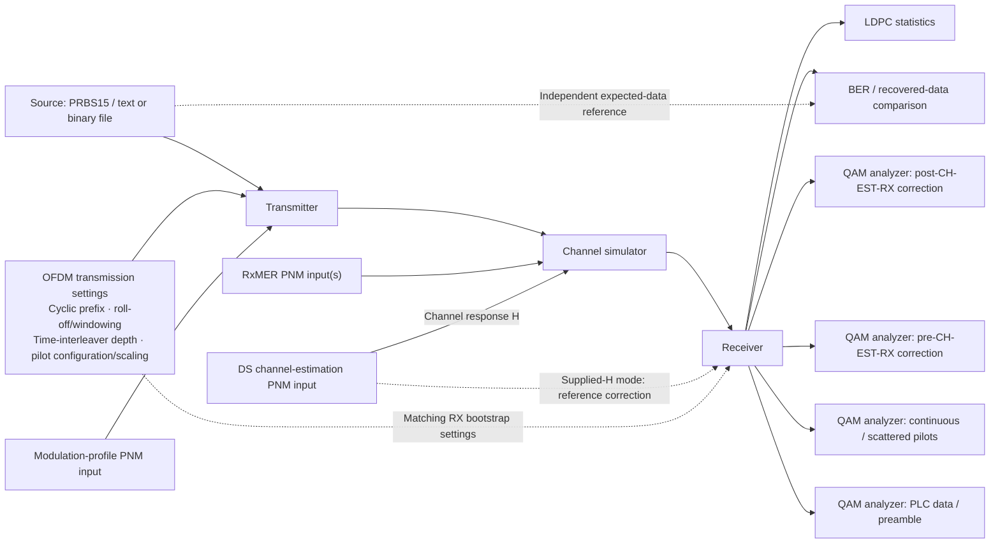
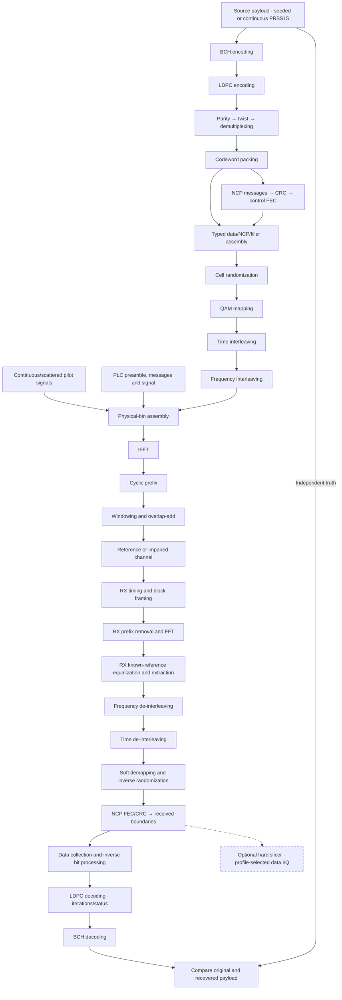

# DOCSIS OFDM Channel Sim architecture

This is the maintained architecture for this repository. The
[implementation checklist](development/checklist.md) records completed work,
remaining requirements and the next implementation step.
The [development status](development/status.md) summarizes the current milestone,
recent evidence and remaining product scope.
The [simulation design index](user/simulation/README.md) links a separate
Mermaid-based user guide for each simulation component. Detailed equations and
examples live in the linked stage guides. The [development workspace](development/README.md)
links tracked [feature records](development/features/README.md). Private evidence
and generated artifacts live under ignored `docs/development/local/`.

Status describes the **current source checkout**, including work awaiting commit.
It does not imply a published release or external DOCSIS interoperability.
Review this document and the checklist at feature completion and each commit-message
request. Update affected design/status before supplying the command; partial work
remains unchecked until its implementation and validation are complete.
Checklist IDs use stable component/work-area prefixes, such as PLC, WAVE-TX, WAVE-RX and
RX-CONFIG, rather than temporary NEXT labels. Local numbering identifies work;
dependencies and current priority determine the next item to implement.

## Purpose and scope

MERLIN (Modulation, Encoding, Reception, Link Impairments & Noise) is the
DOCSIS OFDM Simulation Toolkit. Its transmitter models a CMTS-like single-channel
downstream PHY path, paired with a simulated channel and receiver. Full CMTS MAC
services and multi-channel operation are outside the current scope.

Build a standalone, DOCSIS-focused Rust simulation core with two modes:

- **Ideal/reference:** known payload, fixed single downstream OFDM channel up to
  192 MHz, initially uniform 256-QAM, noiseless recovery first, then controlled
  impairments. The initial observation default is one second, with configurable longer
  durations and separate acquisition, completion and drain in the channel stepper.
- **Measurement-driven:** condition a simulation on supplied RxMER, downstream
  channel estimates and an applied modulation profile. Preserve exact grids,
  missing readings, timestamps and provenance. Establish reference planes before
  combining impairments so measured residual noise is not counted twice.

The configurable-duration waveform stepper supports noiseless, seeded sample
AWGN and per-carrier RxMER residuals with optional supplied diagonal response H.
The measurement path admits captured ProfileA ID0 with uniform16/256 or verified
non-shortened mixed loading, and explicit same-grid temporal measurement epochs.
Pilot-derived receiver correction is selectable alongside supplied-H reception. The channel job and CLI expose
cancellation, runtime limits, partial results and versioned probe export.
The existing CLI also retains the earlier16-QAM coding experiment;
Uniform/mixed packing/interleaving is exercised by the shared library, channel
CLI, examples and tests. Separate seeded, continuous PRBS15 and finite exact-byte file sources are implemented.
File traffic supports explicit PRBS15 fill and separate meaningful-data verification;
see the [PRBS design](user/simulation/prbs.md) and [file-source guide](user/simulation/file-source/README.md).

Downstream mapping and reference soft demapping cover constellations through
16384-QAM. Complete coding support must be tracked separately for each order;
current short8/9 bit processing supports uniform 16/256-QAM. See
[modulation coverage](reference/ofdm-support.md). DOCSIS4.0 FDD delegation does
not establish FDX behavior. OFDMA is a later scope.

All FEC, DSP, channel models and scientific calculations are Rust, including
algorithm dependencies. Scientific crates forbid unsafe code. A future Qt
presentation component and Python bindings consume the public Rust APIs;
neither owns scientific calculations. There is no UI or binding implementation
in this stage, and no device capture/control or network-service dependency.

## Downstream FEC shortening (FEC-03)

`fec-codec/src/shortening/` implements variable original-length coding around the
existing BCH/LDPC mother stages. `parameters` owns validated K, `encoding` the
six-stage TX coordinates, `decoding` known-zero RX restoration and consistency,
and `codec` their reusable composition. Each stage returns direct bounded test
points, with independently measured K-bit payload comparison and actual decoder
flags/iterations. Existing full-block constructors remain unchanged.

Local PHY3.1 I20 §7.5.4, PDF112–115 specifies only the16200-bit rate8/9 mother
code and shortening with all168 BCH/1800 LDPC parity retained. Normal64800-bit
frames are not used. Original PDF Figures46–47 were visually verified; PHY4.0
I07 FDX/FDD §7.2.5.4/§7.3.5.4 delegates FEC to these3.1 requirements. No additional
mother family or broader FDX simulation follows from that delegation.

For original K bits, prepend S=14232-K zeros before BCH, remove that prefix,
append S zeros before LDPC and omit those systematic zeros from the transmitted
word. Its length is K+1968. RX reconstructs finite positive known-zero evidence,
uses the existing mother decoder, restores the BCH prefix and checks omitted
coordinate consistency. Numerical LLR saturation is an explicit receiver policy;
failed decisions and actual statuses remain available for independent truth BER.

The [task design](development/features/fec-shortening/design.md) and
[component guides](user/fec-shortening/README.md) document diagrams, equations,
module contracts and validation. Shortened bit interleaving, cell packing,
received length/signaling and waveform admission remain QAM-03. The file source
still uses its full-word padding policy; this codec extension does not silently
change channel operation or the measurement JSON contract.

## Planned visual system workspace and payload selection

The future Qt workspace starts from the user's system diagram: clickable
**Source → Transmitter → Channel simulator → Receiver** blocks, a files/input
panel, and separate LDPC, BER, payload pre/post-CE, pilot and PLC analyzers.
Each block opens its purpose, settings, status and available stage observations;
analyzers consume bounded existing/new Rust contracts without changing the run.
The [workspace plan and diagram](development/features/visual-workspace/plan.md)
record this starting layout and ownership. This is planned; no Qt UI exists yet.

### Updated workspace diagram guide

The updated user sketch adds a separate **OFDM transmission settings** panel.
Use this as the workspace navigation guide, not a final screen layout. Each
processing block and analyzer opens its own focused panel; the settings panel
configures the transmitter and the matching receiver bootstrap for the next run.



The settings panel explains the purpose and trade-offs of each control:

| Setting | Purpose and ownership |
| --- | --- |
| Cyclic prefix | Protection against channel delay spread, with a capacity cost; applied by WAVE-TX and removed by matching WAVE-RX. |
| Roll-off/windowing | Symbol-edge shaping and spectral behavior; matched waveform geometry owns taper and overlap processing. |
| Time-interleaver depth | Spreads coded cells across symbols, affecting burst robustness, latency and startup/drain state. |
| Pilot configuration/scaling | Applicable continuous/scattered pilot references and boost; TX generation and CH-EST-RX must use consistent PHY settings. |

Use supported PHY choices and existing Rust validation; do not expose arbitrary
pilot patterns or a second Qt implementation of the settings math. Settings are
fixed during a run. A change is validated before starting a new run, preserving
active source, interleaver and receiver state. The settings panel links to the
[transmission guide](user/transmission.md), [waveform components](user/waveform/README.md)
and [pilot design](user/pilot-signals.md).

Receiver analyzer arrows represent read-only test points, including the raw FFT
before correction and matched points after correction. Supplied H and independently
pilot-estimated H-hat remain separate receiver modes. The source comparison path
is verification, not receiver feedback or PRBS reseeding. PNM labels describe input
roles; current files enter through decoded JSON or validated typed scenarios.

The Rust API and CLI implement **PRBS15 or user-supplied text/binary file bytes**.
The planned Qt Source block will open editable settings and an OS file picker.
The source preserves exact bytes, MSB-first file bit order, original length and
independent recovered-data comparison; text needs no encoding conversion.

Before a run, Rust validates the16MiB input bound and optional explicit total-bit
target/PRBS seed. Appending PRBS15 is opt-in and finite; never silently append,
repeat or truncate input. The future source panel shows original size, target
and remaining fill count from the same Rust contract. A minimum/alignment or
automatic target based on coding/profile/duration remains **TODO for later
definition**; fixed-size FEC blocks do not require fixed-size user files.

Keep original-file bits, appended PRBS15 bits and final-codeword padding distinct.
Recovered-file output contains only the original bytes; compare file and PRBS15
segments separately, excluding coding padding from BER. Without optional fill,
send once and then use idle/filler. Duration completion does not imply full file
completion: explicit generated/compared flags and recovered-prefix metadata
retain partial results. Source/CLI integration now precedes the planned Qt
control; continuous PRBS behavior is unchanged. SRC-04..06 track this extension.
See the [file source design](user/simulation/file-source/README.md) and
[implementation record](development/features/file-payload-source/implementation.md).

The file panel associates inputs with their processing stages. Measurement files
continue through the current decoded-PNM JSON importer; listing multiple RxMER
files does not itself activate playback; explicit validated epoch schedules
control temporal transitions. Supplied CE provides H to the
channel and1/H to reference RX correction. The expected-data connection to BER is
a verification path, not receiver feedback into the source.

## PNM measurement input direction

Use the current `pnm-decode` JSON output from PNM Viewer Toolkit as the starting
external measurement format for RxMER, downstream channel estimates and applied
modulation profiles. A future Rust import adapter will translate those decoded
documents into this repository's typed scenario inputs. Rust applications may
also supply the same validated scenario types directly through the public API.
Binary PNM decoding remains outside the simulation engine; the engine does not
launch `pnm-decode` or depend on the viewer application.

The `import-pnm` CLI and shared `scenario::pnm_json` API implement this direction
for the current range-scheme decoder output. The waveform command accepts the
converted scenario with explicit source/profile/epoch selection. Raw decoder
documents are inputs to import-pnm, not direct channel requests. Ideal/reference
runs require no PNM captures. Explicit temporal epochs and frozen mixed ProfileA
loading now use this same importer/engine; dynamic profile activation remains NCP-03.

Start the importer against representative current decoder output. Formal schema
versioning, a supported-toolkit-version table and compatibility enforcement are
deferred under INPUT-02 in the [checklist](development/checklist.md). Existing
scenario validation for grids, missing readings, timestamps and provenance
continues to apply.

The [PNM input guide](user/measurement-inputs/README.md) links current decoder
fixtures and Rust-generated RxMER alternatives. The sanitized originals are kept
locally under ignored development storage. The three demo captures share a spatial
grid but have different timestamps; they are not contemporaneous observations.
The importer and current fixed-profile waveform integration now consume these
fixtures; their different timestamps still require explicit tolerance.

The [LTE ingress approximation](user/measurement-inputs/lte-ingress.md) is a shared
Rust frequency-domain residual-power helper under `signal_processing::noise`.
Fixture preparation checks exact spatial alignment and emits a synthetic RxMER
document plus settings/alignment sidecar. It does not synthesize an LTE waveform.
The implemented measurement-driven mode starts noiseless and uses RxMER as its total
residual-error budget; no extra thermal/system floor is enabled. Derived LTE MER
already includes baseline plus added interference and must be applied once, not
combined with a second baseline or LTE injection in the waveform model.

See the [impairment component guides](user/impairments/README.md). Sample AWGN owns
an independent contiguous seeded stream. The measured channel synthesizes Gaussian
bin residuals plus supplied H through its own IFFT/CP/window/overlap stream. It is
a synchronized symbol-diagonal model, not arbitrary continuous-time convolution.
The receiver uses explicit known H; blind estimation remains open. Variances follow
the same inverse cell interleaver as received I/Q before per-cell LLR calculation.
Existing channel input/output and RX FFT/equalized probes expose the actual stages.
The protected LTE sweep starts narrow and rejects overlap with the PLC6MHz neighborhood.
The same Rust fixture generator offers a separate700–727MHz data-only RxMER
stress cap to observe actual post-FEC errors. It preserves pilots, PLC, nulls and
source identity; it is not modeled as a single LTE carrier. See the
[experiment commands and results](user/impairments/experiments.md).
An offline Rust fixture exporter preserves the original RxMER PNM header and
encodes exactly representable scenario readings for external viewing. It does
not change the decoded-JSON production input contract.

## Paired pre/post equalization constellation

**CONST-01..05** add bounded paired observations using the supplied-response
path before independent pilot estimation. Standard DS channel-estimation PNM
supplies H; the channel applies H and RX applies1/H. No correction-coefficient
input mode is inferred or added.

`simulation/channel/constellation/` separates selection, typed results and bounded
collection. The collector pairs `ReceivedSymbol.bins` and `equalized` at the same
physical bin/time, then carries diagnostic coordinates through an independent
instance of the existing receive interleaver. Actual received NCP payload ranks
select eligible points and the existing source window excludes acquisition,
filler and outside-observation cells. Failed payload codewords remain eligible.
No transmitter truth is passed into classification, equalization or decoding.

The default target is8192 total QAM pairs for a supported profile/carrier interval.
A bounded NI*M reorder map delays emission until receive-time order is known;
neither inverse history nor result storage grows with run duration. Collection
stops at its requested cap, with explicit partial/unavailable status when too few
points exist. Confirmed pairs survive cancellation and terminal stage/probe
failure. FEC results and RNG streams remain independent of capture settings.

`ChannelRun` exposes borrowed and owned partial capture access. `run_channel`
returns the same typed result through optional `constellation` JSON, reusing the
existing channel command and16MiB output policy. Default requests omit the new
result/settings field when collection is disabled. Existing raw/equalized generic
probe stages remain separate and available. No new noise/QAM/equalizer math or
Qt UI is introduced. See the [accepted plan](development/features/paired-constellation/plan.md),
[implementation](development/features/paired-constellation/implementation.md) and
[user guide](user/impairments/paired-constellation.md). MODEL-05 now adds the supported pilot-estimated receiver below; full blind
acquisition remains WAVE-RX-05.

## Receiver Channel Estimation (CH-EST-RX) and pilot/PLC analyzers

Channel Estimation (CH-EST) names the processing function; the RX or TX suffix
identifies its direction. Receiver Channel Estimation (CH-EST-RX) estimates H
from received pilots; CH-EST-TX is reserved for transmitter-side work.

**CH-EST-RX-01..06 are implemented for the documented bootstrap scope.**
`signal_processing/receiver/channel_estimation/` owns receiver-generated pilot
references, per-pilot LS estimates, bounded128-symbol history, delay-aware complex
interpolation and bounded cyclic-prefix timing search. It accepts received samples
and independent references, never the simulated H. `receiver_mode=pilot_estimated`
uses1/H-hat; omission preserves the supplied-H baseline.

The CLI keeps known sample timing/PLC phase. A separate public acquisition operation
composes an observed CP boundary with pilot reception while retaining known
numerology and PLC phase. Full blind numerology/carrier/PLC-phase acquisition stays
WAVE-RX-05; neither API claims a production CM receiver.

The first bounded raw PLC frame is corrected using the completed pilot pattern
before FEC/admission. Independent source/receiver owners continue beyond startup.
Raw noise calibration is converted through the actual applied inverse; it does
not add noise or claim a complete posterior model of estimator uncertainty.
History aging, edge/gap interpolation, near-zero rejection and prior pilot
predictions are explicit. A ready flag is not a guarantee of estimate accuracy.

`simulation/channel/protected_constellation/` owns opt-in separate continuous
pilot, scattered pilot, PLC16-QAM and BPSK-preamble pairs, including acquisition
and failed-frame observations. Targets/windows and combined retention are bounded;
current-fit pilots are labeled separately from pre-update predictions. Public
Rust access and the CLI expose identical scientific results. Existing payload
capture reports each selected cell's actual modulation order and correction mode.
`rx.channel_estimation.response` adds a dimensionless-gain test point; the final
job carries the latest bounded receiver estimate, not unlimited FFT history.

See the [subsystem user guides](user/receiver-estimation/README.md) and
[implementation/validation record](development/features/pilot-channel-estimation/implementation.md).

## Temporal measurements and applied profiles

`simulation/channel/timeline.rs` owns explicit piecewise measurement epochs.
Import resolves strictly increasing original timestamps to physical observation
symbol boundaries with ceiling division; direct Rust requests can specify an
explicit symbol schedule. All frames retain identity/grid/time/provenance and
pass coverage checks before work. The channel replaces response/residual plans
without resetting source, noise, interleaver or overlap state. Supplied-H RX updates
its reference; estimated RX continues to observe pilots without receiving H.
No layout or profile-activation change is allowed mid-run.

`transmission/layout/bit_loading.rs` implements the normative Ci=P^-1(Bi) frequency
mapping. `modulation/interleaving/mixed.rs` owns non-shortened24-column mixed bit
processing; the packer groups coded bits using per-source-rank loading and explicit
last-cell padding. Actual PLC DPDs deliver the frozen applied ProfileA to RX.
The receiver demaps variable-width soft cells and removes only final-cell padding
before actual LDPC/BCH recovery. Uniform16/256 and mixed0,4,6..14-bit profiles are
supported; unverified uniform higher-order coding, shortened waveform transport and dynamic profile
activation reject explicitly rather than substituting mixed rules.

The temporal model is piecewise-constant variance with conditionally independent
Gaussian residuals. RxMER alone supplies no burst correlation or event timing.
Power/lag tests and an identical-epoch RNG/FEC invariance test validate this model;
a different future burst process requires separate explicit inputs and evidence.
See [measurement playback](user/impairments/measurement-timeline.md) and
[applied-profile design](user/payload-transport/applied-profiles.md).

## Modules and stage boundaries

**Each distinct algorithm stage has a focused module and a directly testable typed
input/output boundary.** Stateful stages own explicit structs; stateless stages
can use functions. Do not create empty object wrappers or files solely to mimic
classes. Orchestrators connect components without hiding their intermediate data
or implementing a second copy of their mathematics.

The [unchecked-item review](development/checklist-review.md) distinguishes
completed component foundations from unfinished adapter, job/CLI lifecycle and
expanded PHY requirements. It predates the duration-stepper completion below.
Checked substeps do not close their parent requirement.

Parity interleaving, column twisting and cell demultiplexing now expose separate
forward/soft-inverse APIs and direct intermediate arrays. The existing facade
composes their shared mapping owners. Supported coding modes remain uniform
16/256-QAM short8/9; splitting stages does not expand that scientific support.

Current source ownership:

```text
crates/
├── fec-codec/src/
│   ├── bch.rs                 Payload BCH encoder/decoder
│   ├── ldpc.rs                Payload LDPC encoder/soft decoder
│   ├── concatenated.rs        Full-word composition and payload comparison
│   ├── shortening/            Variable-length TX/RX boundaries and mother-code reuse
│   ├── crc.rs                 CRC-24-D
│   ├── ncp/                   NCP mother matrix, shortening/puncturing and decoder
│   ├── plc/                   Separate PLC matrix, encoding, puncturing and decoding
│   └── parameters.rs          Verified coding dimensions
├── ofdm/src/
│   ├── types/                 Shared identities, units and modulation registry
│   ├── transmission/
│   │   ├── settings.rs        Fixed numerology
│   │   ├── timing.rs          Integer sample-clock schedules
│   │   ├── layout/            Physical roles and inverse pilot reference
│   │   ├── frame/             Protected physical frequency-bin assembly
│   │   ├── packing/           Bounded codeword queue and symbol plans
│   │   ├── symbols/           Actual NCP/data/filler assembly and typed cell values
│   │   ├── ncp/               Messages, control mapping and field CRC acceptance
│   │   └── plc/               Acquisition/messages, coding, interleaving, masks and signals
│   │       └── receiver_configuration/  Received channel/profiles, collection and readiness
│   ├── signal_processing/
│   │   ├── modulation/        QAM, LLRs, bit processing and cell randomization
│   │   ├── interleaving/      Separate time, frequency and composition modules
│   │   ├── pilots/            Shared sequence, power and separate CP/SP signals
│   │   ├── waveform/          TX IFFT/prefix/window/overlap and RX FFT/prefix primitives
│   │   ├── receiver/          Known timing, reference equalization and extraction
│   │   │   └── payload/       Acquired configuration, NCP hypotheses and bounded word recovery
│   │   ├── channel/           Unity time-domain reference transfer
│   │   ├── noise/             AWGN and measured residual-noise processing
│   │   └── ...                Analytical bit-loading/capacity helpers
│   ├── simulation/
│   │   ├── source/            Seeded / PRBS15 / file sources; independent verification
│   │   ├── pilots/            Typed stage composition and optional observation
│   │   ├── plc/               PLC composition, acquisition and optional observation
│   │   ├── waveform/          Separate TX/RX, bounded reference experiment and probes
│   │   ├── payload/           Continuous payload TX/RX, probes and bounded waveform proof
│   │   ├── channel/           Settings, shared link, stepper, window accounting and bounded jobs
│   │   ├── test_points/       Borrowed events, finite selection and versioned JSONL writer export
│   │   ├── coding_loop/       Independent 256-QAM codeword trials
│   │   ├── runner.rs          Existing 16-QAM trial orchestration
│   │   ├── config.rs          Work limits and receiver policy
│   │   └── results.rs         Counters, truth comparisons and confidence bounds
│   ├── scenario/              Decoded observations, grids and association
│   └── profile/               Hypotheses, role protection and screening
└── cli/src/
    ├── main.rs                Startup and exit
    ├── arguments.rs           CLI syntax
    ├── commands/              Thin operation adapters
    ├── logging/               CLI-only stderr backend and RUST_LOG setup
    └── json_io.rs             Bounded input and safe new-file exports
```

Dependencies flow from CLI/future adapters to `docsis-ofdm-fec`, then to the
optional `fec-codec`. Analysis-only builds exclude codec-backed simulation.
Preserve established imports through re-exports when reorganizing modules;
each calculation retains one canonical implementation.

## Transmission and receiver flow

The diagram describes the target channel path. Dashed-border boxes are planned
components. The fixed256-QAM noiseless channel stepper now connects the solid path;
nonideal operation and the optional hard slicer remain separate work.



The NCP and payload receiver paths use the appropriate separate demapping
hypotheses. Inverse randomization uses the recovered source-symbol phase, not the
later channel-output phase. Actual pilot signals are inserted after interleaving;
PLC, continuous pilots and exclusions never enter the reduced interleaver domain.
Initially timing/equalization can use known reference settings; blind acquisition
and estimated-channel operation are separate milestones, not implied by that mode.

Current integration tests already connect real payload/NCP coding, randomization,
QAM, cell interleaving, inverse pilot references and received pointer discovery.
The reusable payload TX/RX owners now feed a duration-planned channel stepper;
scientific algorithms remain in their existing component modules.

## Test points and data access

Existing APIs expose useful intermediate arrays and results. The common typed,
bounded observer covers pilot/PLC, physical bins, waveform TX/RX, payload/NCP,
source output and the existing coding experiment's noise output. A versioned
bounded JSONL writer adapter and the channel CLI export selected events. Other
stage IDs below remain proposed where direct outputs are not wired to producers. “Direct” means a caller can
obtain data through an existing stage API.

| Test point | Owner / data | Access now |
| --- | --- | --- |
| `source.payload` | `simulation::source`; source bits and seed/source identity | Direct output plus bounded source producer in coding/channel jobs |
| `tx.bch.word` | `fec_codec::bch`; BCH data plus parity | Direct |
| `tx.ldpc.word` | `fec_codec::ldpc`; systematic word plus parity | Direct |
| `tx.bits.parity`, `tx.bits.twist`, `tx.bits.demux` | Separate bit-processing stages; bit positions and cell labels | Separate forward/soft-inverse APIs and direct intermediate arrays; composed mapping preserved |
| `tx.packing.symbol` | `transmission::packing`; starts, roles, filler and offsets | Direct plan; IDs are transmitter truth only |
| `tx.ncp.messages`, `tx.ncp.crc`, `tx.ncp.encoded` | Message bytes, CRC, control-code bits/labels | Direct field/codec outputs |
| `tx.randomizer.cells` | Randomized labels and diagnostic LFSR state | Direct per-cell output/state |
| `tx.qam.iq` | Normalized I/Q with modulation and reference plane | Direct mapper output |
| `tx.time.cells`, `tx.frequency.cells` | Each cell-interleaver output with startup markers | Direct separate APIs |
| `tx.pilots.sequence`, `tx.pilots.continuous`, `tx.pilots.scattered`, `tx.pilots.power` | Separate sequence, signals, boost and physical locations | Direct values and bounded observer |
| `tx.plc.message` | `transmission::plc`; TS+MC information bytes and288-bit inputs | Fixed OCD/ProfileA/NCP packets, scheduling/reassembly and bounded message-byte observer |
| `tx.plc.coded` | `fec_codec::plc` and thin `transmission::plc::coding`; mother/transmitted bits | Mother bits direct; transmitted bits through bounded observer |
| `rx.plc.llrs`, `rx.plc.decoded` | Restored mother LLRs and soft decisions with iterations/parity | Direct APIs; common observer TODO |
| `tx.plc.coded_nibbles`, `tx.plc.interleaved` | Grouped labels and time-major PLC grid | Direct typed results and bounded observer; explicit grid metadata |
| `rx.plc.deinterleaved` | Hard-label or soft-bit inverse PLC permutation | Direct APIs; common observer TODO |
| `tx.plc.randomized`, `rx.plc.descrambled` | Independent PLC masks and sign-only soft inverse; frame-index/register snapshots | Direct block APIs; TX labels through bounded observer, RX observer TODO |
| `tx.plc.preamble`, `tx.plc.iq` | Verified BPSK preamble and shared16-QAM mapping | Direct typed arrays and bounded observer |
| `tx.frame.bins` | Full physical frequency grid, roles and zero/excluded bins | Direct assembler and bounded observer; data None preserved |
| `tx.ifft.samples`, `tx.cp.samples`, `tx.window.samples`, `tx.overlap_add.samples` | Separate TX waveform stages, frozen geometry and sample indices | Direct stage results and bounded observer |
| `channel.input`, `channel.output` | TX-output/RX-input I/Q with preserved sample indices | Unity, sample AWGN or symbol-diagonal H/RxMER synthesis with bounded observation |
| `rx.framed.samples`, `rx.cp.samples`, `rx.fft.bins`, `rx.equalized.iq` | RX known-boundary periods, useful samples, raw bins and reference-compensated bins | Direct results and bounded observer |
| `rx.plc.iq`, `rx.pilots.iq`, `rx.reduced.iq` | RX separated protected roles and data/scattered domain | Direct results and bounded observer; sparse pilots retain physical bins |
| `rx.timing`, `rx.channel.estimate` | Future estimated timing/channel state, distinct from supplied reference | TODO nonideal acquisition; not inferred from known-reference tests |
| `rx.frequency.cells`, `rx.time.cells` | Separate inverse cell-interleaver outputs and source phase | Direct |
| `rx.ncp.llrs`, `rx.ncp.accepted` | Actual soft records, CRC-accepted messages and direct block iterations | Production source decoder and bounded observer |
| `rx.data.llrs`, `rx.descrambler.llrs` | Data likelihoods after/before sign inversion | Post-inverse soft records have production observer; raw demapper remains direct |
| `rx.slicer.decisions` | Nearest label/reference point and distance/error vector | TODO hard slicer |
| `rx.bits.inverse` | Complete word LLRs restored to codeword order | Production collector and bounded observer; independent inverse bit-stage APIs available directly |
| `rx.ldpc.bits` | Decisions, parity success and actual iteration count | Direct |
| `rx.bch.payload` | Recovered bits, status and corrected-bit count | Direct |
| `tx.payload.ldpc`, `tx.payload.labels` | Actual enqueue-stage coding/label outputs | Bounded TX observer; queue ID is diagnostic, placement time unknown |
| `tx.cells.mapped`, `tx.cells.interleaved`, `rx.cells.restored` | Typed cells preserving pilots and unavailable history | Production stream owners and bounded directional observer |
| `rx.payload.bits` | Actual recovered BCH payload, independent of source truth | Production collector and bounded RX observer |
| `result.truth` | Actual bit/codeword comparisons and trial counters | Bounded payload-waveform proof plus duration-step results, PRBS totals and fixed iteration histogram; whole-word source-window metrics and explicit complete/partial job results implemented |

The implemented contract provides borrowed bit/label arrays, sparse pilot records
and a power record, with explicit metadata and finite selection budgets. See the
[pilot guide](user/pilot-signals.md) for the executable example and exact behavior.
The broader contract, including future producers, must provide:

- Stage ID, direction and run/configuration identity; codeword/profile identity
  where known. Receiver identities must come from decoded signaling/session state,
  never transmitter diagnostic IDs supplied as hidden receiver input.
- Source-symbol and channel-symbol indices separately; sample-clock position when
  applicable, PLC phase, physical/reduced grid mapping, units and normalization.
- Explicit value type and shape: bits, labels, I/Q, roles, LLRs or typed metadata.
  Preserve missing/startup/drain markers and success/failure states.
- Immutable borrowed data during a callback or explicitly owned snapshots with
  documented lifetime. Do not expose mutable internal buffers or RNG state.
- Opt-in stage selection, symbol/codeword/sample ranges and explicit data limits.
  Stream large sample blocks; do not retain an entire second of waveform by default.
- A disabled-observer path and tests proving observation does not alter RNG draws,
  stage order, scientific outputs or decoder decisions. Export/sampling belongs
  to adapters; scientific calculations remain in Rust stage modules.

Native typed stage calls remain usable without observers. JSON is an export
adapter, not the only way to get data. Probe failures and cancellation need an
explicit runner policy that preserves already completed scientific results.

The fixed-setting PLC path now generates OCD, ProfileA and NCP descriptors as
single-part management MAC packets, with HCS/FCS, mandatory edge/CP/PLC assignments,
MC segmentation and independent reassembly. A frozen scheduler repeats the set
within the200ms default using integer sample timing; packets too large for the
supported single-part contract or repeat budget fail explicitly. The source
settings and scheduler cadence must match. Received OCD geometry reuses the
existing physical-layout validator; DPD TLVs retain explicit profile identity.

Separate PLC stages own message coding, nibble grouping, block interleaving,
randomization, shared16-QAM mapping and the eight-symbol BPSK preamble. Full-frame
composition is in `simulation/plc/{transmitter,receiver}.rs`, bounded to one128-symbol
frame per operation. The receiver takes received equalized local PLC I/Q with
known spacing/frame alignment, retains decisions/iterations and independently
checks message and packet acceptance. This is not blind acquisition.
`transmission/plc/receiver_configuration/` now applies received OCD/ProfileA/NCP
messages through encapsulated channel, profile, collection, configuration and
readiness owners. Channel reconstruction and packet validation share one OCD
physical validator. Profiles apply specific-over-default assignments independent
of TLV order, with OCD protected roles taking precedence. Source/channel identity
is pinned per fixed session; OCD and the two profile counts remain independent.
A complete immutable receiver snapshot derives physical/reduced grids, prefix,
roll-off, interleaving and NCP modulation without transmitter objects.

`simulation/plc/acquisition.rs` composes PLC I/Q decoding, bounded MC reassembly
and configuration admission. Only supplied PLC bootstrap spacing/alignment stays
outside received signaling. The readiness gate is Waiting/Ready/Rejected and
exposes data/NCP settings only when Ready. Rejection preserves accepted descriptors
and historical configuration; a valid repeat can reopen the gate. Changed packet
content requires an explicit reset in this fixed-session implementation. Live
profile activation, descriptor timeouts, automatic loss recovery and full payload
receive orchestration remain separate work. See the per-subsystem
[receiver-configuration design guides](user/receiver-configuration/README.md).

`transmission/frame/assembly.rs` combines already cell-interleaved data/NCP,
scattered placeholders, PLC and actual pilots in increasing physical-bin order.
Protected bins cannot be overwritten; excluded bins are zero and unavailable data
history stays None. Normalization is an explicit RMS reference. Completed PLC and
physical outputs expose bounded optional windows through
`simulation/plc/observation.rs`; callbacks cannot modify scientific stage state.
The [PLC channel guide](user/plc-channel.md) includes the complete flow, math,
reproducible example, supported fixed subset and verification scope. Individual
[coding](user/plc-coding.md), [message](user/plc-messages.md),
[interleaving](user/plc-interleaving.md) and [randomization](user/plc-randomization.md)
guides remain focused stage references. External interoperability remains pending;
production fixed-profile data/NCP transport is implemented separately below. The separate waveform path
now carries these PLC/pilot signals through actual time-domain samples with
known-reference reception; see [waveform design](user/waveform/README.md).

## Waveform direction and configuration

Waveform means the complete **TX → channel → RX** path, not just reception.
The [checklist](development/checklist.md#waveform-direction-and-completion-scope)
uses direction-specific groups:

| Group | Direction and responsibility | Processing boundary |
| --- | --- | --- |
| `WAVE-TX` | Transmitter: IFFT, prefix insertion, windowing and overlap-add | Physical frequency bins → time-domain samples |
| `WAVE-CH` | Connecting channel: noiseless reference first | TX time samples → RX time samples |
| `WAVE-RX` | Receiver: framing, prefix removal, FFT, extraction and recovery | RX time samples → recovered frequency bins and decoded signals |
| `WAVE-QA` | Validation across both directions and the channel | Bounded observations and independent end-to-end comparisons |

Each subsystem owns its configuration/state and exposes testable intermediate
outputs. Shared transform/prefix primitives keep one numerical owner; TX/RX
composition remains separate. Test truth is used only for comparison, never as
an input to the receive decoder.

The first noiseless waveform milestone is implemented: WAVE-TX-01..03,
WAVE-CH-01, WAVE-RX-01..04 and WAVE-QA-01..02. Centered unitary transforms,
separate prefix operations, a half-sample Tukey taper, stateful overlap-add,
known-boundary stream framing, reference equalization and protected-role
extraction have independent public boundaries. TX/RX each own configuration
and history; finite sample blocks retain absolute ticks. Completed outputs are
observed after computation through thirteen direction-tagged probe producers.

`simulation/waveform/reference.rs` streams at most two PLC frames through real
samples and compares recovered bins and actual decoded information bits.
Its data plane contains deterministic256-QAM reference cells, not encoded
payload/NCP. Tests cover both spacings with a192MHz configured cap, a wide
active envelope and internal exclusions; the example uses a24MHz envelope.
Neither establishes external interoperability or a one-second payload experiment.
CELL-02/WAVE-RX-06 now add the separate actual payload waveform path described
below. The duration stepper is implemented separately; nonideal acquisition
(WAVE-RX-05) and temporal measurement-driven expansion remain open. Window accounting
and bounded job/CLI lifecycle are implemented separately.

See the [per-subsystem guides](user/waveform/README.md) and
[pinned waveform evidence](reference/waveform-evidence.md).

Prefix length and roll-off are **user-configurable before a run and constant
within that run**. TX validates and retains the chosen configuration. OCD
advertises the applicable settings; RX derives its channel configuration from
received signaling after the explicit known-phase PLC bootstrap. A setting
change starts a new configured run/session in this fixed-session model. See
[the prefix explanation](user/transmission.md#configurable-prefix-constant-per-run).

## Production fixed-profile payload transport

`transmission/symbols/assembly.rs` encodes the existing packer plan's real NCP
messages/CRC/FEC and maps continuously randomized data, NCP and BPSK filler.
Typed cells carry samples/pilot placeholders only; outer None retains unavailable
interleaver history. TX diagnostic IDs and reservation offsets never enter RX.
`simulation/payload/transmitter.rs` owns separate coding, packing, assembly and
cell-interleaving state, with a bounded queue and explicit M-1 drain.

`signal_processing/receiver/payload/` separates acquired-configuration support
checks, NCP hypotheses, the bounded pending-word collector and source decoder.
`simulation/payload/receiver.rs` checks the live PLC gate and immutable snapshot
on every call, inverse-interleaves actual received samples and reconstructs the
source index from known matched-pair delay. The source decoder uses CRC-accepted
NCP spans, independent soft hypotheses and actual LDPC/BCH results. Bad control
closes recovery without clearing pending history or caller-owned completed words.

Support is frozen ProfileA ID0 with uniform16/256 or verified mixed loading,
including zero-loaded carriers, and uniform positive QPSK/16-QAM/64-QAM NCP.
Odd selection, activation updates and tagging fail explicitly; dynamic switching
remains NCP-03. See the applied-profile design for non-shortened coding bounds. Descriptor counts remain independent.
The synchronized payload origin is a128-symbol boundary after PLC acquisition.
TX deliberately emits recorded BPSK replacements for unavailable startup/drain
history; RX suppresses only the configured M-1 warm-up, using no TX validity list.

Ten bounded producers expose coding, mapped/interleaved/restored cells, accepted
control, soft records and recovered payload. Source/channel coordinates and
original data-position ranks stay explicit. The bounded
`simulation/payload/reference.rs` proof acquires PLC through samples, configures
independent payload RX, streams actual encoded payload/NCP through the waveform,
and compares recovered words only after decoding. All three NCP orders have cell
transport tests; both spacings additionally have actual sample-domain proof at
maximum depth with reset-crossing words and drain completion.

See the [per-subsystem design](user/payload-transport/README.md) and
[evidence](reference/payload-transport-evidence.md). This completes CELL-02 and
WAVE-RX-06 for the supported subset. SRC-02/SRC-03 now add an explicit PRBS15
source and independent recovered-stream verifier. The waveform example uses
continuous PRBS across codewords, the sequence period and PHY reset; no source
truth enters receive decoding. Literal recurrence vectors and a complete-period
check are mathematical evidence, not external DOCSIS interoperability vectors.

## Configurable-duration channel stepping

`simulation/channel/` now owns frozen settings, checked64-bit duration plans,
shared actual waveform/PLC link composition, a one-symbol-at-a-time runner and
bounded cumulative/per-step results. It reuses existing payload/waveform TX/RX
owners, rather than duplicating them in channel wrapper modules. The old bounded
payload verifier shares the same link and preserves its public import paths.

The initial observation default is one second, configurable up to an application
limit of one hour. Only complete source-symbol periods are scheduled; unused
trailing ticks stay explicit. Acquisition, source observation, queued-word
completion, cell-interleaver drain and the final window tail are separate. PRBS,
partial codewords, PLC phase, randomizers and waveform overlap persist across calls
and second boundaries. Existing bounded test points remain available.

The runner offers PRBS payloads to an eight-word queue, stops generating at the
observation boundary, completes queued words, then drains. Per-step decoded words
carry actual iteration counts/BCH flags and independent PRBS comparisons. Summary
storage does not grow with duration: PLC iteration records are consumed per frame,
payload iterations use a101-bin histogram, and samples/words are not retained as
whole-run history. Failed sessions close explicitly; zero BER is unavailable
until actual bits have been compared. A1.01-second50kHz release experiment recovered
8950 words/127376400 payload bits with zero payload or PLC errors.

The RUN group is now implemented for the fixed-profile noiseless scope. A shared
window classifier uses received inclusive source-symbol spans and a half-open
observation window; whole-contained words contribute window BER/information-bit
rate, crossing/outside words remain explicitly excluded while global PRBS truth
stays continuous. Late receive completion during drain does not change source
membership. Partial jobs distinguish received announced incomplete starts from
admitted-but-unrecovered words. Final window rate stays unavailable until completion.

The job wrapper checks a caller cancellation token and finite host-runtime budget
between bounded steps, retains finite word details and all completed scalar totals,
and reports Complete/Cancelled/RuntimeExceeded/Failed independently of decoder
success. The CLI writes the same typed result and never replaces existing files.
Versioned JSONL export preserves original selected offsets, units and grid metadata,
with independent record/stream limits and explicit terminal I/O/limit errors.

ARCH-05/06/07 and QA-04 close this infrastructure milestone: maintained export,
source/noise draw-invariance tests, separate bit-processing boundaries, and a
release channel/probe smoke check in the pre-push gate. The subsequent impairment
group adds controlled waveform noise, PNM JSON import, fixed-profile measured
operation and supplied H compensation. The supported MODEL-05/06/07 extension
now adds pilot estimation, explicit epochs and mixed applied profiles; full blind
acquisition and dynamic profile switching remain separate. The design follows the
[user diagram reference](development/impairment-reference.md).
See the [component guides](user/channel-runner/README.md),
[channel CLI](user/channel-runner/cli.md), [export](user/simulation/probe-export.md)
and [bit-processing design](user/bit-processing/README.md).

## Planned module ownership

These paths are the accepted direction for upcoming work, not existing files or
promises that the algorithms have been implemented. Refine a path in this document
before implementation if source analysis shows a better existing owner.

| Planned path under `crates/ofdm/src/` | Responsibility |
| --- | --- |
| `transmission/layout/additional_pilots.rs` | Specification-based additional continuous-pilot placement |
| `signal_processing/receiver/estimation.rs` | WAVE-RX: independently verified nonideal synchronization/channel estimation beyond the existing known-reference receiver |
| `signal_processing/modulation/slicing.rs` | Diagnostic hard decisions; keep soft demapping for LDPC |

If PLC needs a new coding algorithm, its reusable primitive belongs in
`fec-codec`, selected only after local PHY verification. Do not assume payload or
NCP coding is interchangeable with PLC coding. Shared sequence/math definitions
have one owner; do not copy an LFSR into every consumer.

The hard slicer is diagnostic: nearest constellation point with an explicit tie
policy, symbol-error counts and data for EVM inspection. It must not silently
replace soft LLR inputs to LDPC. Its implementation remains on the checklist.

## Diagnostic logging

Scientific crates use the shared `log` facade; only the CLI installs `env_logger`.
The backend defaults to info on stderr and accepts `RUST_LOG` filters. Libraries
keep logger ownership with the caller. Error records belong at the terminal
application boundary, with separately suppressed failures recorded by their owner.
Expected decoder failures/input rejection are debug diagnostics; scientific
outcomes remain typed results. No sample/capture arrays or MACs are logged.

The current retrofit covers command/JSON failure handling, simulation lifecycle,
BCH and payload/NCP/PLC LDPC outcomes, timestamp CRC rejection and observer
failures/budgets. Logs are separate from typed test points and cannot control
scientific decisions or RNG draws. See [logging](development/logging.md).

The simulation core exposes `SimulationError` for domain failures, with stable
`code` and readable `message` fields. CLI and future adapters translate this
shared type; renaming it does not change serialized error categories.

## Lifecycle, validation and future interfaces

Freeze numerology, layout and profile before each run. Carry partial codewords,
interleaver buffers and sequence phase across calls. Keep PLC and data/NCP
randomizer states separate. The cell-interleaver pair adds M-1 symbols of delay;
None history is not transmitted payload; the physical reference uses explicit
recorded startup/drain replacements. Warm-up, configurable observation duration
(initially one second) and drain need separate accounting, including complete
versus unfinished observation-window words in the shared source-window classifier. The existing
`one_second_timing` helper now delegates to general duration/sample planning,
while preserving its original32-bit result shape. New plans use64-bit counts.

Bound files, buffers, observations, work and decoder iterations. Preserve
completed results on cancellation. Keep decoder success, truth errors, measured
observations and analytical screening distinct. No completed comparisons means
no fabricated zero BER. The seeded baseline is reproducible on the tested build;
external interoperability and untested platforms remain separate validation work.

Future Python/Qt adapters call the same scientific APIs and test-point contracts.
They do not implement DSP, codec math or scientific JSON post-processing. Native
bindings, packaging and presentation are later milestones. Git/release helpers
exist, but native installers and multi-OS release automation do not yet exist.

## Stage references

- [FEC codec](user/fec-codec.md), [coding evidence](reference/coding-mode.md)
- [QAM mapping](user/qam-mapping.md), [256-QAM bit/coding loop](user/qam256-coding-loop.md)
- [Randomizer](user/cell-randomizer.md), [symbol packing](user/symbol-packing.md), [NCP](user/ncp.md)
- [PLC LDPC coding](user/plc-coding.md)
- [PLC message blocks](user/plc-messages.md), [PLC evidence](reference/plc-evidence.md)
- [Pilot signals and test points](user/pilot-signals.md)
- [Physical layout](user/carrier-layout.md), [cell interleaving](user/cell-interleaving.md)
- [Transmission setup and timing](user/transmission.md), [public APIs](reference/public-api.md)
- [JSON contracts](reference/documents.md), [build/test](development/build.md), [Git/releases](development/git.md)

Pinned scientific sources and section/page evidence are recorded in those guides.
Use local versioned PHY sources before adding pilot/PLC details. Update this
architecture and the [checklist](development/checklist.md) together as stages change.

The [pilot/PLC reference demonstration](user/impairments/pilot-plc-constellation.md)
uses an example-owned observer over existing RX FFT/equalized probes. It keeps
the four signal classes separate during acquisition. The newer CH-EST-RX shared
collector and pilot-derived correction are documented in the receiver guides above.
