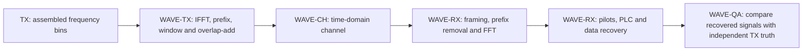

# Implementation checklist

This is the official progress and TODO list for DOCSIS OFDM Channel Sim. Read it
with the [architecture](../architecture.md) and the concise
[development status](status.md). The [development workspace](README.md) links
ongoing plans and historical feature records. Update both when adding a stage,
changing ownership, exposing a test point or extending signal-processing support.
Review both at feature completion and before supplying each commit message;
update affected sections and retain unchecked status for partial work.

Checked means present in the current checkout with supporting validation; it does
not mean committed, released or externally interoperable. Unchecked means work
remains. Detailed limitations stay in the stage guides rather than being hidden
by a broad “implemented” claim.

The downstream backfill preserves historical checked marks when a specific
execution record is incomplete, but explicitly flags the requirement and adds
a separate open acceptance task. Such a mark is retained history, not a newly
verified pass; see [evidence gaps](#downstream-requirements-and-acceptance-gaps).

The [unchecked-item review](checklist-review.md) records source/test evidence for
the remaining items. Checked substeps show finished components inside an open
parent requirement; they do not imply that the full parent is complete.

Checklist IDs use the owning component or work area's prefix and a stable local
number: `PLC-01` for PLC work, `WAVE-TX-01` for waveform transmission,
`WAVE-RX-01` for waveform reception and `RX-CONFIG-01` for receiver
configuration. `WAVE-CH` owns the connecting channel; `WAVE-QA` owns shared
waveform observation and integration checks. Use this pattern for new groups instead of a temporary
`NEXT` prefix. Keep IDs stable when status or scheduling changes; numbering is
local to a component, not a global execution order. Select the next unfinished
item by the documented dependencies and current implementation priority.

New or materially revised scope follows the
[development workflow](../../skills/development-workflow/SKILL.md#linked-requirements-and-tasks):
direct requirement and architecture links, explicit prerequisite IDs, acceptance
evidence and reverse requirement-to-task navigation. Preserve existing IDs/history
and declared status owners rather than duplicating or renumbering old tasks.

## Terminology

**Cell = QAM symbol**: one complex I/Q point on one subcarrier during one OFDM
symbol period. An **OFDM symbol** contains the complete set of subcarrier points
for that period. A256-QAM cell carries eight coded bits; pilot/control cells may
instead use BPSK or QPSK. Read cell interleaving as modulation-symbol interleaving,
distinct from bit interleaving. Introduce the term as **QAM symbol (cell)**; see
the [architecture definition](../architecture.md#terminology-cell-and-symbol).

## Engineering guidance

- [x] **DEV-GUIDE-01** Incorporate reviewed foundation clarifications additively.
  Requirements: [GUIDE-R1](features/engineering-guidance/design.md#guide-r1-preserve-local-contracts),
  [GUIDE-R2](features/engineering-guidance/design.md#guide-r2-traceable-planning-and-reuse),
  [GUIDE-R3](features/engineering-guidance/design.md#guide-r3-review-and-evidence),
  [GUIDE-R4](features/engineering-guidance/design.md#guide-r4-self-contained-discovery),
  [GUIDE-R5](features/engineering-guidance/design.md#guide-r5-candidate-provenance-and-truthful-validation).
  Architecture/file plan: [guidance owners](features/engineering-guidance/design.md#architecture-and-ownership).
  Dependencies: none; existing engineering documentation is the reviewed baseline.
  Acceptance: preserve all prior instruction lines and local contracts, resolve
  added file/fragment/discovery links, validate skill metadata and identify the
  dirty source candidate. Evidence: [validation record](features/engineering-guidance/validation.md).

  Requirements: [DEV-GUIDE-01](../requirements.md#ds-dev-guide-01).

## Upstream skill migration

- [x] **SKILL-US-01** Migrate pinned upstream guidance into existing MERLIN skills.
  Requirements: [SKILL-US-R1](features/upstream-skills/design.md#skill-us-r1-pinned-and-scoped-migration),
  [SKILL-US-R2](features/upstream-skills/design.md#skill-us-r2-direction-correct-scientific-guidance),
  [SKILL-US-R3](features/upstream-skills/design.md#skill-us-r3-paired-apis-and-compatibility),
  [SKILL-US-R4](features/upstream-skills/design.md#skill-us-r4-local-resources-and-attribution).
  Architecture/files: [local guidance owners](features/upstream-skills/design.md#architecture-and-destination-files).
  Dependency: DEV-GUIDE-01; baseline local guidance is already incorporated.
  Acceptance: map all 20 source skills, preserve local/source work and notices,
  adapt upstream science/testing/API references, validate metadata/navigation and
  retain existing runtime support boundaries. Evidence: [validation](features/upstream-skills/validation.md).

  Requirements: [SKILL-US-01](../requirements.md#ds-skill-us-01).

## Downstream requirements and acceptance gaps

The [detailed requirements](../requirements.md#detailed-downstream-contract-register)
and [backfill design](features/downstream-requirements/design.md) add traceability
to existing acceptance history. Links added to historical tasks preserve all
original IDs, nested criteria and checkbox states. Checked tasks with incomplete
records keep their marks and gain separate targeted acceptance tasks below.
The machine index is a frozen evidence snapshot; this checklist remains the
completion owner. Older review/validation snapshots do not override later states.

- [x] **DS-REQ-01** Backfill downstream requirements and bidirectional traceability.
  Requirements: [REQ-COM-DOC-01](../requirements.md#req-com-doc-01),
  [existing downstream contracts](../requirements.md#detailed-downstream-contract-register)
  and [original API clauses](../requirements.md#individual-api-handoff-requirements).
  Architecture: [requirement/evidence ownership](../architecture.md#requirements-and-historical-evidence-ownership).
  Dependency: INT-DOC-01.
  Acceptance: preserve all original official/UI tasks and API clauses; resolve
  requirement/task/architecture/module/test/record links; distinguish historical,
  current, superseded and pending scope; record missing evidence as open tasks.
  Evidence: [documentation validation](features/downstream-requirements/validation.md).
  This closes backfill documentation, not the gaps or unified runtime acceptance.

- [x] **DS-GAP-01** Resolve the historical source-organization compatibility gap.
  Requirement: [ARCH-02](../requirements.md#ds-arch-02).
  Architecture: [module boundaries](../architecture.md#modules-and-stage-boundaries).
  Owners: `crates/{ofdm,fec-codec,cli}/src/`.
  Dependency: DS-REQ-01.
  Acceptance: locate an attributable executed compatibility record or run focused
  `public_paths`/`concatenated` tests and bounded fixed-seed CLI JSON checks for
  retained imports, standalone codec use, schemas and seeded behavior. Record
  exact commands/results and scope; do not manufacture an old pre-refactor pass.
  [Evidence gap](features/downstream-requirements/design.md#targeted-evidence-gaps).
  Evidence: [pre-import baseline](features/unified-backend/baseline.md).

- [x] **DS-GAP-02** Resolve incomplete early numerical-stage execution records.
  Requirements: [FEC-01](../requirements.md#ds-fec-01),
  [FEC-02](../requirements.md#ds-fec-02), [QAM-01](../requirements.md#ds-qam-01),
  [RAND-01](../requirements.md#ds-rand-01), [CFG-01](../requirements.md#ds-cfg-01).
  Architecture: [FEC/DSP boundaries](../architecture.md#modules-and-stage-boundaries)
  and [waveform settings](../architecture.md#waveform-direction-and-configuration).
  Owners: `crates/fec-codec/src/`, `crates/ofdm/src/signal_processing/` and
  `crates/ofdm/src/transmission/settings.rs`.
  Dependency: DS-REQ-01.
  Acceptance: recover attributable results or execute existing independent
  `codec`, `normative`, `concatenated`, `qam_mapping`, `qam_reference_tables`,
  `cell_randomizer` and `transmission` cases covering actual failures/corrections,
  label/LLR signs, reset/clocking and timing limits. Record selected commands,
  results and limitations in MERLIN; no full historical-process replay required.
  [Evidence gap](features/downstream-requirements/design.md#targeted-evidence-gaps).
  Evidence: [pre-import baseline](features/unified-backend/baseline.md).

- [x] **DS-GAP-03** Resolve DPD preview/full-view acceptance specificity.
  Requirements: [UI-DPD-VIEW-01](../requirements.md#ds-ui-dpd-view-01),
  [UI-DPD-VIEW-02](../requirements.md#ds-ui-dpd-view-02).
  Architecture: [profile input](../architecture.md#downstream-profile-input-dialog).
  Owner: Qt profile-input adapters, plot providers and QML under `apps/qt/`.
  Dependency: DS-REQ-01.
  Acceptance: identify a valid record covering these exact contracts or run
  focused adapter/QML cases for binary/JSON DPD agreement, preserved physical
  grids/roles, bounded plotting and full-view controls. Use Qt scoped checks;
  record actual results and build the latest executable if UI code changes.
  Existing native/installed lifecycle tasks retain their separate open states.
  [Evidence gap](features/downstream-requirements/design.md#targeted-evidence-gaps).
  Evidence: [dedicated DPD viewer acceptance](features/pnm-measurement-inputs/profile-view.md).

## Unified backend integration

These are integration tasks in the unified MERLIN workspace, not copied source
checkmarks. [Canonical architecture](../architecture.md#unified-backend-integration),
[requirements](../requirements.md) and [source/document inventory](features/unified-backend/source-review.md)
govern scope. The baseline and standalone FEC gates have local acceptance below;
later DSP, PHY, input and adapter gates remain open. INT-DOC-01 is design consolidation;
INT-DOC-02 is the final ten-condition documentation acceptance after runtime tests.
Existing downstream and SKILL-US-01 statuses remain unchanged. Each task's
architecture owner identifies concrete implementation/test paths and dispositions.

- [x] **INT-DOC-01** Consolidate architecture, requirements, checklists and source records.
  Requirements: [REQ-COM-DOC-01](../requirements.md#req-com-doc-01).
  Architecture/owners/tests: [canonical placement](../architecture.md#unified-backend-integration).
  Depends on: SKILL-US-01.
  Acceptance: Complete all source document/requirement/task dispositions, preserve downstream IDs/statuses/API clauses, resolve local links and dependency/coverage checks. Documentation only; final runtime correspondence remains INT-DOC-02.

- [x] **DOC-ORG-01** Establish functional feature-documentation ownership.
  Requirements: [DOC-R3](../requirements.md#ds-doc-r3), [REQ-COM-DOC-01](../requirements.md#req-com-doc-01).
  Architecture/owners: [documentation ownership](../architecture.md#requirements-and-historical-evidence-ownership).
  Depends on: DS-REQ-01, INT-DOC-01.
  Design: [approved mapping](features/unified-backend/feature-documentation-plan.md), [current functional records](features/unified-backend/source-review.md#functional-ownership-after-doc-org-01).
  Acceptance: Account for all 170 originals; preserve 151 Keep and 12 Archive hashes, seven reviewed adaptations, all requirement IDs and historical checkbox states/aliases. Add nine functional records with direct canonical/task/module/evidence links; resolve Markdown/fragments, current locators, inventories, navigation and skills; keep dependencies acyclic and scientific/UI implementations unchanged.
  Evidence: [structural acceptance](features/unified-backend/validation.md#doc-org-01-functional-documentation-acceptance).

- [x] **INT-BASE-01** Establish reproducible unified-workspace regression baseline.
  Requirements: [REQ-DS-PHY-01](../requirements.md#req-ds-phy-01), [REQ-COM-SYS-05](../requirements.md#req-com-sys-05).
  Architecture/owners/tests: [canonical placement](../architecture.md#unified-acceptance-and-final-documentation-gate).
  Depends on: INT-DOC-01, DS-REQ-01.
  Acceptance: Record exact source/target/toolchain/locks and run the existing MERLIN regression/analysis-only/examples/native API baselines. Source results stay separately labeled; no invented external interoperability.
  Evidence: [pre-import baseline](features/unified-backend/baseline.md).

- [x] **INT-LICENSE-01** Review scientific source rights, notices and dependency contracts.
  Requirements: [REQ-COM-NFR-02](../requirements.md#req-com-nfr-02), [REQ-DS-DELIVERY-01](../requirements.md#req-ds-delivery-01).
  Architecture/owners/tests: [canonical placement](../architecture.md#unified-crate-ownership).
  Depends on: INT-DOC-01.
  Acceptance: Inventory each imported file/resource and transitive dependency with source/version/license/notices/modifications and artifact obligations; preserve Apache/MIT science and GPL Qt boundary. Resolve actual reuse permissions before import; retain both lock audits and pins.
  Evidence: [pre-import review](features/unified-backend/reuse-review.md).

- [x] **INT-REUSE-01** Audit function-level DSP/FEC reuse and final leaf placement.
  Requirements: [REQ-COM-SYS-03](../requirements.md#req-com-sys-03), [REQ-COM-REUSE-01](../requirements.md#req-com-reuse-01).
  Architecture/owners/tests: [canonical placement](../architecture.md#unified-shared-dsp-and-fec).
  Depends on: INT-BASE-01, INT-LICENSE-01.
  Acceptance: Map exact source/target symbols as SHARE/REUSE/ADAPT/SEPARATE/DEFER, check every numerical convention and consumer, settle concrete file/test paths, record compatibility/performance baselines and architecture-review decisions before scientific migration.
  Evidence: [pre-import review](features/unified-backend/reuse-review.md).
  Feature records: [signal-processing/design.md](features/signal-processing/design.md).

- [x] **INT-FEC-01** Integrate independently source-checked upstream LDPC families.
  Requirements: [REQ-COM-SYS-05](../requirements.md#req-com-sys-05), [REQ-US-TX-02](../requirements.md#req-us-tx-02), [REQ-US-RX-08](../requirements.md#req-us-rx-08), [REQ-DS-FEC-01](../requirements.md#req-ds-fec-01), [REQ-COM-REUSE-01](../requirements.md#req-com-reuse-01).
  Architecture/owners/tests: [canonical placement](../architecture.md#unified-shared-dsp-and-fec).
  Depends on: INT-REUSE-01.
  Acceptance: All three families pass original row/edge/frozen-parity, shortening, failed-decision/iteration/known-zero/truth cases in fec-codec; all downstream BCH/LDPC/NCP/PLC regressions pass. No BCH on ordinary upstream data, no regenerated golden expectations.
  Evidence: [MERLIN codec and regression results](features/unified-backend/fec-validation.md).
  Feature records: [fec/design.md](features/fec/design.md), [ofdma/transmitter.md](features/ofdma/transmitter.md), [ofdma/receiver.md](features/ofdma/receiver.md).

- [x] **INT-PLAN-01** Reconcile the current backend master prompt before code migration.
  Requirements: [REQ-COM-API-07](../requirements.md#req-com-api-07), [REQ-COM-API-08](../requirements.md#req-com-api-08), [REQ-COM-API-09](../requirements.md#req-com-api-09), [REQ-COM-TRACE-01](../requirements.md#req-com-trace-01), [REQ-COM-TRACE-02](../requirements.md#req-com-trace-02).
  Architecture/owners/tests: [traceability ownership](../architecture.md#requirements-and-historical-evidence-ownership).
  Depends on: DOC-ORG-01, INT-FEC-01.
  Acceptance: Preserve the complete new prompt; map every heading to canonical requirements, architecture and tasks; inspect existing Rust/Python exports; record a namespace proposal, operation-matrix coverage gaps, fourteen-field evidence contract and automation gaps. Verify links, dependencies, original task history and prompt integrity. This accepts preflight documentation only; namespace approval and runtime/API delivery remain open.
  Feature records: [master prompt review](features/unified-backend/master-prompt-review.md), [API compatibility matrix](features/high-level-api/compatibility-matrix.md).
  Evidence: [preflight verification](features/unified-backend/master-prompt-review.md#preflight-verification).

- [x] **INT-API-MAP-01** Finalize the literal unified Rust/Python namespace mapping.
  Requirements: [REQ-COM-API-07](../requirements.md#req-com-api-07), [REQ-COM-API-08](../requirements.md#req-com-api-08), [REQ-COM-API-09](../requirements.md#req-com-api-09).
  Architecture/owners/tests: [API ownership](../architecture.md#unified-rust-python-and-cli-apis).
  Depends on: INT-PLAN-01.
  Acceptance: Document exact facade/common/PHY Cargo package and library names, acyclic dependencies, public re-exports, preserved downstream type/import/behavior compatibility, one real Python package/extension layout and named installed-wheel/isolation/parity acceptance. This is a design decision only; export/runtime gates remain open.
  Feature records: [selected namespace design](features/high-level-api/namespace-design.md), [single operation matrix](features/high-level-api/compatibility-matrix.md).

- [x] **INT-DSP-01** Consolidate proven common numerical kernels.
  Requirements: [REQ-COM-REUSE-01](../requirements.md#req-com-reuse-01).
  Architecture/owners/tests: [canonical placement](../architecture.md#unified-shared-dsp-and-fec).
  Depends on: INT-FEC-01, INT-REUSE-01, INT-PLAN-01, INT-API-MAP-01.
  Acceptance: Prove FFT/bin/normalization, QAM/LLR, PRBS continuity, channel/noise equivalence for each extracted kernel; benchmark changed hot paths, preserve re-exports and downstream results. Create dsp only if justified; a documented direct-reuse/no-new-crate decision must pass the same equivalence checks.
  Evidence: [shared kernels and downstream validation](features/signal-processing/validation.md).
  Feature records: [fec/design.md](features/fec/design.md), [signal-processing/design.md](features/signal-processing/design.md).

- [x] **INT-US-CONFIG-01** Register upstream PHY, typed configuration, grants and source.
  Requirements: [REQ-US-CFG-01](../requirements.md#req-us-cfg-01), [REQ-US-CFG-02](../requirements.md#req-us-cfg-02), [REQ-US-CFG-03](../requirements.md#req-us-cfg-03), [REQ-US-CFG-04](../requirements.md#req-us-cfg-04), [REQ-US-CFG-05](../requirements.md#req-us-cfg-05), [REQ-US-CFG-06](../requirements.md#req-us-cfg-06), [REQ-US-PRBS-01](../requirements.md#req-us-prbs-01), [REQ-US-PRBS-02](../requirements.md#req-us-prbs-02), [REQ-US-PRBS-03](../requirements.md#req-us-prbs-03), [REQ-US-PRBS-04](../requirements.md#req-us-prbs-04).
  Architecture/owners/tests: [canonical placement](../architecture.md#unified-upstream-configuration-and-source).
  Depends on: INT-DSP-01.
  Acceptance: Local module registration, supported/domain-valid distinctions, complete source-field coverage and typed idle session foundation pass. Independent grant capacities, all three codeword families, fill/pad/source bookkeeping, PRBS phase/period/seed/range and rejection atomicity pass before waveform use.
  Progress: typed configuration, grants/resources and continuous source are registered;
  [typed foundation evidence](features/ofdma/design.md#validation) covers this unit only.
  Full document admission, source-field coverage and typed session acceptance now pass locally.
  Public exports follow the [selected exact mapping](features/high-level-api/namespace-design.md); initial typed upstream stage APIs precede final facade convergence. No empty namespace scaffold.
  Feature records: [ofdma/configuration.md](features/ofdma/configuration.md).
  Acceptance evidence: [83 local cases and 40 exact chains](features/ofdma/design.md#session-and-core-acceptance).

- [x] **INT-US-TX-01** Migrate all eight upstream transmitter boundaries.
  Requirements: [REQ-US-TX-01](../requirements.md#req-us-tx-01), [REQ-US-TX-03](../requirements.md#req-us-tx-03), [REQ-US-TX-04](../requirements.md#req-us-tx-04), [REQ-US-TX-05](../requirements.md#req-us-tx-05), [REQ-US-TX-06](../requirements.md#req-us-tx-06), [REQ-US-TX-07](../requirements.md#req-us-tx-07), [REQ-US-TX-08](../requirements.md#req-us-tx-08).
  Architecture/owners/tests: [canonical placement](../architecture.md#unified-upstream-processing-order).
  Depends on: INT-US-CONFIG-01.
  Acceptance: Each US-TX-01..08 typed boundary passes independent source/order/label/pilot/permutation/Pre-Eq/transform/window vectors for both numerologies and declared supported orders/patterns, including chunk/state/invalid-input cases and exact source accounting.
  Progress: [typed TX implementation unit](features/ofdma/design.md#int-us-tx-01-transmitter-implementation-unit)
  and combined configuration/TX acceptance now pass locally.
  Feature records: [ofdma/transmitter.md](features/ofdma/transmitter.md), [ofdma/pre-equalization.md](features/ofdma/pre-equalization.md).
  Acceptance evidence: [83 local cases and 40 exact chains](features/ofdma/design.md#session-and-core-acceptance).

- [x] **INT-US-CH-01** Migrate unity and supported upstream channel models.
  Requirements: [REQ-US-CH-01](../requirements.md#req-us-ch-01), [REQ-US-CH-02](../requirements.md#req-us-ch-02), [REQ-US-CH-03](../requirements.md#req-us-ch-03), [REQ-US-CH-04](../requirements.md#req-us-ch-04), [REQ-US-CH-05](../requirements.md#req-us-ch-05), [REQ-US-CH-06](../requirements.md#req-us-ch-06).
  Architecture/owners/tests: [canonical placement](../architecture.md#unified-channel-and-measurement-reference-planes).
  Depends on: INT-US-TX-01.
  Acceptance: Unity is bitwise exact including signed zero/metadata/no-RNG; causal FIR, AWGN, restricted RxMER residual, integer delay/phase/CFO pass independent samples/powers, chunk/seed/observation/drain and whole-schedule rejection tests. Preserve source composition restrictions.
  Progress: [channel implementation unit](features/ofdma/design.md#int-us-ch-01-channel-implementation-unit)
  and full-schedule/observer acceptance now pass locally.
  Feature records: [ofdma/channel.md](features/ofdma/channel.md).
  Acceptance evidence: [83 local cases and 40 exact chains](features/ofdma/design.md#session-and-core-acceptance).

- [x] **INT-US-RX-01** Migrate all nine received-only upstream receiver boundaries.
  Requirements: [REQ-US-RX-01](../requirements.md#req-us-rx-01), [REQ-US-RX-02](../requirements.md#req-us-rx-02), [REQ-US-RX-03](../requirements.md#req-us-rx-03), [REQ-US-RX-04](../requirements.md#req-us-rx-04), [REQ-US-RX-05](../requirements.md#req-us-rx-05), [REQ-US-RX-06](../requirements.md#req-us-rx-06), [REQ-US-RX-07](../requirements.md#req-us-rx-07), [REQ-US-RX-09](../requirements.md#req-us-rx-09).
  Architecture/owners/tests: [canonical placement](../architecture.md#unified-upstream-processing-order).
  Depends on: INT-US-CH-01, INT-US-TX-01.
  Acceptance: US-RX-01..09 pass configured timing/window/FFT, FrameFlatLs/FramePilotLinear, inverse resources, finite MaxLog, soft mask, shortening/LDPC and information coverage tests without hidden TX/H/C/source truth; missing data never compacts positions.
  Progress: [received-only RX and direct loop](features/ofdma/design.md#int-us-rx-01-received-only-receiver-implementation-unit)
  and combined configuration/session acceptance now pass locally.
  Feature records: [ofdma/receiver.md](features/ofdma/receiver.md).
  Acceptance evidence: [83 local cases and 40 exact chains](features/ofdma/design.md#session-and-core-acceptance).

- [x] **INT-US-LOOP-01** Accept bounded upstream loop, observations and lifecycle locally.
  Requirements: [REQ-US-SYS-01](../requirements.md#req-us-sys-01), [REQ-US-SYS-02](../requirements.md#req-us-sys-02), [REQ-US-SYS-04](../requirements.md#req-us-sys-04), [REQ-COM-OBS-01](../requirements.md#req-com-obs-01), [REQ-COM-OBS-02](../requirements.md#req-com-obs-02), [REQ-COM-LIFE-01](../requirements.md#req-com-life-01), [REQ-COM-LIFE-02](../requirements.md#req-com-life-02), [REQ-COM-LIFE-03](../requirements.md#req-com-life-03), [REQ-COM-NFR-01](../requirements.md#req-com-nfr-01).
  Architecture/owners/tests: [canonical placement](../architecture.md#unified-rust-python-and-cli-apis).
  Depends on: INT-US-RX-01.
  Acceptance: Actual MERLIN source→TX→channel→RX recovers independently compared meaningful bits for both numerologies and supported loading; retain real FEC failure/partial/coverage outcomes. Execute through the initial public Rust upstream session developed alongside the stages; final API convergence remains INT-RUST-01. Cancellation precedes pause acceptance; test state preservation, deterministic science, passive metrics/taps and bounded aggregate/retained work.
  Feature records: [high-level-api/upstream.md](features/high-level-api/upstream.md).
  Acceptance evidence: [83 local cases and 40 exact chains](features/ofdma/design.md#session-and-core-acceptance).

- [x] **INT-PNM-01** Integrate source-derived upstream capture inspectors and decoders.
  Requirements: [REQ-US-PNM-01](../requirements.md#req-us-pnm-01), [REQ-US-PNM-02](../requirements.md#req-us-pnm-02), [REQ-US-PNM-03](../requirements.md#req-us-pnm-03).
  Architecture/owners/tests: [canonical placement](../architecture.md#unified-pnm-and-capture-admission).
  Depends on: INT-US-LOOP-01.
  Acceptance: Reuse verified pinned parser capabilities; UCD multipart/envelope, CCAP RxMER and applied/last-update Pre-Eq pass source-derived independent length/offset/scaling/sentinel/flag/overflow/original-byte tests locally. Unknown metadata remains inspectable; no guessed association.
  Feature records: [ofdma/pre-equalization.md](features/ofdma/pre-equalization.md), [pnm-measurement-inputs/upstream.md](features/pnm-measurement-inputs/upstream.md).
  Acceptance evidence: [15 decoder cases and downstream input regressions](features/pnm-measurement-inputs/upstream.md#decoder-acceptance).

- [x] **INT-PNM-02** Integrate explicit measured association and playback.
  Requirements: [REQ-US-PNM-01](../requirements.md#req-us-pnm-01), [REQ-US-PNM-02](../requirements.md#req-us-pnm-02), [REQ-US-PNM-03](../requirements.md#req-us-pnm-03), [REQ-US-PNM-04](../requirements.md#req-us-pnm-04).
  Architecture/owners/tests: [canonical placement](../architecture.md#unified-pnm-and-capture-admission).
  Depends on: INT-PNM-01, INT-US-CONFIG-01, INT-US-CH-01.
  Acceptance: Complete-plan UCD/CM/CCAP-interface/grid/time mapping, source coverage, power-domain selection/average/hold/interpolation and corresponding-probe Set/Adjust schedules pass. Validate later events before consumption; actual captured-plan runs preserve originals and reject incompatible C/H/RxMER combinations atomically.
  Feature records: [ofdma/channel.md](features/ofdma/channel.md), [ofdma/pre-equalization.md](features/ofdma/pre-equalization.md), [pnm-measurement-inputs/upstream.md](features/pnm-measurement-inputs/upstream.md).
  Acceptance evidence: [23 input cases and 83 core regressions](features/pnm-measurement-inputs/upstream.md#measured-association-acceptance).

- [x] **INT-RUST-01** Converge typed Rust APIs without downstream breakage.
  Requirements: [REQ-US-API-01](../requirements.md#req-us-api-01), [REQ-COM-API-03](../requirements.md#req-com-api-03), [REQ-COM-API-06](../requirements.md#req-com-api-06), [REQ-DS-API-01](../requirements.md#req-ds-api-01), [REQ-COM-API-07](../requirements.md#req-com-api-07), [REQ-COM-API-09](../requirements.md#req-com-api-09).
  Architecture/owners/tests: [canonical placement](../architecture.md#unified-rust-python-and-cli-apis).
  Depends on: INT-US-LOOP-01, INT-PNM-02.
  Acceptance: Public upstream operations and common lifecycle/error/provenance semantics pass native Rust tests, idle/Busy/ownership/bounds/unsupported/versioned-schema checks. Preserve every downstream import/entrypoint/report, optional analysis-only support and Rust-only independence. Approve namespace-to-crate mapping before compatibility-sensitive edits; accept explicit direction imports/aliases with every exported Rust operation in the authoritative matrix.
  Feature records: [high-level-api/upstream.md](features/high-level-api/upstream.md).
  Progress: [implemented facade/common contracts and passing compatibility checks](features/high-level-api/namespace-design.md#namespace-implementation-validation); [complete operation coverage](features/high-level-api/upstream.md#rust-api-acceptance) now passes compiler-export and executed Rust case checks.

- [x] **INT-PY-01** Expose upstream through the existing native Python distribution.
  Requirements: [REQ-US-API-02](../requirements.md#req-us-api-02), [REQ-COM-API-04](../requirements.md#req-com-api-04), [REQ-COM-API-05](../requirements.md#req-com-api-05), [REQ-DS-API-01](../requirements.md#req-ds-api-01), [REQ-COM-API-08](../requirements.md#req-com-api-08), [REQ-COM-API-09](../requirements.md#req-com-api-09).
  Architecture/owners/tests: [canonical placement](../architecture.md#unified-rust-python-and-cli-apis).
  Depends on: INT-RUST-01.
  Acceptance: Actual native extension exports/types/errors/owned results and independently executed Rust/Python runs agree, including configuration/captures/cancel/pause/Busy/interpreter-lock release. Both languages document the same supported behavior; preserve existing workbench recipes and old Python imports. Verify direct downstream/upstream imports, discovery, typing and installed wheels on declared Python 3.10+ environments; attributes alone do not satisfy submodule import acceptance.
  Feature records: [high-level-api/upstream.md](features/high-level-api/upstream.md).

  Acceptance: [native namespace implementation unit](features/high-level-api/python-evidence.json)
  passes 46 installed Linux/CPython 3.10 cases, including fresh direct Rust parity,
  original downstream workbenches/Designer recipes and common-token cancellation.
  One-extension wheel/discovery/typing/legal payload and both legacy FEC examples
  pass. [Complete native operation coverage](features/high-level-api/python-operation-evidence.json)
  matches all 373 installed entries and 88 directional/common class exports;
  all 59 legacy root exports/signatures/defaults are preserved. Two additional
  native conversion cases close targeted gaps (48 native cases total across the
  recorded runs). Other interpreter/platform runtime and final regression gates
  remain separate.

- [x] **INT-CLI-01** Add upstream commands to the existing CLI.
  Requirements: [REQ-COM-IDENTITY-01](../requirements.md#req-com-identity-01), [REQ-DS-API-01](../requirements.md#req-ds-api-01).
  Architecture/owners/tests: [canonical placement](../architecture.md#unified-rust-python-and-cli-apis).
  Depends on: INT-RUST-01.
  Acceptance: All existing commands/output schemas still pass; new upstream commands use canonical Rust operations, bounded JSON/I/O and create-new export behavior. No parallel executable or algorithm implementation.
  Feature records: [high-level-api/upstream.md](features/high-level-api/upstream.md).
  Acceptance evidence: [exact candidate and requirement records](features/high-level-api/cli-evidence.json),
  [32 executed CLI cases](features/high-level-api/cli-test-results.json): all 23
  original downstream cases plus nine upstream cases pass. Both numerologies,
  measured/raw provenance, idle preview, direct Rust parity, failed recovery,
  actual Linux Ctrl-C and protected input/output limits pass; CLI Clippy/fmt pass.

- [x] **INT-TOOLS-01** Reconcile dependency, example and delivery inventories.
  Requirements: [REQ-COM-NFR-03](../requirements.md#req-com-nfr-03), [REQ-DS-DELIVERY-01](../requirements.md#req-ds-delivery-01), [REQ-COM-TRACE-02](../requirements.md#req-com-trace-02).
  Architecture/owners/tests: [canonical placement](../architecture.md#unified-normative-evidence-and-exclusions).
  Depends on: INT-LICENSE-01, INT-PY-01, INT-CLI-01.
  Acceptance: Validate local manifests/locks/version/pins/notices, examples and package member inventories without silently changing toolchains, two CI entrypoints or native target scope. Preserve caches and generated Python-guide policy; installed/hosted claims require separate actual evidence. Close every [traceability automation gap](features/unified-backend/master-prompt-review.md#automated-validation-gaps), including exact symbols/cases, executed evidence and actual native Rust/Python export coverage.
  Feature record: [executed traceability design](features/unified-backend/design.md#int-tools-01-executed-implementation-traceability).
  Acceptance evidence: [candidate/requirement records](features/unified-backend/tooling-evidence.json)
  and [190 tool cases plus 48 fresh installed native cases](features/unified-backend/tooling-test-results.json).
  Exact compiler/native/compiled-case acceptance, all three unchanged third-party
  lock inventories, twelve example targets, real CLI archive and three wheel
  smokes pass locally. Historical formats/states remain preserved; hosted and
  final regression/documentation/backend gates remain separate.

- [x] **INT-REG-01** Pass unified downstream and upstream backend regressions.
  Requirements: [REQ-DS-FEC-01](../requirements.md#req-ds-fec-01), [REQ-DS-PHY-01](../requirements.md#req-ds-phy-01), [REQ-DS-RUN-01](../requirements.md#req-ds-run-01), [REQ-DS-INPUT-01](../requirements.md#req-ds-input-01), [REQ-DS-API-01](../requirements.md#req-ds-api-01), [REQ-DS-UI-01](../requirements.md#req-ds-ui-01).
  Architecture/owners/tests: [canonical placement](../architecture.md#unified-acceptance-and-final-documentation-gate).
  Depends on: INT-TOOLS-01, INT-PNM-02, INT-FEC-01, INT-DSP-01,
  DS-GAP-01, DS-GAP-02, DS-GAP-03.
  Acceptance: Run full required MERLIN Rust tests/Clippy/format/analysis-only/doctests/examples plus actual Python/CLI/PNM compatibility and applicable Qt integration checks. Record deterministic values separately from elapsed time, all failures/omissions and exact candidate. Source-only passes are insufficient.
  Acceptance evidence: [final source/case records](features/unified-backend/regression-evidence.json)
  and [complete local regression](features/unified-backend/validation.md#int-reg-01-complete-unified-workspace-regression).
  605 workspace, 4 preparation and 139 analysis-only cases plus 12 workflows pass;
  static, native parity and existing downstream Qt compatibility pass. Three
  ignored benchmarks, empty doctest phases, maintenance advisory and local-only
  platform/installer boundaries remain explicit. Subsequent final documentation
  acceptance is recorded below.

- [x] **INT-DOC-02** Complete final documentation and skill correspondence.
  Requirements: [REQ-COM-DOC-01](../requirements.md#req-com-doc-01), [REQ-COM-TRACE-01](../requirements.md#req-com-trace-01), [REQ-COM-API-09](../requirements.md#req-com-api-09).
  Architecture/owners/tests: [canonical placement](../architecture.md#unified-acceptance-and-final-documentation-gate).
  Depends on: INT-REG-01, DS-REQ-01, DOC-ORG-01.
  Acceptance: Meet all ten user documentation completion conditions: one architecture/requirements/checklist; complete requirement/task evidence; resolving links; skills name actual final modules; no obsolete user-facing branding; docs match implemented support and every newly accepted capability has local integrated evidence. The master prompt crosswalk, complete operation matrix and fourteen-field requirement records must match actual exported symbols and executed cases.
  Acceptance evidence: [ten-condition review](features/unified-backend/validation.md#int-doc-02-final-documentation-correspondence)
  and [exact documentation requirement chains](features/unified-backend/documentation-evidence.json).
  All 520 IDs, 59 source clauses, 430 downstream task mappings, 12 skills and
  24 discovery links remain intact. Strict references cover 147 native class
  imports; 80 tool cases and fresh export/compiled-case acceptance pass.

- [x] **INT-ACCEPT-01** Accept the unified backend within declared supported scope.
  Requirements: [REQ-COM-NFR-04](../requirements.md#req-com-nfr-04), [REQ-COM-DOC-01](../requirements.md#req-com-doc-01), [REQ-DS-DELIVERY-01](../requirements.md#req-ds-delivery-01), [REQ-COM-TRACE-01](../requirements.md#req-com-trace-01), [REQ-COM-TRACE-02](../requirements.md#req-com-trace-02).
  Architecture/owners/tests: [canonical placement](../architecture.md#unified-acceptance-and-final-documentation-gate).
  Depends on: INT-DOC-02, INT-REG-01, INT-TOOLS-01.
  Acceptance: Review complete requirement/acceptance and numerical/performance/provenance/license matrices for both independently executable directions. All mandatory children pass locally; retain limitations, deferred scope and native/hosted boundaries. No merge, release, publication or push is authorized by acceptance.
  Acceptance evidence: [final supported-scope review](features/unified-backend/validation.md#int-accept-01-final-backend-acceptance)
  and [exact requirement/candidate records](features/unified-backend/acceptance-evidence.json).
  All 22 mandatory integration tasks pass their local gates; the 832-file runtime
  manifest still matches current bytes. Final 85 tool cases and fresh strict
  compiler/native/compiled-case acceptance pass. INT-DEFER-01, broader platform
  and installed/hosted boundaries remain explicit; no publication is implied.

- [ ] **INT-DEFER-01** Retain explicit future UI, wider PHY and ranging designs.
  Requirements: [REQ-US-OBS-03](../requirements.md#req-us-obs-03), [REQ-US-OBS-04](../requirements.md#req-us-obs-04).
  Architecture/owners/tests: [canonical placement](../architecture.md#unified-normative-evidence-and-exclusions).
  Depends on: none; explicitly deferred outside current delivery.
  Acceptance: Deferred outside this backend migration: upstream GUI, wider acquisition/confidence, fractional timing/phase noise, broad C/H/RxMER synthesis, finite-file transport and ranging/probe execution. Preserve detailed designs and evidence; require separate approval, source checks and implementation tests before exposure. This is not a dependency for backend acceptance.
  Feature records: [ofdma/receiver.md](features/ofdma/receiver.md), [ofdma/channel.md](features/ofdma/channel.md).

## Unified Qt Workbench delivery

New UI scope; completion is recorded per task. [Canonical requirements](../requirements.md#unified-qt-workbench-requirements)
and [architecture](../architecture.md#unified-qt-workbench) own behavior/design.
The [full inventory and migration plan](features/unified-qt-workbench/migration-plan.md)
refine file ownership. [API gaps](features/unified-qt-workbench/api-gap-matrix.md)
are prerequisites, not permission for Qt to use private science. Prior backend,
FEC and UI-ORG acceptance/history are unchanged. The user accepted initial serial
execution and per-active-direction Save. [Continuous execution](features/unified-qt-workbench/execution-authorization.md)
now authorizes local task commits and continuation without routine approval pauses.
The user's upstream diagram is an explicit prerequisite of UIU-US-01, not a
blocker for earlier eligible API/downstream work after plan approval.

- [x] **UIU-PLAN-01** Agree the UI planning baseline, full inventory, ownership/API gaps and migration design.
  Requirements: [REQ-UIU-01](../requirements.md#req-uiu-01), [REQ-UIU-04](../requirements.md#req-uiu-04), [REQ-UIU-26](../requirements.md#req-uiu-26), [REQ-UIU-27](../requirements.md#req-uiu-27).
  Dependencies: accepted backend checkpoint; user agreement on this UI plan.
  Architecture/files: [baseline owner](../architecture.md#unified-qt-workbench), [inventory/destinations](features/unified-qt-workbench/source-inventory.json), [API/file plan](features/unified-qt-workbench/api-gap-matrix.md).
  Acceptance: Review 178 tracked paths/hashes, master-clause coverage, requirement/task links, dependency graph and preserved history. The user accepted the plan by authorizing all 21 delivery tasks.
  Evidence: [planning acceptance](features/unified-qt-workbench/validation.md#uiu-plan-01-accepted-planning-baseline); 178 hashes, 27 requirement IDs, 21 tasks and 31 acyclic dependency edges pass. Historical downstream/backend states remain intact.

- [x] **UIU-BASE-01** Establish a fresh downstream Qt baseline before moving source.
  Requirements: [REQ-UIU-01](../requirements.md#req-uiu-01), [REQ-UIU-08](../requirements.md#req-uiu-08), [REQ-UIU-25](../requirements.md#req-uiu-25).
  Dependencies: [UIU-PLAN-01](#task-uiu-plan-01).
  Architecture/files: [baseline owner](../architecture.md#unified-qt-workbench), [inventory/destinations](features/unified-qt-workbench/source-inventory.json), [API/file plan](features/unified-qt-workbench/api-gap-matrix.md).
  Acceptance: Record exact candidate/toolchain, existing Qt Rust and QML results, native build/startup and current DS/project smoke. Prior backend evidence is historical context.
  Evidence: [fresh baseline acceptance](features/unified-qt-workbench/validation.md#uiu-base-01-fresh-qt-baseline-accepted) and [exact cases/source hashes](features/unified-qt-workbench/baseline-evidence.json): format/Clippy/build, 87 Rust tests, 89 QML checks, four project validators and two XCB startup smokes pass. All 178 application hashes are unchanged; Windows/installed lifecycle remains unverified.

- [ ] **UIU-BOUND-01** Enforce the public-API boundary before migration.
  Requirements: [REQ-UIU-02](../requirements.md#req-uiu-02), [REQ-UIU-03](../requirements.md#req-uiu-03), [REQ-UIU-24](../requirements.md#req-uiu-24).
  Dependencies: [UIU-BASE-01](#task-uiu-base-01).
  Architecture/files: [api owner](../architecture.md#unified-qt-public-api-boundary), [inventory/destinations](features/unified-qt-workbench/source-inventory.json), [API/file plan](features/unified-qt-workbench/api-gap-matrix.md).
  Acceptance: Add Cargo identity/source guard and negative alias/direct-call cases, reviewed finite legacy-site list with sunset tasks; no new scientific exceptions.
  Evidence: [api acceptance plan](features/unified-qt-workbench/validation.md#api); pending implementation/acceptance.

- [ ] **UIU-API-01** Expose compatible input/editor/preview admission through the facade.
  Requirements: [REQ-UIU-02](../requirements.md#req-uiu-02), [REQ-UIU-09](../requirements.md#req-uiu-09), [REQ-UIU-13](../requirements.md#req-uiu-13), [REQ-UIU-22](../requirements.md#req-uiu-22), [REQ-UIU-24](../requirements.md#req-uiu-24).
  Dependencies: [UIU-BOUND-01](#task-uiu-bound-01).
  Architecture/files: [api owner](../architecture.md#unified-qt-public-api-boundary), [inventory/destinations](features/unified-qt-workbench/source-inventory.json), [API/file plan](features/unified-qt-workbench/api-gap-matrix.md).
  Acceptance: Specify exact typed extensions, native-input re-exports and parity; preserve independent builds and editor/Designer/provenance behavior. Core/API plus installed-wheel tests precede Qt adoption.
  Evidence: [api acceptance plan](features/unified-qt-workbench/validation.md#api); pending implementation/acceptance.

- [ ] **UIU-API-02** Complete downstream controlled jobs and retained public observations.
  Requirements: [REQ-UIU-02](../requirements.md#req-uiu-02), [REQ-UIU-07](../requirements.md#req-uiu-07), [REQ-UIU-09](../requirements.md#req-uiu-09), [REQ-UIU-16](../requirements.md#req-uiu-16), [REQ-UIU-17](../requirements.md#req-uiu-17), [REQ-UIU-18](../requirements.md#req-uiu-18), [REQ-UIU-19](../requirements.md#req-uiu-19), [REQ-UIU-20](../requirements.md#req-uiu-20), [REQ-UIU-24](../requirements.md#req-uiu-24).
  Dependencies: [UIU-API-01](#task-uiu-api-01).
  Architecture/files: [api owner](../architecture.md#unified-qt-public-api-boundary), [inventory/destinations](features/unified-qt-workbench/source-inventory.json), [API/file plan](features/unified-qt-workbench/api-gap-matrix.md).
  Acceptance: Typed full-loop request/control/result contracts reuse existing owners; validate pause/cancel/progress, immutable bounded observations, PSD/MER/FEC/PRBS and old outputs plus Python parity. Commit before matching Qt calls migrate.
  Evidence: [api acceptance plan](features/unified-qt-workbench/validation.md#api); pending implementation/acceptance.

- [ ] **UIU-API-03** Add bounded idle upstream resource-grid observation.
  Requirements: [REQ-UIU-02](../requirements.md#req-uiu-02), [REQ-UIU-14](../requirements.md#req-uiu-14), [REQ-UIU-24](../requirements.md#req-uiu-24).
  Dependencies: [UIU-BOUND-01](#task-uiu-bound-01).
  Architecture/files: [api owner](../architecture.md#unified-qt-public-api-boundary), [inventory/destinations](features/unified-qt-workbench/source-inventory.json), [API/file plan](features/unified-qt-workbench/api-gap-matrix.md).
  Acceptance: Finalize grid request/snapshot fields/budgets, reuse ResourcePlan and literal coordinate vectors, all accepted patterns/numerologies, no hidden run/mutation and installed-wheel parity. Commit before viewer work.
  Evidence: [api acceptance plan](features/unified-qt-workbench/validation.md#api); pending implementation/acceptance.

- [ ] **UIU-API-04** Close only actual upstream instrument API gaps.
  Requirements: [REQ-UIU-02](../requirements.md#req-uiu-02), [REQ-UIU-12](../requirements.md#req-uiu-12), [REQ-UIU-16](../requirements.md#req-uiu-16), [REQ-UIU-17](../requirements.md#req-uiu-17), [REQ-UIU-18](../requirements.md#req-uiu-18), [REQ-UIU-19](../requirements.md#req-uiu-19), [REQ-UIU-20](../requirements.md#req-uiu-20), [REQ-UIU-24](../requirements.md#req-uiu-24).
  Dependencies: [UIU-BOUND-01](#task-uiu-bound-01).
  Architecture/files: [api owner](../architecture.md#unified-qt-public-api-boundary), [inventory/destinations](features/unified-qt-workbench/source-inventory.json), [API/file plan](features/unified-qt-workbench/api-gap-matrix.md).
  Acceptance: Map every required window to existing/new typed observations; validate real stage/tap/response/soft/FEC data, bounds, reference planes, unsupported modes and Python parity before Qt exposure.
  Evidence: [api acceptance plan](features/unified-qt-workbench/validation.md#api); pending implementation/acceptance.

- [ ] **UIU-API-05** Define and implement direction-aware public project admission.
  Requirements: [REQ-UIU-02](../requirements.md#req-uiu-02), [REQ-UIU-13](../requirements.md#req-uiu-13), [REQ-UIU-22](../requirements.md#req-uiu-22), [REQ-UIU-23](../requirements.md#req-uiu-23), [REQ-UIU-24](../requirements.md#req-uiu-24).
  Dependencies: [UIU-API-01](#task-uiu-api-01), [UIU-API-04](#task-uiu-api-04).
  Architecture/files: [api owner](../architecture.md#unified-qt-public-api-boundary), [inventory/destinations](features/unified-qt-workbench/source-inventory.json), [API/file plan](features/unified-qt-workbench/api-gap-matrix.md).
  Acceptance: Finalize schema 3 field/version/aggregate budget design; retain schema 1/2 DS semantics; validate original inputs, both direction load/run/serialize and Rust/Python/UI fixture parity before Qt consumer changes.
  Evidence: [api acceptance plan](features/unified-qt-workbench/validation.md#api); pending implementation/acceptance.

- [ ] **UIU-ORG-01** Move proven generic shell/theme/dialog infrastructure by inventory.
  Requirements: [REQ-UIU-04](../requirements.md#req-uiu-04), [REQ-UIU-25](../requirements.md#req-uiu-25).
  Dependencies: [UIU-BOUND-01](#task-uiu-bound-01).
  Architecture/files: [organization owner](../architecture.md#unified-qt-source-ownership), [inventory/destinations](features/unified-qt-workbench/source-inventory.json), [API/file plan](features/unified-qt-workbench/api-gap-matrix.md).
  Acceptance: Focused moves with notices, explicit registrations/imports/resources, all bridge entries together, same module/entry/executable; matching Qt checks and native build. Do not pre-accept scientific instruments as shared.
  Evidence: [organization acceptance plan](features/unified-qt-workbench/validation.md#organization); pending implementation/acceptance.

- [ ] **UIU-DS-01** Organize downstream owners and migrate legacy scientific calls.
  Requirements: [REQ-UIU-02](../requirements.md#req-uiu-02), [REQ-UIU-03](../requirements.md#req-uiu-03), [REQ-UIU-04](../requirements.md#req-uiu-04), [REQ-UIU-08](../requirements.md#req-uiu-08), [REQ-UIU-09](../requirements.md#req-uiu-09).
  Dependencies: [UIU-ORG-01](#task-uiu-org-01), [UIU-API-02](#task-uiu-api-02).
  Architecture/files: [organization owner](../architecture.md#unified-qt-source-ownership), [inventory/destinations](features/unified-qt-workbench/source-inventory.json), [API/file plan](features/unified-qt-workbench/api-gap-matrix.md).
  Acceptance: Adopt validated facade operations, remove matching legacy guard entries, preserve existing presentation/readiness/instruments/results, tests and project semantics; build latest Qt executable.
  Evidence: [organization acceptance plan](features/unified-qt-workbench/validation.md#organization); pending implementation/acceptance.

- [ ] **UIU-SESSION-01** Make direction sessions explicit and serialize initial dispatch.
  Requirements: [REQ-UIU-03](../requirements.md#req-uiu-03), [REQ-UIU-06](../requirements.md#req-uiu-06), [REQ-UIU-07](../requirements.md#req-uiu-07).
  Dependencies: [UIU-DS-01](#task-uiu-ds-01).
  Architecture/files: [shell owner](../architecture.md#unified-qt-session-and-file-lifecycle), [inventory/destinations](features/unified-qt-workbench/source-inventory.json), [API/file plan](features/unified-qt-workbench/api-gap-matrix.md).
  Acceptance: Remove implicit input/latest-result routing, identify session/generation/run callbacks, keep isolated stores and aggregate retention budgets; test Busy/paused ownership, stale callbacks, cancel/destruction and no cross-tab overwrite.
  Evidence: [shell acceptance plan](features/unified-qt-workbench/validation.md#shell); pending implementation/acceptance.

- [ ] **UIU-SHELL-01** Build persistent direction tabs and scoped shell actions.
  Requirements: [REQ-UIU-05](../requirements.md#req-uiu-05), [REQ-UIU-06](../requirements.md#req-uiu-06), [REQ-UIU-08](../requirements.md#req-uiu-08), [REQ-UIU-25](../requirements.md#req-uiu-25).
  Dependencies: [UIU-SESSION-01](#task-uiu-session-01).
  Architecture/files: [shell owner](../architecture.md#unified-qt-session-and-file-lifecycle), [inventory/destinations](features/unified-qt-workbench/source-inventory.json), [API/file plan](features/unified-qt-workbench/api-gap-matrix.md).
  Acceptance: Preserve File/Settings/About/update and DS workbench, remove internal canvas title, retain controls/focus; test switching during idle/run/pause, selections, separate dirty states and second Start rejection.
  Evidence: [shell acceptance plan](features/unified-qt-workbench/validation.md#shell); pending implementation/acceptance.

- [ ] **UIU-US-01** Implement approved upstream startup layout and configuration drill-ins.
  Requirements: [REQ-UIU-10](../requirements.md#req-uiu-10), [REQ-UIU-11](../requirements.md#req-uiu-11), [REQ-UIU-27](../requirements.md#req-uiu-27).
  Dependencies: [UIU-SHELL-01](#task-uiu-shell-01).
  Architecture/files: [upstream owner](../architecture.md#unified-qt-upstream-scientific-presentation), [inventory/destinations](features/unified-qt-workbench/source-inventory.json), [API/file plan](features/unified-qt-workbench/api-gap-matrix.md).
  Acceptance: Requires user's upstream diagram/final visual agreement. Keep CM→channel→CMTS samples separate from controls, H/C/C×H/RxMER labels, typed Apply/Cancel and supported-mode admission; no inferred wider support.
  Evidence: [upstream acceptance plan](features/unified-qt-workbench/validation.md#upstream); pending implementation/acceptance.

- [ ] **UIU-US-02** Connect upstream execution and direction lifecycle.
  Requirements: [REQ-UIU-03](../requirements.md#req-uiu-03), [REQ-UIU-07](../requirements.md#req-uiu-07), [REQ-UIU-12](../requirements.md#req-uiu-12), [REQ-UIU-27](../requirements.md#req-uiu-27).
  Dependencies: [UIU-US-01](#task-uiu-us-01), [UIU-API-04](#task-uiu-api-04).
  Architecture/files: [upstream owner](../architecture.md#unified-qt-upstream-scientific-presentation), [inventory/destinations](features/unified-qt-workbench/source-inventory.json), [API/file plan](features/unified-qt-workbench/api-gap-matrix.md).
  Acceptance: Only public API worker; actual bounded runs/progress/cancel/partial results, direction-owned controls and results, responsive Qt and downstream isolation. No internal engine access.
  Evidence: [upstream acceptance plan](features/unified-qt-workbench/validation.md#upstream); pending implementation/acceptance.

- [ ] **UIU-US-03** Integrate upstream native PNM inputs and viewers.
  Requirements: [REQ-UIU-13](../requirements.md#req-uiu-13), [REQ-UIU-21](../requirements.md#req-uiu-21).
  Dependencies: [UIU-US-01](#task-uiu-us-01), [UIU-API-01](#task-uiu-api-01).
  Architecture/files: [upstream owner](../architecture.md#unified-qt-upstream-scientific-presentation), [inventory/destinations](features/unified-qt-workbench/source-inventory.json), [API/file plan](features/unified-qt-workbench/api-gap-matrix.md).
  Acceptance: Actual UCD/RxMER/Pre-Eq binary/JSON, exact original evidence/association, supported residual restrictions, explicit errors and no changed accepted state on failure.
  Evidence: [upstream acceptance plan](features/unified-qt-workbench/validation.md#upstream); pending implementation/acceptance.

- [ ] **UIU-US-04** Render authoritative upstream allocation/pilot grid.
  Requirements: [REQ-UIU-14](../requirements.md#req-uiu-14).
  Dependencies: [UIU-US-01](#task-uiu-us-01), [UIU-API-03](#task-uiu-api-03).
  Architecture/files: [upstream owner](../architecture.md#unified-qt-upstream-scientific-presentation), [inventory/destinations](features/unified-qt-workbench/source-inventory.json), [API/file plan](features/unified-qt-workbench/api-gap-matrix.md).
  Acceptance: Symbol-X/physical-carrier-Y, actual metadata and counts, bounded batched drawing with zoom/pan/inspection/grant selection; geometry/data tests and target-Qt responsiveness/object-budget evidence.
  Evidence: [upstream acceptance plan](features/unified-qt-workbench/validation.md#upstream); pending implementation/acceptance.

- [ ] **UIU-SHARED-01** Extract proven shared QAM/spectrum/response/measurement presentation.
  Requirements: [REQ-UIU-15](../requirements.md#req-uiu-15), [REQ-UIU-16](../requirements.md#req-uiu-16), [REQ-UIU-17](../requirements.md#req-uiu-17), [REQ-UIU-18](../requirements.md#req-uiu-18), [REQ-UIU-21](../requirements.md#req-uiu-21).
  Dependencies: [UIU-DS-01](#task-uiu-ds-01), [UIU-US-02](#task-uiu-us-02), [UIU-US-03](#task-uiu-us-03).
  Architecture/files: [instruments owner](../architecture.md#unified-qt-shared-instruments), [inventory/destinations](features/unified-qt-workbench/source-inventory.json), [API/file plan](features/unified-qt-workbench/api-gap-matrix.md).
  Acceptance: Each extracted scientific renderer needs two real API-backed direction consumers and tests. Keep direction semantics/units/taps/overlays and unavailable states explicit; no numerical science in Qt.
  Evidence: [instruments acceptance plan](features/unified-qt-workbench/validation.md#instruments); pending implementation/acceptance.

- [ ] **UIU-SHARED-02** Share compatible FEC/verification presentation.
  Requirements: [REQ-UIU-15](../requirements.md#req-uiu-15), [REQ-UIU-19](../requirements.md#req-uiu-19), [REQ-UIU-20](../requirements.md#req-uiu-20).
  Dependencies: [UIU-SHARED-01](#task-uiu-shared-01).
  Architecture/files: [instruments owner](../architecture.md#unified-qt-shared-instruments), [inventory/destinations](features/unified-qt-workbench/source-inventory.json), [API/file plan](features/unified-qt-workbench/api-gap-matrix.md).
  Acceptance: Actual DS and US results, correct code families, iterations/LLR bounds, partial outcomes, PRBS identity and BER denominator; two real consumers per extraction and unchanged DS behavior.
  Evidence: [instruments acceptance plan](features/unified-qt-workbench/validation.md#instruments); pending implementation/acceptance.

- [ ] **UIU-FILE-01** Wire per-direction project Save/Open and dirty guards.
  Requirements: [REQ-UIU-22](../requirements.md#req-uiu-22), [REQ-UIU-24](../requirements.md#req-uiu-24).
  Dependencies: [UIU-API-05](#task-uiu-api-05), [UIU-SHELL-01](#task-uiu-shell-01), [UIU-US-03](#task-uiu-us-03).
  Architecture/files: [persistence owner](../architecture.md#unified-qt-session-and-file-lifecycle), [inventory/destinations](features/unified-qt-workbench/source-inventory.json), [API/file plan](features/unified-qt-workbench/api-gap-matrix.md).
  Acceptance: Legacy DS plus new DS/US round trips and Rust/Python load/run, direction routing and target-tab dirty guard, cancel/failure preservation, safe writes and both-tab close behavior.
  Evidence: [persistence acceptance plan](features/unified-qt-workbench/validation.md#persistence); pending implementation/acceptance.

- [ ] **UIU-RECOVERY-01** Preserve both direction projects across application restart/update.
  Requirements: [REQ-UIU-23](../requirements.md#req-uiu-23).
  Dependencies: [UIU-FILE-01](#task-uiu-file-01).
  Architecture/files: [persistence owner](../architecture.md#unified-qt-session-and-file-lifecycle), [inventory/destinations](features/unified-qt-workbench/source-inventory.json), [API/file plan](features/unified-qt-workbench/api-gap-matrix.md).
  Acceptance: Bounded private recovery bundle of independently API-valid projects and active-tab/UI state, atomic restore/failure tests and source-install guards; no installed lifecycle claim without native evidence.
  Evidence: [persistence acceptance plan](features/unified-qt-workbench/validation.md#persistence); pending implementation/acceptance.

- [ ] **UIU-QA-01** Accept unified Qt functionality and reconcile final correspondence.
  Requirements: [REQ-UIU-01](../requirements.md#req-uiu-01), [REQ-UIU-02](../requirements.md#req-uiu-02), [REQ-UIU-03](../requirements.md#req-uiu-03), [REQ-UIU-04](../requirements.md#req-uiu-04), [REQ-UIU-05](../requirements.md#req-uiu-05), [REQ-UIU-06](../requirements.md#req-uiu-06), [REQ-UIU-07](../requirements.md#req-uiu-07), [REQ-UIU-08](../requirements.md#req-uiu-08), [REQ-UIU-09](../requirements.md#req-uiu-09), [REQ-UIU-10](../requirements.md#req-uiu-10), [REQ-UIU-11](../requirements.md#req-uiu-11), [REQ-UIU-12](../requirements.md#req-uiu-12), [REQ-UIU-13](../requirements.md#req-uiu-13), [REQ-UIU-14](../requirements.md#req-uiu-14), [REQ-UIU-15](../requirements.md#req-uiu-15), [REQ-UIU-16](../requirements.md#req-uiu-16), [REQ-UIU-17](../requirements.md#req-uiu-17), [REQ-UIU-18](../requirements.md#req-uiu-18), [REQ-UIU-19](../requirements.md#req-uiu-19), [REQ-UIU-20](../requirements.md#req-uiu-20), [REQ-UIU-21](../requirements.md#req-uiu-21), [REQ-UIU-22](../requirements.md#req-uiu-22), [REQ-UIU-23](../requirements.md#req-uiu-23), [REQ-UIU-24](../requirements.md#req-uiu-24), [REQ-UIU-25](../requirements.md#req-uiu-25), [REQ-UIU-26](../requirements.md#req-uiu-26), [REQ-UIU-27](../requirements.md#req-uiu-27).
  Dependencies: [UIU-US-04](#task-uiu-us-04), [UIU-SHARED-02](#task-uiu-shared-02), [UIU-RECOVERY-01](#task-uiu-recovery-01).
  Architecture/files: [acceptance owner](../architecture.md#unified-qt-acceptance), [inventory/destinations](features/unified-qt-workbench/source-inventory.json), [API/file plan](features/unified-qt-workbench/api-gap-matrix.md).
  Acceptance: Both actual direction runs, independent API/wheel/CLI regressions as affected, zero scientific boundary entries, complete inventory disposition/licensing, Qt/native build/launch, scientific presentation and persistence checks, final guides/skills/links/evidence and focused commit report. Record every remaining platform/mode limitation.
  Evidence: [acceptance acceptance plan](features/unified-qt-workbench/validation.md#acceptance); pending implementation/acceptance.

## Architecture and module rules

- [x] **ARCH-01** Maintain one canonical architecture and this checklist.

  Requirements: [ARCH-01](../requirements.md#ds-arch-01).

- [x] **ARCH-02** Separate codec, DSP, transmission, simulation and adapter ownership.

  Requirements: [ARCH-02](../requirements.md#ds-arch-02).

- [x] **ARCH-03** Record stage test-point IDs, metadata and bounded observation design.

  Requirements: [ARCH-03](../requirements.md#ds-arch-03).

- [x] **ARCH-04** Implement the common typed test-point model and opt-in observer.

  Requirements: [ARCH-04](../requirements.md#ds-arch-04).

- [x] **ARCH-05** Implement bounded stage/range selection and export through an adapter.

  Requirements: [ARCH-05](../requirements.md#ds-arch-05).

  - [x] Select registered stages, element ranges and source/channel symbol ranges
    with finite event/element budgets in `simulation/test_points/`.
  - [x] Deliver the bounded versioned JSONL writer and channel CLI adapter;
    preserve original selected metadata and reject byte/I/O failures explicitly.

- [x] **ARCH-06** Prove probes do not change RNG draws, state, outputs or decisions.

  Requirements: [ARCH-06](../requirements.md#ds-arch-06).

  - [x] Verify available pilot/PLC/waveform/payload producers, including retained
    state and disabled/enabled/failed/exhausted observer cases where supported.
  - [x] Cover actual source and preexisting coding-noise producers: enabled,
    exhausted and failed observers preserve source/next-noise draws and outcomes.

- [x] **ARCH-07** Expose parity, twist and demultiplexing as separately callable stages,
  including reverse boundaries, while preserving the existing bit-processing API.

  Requirements: [ARCH-07](../requirements.md#ds-arch-07).

  - [x] Provide the composed16/256-QAM permutation and soft inverse (`BITS-01`).
  - [x] Expose independently callable parity/twist/demultiplexing forward and
    soft-inverse modules; compose those same mapping owners in the legacy facade.

Every new algorithm gets a focused module, typed output and independent tests.
Stateful stages own their state; runners only connect stages. Direct stage outputs
remain usable independently of the observer. ARCH-04 currently registers the four
pilot stages, seven PLC stages, physical bins and thirteen waveform TX/channel/RX
boundaries plus ten payload/NCP TX/RX producers and source/legacy-noise outputs.
ARCH-05 now includes bounded JSONL/CLI export; ARCH-06 covers current stateful/RNG
producers; ARCH-07 supplies independent bit-processing boundaries. Future producers
must preserve the same limits and invariance requirements.

## Payload source

Guide: [Source design](../user/simulation/source.md).

- [x] **SRC-01** Deterministic seeded payload source, separate from codecs.

  Requirements: [SRC-01](../requirements.md#ds-src-01).

- [x] **SRC-02** PRBS source with explicit polynomial, seed, ordering and continuity.

  Requirements: [SRC-02](../requirements.md#ds-src-02).

- [x] **SRC-03** Independent PRBS recurrence vectors, full-period tests and
  recovered-stream comparison through actual waveform samples at both spacings.
  [PRBS design](../user/simulation/prbs.md) records seed/bit order, bounds and
  the distinction between mathematical and external interoperability evidence.

  Requirements: [SRC-03](../requirements.md#ds-src-03).

- [x] **SRC-04** Add a bounded exact-byte text/binary source beside PRBS15, with an
  explicit bit order and cursor; preserve PRBS/noise behavior.

  Requirements: [SRC-04](../requirements.md#ds-src-04).

- [x] **SRC-05** Define send-once EOF, final-codeword padding and meaningful-length
  accounting; support explicit total-bit targets with opt-in PRBS15 append-to-fill.
  Independently compare file/fill bits, exclude padding and preserve original bytes.

  Requirements: [SRC-05](../requirements.md#ds-src-05).

- [x] **SRC-06** Expose source selection through shared Rust/CLI configuration;
  test text/binary byte preservation, size checks, optional PRBS fill, empty/oversized
  inputs, EOF, truncation and cancellation; keep noise/source state independent.
  See the [file-source design](../user/simulation/file-source/README.md),
  [task design](features/file-payload-source/design.md),
  [implementation and tests](features/file-payload-source/implementation.md) and
  [source/workspace plan](features/visual-workspace/plan.md).

  Requirements: [SRC-06](../requirements.md#ds-src-06).

Automatic channel-derived minimum/alignment/target rules remain a deferred policy
decision. The implemented file source uses bounded arbitrary bytes and an optional
explicit target; completing SRC-04..06 does not implement the Qt controls.

## Forward error correction

Guide: [FEC codec](../user/fec-codec.md).

- [x] **FEC-01** Rust BCH14232/14400 and short16200 rate8/9 LDPC encode/decode.

  Requirements: [FEC-01](../requirements.md#ds-fec-01).

- [x] **FEC-02** Concatenated codec results, payload truth comparison and actual
  LDPC iterations, with correction/failure and zero-error tests.

  Requirements: [FEC-02](../requirements.md#ds-fec-02).

- [x] **FEC-03** Implement PHY-verified downstream shortened codeword lengths and
  effective rates using the short16200-bit rate8/9 mother code; retain all BCH/LDPC
  parity and verify both TX/RX shortening boundaries independently.

  Requirements: [FEC-03](../requirements.md#ds-fec-03).

  - [x] Verify local PHY I20 Table23/Figures46–47 and4.0 FEC delegation; normal64800
    downstream frames and other mother rates are not introduced.
  - [x] Expose validated lengths, independent stage outputs, known-zero restoration,
    consistency checks, actual decoder statuses/iterations and payload comparison.
  - [x] Validate independent parity/coordinate oracles, varied lengths, noiseless
    recovery, correction/failure boundaries and full-mode compatibility.
  See the [task design](features/fec-shortening/design.md),
  [validation](features/fec-shortening/validation.md) and
  [component guides](../user/fec-shortening/README.md). QAM-03 now connects
  explicit shortened words through bit processing, received NCP boundaries and waveform.

## Codeword bit processing

Guide: [Bit-processing flow](../user/qam256-coding-loop.md).

- [x] **BITS-01** Uniform16/256-QAM parity/twist/demux and soft inverse.

  Requirements: [BITS-01](../requirements.md#ds-bits-01).

- [x] **BITS-02** Non-shortened mixed24-column parity/twist ordering, bypassed
  demultiplexing and independently transcribed full-matrix permutation tests.

  Requirements: [BITS-02](../requirements.md#ds-bits-02).

## QAM mapping and soft demapping

Guide: [QAM mapping](../user/qam-mapping.md).

- [x] **QAM-01** Embedded label-ordered mapping and max-log LLRs through16384-QAM.

  Requirements: [QAM-01](../requirements.md#ds-qam-01).

- [x] **QAM-02** Standalone hard slicer with deterministic ties, nearest label,
  reference I/Q and error/distance output; keep LDPC soft inputs unchanged.

  Requirements: [QAM-02](../requirements.md#ds-qam-02).

- [x] **QAM-03** Complete coding/placement support beyond uniform16/256-QAM,
  including verified per-order padding, shortening and non-square rules.

  Requirements: [QAM-03](../requirements.md#ds-qam-03).

  - [x] Implement all full uniform orders through16384-QAM from pinned tables.
  - [x] Implement shortened24-column holes, soft inverse and final-cell grouping.
  - [x] Discover shortened lengths from received NCP boundaries with odd-byte admission.
  - [x] Validate uniform and explicit shortened words through live PLC/NCP and waveform
    at both spacings, retaining actual failed decisions and original-length test points.
  See the [task design](features/qam-completion/design.md) and
  [component guides](../user/qam-processing/README.md). General SRC/file jobs retain
  full-word EOF padding; shortened traffic is an explicit API/reference experiment.

- [x] **QAM-04** Validate full/shortened/mixed QAM within MERLIN's closed loop.

  Requirements: [QAM-04](../requirements.md#ds-qam-04).

  - [x] Implement frozen mixed ProfileA transport, variable-width cells, zero loading
    and final-cell padding through actual PLC/NCP/waveform/FEC at both spacings.
  - [x] Check all32720 data labels against pinned PyPNM text rows, source hashes
    and normative scaling; verify selected inverse-soft-bit signs.
  - [x] Verify supported uniform orders through16K and shortened/mixed recovery
    with original-bit comparisons and actual decoder outcomes.
  Scope clarified2026-11-09: external coding-chain interoperability is not part
  of minimum acceptance. This does not claim external vectors were executed.
  See [closed-loop acceptance](features/closed-loop-validation/design.md).

## Data and NCP randomization

Guide: [Cell randomization](../user/cell-randomizer.md).

- [x] **RAND-01** Stateful data/NCP cell randomization and soft inverse, including
  pilot skipping, zero-loaded clocking and128-symbol reset tests.

  Requirements: [RAND-01](../requirements.md#ds-rand-01).

## Codeword packing

Guide: [Symbol packing](../user/symbol-packing.md).

- [x] **PACK-01** Bounded256-QAM queue, continuation, filler and NCP reservations.

  Requirements: [PACK-01](../requirements.md#ds-pack-01).

- [x] **PACK-02** Bounded coded-bit packing against inverse-frequency profiles,
  variable-width mapping, zero loading and last-cell padding without TX IDs in RX.

  Requirements: [PACK-02](../requirements.md#ds-pack-02).

- [x] **PACK-03** Gate simulation-only packer state in analysis builds;
  validate without warning suppression.
  [Design](features/symbol-packing/design.md).

  Requirements: [PACK-03](../requirements.md#ds-pack-03).

## Next Codeword Pointer signaling

Guide: [NCP signaling](../user/ncp.md).

- [x] **NCP-01** Real NCP messages, CRC-24-D, separate control LDPC and QAM grouping.

  Requirements: [NCP-01](../requirements.md#ds-ncp-01).

- [x] **NCP-02** CRC-accepted receiver pointer discovery without transmitter IDs.

  Requirements: [NCP-02](../requirements.md#ds-ncp-02).

- [x] **NCP-03** Opt-in bounded data/NCP generation switching: received DPD bank,
  C-selected data profiles0..15, exact128-symbol U announcement and N-selected
  positive uniform NCP changes. Preserve codeword/randomizer/interleaver state;
  verify real PLC DPD recovery and crossing-word payload recovery at both spacings.
  Same-parity generation replacement requires reacquisition; OPT tagging and dynamic
  shortened words are excluded. The duration CLI remains fixed-profile.
  Guide: [dynamic profiles](../user/ncp-profiles/README.md).

  Requirements: [NCP-03](../requirements.md#ds-ncp-03).

## Fixed channel and cell transport

- [x] **CFG-01** Fixed25/50kHz numerology, up-to192MHz setup, prefix/roll-off validation
  and integer one-second timing calculations.

  Requirements: [CFG-01](../requirements.md#ds-cfg-01).

- [x] **LAYOUT-01** Explicit physical PLC/continuous/scattered/excluded roles.

  Requirements: [LAYOUT-01](../requirements.md#ds-layout-01).

- [x] **LAYOUT-02** Reduced-domain association and128-symbol inverse pilot reference.

  Requirements: [LAYOUT-02](../requirements.md#ds-layout-02).

- [x] **LAYOUT-03** Generate additional continuous pilots using PHY I20 density,
  merged spectrum, PLC/poor-bin avoidance, edge guards, isolated-region coverage
  and reproducible bounded disturbance. Validate both spacings and invalid inputs.
  Guide: [pilot placement](../user/carrier-placement.md).

  Requirements: [LAYOUT-03](../requirements.md#ds-layout-03).

- [x] **INT-01** Frequency permutation and inverse, full/partial columns and both NI limits.

  Requirements: [INT-01](../requirements.md#ds-int-01).

- [x] **INT-02** Stateful time interleaving and inverse at all supported depths,
  including dummy padding, M-1 pair delay, startup/drain and rejected-call atomicity.

  Requirements: [INT-02](../requirements.md#ds-int-02).

- [x] **INT-03** Physical pilot-reference alignment over the complete128-symbol cycle.

  Requirements: [INT-03](../requirements.md#ds-int-03).

- [x] **CELL-01** Integration tests recovering real NCP and payloads at both spacings,
  maximum time depth and the randomizer reset, with zero payload bit errors.

  Requirements: [CELL-01](../requirements.md#ds-cell-01).

- [x] **CELL-02** Promote test-only data/NCP/filler assembly and receive orchestration
  into reusable production modules with selected test points.

  Requirements: [CELL-02](../requirements.md#ds-cell-02).

CELL-02 now supplies reusable assembly, TX/RX stream owners, received-configuration
checks, NCP hypotheses and bounded payload collection. Its
[actual payload waveform proof](../user/payload-transport/reference-experiment.md)
adds sample-domain recovery; the earlier CELL-01 fixture remains a cell-only test. Guides:
[transmission](../user/transmission.md), [layout](../user/carrier-layout.md),
[cell interleaving](../user/cell-interleaving.md).

## Pilot and PLC signal stages

Start here before moving to IFFT. Develop each component separately and keep its
input, output, phase and normalization available for tests. Typed pilot results
and bounded test points are now implemented in separate modules. The [pilot guide](../user/pilot-signals.md) records the verified sequence,
scaling and example. The [PLC message guide](../user/plc-messages.md) now covers
the timestamp/MC framing and FEC-input boundary. [PLC coding](../user/plc-coding.md)
now recovers those inputs. [PLC block interleaving](../user/plc-interleaving.md)
adds tested permutation/inverse stages and bounded label observations.
[PLC randomization](../user/plc-randomization.md) now adds separate TX/RX state,
frame resets and a sign-only soft inverse, with direct typed snapshots.
The [complete fixed PLC path](../user/plc-channel.md) now includes acquisition
packets, repetition/segmentation, preamble, mapping, physical-bin assembly and
bounded observations. **RX-CONFIG-01** now builds receiver-owned configuration
from those decoded messages. The first waveform TX/channel/RX milestone is now
implemented below. **CELL-02 / WAVE-RX-06** now add actual fixed256-QAM
payload/NCP waveform transport. **SRC-02 / SRC-03: PRBS** are now complete,
with independent recurrence vectors and actual recovered-stream comparison.
The complete RUN group now includes source-window accounting, cancellation,
partial jobs, CLI delivery and probe export. The subsequent MODEL-04/INPUT-01
group now adds waveform impairments and fixed-profile measured operation;
MODEL-05/06/07 now add supported pilot estimation, temporal epochs and mixed
profiles below; WAVE-RX-05 now verifies bounded integer-CFO/numerology acquisition.

- [x] **PLC-01** Confirm local PHY3.1 I20 section7.5.15 pilot requirements and
  section7.5.13 PLC requirements; record endpoint, sequence/bit order, scaling,
  phase and exact section/page evidence. Check PHY4.0 delegation where applicable.

  Requirements: [PLC-01](../requirements.md#ds-plc-01).

- [x] **PLC-02** Define typed pilot sequence/value and PLC stage results, with
  shared test-point metadata and bounded optional observation.

  Requirements: [PLC-02](../requirements.md#ds-plc-02).

- [x] **PLC-03** Implement shared pilot sequence logic in its own module and
  verify independent sequence/phase vectors.

  Requirements: [PLC-03](../requirements.md#ds-plc-03).

- [x] **PLC-04** Implement continuous-pilot signal generation separately from
  additional-pilot placement; expose signs, I/Q, boost and locations.

  Requirements: [PLC-04](../requirements.md#ds-plc-04).

- [x] **PLC-05** Implement scattered-pilot signal generation separately, using
  the existing physical pattern and correct PLC-aligned phase after interleaving.

  Requirements: [PLC-05](../requirements.md#ds-plc-05).

- [x] **PLC-06** Implement shared pilot power/boost conversion with explicit
  reference energy; test signs, levels and collisions with protected roles.

  Requirements: [PLC-06](../requirements.md#ds-plc-06).

- [x] **PLC-07A** Implement validated timestamp/MC message blocks, exact frame
  capacity and consecutive MSB-first36-byte/288-bit FEC inputs.

  Requirements: [PLC-07A](../requirements.md#ds-plc-07a).

- [x] **PLC-07** Complete fixed-setting PLC acquisition messages: OCD, Profile A
  and NCP DPD MAC packets, packet CRCs, segmentation and repetition scheduling.

  Requirements: [PLC-07](../requirements.md#ds-plc-07).

- [x] **PLC-08** Implement verified PLC coding as a separate stage; reuse a codec
  only where the PHY parameters match, otherwise add a focused Rust primitive.

  Requirements: [PLC-08](../requirements.md#ds-plc-08).

- [x] **PLC-09** Implement PLC block interleaving in its own module with
  independent permutation vectors and a coded-to-interleaved test point.

  Requirements: [PLC-09](../requirements.md#ds-plc-09).

- [x] **PLC-10** Implement PLC randomization with independent state and its own
  phase/reset tests; do not reuse data/NCP randomizer state.

  Requirements: [PLC-10](../requirements.md#ds-plc-10).

- [x] **PLC-11** Implement the PLC preamble in its own module with phase/sign tests.

  Requirements: [PLC-11](../requirements.md#ds-plc-11).

- [x] **PLC-12** Implement PLC QAM mapping separately with label/scale vectors.

  Requirements: [PLC-12](../requirements.md#ds-plc-12).

- [x] **PLC-13** Implement physical-bin assembly that combines interleaved cells,
  pilot values and PLC without moving protected bins or replacing placeholders early.

  Requirements: [PLC-13](../requirements.md#ds-plc-13).

- [x] **PLC-14** Add selectable outputs for pilot values, PLC bytes/coded bits/IQ
  and complete physical frequency bins; test with observation on and off.

  Requirements: [PLC-14](../requirements.md#ds-plc-14).

- [x] **PLC-15** Add module tests, a bounded example, integration tests and a user
  guide with equations/diagram. Mark this stage complete only after these pass.

  Requirements: [PLC-15](../requirements.md#ds-plc-15).

Pilot and PLC evidence for PLC-01 is recorded in [PLC evidence](../reference/plc-evidence.md)
and the stage guides. Tables48/49, Figure68 and the block-interleaving figures
were verified against the local PHY PDF. Acquisition management fields, assignments,
MC segmentation and repeat intervals use pinned MULPI I25 text. The supported
fixed subset has single-part OCD/ProfileA/NCP messages; arbitrary profiles,
list/vector TLVs, multipart MMMs and EM/TR modes are not claimed.

PLC-14/PLC-15 now include selectable message bytes, transmitted coded bits, labels,
PLC data/preamble I/Q and full physical grids, with independent module tests,
both-spacing multi-frame FEC/QAM/CRC integration and a bounded example. RX diagnostics
remain directly accessible; additional RX common-observer producers remain
future work, while the shared JSONL writer/CLI export is now implemented. QA-05 now records closed-loop acceptance; external interoperability is optional;
the initial known-reference waveform validation is now covered by WAVE-QA-02.

Planned paths and test-point IDs are in the architecture. Resolve any missing
normative behavior using the [pilot/PLC development record](features/pilot-plc-signals/architecture.md)
and private evidence under `docs/development/local/pilot-plc-signals/` before implementing it.
Do not create empty source files merely to make the planned tree appear complete.

## Receiver configuration from PLC

- [x] **RX-CONFIG-01** Add receiver-owned state that consumes CRC-validated,
  reassembled OCD/ProfileA/NCP DPD descriptors and applies a consistent channel
  configuration. Preserve channel/profile/change identities; validate required
  descriptors before data/NCP recovery. Derive layout, interleaving and modulation
  from received signaling rather than copying transmitter settings. Keep supplied
  PLC bootstrap knowledge explicit. Test missing/corrupt/inconsistent messages,
  configuration readiness and unchanged valid state after rejection.

  Requirements: [RX-CONFIG-01](../requirements.md#ds-rx-config-01).

Separate channel/profile/collection/configuration/state modules now validate
received settings and expose a complete immutable snapshot behind a readiness
gate. The acquisition composition receives actual PLC I/Q and messages; consumers
can build physical/pilot/interleaver settings from received data alone. Tests cover
all descriptor orders, independent counters, missing/corrupt/conflicting input,
profile precedence and multi-frame transport. Fixed payload recovery now consumes
these settings under WAVE-RX-06; opt-in dynamic activation is documented under NCP-03. See the
[receiver configuration design](../user/receiver-configuration/README.md).

## Waveform direction and completion scope

Waveform work covers the **transmitter, connecting channel and receiver**.
TX converts physical frequency-bin I/Q into time-domain samples. RX processes
received samples back into frequency-bin I/Q and recovers the carried signals.
Each direction has separate component IDs, modules, tests and design guides.
Shared numerical primitives keep one implementation; direction labels do not
require duplicate algorithms.

The first noiseless milestone now includes TX stages, their matched RX
primitives, the unity channel, known-reference framing/extraction, bounded
observations and actual PLC waveform integration. Each completed item links
to its subsystem guide in the [waveform index](../user/waveform/README.md).
Bounded nonideal synchronization is now available under WAVE-RX-05. WAVE-RX-06 now
implements production transport for the explicitly supported fixed256-QAM
subset; it does not imply dynamic or every-order payload support. The one-second runner has its own RUN group below.

## Waveform transmitter: IFFT

Design: [TX IFFT](../user/waveform/tx-ifft.md).

- [x] **WAVE-TX-01** Convert the complete physical frequency grid to time-domain
  I/Q in a separate IFFT module. Specify bin ordering, amplitude normalization,
  sample clock and sample indices. Verify independent impulse/tone and energy
  vectors at both FFT sizes, alongside the matched WAVE-RX-01 transform.

  Requirements: [WAVE-TX-01](../requirements.md#ds-wave-tx-01).

## Waveform transmitter: cyclic-prefix insertion

Design: [TX prefix insertion](../user/waveform/tx-prefix.md).

- [x] **WAVE-TX-02** Insert the selected cyclic prefix in a focused TX operation.
  Users choose a PHY-permitted length before the run; validate and retain that
  configuration for the run. Copy the useful symbol's trailing samples to its
  front without changing the useful samples. Test every permitted prefix,
  invalid settings, output lengths and symbol boundaries at both spacings.

  Requirements: [WAVE-TX-02](../requirements.md#ds-wave-tx-02).

A fixed prefix is a per-run setting, not a hard-coded user restriction.
Changing it requires a newly configured run/session. The transmitter advertises
it in OCD; the receiver uses decoded settings after acquisition, with initial
PLC bootstrap knowledge kept explicit. WAVE-RX-02 owns the inverse operation.

## Waveform transmitter: windowing and overlap-add

Design: [TX windowing](../user/waveform/tx-window.md) and [TX overlap-add](../user/waveform/tx-overlap.md).

- [x] **WAVE-TX-03** Keep TX windowing and stateful overlap-add in separate
  modules. Apply the selected roll-off and cyclic extension using pinned PHY
  rules. Verify taper samples, energy, continuity, symbol cadence, startup/drain
  tails and state across block boundaries. Roll-off must not add to symbol cadence.

  Requirements: [WAVE-TX-03](../requirements.md#ds-wave-tx-03).

## Waveform channel: reference connection

Design: [Unity channel](../user/waveform/channel.md).

- [x] **WAVE-CH-01** Connect TX time samples to RX time samples through a
  reference/noiseless channel module. Document input/output reference planes,
  sample clock, timing and gain. Verify unity transfer and block continuity;
  impairments remain separate MODEL work.

  Requirements: [WAVE-CH-01](../requirements.md#ds-wave-ch-01).

## Waveform receiver: FFT

Design: [RX FFT](../user/waveform/rx-fft.md).

- [x] **WAVE-RX-01** Convert a useful received time-domain symbol to physical
  frequency-bin I/Q in a separate FFT module. Match the documented TX ordering
  and normalization. Test independent vectors and IFFT/FFT recovery at both
  sizes; a round trip alone is insufficient validation.

  Requirements: [WAVE-RX-01](../requirements.md#ds-wave-rx-01).

## Waveform receiver: cyclic-prefix removal

Design: [RX prefix removal](../user/waveform/rx-prefix.md).

- [x] **WAVE-RX-02** Remove the configured prefix from a correctly framed RX
  symbol, preserving exactly the useful FFT input. Check input length, boundaries
  and every permitted prefix at both spacings. Keep prefix removal separate
  from timing acquisition and from TX prefix insertion.

  Requirements: [WAVE-RX-02](../requirements.md#ds-wave-rx-02).

## Waveform receiver: timing and symbol framing

Design: [RX known-reference framing](../user/waveform/rx-framing.md).

- [x] **WAVE-RX-03** Recover symbol windows from the received stream using
  explicit known-reference timing first. Compose framing, prefix removal and
  FFT recovery without borrowing transmitter buffers or payload truth. Verify
  offsets, arbitrary input block splits, partial symbols and windowed boundaries.
  Known timing does not establish blind synchronization.

  Requirements: [WAVE-RX-03](../requirements.md#ds-wave-rx-03).

## Waveform receiver: signal extraction and equalization

Design: [RX extraction](../user/waveform/rx-extraction.md) and [equalization](../user/waveform/rx-equalization.md).

- [x] **WAVE-RX-04** Extract pilots and PLC from recovered bins and apply
  known-reference equalization first. Preserve frequency/role associations and
  amplitude units; feed actual received PLC cells into the existing decoder and
  receiver-configuration owner. Keep bootstrap settings explicit.

  Requirements: [WAVE-RX-04](../requirements.md#ds-wave-rx-04).

## Waveform receiver: nonideal acquisition and payload recovery

Design: [Known-reference waveform](../user/waveform/README.md) and
[fixed payload transport](../user/payload-transport/README.md).

- [x] **WAVE-RX-05** Complete bounded nonideal acquisition verification for the
  minimum single-channel engine, retaining explicit bootstrap/search assumptions.

  Requirements: [WAVE-RX-05](../requirements.md#ds-wave-rx-05).

  - [x] Received-only CP timing, fractional CFO and held-out pilot-phase scoring.
  - [x] Select25/50kHz spacing from supplied bootstrap hypotheses and recover
    signed integer-carrier CFO, with two-symbol phase scoring for narrow channels.
  - [x] Verify24/90/192MHz, reflected paths and noise, continuous correction,
    ambiguity/resource rejection and actual zero-error BCH/LDPC block recovery.
  CP/RP/maps remain supplied possibilities; the channel CLI retains known timing.
  This finite acquisition model does not certify arbitrary RF acquisition or
  independent full-channel interoperability; that is outside minimum QA-05 scope.
  Guide: [WAVE-RX acquisition](../user/waveform/rx-acquisition.md).
  Design: [WAVE-RX-05](features/receiver-acquisition/design.md).

- [x] **WAVE-RX-06** Connect physical data extraction, inverse cell interleaving,
  source-phase inverse randomization, NCP discovery and data decoding in production.
  Use received configuration; preserve the separate control/payload codec paths.
  The original fixed uniform256-QAM ProfileA and positive uniform QPSK/16-QAM/64-QAM NCP
  now have live readiness checks, source/channel identities, explicit startup
  filler and M-1 drain, terminal rejection diagnostics and ten bounded test points.
  Tests include actual PLC acquisition then real sample-domain payload recovery
  at both spacings, all three NCP orders in cell transport, reset-crossing words,
  CRC/profile/continuation errors and observer invariance. Dynamic switching,
  mixed/zero DPD loading and blind acquisition remain outside this fixed subset.

  Requirements: [WAVE-RX-06](../requirements.md#ds-wave-rx-06).

## Waveform validation: observations

Design: [Waveform test points](../user/waveform/observations.md).

- [x] **WAVE-QA-01** Add direction-tagged test points at each TX, channel and RX
  boundary, with explicit sample/bin units, finite block/range limits and direct
  library access. Prove observation does not change outputs or stage state.

  Requirements: [WAVE-QA-01](../requirements.md#ds-wave-qa-01).

## Waveform validation: noiseless integration

Design: [Actual waveform reference experiment](../user/waveform/reference-experiment.md).

- [x] **WAVE-QA-02** Connect TX waveform generation, the noiseless channel and
  matched known-reference RX using real pilot/PLC signals. Verify recovered
  frequency bins numerically and actual decoded PLC information with zero bit
  errors at both spacings. Include prefix/window/overlap boundaries and retain
  decoder diagnostics. Document which payload/runner stages remain unfinished.

  Requirements: [WAVE-QA-02](../requirements.md#ds-wave-qa-02).

Completed waveform validation includes independent centered/unitary vectors,
all permitted CP/RP combinations at both spacings, shifted-window sums,
partial/offset stream framing, rejection invariance and actual two-frame PLC
recovery. Integration exercises a192MHz configured cap and wide active grid
with synthetic exclusions, complete FFT-bin comparisons, actual decoder
iterations, zero information-bit errors and observation invariance. This is
reference PLC/pilot verification. The separate CELL-02/WAVE-RX-06 proof adds
actual encoded payload/NCP recovery; the separate RUN group now validates
the duration-based lifecycle rather than inferring it from either bounded example. [Evidence](../reference/waveform-evidence.md).

## Configurable-duration reference run

Design: [Channel runner](../user/channel-runner/README.md),
[timing](../user/channel-runner/timing.md), [session](../user/channel-runner/session.md)
and [results](../user/channel-runner/results.md). All RUN items are implemented
for fixed-profile noiseless operation. See [accounting](../user/channel-runner/accounting.md),
[job lifecycle](../user/channel-runner/job.md), [CLI](../user/channel-runner/cli.md)
and [the later impairment reference](impairment-reference.md).

- [x] **RUN-01** Separate transmitter, receiver and runner modules; avoid moving
  numerical algorithms into a large orchestration function.

  Requirements: [RUN-01](../requirements.md#ds-run-01).

  - [x] Separate reusable payload/waveform TX and RX state owners; compose them
    in the bounded reference verifier without duplicating stage mathematics.
  - [x] Add the symbol-stepping duration-runner owner around those existing stages.

- [x] **RUN-02** Stream a user-configured duration of one fixed channel, initially
  defaulting to one simulated second. Use checked64-bit sample accounting and
  bounded buffers for longer runs; never reset stage state at second boundaries.
  Keep acquisition, observation, queue completion, cell drain and final tail
  separate. `duration_timing`/`sample_timing` now provide64-bit plans; the legacy
  one-second helper delegates to them without changing its result contract.

  Requirements: [RUN-02](../requirements.md#ds-run-02).

- [x] **RUN-03** Preserve partial codewords, interleaver history, PLC phase and
  sequence state across buffer boundaries; no per-codeword state resets.

  Requirements: [RUN-03](../requirements.md#ds-run-03).

  - [x] Verify these stateful foundations in payload/waveform/PLC tests and
    continuous PRBS chunk, codeword and period tests.
  - [x] Verify their joint lifecycle in the duration runner, including longer
    intervals and observation boundaries without reseeding or phase resets.

- [x] **RUN-04** Use source-symbol/sample identities for comparison and report
  complete, incomplete and excluded warm-up/drain payloads separately.
  Whole-word source-window classification retains crossing/outside counts, late
  contained recoveries, received incomplete starts and generated-unrecovered words.
  Window BER/rate use only contained comparisons; final rate is null for partial jobs.

  Requirements: [RUN-04](../requirements.md#ds-run-04).

- [x] **RUN-05** Zero noiseless payload errors with actual NCP discovery; retain
  LDPC iterations, BCH outcomes, codeword errors and the number of compared bits.

  Requirements: [RUN-05](../requirements.md#ds-run-05).

  - [x] Recover four real payloads through waveform samples at both spacings;
    compare56928 PRBS bits per spacing with zero errors and retain decoder results.
  - [x] Retain per-step received comparisons, genuine iterations/BCH flags and
    bounded cumulative totals in duration runs. A1.01-second50kHz release run
    recovered8950 words/127376400 bits with zero payload or PLC errors.
    RUN-04 now adds independent observation-window incomplete/excluded accounting.

- [x] **RUN-06** Bound memory/runtime/probe output, support cancellation and retain
  completed simulation results, including an explicit partial status.

  Requirements: [RUN-06](../requirements.md#ds-run-06).

  - [x] Keep waveform/queue/history storage bounded independently of duration;
    expose completed step results and close failed sessions explicitly.
  - [x] Add cooperative token/runtime checks, progress, bounded retained details
    and Complete/Cancelled/RuntimeExceeded/Failed results preserving completed science.

- [x] **RUN-07** Expose the channel runner through one public Rust API and a thin
  CLI command with shared typed JSON results; preserve the earlier coding mode.

  Requirements: [RUN-07](../requirements.md#ds-run-07).

  - [x] Expose `ChannelRun`, settings, duration plans and typed step/summary JSON.
  - [x] Add `ofdm-fec channel` with versioned requests, shared typed JSON and
    bounded optional JSONL probes; preserve older coding commands and no-clobber output.

- [x] **RUN-08** Provide a reproducible PRBS-based example, math, assumptions and
  CLI/user documentation for the duration-based path and its initial one-second default.

  Requirements: [RUN-08](../requirements.md#ds-run-08).

  - [x] Provide bounded and duration-based PRBS waveform examples and
    per-component guides with Mermaid, timing, recurrence and comparison math.
  - [x] Provide the one-second default request, quick probe-export request and
    subsystem guides with Mermaid/math, bounds and partial-result meanings.

## Impairments and measurement-driven operation

- [x] **INPUT-01** Import current `pnm-decode` JSON for RxMER, downstream channel
  estimates and applied modulation profiles into the shared typed scenario model.
  Keep binary decoding external and direct Rust API inputs available; preserve
  source grids, nulls, timestamps and provenance. The CLI currently requires this
  repository's scenario JSON; `import-pnm` converts current decoder range-scheme
  documents using explicit timestamp tolerance and SHA-256 of the exact JSON inputs.

  Requirements: [INPUT-01](../requirements.md#ds-input-01).

  - [x] Prepare three current decoded single-capture fixtures with provenance,
    original local binaries and reproducible Rust-generated RxMER alternatives.
    Document timestamp differences and retain the parent importer TODO.
  - [x] Add a Rust LTE-inspired10MHz downlink fixture with linear residual-power
    combination, exact identity/grid/coverage rejection and an alignment sidecar.
    Keep the rectangular notch and record no additional thermal floor/apply-once
    policy. Fixture preparation alone does not establish waveform/FEC behavior.
  - [x] Validate/import all three capture types, expand bounded profiles, preserve
    missing readings and provide standalone CLI plus direct typed Rust API tests.

- [x] Validate synthetic24/90MHz inputs at25kHz with four captured-profile
  QAM orders, deterministic regeneration and eight noiseless waveform/FEC runs.
  See [width design](features/channel-widths/design.md); measured selection
  remains ProfileA only and external/native validation stays pending.

  Requirements: [REQ-DS-WIDTH-01](../requirements.md#ds-req-ds-width-01).

- [x] **INPUT-02** Explicit decoder contract revision1 pins pnm-decode0.3.6;
  request schema2 requires the producer declaration. Preserve legacy schema1,
  exact-byte hashes/nulls/grids and shared Rust validation. Test actual exports,
  additive display fields and rejection of unsupported producer/revision drift.
  Guide: [import contract](../user/impairments/pnm-import.md#explicit-decoder-contract-input-02).

  Requirements: [INPUT-02](../requirements.md#ds-input-02).

- [x] **MODEL-01** Controlled cell AWGN and RxMER-derived residual noise in the
  original coding experiment, distinct from measured observations and screening.

  Requirements: [MODEL-01](../requirements.md#ds-model-01).

- [x] **MODEL-02** Scenario identity/grid/time association and protected-role profiles.

  Requirements: [MODEL-02](../requirements.md#ds-model-02).

- [x] **MODEL-03** Analytical temporal screening and gross useful-symbol capacity.

  Requirements: [MODEL-03](../requirements.md#ds-model-03).

- [x] **MODEL-04** Verified waveform channel/impairment models with test points and
  explicit reference planes; validate against the noiseless baseline first.

  Requirements: [MODEL-04](../requirements.md#ds-model-04).

  - [x] Seeded sample AWGN with chunk-invariant draws and unitary variance tests.
  - [x] Gaussian per-carrier residual synthesis through waveform samples, with
    independently transported per-cell LLR variances and no added thermal floor.
  - [x] Verify actual MER, PRBS/FEC outcomes, partial failure and protected narrow
    LTE sweep. This is a synchronized diagonal model, not general FIR multipath.
  - [x] Expose LTE interference strength and a separate data-only RxMER stress
    fixture for CLI error-boundary sweeps, keeping the PLC neighborhood unchanged.
  - [x] Export baseline and12/11/10/9dB binary PNM demos, preserving original
    headers and verifying all readings through the external decoder.

## Paired constellation before and after equalization

**Completed group: CONST-01 through CONST-05.** Uses supplied H and
matching1/H first. MODEL-05 now adds independent pilot estimation; the bounded nonideal acquisition model is documented under WAVE-RX-05.
The [feature plan](features/paired-constellation/plan.md) defines confirmed reuse,
profile/coordinate selection, reference planes, bounded collection and tests.
The [user design](../user/impairments/paired-constellation.md) explains the result.

- [x] **CONST-01** Define typed selection and payload-only coordinate attribution
  through interleaving/NCP; default to8192 total QAM pairs for a supported profile.

  Requirements: [CONST-01](../requirements.md#ds-const-01).

- [x] **CONST-02** Collect matched raw FFT/equalized I/Q with finite storage,
  exact carrier/time metadata, shared scaling and honest partial/exhausted status.

  Requirements: [CONST-02](../requirements.md#ds-const-02).

- [x] **CONST-03** Expose one Rust result through the public API and opt-in channel
  CLI JSON; preserve existing input contracts and no-clobber/output limits.

  Requirements: [CONST-03](../requirements.md#ds-const-03).

- [x] **CONST-04** Verify H/inverse reference planes, payload eligibility including
  failed words, startup/drain handling and unchanged simulation/RNG outcomes.

  Requirements: [CONST-04](../requirements.md#ds-const-04).

- [x] **CONST-05** Provide a reproducible8192-pair demo, user instructions and
  actual validation evidence; update design/status after implementation.

  Requirements: [CONST-05](../requirements.md#ds-const-05).

Implementation and Linux validation are recorded in the
[component record](features/paired-constellation/implementation.md). The full gate
passed, including release-mode measured capture with8192 pairs. Independent
estimation and nonideal timing remain unfinished below.

## Remaining receiver and measurement work

Notation: **Channel Estimation (CH-EST)** is the function; **Receiver Channel
Estimation (CH-EST-RX)** and **Transmitter Channel Estimation (CH-EST-TX)**
include direction. Use these prefixes for their respective task IDs.

- [x] **MODEL-05** Applied downstream channel-estimate model and receiver estimation/
  equalization with no double counting of post-equalization RxMER noise.

  Requirements: [MODEL-05](../requirements.md#ds-model-05). [CH-EST-RX-01..06](../requirements.md#feature-scoped-receiver-contracts).

  - [x] Apply supplied channel response H and independent known-reference1/H;
    verify complex gain and captured frequency response without duplicate residuals.
  - [x] Independently estimate H from pilots and validate noisy equalization;
    provide bounded CP timing acquisition with known numerology/PLC phase.
    Bounded WAVE-RX-05 acquisition is opt-in; the CLI retains known timing.

  - [x] **CH-EST-RX-01** Build receiver-owned known pilot references and per-pilot H-hat
    estimates, starting noiseless with explicit known timing/phase.
  - [x] **CH-EST-RX-02** Interpolate estimates across data/PLC carriers and apply1/H-hat
    independently of supplied H; test startup, coverage and near-zero policies.
  - [x] **CH-EST-RX-03** Add bounded separate continuous/scattered-pilot pre/post I/Q
    analyzers with sign/boost/phase metadata and in-fit/held-out interpretation.
  - [x] **CH-EST-RX-04** Add bounded separate PLC16-QAM and BPSK-preamble analyzers,
    observable during acquisition and retained on failed control/FEC outcomes.
  - [x] **CH-EST-RX-05** Validate reference-versus-estimated reception, noisy/noiseless
    behavior and independent errors/iterations, plus observation invariance.
  - [x] **CH-EST-RX-06** Export shared Rust/CLI results and actual pilot/PLC plots;
    update per-subsystem user guides and pass the full gate for supported scope.

The implemented MODEL-05 group is detailed in the
[pilot-estimation and analyzer plan](features/pilot-channel-estimation/plan.md).
WAVE-RX-05 now provides bounded nonideal acquisition. Bounded CP sample-offset search
is implemented independently; CLI operation retains known timing/PLC phase.
See the [implementation record](features/pilot-channel-estimation/implementation.md).

- [x] **CH-EST-RX-07** Define independent RX inputs, noise policy and bounded
  sample-filter contracts; audit all simulator-assisted receiver inputs.

  Requirements: [CH-EST-RX-07](../requirements.md#ds-ch-est-rx-07).

- [x] **CH-EST-RX-08** Add continuous synthetic echo/delay filtering with persistent
  sample history, explicit tail accounting and bounded efficient processing.

  Requirements: [CH-EST-RX-08](../requirements.md#ds-ch-est-rx-08).

- [x] **CH-EST-RX-09** Reconstruct a bounded causal filter from CM coefficients
  with explicit band/gap/delay policies and measured approximation errors.

  Requirements: [CH-EST-RX-09](../requirements.md#ds-ch-est-rx-09).

- [x] **CH-EST-RX-10** Validate/refine pilot estimation, timing, received-only
  reliability and deep-null policies against actual channel memory.

  Requirements: [CH-EST-RX-10](../requirements.md#ds-ch-est-rx-10).

- [x] **CH-EST-RX-11** Integrate shared Rust/CLI/WB settings and bounded applied-H
  versus estimated-H diagnostics without exposing truth to receiver decisions.
  MCE defaults to Off, with enablement/settings in Receiver Configuration;
  preserve saved modes and validate Apply/Cancel, persistence and next-run use.
  Hide the direct supplied-H diagram branch for MCE; retain channel paths.
  Label response Display choices using the retained MCE or legacy pilot result.
  Verify supplied H impairs both MCE states identically; Off uses reference
  correction and On uses received-pilot estimates without supplied H in RX.

  Requirements: [CH-EST-RX-11](../requirements.md#ds-ch-est-rx-11).

- [x] **CH-EST-RX-12** Verify analytic echoes, real waveform/FEC recovery, input
  isolation, resource limits and unchanged legacy modes; document scope.

  Requirements: [CH-EST-RX-12](../requirements.md#ds-ch-est-rx-12).

These bounded static-channel extensions preserve the MODEL-05 baseline. Full
Rust validation, 66 adapter tests, 57 QML checks, Clippy and native Ubuntu
dark/light views pass. See the [implementation/limits](features/independent-channel-estimation/implementation.md)
and the
[independent receiver and channel-memory plan](features/independent-channel-estimation/design.md).

- [x] **MODEL-06** Measurement-driven channel runs using the applied modulation
  profile, missing-carrier policy, temporal frames and actual FEC outcomes.

  Requirements: [MODEL-06](../requirements.md#ds-model-06).

  - [x] Select one captured frame/profile/response with explicit epoch tolerance,
    reject missing active samples and unsupported loading, and run real256-QAM FEC.
  - [x] Add explicit same-grid temporal epochs and frozen uniform16/256/mixed
    ProfileA modes through actual coding/waveform/FEC, including zero loading.
    This fixed subset rejects other selectors; NCP-03 provides opt-in dynamic full-word transport.

- [x] **MODEL-07** Validate any temporal/burst model independently; RxMER alone does
  not supply time correlation, impulse noise or modem implementation behavior.

  Requirements: [MODEL-07](../requirements.md#ds-model-07).

  - [x] State the piecewise-constant, independent Gaussian model; verify power/lag
    statistics and unchanged RNG/FEC when an identical epoch is inserted.
  - [x] Preserve original capture times and reject invalid/out-of-window/oversized
    schedules before work; do not infer a burst process from RxMER.

## Tooling, validation and later interfaces

### Project-local tooling

- [x] **QA-01** Project-local Cargo wrapper, version source and Git/release helpers.

  Requirements: [QA-01](../requirements.md#ds-qa-01).

### Local validation and simulation regression

- [x] **QA-02** Formatting, warnings-denied Clippy, workspace and analysis-only tests,
  release CLI build and smoke validation in the existing pre-push gate.

  Requirements: [QA-02](../requirements.md#ds-qa-02).

- [x] **QA-03** Deterministic numerical tests with pinned source evidence and
  independent fixed vectors where available.

  Requirements: [QA-03](../requirements.md#ds-qa-03).

### Rust logging and diagnostics

- [x] **QA-08** Add standard Rust facade and CLI-owned stderr logging, explicit
  levels/error ownership and tests for filters, clean data output and simulation
  invariance; document the current instrumentation scope.

  Requirements: [QA-08](../requirements.md#ds-qa-08).

### CLI and test-point validation

- [x] **QA-04** Extend the gate as new channel commands/test-point exports are added.
  Release-mode channel/JSONL smoke validation and actual CLI no-clobber/schema tests
  now accompany the existing coding CLI checks.

  Requirements: [QA-04](../requirements.md#ds-qa-04).

### Closed-loop end-to-end validation

- [x] **QA-05** Validate MERLIN TX/channel/RX against the original source.

  Requirements: [QA-05](../requirements.md#ds-qa-05).

  - [x] Recover PRBS/file data through actual waveform, control and FEC stages;
    require positive compared bits and zero errors in supported noiseless tests.
  - [x] Verify impaired-channel decoder results, exact file/fill comparisons,
    actual control recovery, cancellation/partial outcomes and API/CLI consistency.
  - [x] Pass workspace/focused tests, Clippy, formatting and analysis-only checks.
  Scope clarified2026-11-09: another implementation is not required. Existing
  external-vector admission tooling stays optional and is not simulation evidence.
  Evidence: [closed-loop validation](features/closed-loop-validation/validation.md).

### Ubuntu builds and deferred cross-platform runtime

- [ ] **QA-06** Validate Ubuntu 22.04, 24.04 and 26.04 x64 in CI.
  Windows desktop validation is configured under UI-MSI-01; native evidence
  remains pending. macOS is deferred; Linux checks do not establish support.

  Requirements: [QA-06](../requirements.md#ds-qa-06).

  - [x] Prepare lean preflight, science tests and CLI smoke jobs for all three
    Ubuntu releases with pinned Rust and separate caches.
  - [ ] Push/run the workflows later and retain actual native results.
  Guide: [native validation and delivery](native-delivery.md).

### Native packaging and release automation

- [ ] **INSTALL-EXAMPLES-01** Include the curated runnable WB inventory, PNM
  originals, hashes and notices in desktop installers; verify installed Open
  location, offline restore and relocation on each supported OS.
  [Design](features/workbench-examples/design.md).

  Requirements: [INSTALL-EXAMPLES-01](../requirements.md#ds-install-examples-01).

- [ ] **CH-EST-PLAYBACK-01** Define and validate varying channel-estimate
  collections before enabling the reserved multi-RxMER/multi-channel scenario.

  Requirements: [CH-EST-PLAYBACK-01](../requirements.md#ds-ch-est-playback-01).

- [ ] **QA-07** Native packaging and release automation after core functionality.

  Requirements: [QA-07](../requirements.md#ds-qa-07).

  - [x] Prepare CLI archives, DEB/PKG/MSI builders, checksums, license/example staging,
    tag/version verification, tested-artifact publication and per-OS install guides.
  - [ ] Verify all native installers and their install/upgrade/uninstall lifecycles;
    run tag publication after the later workflow push.
  Guide: [installation](../user/install/README.md).

### Optional Python adapter

- [x] **API-01** Deliver optional Python access to the existing Rust simulation
  engine. The 2026-11-14 handoff supersedes the original `MerlinSimulation`
  sketch; implementation is tracked by API-RUST-01 and API-PY-01 below.
  [Current design](features/high-level-api/design.md),
  [historical proposal](features/python-adapter/design.md).

  Requirements: [API-01](../requirements.md#ds-api-01).

### Qt simulation workbench

- [x] **UI-RF-02** Expand the channel workbench to available window space with
  balanced edge margins, equal growing gaps and matching measurement branches.
  [Design](features/rf-power-budget/design.md#ui-rf-02-responsive-channel-workbench-spacing).

  Requirements: [UI-RF-02](../requirements.md#ds-ui-rf-02).

- [x] **UI-RF-01** Implement amplifier/attenuator dialogs, scalar Rust conditioning,
  shared TP SA/QAM, optional electrical calibration/independent receiver noise and
  versioned WB persistence. Scoped tests and native VM checks pass.
  [Design](features/rf-power-budget/design.md#ui-rf-01-implemented-scalar-conditioning-and-channel-instruments).

  Requirements: [UI-RF-01](../requirements.md#ds-ui-rf-01).

- [ ] **RF-POWER-01** Complete RF-port loading/capability, per-subband electrical
  limits and physical receiver overload/AGC modeling. Scalar conditioning,
  optional reference/noise, calibrated TP Channel Power and WB persistence are
  implemented by UI-RF-01;60 dBmV is not a universal normative CMTS ceiling.
  [Design](features/rf-power-budget/design.md).

  Requirements: [RF-POWER-01](../requirements.md#ds-rf-power-01).

- [x] **UI-ORG-02** Group all QObject bridges, input models, workbench state,
  simulation lifecycle and platform integration; decouple saved-input restoration
  from Qt bridges. [Design](features/qt-source-organization/design.md#ui-org-02-organize-the-remaining-rust-qt-adapter).

  Requirements: [UI-ORG-02](../requirements.md#ds-ui-org-02).

- [x] **UI-ORG-01** Group QML windows/components and Rust instrument providers
  by responsibility; update registration, imports, resource references and
  coding-style guidance. [Design](features/qt-source-organization/design.md).

  Requirements: [UI-ORG-01](../requirements.md#ds-ui-org-01).

- [x] **UI-INSTR-01** Share one channel TP QAM presentation with tap-specific data
  providers. Instrument-folder organization is handled by UI-ORG-01. [Plan](features/rf-power-budget/design.md#shared-instrument-organization-proposal).

  Requirements: [UI-INSTR-01](../requirements.md#ds-ui-instr-01).

- [x] **WAVE-CH-TILT-01** Implement manual tilt and full additional cable loss
  with Rust-owned composition, bounded preview, explicit RxMER/correction policy
  and versioned workbench persistence. [Design](features/channel-tilt/design.md).

  Requirements: [WAVE-CH-TILT-01](../requirements.md#ds-wave-ch-tilt-01).

- [x] **UI-CH-02 / WAVE-CH-COMPOSE-01** Replace duplicate measurement controls
  with graphic loss/echo cards and an accepted combined-response preview.
  Compose diagonal loss with stateful echoes through one shared Rust plan;
  validate analytic response, actual samples, payload recovery and native UI.
  [Design](features/channel-workbench/design.md#ui-ch-02--wave-ch-compose-01-graphic-model-controls-and-composition).

  Requirements: [UI-CH-02](../requirements.md#ds-ui-ch-02).

- [x] **UI-CH-01** Implement Channel Input/Model/Output staging, direct measurement
  input frames and Spectrum/QAM chooser at each signal boundary.
  [Design](features/channel-workbench/design.md).

  Requirements: [UI-CH-01](../requirements.md#ds-ui-ch-01).

- [x] **UI-DOC-01** Refresh native user-guide captures, remove obsolete
  overview copies and reconcile stale instructions.
  [Audit record](features/user-guide-captures/design.md).

  Requirements: [UI-DOC-01](../requirements.md#ds-ui-doc-01).

- [x] **UI-SA-07** Place metadata inside the SA plot, run actions in the footer
  and cable echo context in a labeled grid.
  [Design](features/transmitter-spectrum/design.md#ui-sa-07-plot-metadata-footer-actions-and-cable-context).

  Requirements: [UI-SA-07](../requirements.md#ds-ui-sa-07).

- [x] **UI-SA-06** Use radio buttons for SA frequency axes and remove redundant
  caption/raw Tap text. [Design](features/transmitter-spectrum/design.md#ui-sa-06-concise-frequency-axis-controls).

  Requirements: [UI-SA-06](../requirements.md#ds-ui-sa-06).

- [x] **UI-DOC-02** Add terminology Markdown and About menu online access.
  [Design](features/terminology/design.md).

  Requirements: [REQ-DS-DOC-TERMS-01](../requirements.md#ds-req-ds-doc-terms-01).

- [x] **UI-TX-06** Identify Source and Source Bits as originating in PRBS-TX.
  [Design](features/transmitter-workbench/design.md#ui-tx-06-source-stage-origin-label).

  Requirements: [UI-TX-06](../requirements.md#ds-ui-tx-06).

- [x] **UI-TX-05** Color Data/NCP QAM roles with a legend and retain actual
  TX role provenance through bounded observation/display selection.
  [Design](features/transmitter-workbench/design.md#ui-tx-05-qam-symbol-role-colors-and-legend).

  Requirements: [UI-TX-05](../requirements.md#ds-ui-tx-05).

- [x] **UI-TX-04** Replace message TLV buttons with a folding tree grid and
  registry-backed decoded fields, preserving exact packet bytes.
  [Design](features/transmitter-workbench/design.md#ui-tx-04-folding-descriptor-tree-grid).

  Requirements: [UI-TX-04](../requirements.md#ds-ui-tx-04).

- [x] **UI-TX-03** Implement the staged Transmitter workbench with
  test-point instruments and generated/emitted OCD/DPD message inspection.
  [Design and validation](features/transmitter-workbench/design.md).

  Requirements: [UI-TX-03](../requirements.md#ds-ui-tx-03).

- [x] **UI-EXAMPLES-01** Organize matching single/multi-RxMER bundles, each with
  a portable WB and original captures. [Design](features/workbench-examples/design.md).

  Requirements: [UI-EXAMPLES-01](../requirements.md#ds-ui-examples-01).

- [x] **UI-EXAMPLES-02** Add channel 193 `multi-rxmer-2`: 132 original RxMER
  files, companion DPD, flat response and bounded 256-file support.
  [Design](features/workbench-examples/design.md#ui-examples-02-channel-193-measured-rxmer-collection).

  Requirements: [UI-EXAMPLES-02](../requirements.md#ds-ui-examples-02).

- [x] **UI-OPEN-01** Default native Open to installed/source example resources,
  independently of the launch directory. [Design](features/workbench-examples/design.md).

  Requirements: [UI-OPEN-01](../requirements.md#ds-ui-open-01).

Detailed tasks: [UI checklist](ui-checklist.md) and
[task design](features/visual-workspace/design.md). Develop left to right, starting
with OFDM Channel Descriptor (OCD). UI-01 is partial: diagram, section-preview dialogs and
theme/icon shell and Rust-validated OFDM tree editor exist. Other editors,
workbench persistence and bounded full-loop Rust jobs are now connected. PRBS-TX now accepts PRBS15
or exact-byte file/finite-fill configuration through shared Rust validation.
UI-SHELL-06 adds a shared circular X to every popup title while retaining footer
buttons and cancellation semantics; see the [design](features/popup-close-controls/design.md).
UI-SHELL-07 relocates RxMER above Channel Simulator, splits the DS Channel
Estimate input into channel/receiver branches and removes the top comparison
connector; verification behavior remains unchanged.
UI-SHELL-09 groups OCD/DPD inside Transmitter Configuration with a merged visual
TX input and revised branded diagram; each block retains independent readiness.
UI-SHELL-10 centers merge/split connectors, refines the header pulse/underline
and identifies OSSI PNM types inside the three capture-input cards.
UI-SHELL-11 removes the left gutter; UI-VERIFY-02 adds a structured recovered-data
panel with bounded payload recovery and per-payload bit-error charts.
UI-COPY-01 removes implementation commentary and stale development footnotes,
preserving actionable diagnostics and essential input/measurement information.
UI-RXMER-04 removes demo/notch actions from RxMER, retaining native file selection.
UI-ZOOM-01 replaces zoom buttons in TX/RX SA and measurement viewers with shared
mouse wheel/range navigation and Full Span; see the [design](features/mouse-zoom/design.md).
UI-SHELL-02/03 provide a standard top File | Settings | About menu, with appearance
under Settings → Global. UI-WB-JSON-01 now implements native Open/Save/Save As
for self-contained JSON with original inputs and accepted block settings.
UI-RXMER-01/02 and UI-RXMER-03 editor previews, with UI-CHANNEL-01 joint readiness,
are implemented. UI-RXMER-03 power playback and UI-QAM-01 supported payload/PLC observations
are now connected to the closed loop;
see the [review plan](features/rxmer-workbench/design.md).
Receiver navigation now has a [dedicated design](features/receiver-workbench/design.md):
UI-RX-WB-01 navigation, NCP/PLC/data-profile QAM selectors (UI-QAM-01) and an
independent RX SA test-point selector (UI-SA-05) are implemented. UI-RX-WB-02
adds aligned, equal-width rounded stage/instrument chips. Actual payload/NCP/PLC/pilot QAM, RX SA and full-loop results are connected.
UI-QAM-02 adds received NCP attribution; UI-QAM-01 exposes available profile,
modulation, bin and receive-symbol filters over retained observations.
UI-CH-EST-RX-01 / UI-SLICER-01 / UI-FEC-01 complete the response/echo, physical
decision/actual LLR and decoder-statistics views; see the
[receiver instrument design](features/receiver-instruments/design.md).
UI-RUN-01 / UI-RX-CONFIG-01 / UI-VERIFY-01 provide validated pre-run readiness,
independent comparison and cooperative Start/Stop/Pause/Resume; see the
[closed-loop design](features/qt-closed-loop/design.md).
UI-SA-03 removes lower SA bookkeeping text. UI-SA-04 fills that space with
Rust-derived symbol/window timing and nominal cable echo budgets. Actual IQ trace
inspection remains pending.
UI-TX-01/02 now add supported Transmitter readiness and a shared Spectrum Analyzer
using actual generated complex-baseband TX output. Full-loop dispatch now has
its own bounded worker and retained RX observations.
The DPD binary/JSON input
dialog accepts compatible profiles and drives DPD/OCD readiness. Remaining UI
work includes expanded waveform trace inspection and native validation on the
other initial Ubuntu targets.

- [ ] **UI-01** Build the planned Qt system workspace after core APIs exist:
  clickable source/TX/channel/RX blocks with focused pop-up dialogs.
  Include persistent lower-right Start, Stop and Pause/Resume controls; define
  Rust pause lifecycle and runtime-budget behavior before implementing pause.
  Include the separate OFDM transmission settings panel from the
  [updated diagram guide](../architecture.md#updated-workspace-diagram-guide):
  cyclic prefix, roll-off/windowing, time-interleaver depth and pilot settings;
  validate through Rust and apply changes to the next run.

  Requirements: [UI-01](../requirements.md#ds-ui-01).

- [ ] **UI-02** Add a role-based file panel and OS file picker; validate inputs
  before applying them to a new run, with clickable/editable PRBS15/text/binary
  source selection, size feedback and an explicit append-PRBS15 fill option.
  Implemented: PRBS-TX source editor with continuous PRBS15 or exact-byte File selection,
  explicit seeds and optional finite total-bit fill. Options and readiness are
  defined in the [architecture](../architecture.md#prbs-tx-source-configuration);
  source acceptance/readiness is implemented; run integration remains pending.

  Requirements: [UI-02](../requirements.md#ds-ui-02).

- [ ] **UI-03** Present separate LDPC, BER, payload pre/post-CE, continuous/scattered
  pilot and PLC-data/preamble analyzers with shared bounded Rust results.

  Requirements: [UI-03](../requirements.md#ds-ui-03).

  - [x] **UI-TX-01/02** Shared Spectrum Analyzer at actual TX overlap-add samples,
    derived readiness, Rust FFT/averaging, bounded viewports and cancellable worker.
  - [ ] Connect additional channel/RX SA taps.
  See [SA design](features/transmitter-spectrum/design.md).

- [ ] **UI-04** Validate responsive jobs, cancellation, observation invariance and
  dark/light readability; add user guides and actual workspace screenshots.
  See the [starting diagram and interaction plan](features/visual-workspace/plan.md).
  All simulation computation stays in Rust. The shell alone does not complete
  UI-01 or the UI-04 validation milestone.

  Requirements: [UI-04](../requirements.md#ds-ui-04).

### Future DOCSIS scope

- [ ] **LATER-01** OFDMA architecture and implementation after downstream scope.
  Historical roadmap marker: supported backend delivery is now accepted under
  [INT-ACCEPT-01](#int-accept-01). Wider upstream scope remains
  [INT-DEFER-01](#int-defer-01); this original checkbox does not own integration
  progress or imply that the accepted backend is still unimplemented.

  Requirements: [LATER-01](../requirements.md#ds-later-01).

- [ ] **LATER-02** Channel bonding/multi-channel simulation or FDX-specific behavior
  only under a separate explicit design and validation scope.

  Requirements: [LATER-02](../requirements.md#ds-later-02).

The previously described “three major stages remaining” refers to the first
noiseless waveform milestone: pilots/PLC, waveform TX/RX, then one-second
integration. It does not mean all the broader product items above are complete.

### Pilot/PLC supplied-H reference evidence

- [x] Provide a [noiseless measured-H demonstration](../user/impairments/pilot-plc-constellation.md)
  with separate continuous/scattered-pilot, PLC-data and preamble plots using
  existing probes; verify modulation geometry and Y=HZ in Rust. This does not
  itself complete CH-EST-RX-01..06. The later shared collector/estimator is now
  implemented and validated separately in the linked receiver implementation record.

  Requirements: [REQ-DS-SUPPLIED-H-01](../requirements.md#ds-req-ds-supplied-h-01).

### Repository introduction

- [x] **DOC-BRAND-05** Refresh the native README overview/analyzers, add
  RxMER Designer, center gallery titles and remove obsolete image assets.
  [Design](features/readme-workbench-diagram/design.md#doc-brand-05-refresh-the-native-screenshot-gallery).

  Requirements: [DOC-BRAND-05](../requirements.md#ds-doc-brand-05).

- [x] **DOC-BRAND-04** Link current SA, QAM, response/echo and RxMER
  screenshots from a compact README analyzer gallery.
  [Design](features/readme-workbench-diagram/design.md#doc-brand-04-analyzer-gallery).

  Requirements: [DOC-BRAND-04](../requirements.md#ds-doc-brand-04).

- [x] **DOC-BRAND-03** Add a documentation index and UI, Rust API and
  planned Python guide entry points.
  [Design](features/readme-workbench-diagram/design.md#doc-brand-03-documentation-entry-points).

  Requirements: [DOC-BRAND-03](../requirements.md#ds-doc-brand-03).

- [x] **DOC-BRAND-02** Shorten README, describe the CMTS downstream PHY
  simulation directly and link existing flow/status documentation.
  [Design](features/readme-workbench-diagram/design.md#doc-brand-02-concise-repository-introduction).

  Requirements: [DOC-BRAND-02](../requirements.md#ds-doc-brand-02).

### Documentation-only push tooling

- [x] **DOC-PUSH-01** Automatically skip the local build/test gate only for
  documentation-only outgoing branch commits; retain full checks for mixed/code
  changes, initial pushes and releases. Inspect merge parents and rename paths.
  Evidence: [design and validation](features/docs-only-push/design.md).

  Requirements: [DOC-PUSH-01](../requirements.md#ds-doc-push-01).

### Security workflows

- [x] **SEC-01** Prepare Rust CodeQL and RustSec dependency-audit workflows,
  weekly/manual triggers, release gates, report retention and README badges.

  Requirements: [SEC-01](../requirements.md#ds-sec-01).

- [ ] Verify CodeQL analysis/upload and dependency checks in GitHub Actions
  after pushing; resolve findings without treating successful scans as proof
  that the engine has no vulnerabilities.
  Evidence: [design and validation](features/security-checks/design.md).

  Requirements: [REQ-DS-SEC-HOSTED-01](../requirements.md#ds-req-ds-sec-hosted-01).

### Development build and test cache (proposed)

Plan: [BUILD-01–04 design](features/build-cache/design.md). No implementation yet.

- [ ] **BUILD-01** Define content fingerprints and an explainable task planner.

  Requirements: [BUILD-01](../requirements.md#ds-build-01).

- [ ] **BUILD-02** Reuse verified build artifacts and separate successful check records.

  Requirements: [BUILD-02](../requirements.md#ds-build-02).

- [ ] **BUILD-03** Map affected crate/subdirectory tests and conservative consumers.

  Requirements: [BUILD-03](../requirements.md#ds-build-03).

- [ ] **BUILD-04** Validate invalidation, concurrency and actual warm-run savings.

  Requirements: [BUILD-04](../requirements.md#ds-build-04).

Local development scope only; existing push/release and security gates stay intact.

### Development setup

- [x] **DEV-01** Add explicit Ubuntu x64 development setup with safe check/dry-run,
  pinned local Rust/Qt and required package declarations. Host syntax/control-flow
  checks pass; clean-machine provisioning remains unverified.

  Requirements: [DEV-01](../requirements.md#ds-dev-01).

- [x] **DEV-02** Fetch the PNM decoder by exact Git/version pins into ignored
  Cargo storage; preserve notices without vendoring viewer source.

  Requirements: [DEV-02](../requirements.md#ds-dev-02).

- [ ] **DEV-03** Validate complete provisioning on pristine Ubuntu 22.04/24.04/26.04.

  Requirements: [DEV-03](../requirements.md#ds-dev-03).

See [setup](setup.md) and [design](features/development-setup/design.md).

## Parallel local validation

- [x] **DEV-05** Schedule independent Rust tests across local CPUs with a pinned
  runner, complete test-phase coverage and measured full-suite results.
  [Design](features/parallel-local-tests/design.md).

  Requirements: [DEV-05](../requirements.md#ds-dev-05).

## Workbench file filtering

- [x] **UI-WB-OPEN-01** Filter main Open / Ctrl+O to workbench JSON in the
  OS-native chooser, preserving folders and input-block selection behavior.
  [Design](features/qt-closed-loop/design.md#ui-wb-open-01-main-open-file-filter).

  Requirements: [UI-WB-OPEN-01](../requirements.md#ds-ui-wb-open-01).

## DPD visual inspection

- [x] **UI-DPD-VIEW-01** Add a read-only profile plot from DPD using the shared
  PNM Viewer-derived chart; hide filenames and document viewing/zoom behavior.
  [Design](features/pnm-measurement-inputs/profile-view.md).

  Requirements: [UI-DPD-VIEW-01](../requirements.md#ds-ui-dpd-view-01).

## Ubuntu 22.04 desktop delivery

- [x] **UI-DEB-01** Build the amd64 Qt DEB with private runtime, examples,
  notices and local package validation. [Design](features/ubuntu-desktop/design.md).

  Requirements: [UI-DEB-01](../requirements.md#ds-ui-deb-01).

- [x] **UI-UPDATE-01** Add background stable-release notification, About retry
  and global startup preference. [Design](features/ubuntu-desktop/design.md).

  Requirements: [UI-UPDATE-01](../requirements.md#ds-ui-update-01).

- [ ] **UI-DEB-02** Retain successful hosted Ubuntu 22.04 build and disposable
  installed/reinstall/remove results; verify this VM's interactive installed UI.

  Requirements: [UI-DEB-02](../requirements.md#ds-ui-deb-02).

- [x] **UI-DEB-03** Fix first-run scratch storage and SDK bootstrap failures;
  verify packaging tests in a fresh tracked checkout. Hosted rerun pending.

  Requirements: [UI-DEB-03](../requirements.md#ds-ui-deb-03).

- [x] **DEV-04** Add explicit local `--skip-test` with retained non-simulation
  checks and Git guards. [Design](features/ubuntu-desktop/local-validation.md).

  Requirements: [DEV-04](../requirements.md#ds-dev-04).

- [x] **SECURITY-DEPS-02** Patch rand/cxx advisories and audit both graphs
  without suppression. [Design](features/ubuntu-desktop/design.md).

  Requirements: [SECURITY-DEPS-02](../requirements.md#ds-security-deps-02).

- [x] **UI-DPD-VIEW-02** Adapt the full PNM Viewer modulation view with
  profile overlays, dB/bit loading, carrier filters/lanes and gross Profile BW.
  [Design](features/pnm-measurement-inputs/profile-view.md#ui-dpd-view-02-full-pnm-viewer-profile-inspection).

  Requirements: [UI-DPD-VIEW-02](../requirements.md#ds-ui-dpd-view-02).

## Receiver profile performance

- [x] **RX-PERF-01** Run all accepted DPD profiles as independent sequential
  experiments with common settings/seeds, bounded result retention, lifecycle
  controls and WB-persisted run mode. Preserve profile-specific failures/results.

  Requirements: [RX-PERF-01](../requirements.md#ds-rx-perf-01).

- [x] **FEC-COUNTS-01** Add actual TotalCW, CCW, UFEC and clean-word accounting,
  including LDPC-only correction evidence and observation-window semantics.

  Requirements: [FEC-COUNTS-01](../requirements.md#ds-fec-counts-01).

- [x] **UI-RX-PERF-01** Add Receiver Profile Performance: measured MER and ideal
  profile minimum MER overlay, profile selection and matching FEC counters.

  Requirements: [UI-RX-PERF-01](../requirements.md#ds-ui-rx-perf-01).

- [x] **UI-RX-PERF-02** Shade the selected result’s first-to-last PLC region
  behind both curves, clipping to the viewport. All 81 adapter and 74 QML
  checks pass; native dark/light and zoom verified with real run results.

  Requirements: [UI-RX-PERF-02](../requirements.md#ds-ui-rx-perf-02).

[Design](features/profile-performance/design.md). Core, Qt and native VM
validation are complete; the user guide includes the current dark capture.

## Automatic Ubuntu desktop updates

- [x] **UI-UPDATE-02** Right-aligned Update chip and automatic Ubuntu
  download/verify/polkit install/restart with WB recovery. Local adapter/QML,
  package identity and native recovery checks pass.
  [Design](features/automatic-updates/design.md).

  Requirements: [UI-UPDATE-02](../requirements.md#ds-ui-update-02).

- [ ] **UI-UPDATE-QA-01** Validate a real installed upgrade, authentication
  cancellation, APT failure and automatic restart on disposable Ubuntu 22.04.

  Requirements: [UI-UPDATE-QA-01](../requirements.md#ds-ui-update-qa-01).

## Main workbench configuration and shared CI

- [x] **UI-WB-CONFIG-01** Main Configure WB with Run/Profiles tabs, explicit
  New/Open activation, subset persistence/migration and Receiver-only controls.
  Adapter/QML checks and native visual/Save As/Open verification pass.

  Requirements: [UI-WB-CONFIG-01](../requirements.md#ds-ui-wb-config-01).

- [x] **UI-WB-CONFIG-02** Explain Noise Seed on label/value hover and editor
  focus, with accessible help, terminology and native guide screenshot.

  Requirements: [UI-WB-CONFIG-02](../requirements.md#ds-ui-wb-config-02).

- [x] **CI-CONSOLIDATE-01** Implement two entry points sharing all validation,
  parallel native tests and release-only packages; static validation passes.

  Requirements: [CI-CONSOLIDATE-01](../requirements.md#ds-ci-consolidate-01).

- [x] **CI-DESKTOP-APT-01** Implement strict refresh, bounded retry and CI mirror
  preference; fake-command retry tests and shell validation pass.

  Requirements: [CI-DESKTOP-APT-01](../requirements.md#ds-ci-desktop-apt-01).

- [ ] **CI-DESKTOP-QA-01** Verify shared hosted validation, successful APT setup,
  release packaging/installed lifecycle and publication on a new authorized tag.

  Requirements: [CI-DESKTOP-QA-01](../requirements.md#ds-ci-desktop-qa-01).

[Design](features/workbench-configuration/design.md).

- [x] **UI-DIALOG-ACTIONS-01** Share lower-right Apply then Cancel actions
  across all nine draft editors; simplify labels and preserve cancellation.
  [Design](features/workbench-configuration/design.md#ui-dialog-actions-01-consistent-editor-actions).

  Requirements: [UI-DIALOG-ACTIONS-01](../requirements.md#ds-ui-dialog-actions-01).

- [x] **UI-FEC-02** Implement the approved FEC overview, actual iteration bars,
  per-profile selection and separate control/codeword tabs. Adapter/QML checks
  and native simulation/visual checks pass; compiled Qt executable is ready.
  [Design](features/fec-monitor/design.md).

  Requirements: [UI-FEC-02](../requirements.md#ds-ui-fec-02).

- [x] **UI-RUN-TIME-01** Show live/final wall elapsed time, per-profile timing,
  actual phase and recovery progress. Clock/lifecycle, adapter and QML checks
  pass; native bounded Profile3 timing/CPU sample and screenshots verified.
  [Design](features/run-elapsed-time/design.md).

  Requirements: [UI-RUN-TIME-01](../requirements.md#ds-ui-run-time-01).

- [x] **UI-TERMS-02** Define interleaver depth/drain in the About-linked guide
  and require technical UI definitions through the UI-design skill.
  [Design](features/run-elapsed-time/design.md#ui-terms-02-processing-terminology).

  Requirements: [UI-TERMS-02](../requirements.md#ds-ui-terms-02).

- [x] **QAM-PERF-01** Replace high-order exhaustive soft demapping with verified
  axis lookups and exact cross-QAM search; preserve labels and numerical results.
  Core/analysis and Qt checks pass; kernel benchmark and native Profile3 run
  measured. Compiled Qt executable is ready.
  [Design](features/qam-demapper-performance/design.md).

  Requirements: [QAM-PERF-01](../requirements.md#ds-qam-perf-01).

- [x] **UI-WB-CONTROLS-01** Rounded main WB actions and idle Configure
  entry chooser: Create New/Open Existing continue only after activation; native
  cancellation/failure preserves state.
  [Design](features/workbench-configuration/design.md#ui-wb-controls-01-workbench-actions-and-entry-flow).

  Requirements: [UI-WB-CONTROLS-01](../requirements.md#ds-ui-wb-controls-01).

## Shared action buttons

- [x] **UI-BUTTONS-01** Apply the approved shared rounded action style across
  all frames, including standard dialog and Apply/Cancel buttons. Preserve
  roles, keyboard behavior, themes and specialized diagram controls; require
  the component through the UI skill.
  [Design](features/workbench-configuration/design.md#ui-buttons-01-shared-action-buttons-across-the-desktop).

  Requirements: [UI-BUTTONS-01](../requirements.md#ds-ui-buttons-01).

- [x] **UI-QAM-DOTS-01** Circular received-I/Q markers and channel-output
  display-limit note; preserve TX role shapes and actual sample coordinates.
  [Design](features/qam-markers/design.md#ui-qam-dots-01-received-iq-marker-shape).

  Requirements: [UI-QAM-DOTS-01](../requirements.md#ds-ui-qam-dots-01).

- [x] **UI-HELP-01** Stable playback diagnostic, computed timing advice,
  hover/focus help and bundled offline FAQ. Unknown messages remain intact.
  [Design](features/contextual-help/design.md).

  Requirements: [UI-HELP-01](../requirements.md#ds-ui-help-01).

- [x] **UI-SA-DETAILS-01** Move acquisition metadata below spectrum axes
  with a Details checkbox; preserve chart data, warnings and power.
  [Design](features/contextual-help/design.md#ui-sa-details-01-spectrum-acquisition-readout).

  Requirements: [UI-SA-DETAILS-01](../requirements.md#ds-ui-sa-details-01).

- [x] **RELEASE-RESUME-01** Explicit version-only interrupted-bump recovery
  with unchanged index, exact candidate validation and no second bump.
  [Design](features/release-resume/design.md).

  Requirements: [RELEASE-RESUME-01](../requirements.md#ds-release-resume-01).

- [x] **RELEASE-RESUME-02** Print the exact recovery command for recognized
  pending candidates; retain original errors and show inspection for other work.
  [Design](features/release-resume/design.md#release-resume-02-actionable-failure-output).

  Requirements: [RELEASE-RESUME-02](../requirements.md#ds-release-resume-02).

- [x] **DEV-TEST-QUICK-01** Explicit local subset with reviewed sweep omissions,
  representative recovery cases, full default and unchanged hosted coverage.
  Verified 471 tests in 132.02 seconds; 21 named sweep cases omitted.
  [Design](features/quick-local-tests/design.md).

  Requirements: [DEV-TEST-QUICK-01](../requirements.md#ds-dev-test-quick-01).

- [x] **RELEASE-ASSET-01** Shared canonical names, unchanged package IDs,
  legacy desktop updater compatibility and generic local APT instructions.
  Verified 14 packaging, 45 adapter and 46 QML tests; native Qt build passes.
  [Design](features/release-asset-names/design.md).

  Requirements: [RELEASE-ASSET-01](../requirements.md#ds-release-asset-01).

- [x] **UI-ABOUT-01** Simplify About, move manual updates into it, add report
  action and remove dropdown ellipses. Verified 45 adapter and 47 QML tests,
  native build and actual dark/light captures; manual update routing passes.
  [Design](features/about-menu/design.md).

  Requirements: [UI-ABOUT-01](../requirements.md#ds-ui-about-01).

## Responsive Open and RxMER selection

- [x] **UI-WB-OPEN-02** Background native Open/recovery, prepared-model adoption,
  loading stage/elapsed/Cancel, no repeated GUI imports; worker failure,
  cancellation and native responsiveness verified.
  [Design](features/responsive-workbench-open/design.md).

  Requirements: [UI-WB-OPEN-02](../requirements.md#ds-ui-wb-open-02).

- [x] **UI-RXMER-SELECT-01** Retain loaded originals and persist selected capture
  identities; Single Shot/Replay controls and CWB-derived capacity. Verify
  selection, legacy restore, strict boundaries and native layout.
  [Design](features/rxmer-selection/design.md).

  Requirements: [UI-RXMER-SELECT-01](../requirements.md#ds-ui-rxmer-select-01).

- [x] **UI-RXMER-ANIM-01** PNM Viewer-style selected-capture animation,
  Play/Pause/step/slider/speed, bounded original viewports and lifecycle cleanup.
  [Design](features/rxmer-selection/design.md#ui-rxmer-anim-01--animated-capture-preview).

  Requirements: [UI-RXMER-ANIM-01](../requirements.md#ds-ui-rxmer-anim-01).

- [x] **UI-TX-GRAPH-01** Graphical transmitter test-point cards and full stage
  graphs, optional exact Details, role legends and shared SA navigation.
  Verified bounded real graphs, missing history and native dark/light layouts;
  54 Rust adapter tests and 53 QML checks pass.
  [Design](features/transmitter-graphs/design.md).

  Requirements: [UI-TX-GRAPH-01](../requirements.md#ds-ui-tx-graph-01).

- [x] **UI-WB-OPEN-03** Show an animated loading activity bar and distinguish
  Time since Open from file progress and simulation time; retain current phase
  and cancellation. QML behavior, native rendering and build verified.
  [Design](features/responsive-workbench-open/design.md#ui-wb-open-03--clear-loading-activity).

  Requirements: [UI-WB-OPEN-03](../requirements.md#ds-ui-wb-open-03).

- [x] **UI-CH-ICON-01** Shared graphical Spectrum Analyzer / QAM Analyzer choices
  for every channel input, output and amplifier TapPoint. Use matching graph
  cards with titles above and no TX Output caption. Verify equal icons,
  keyboard routing and native rendering; 53 QML checks pass.
  [Design](features/channel-workbench/design.md#ui-ch-icon-01--graphical-instrument-choices).

  Requirements: [UI-CH-ICON-01](../requirements.md#ds-ui-ch-icon-01).

- [x] **UI-FEC-TABLE-01** Compact Channel / Metric / Value grid for whole-run
  control statistics, with aligned values and bounded width.
  [Design](features/fec-monitor/design.md#ui-fec-table-01--compact-control-statistics).

  Requirements: [UI-FEC-TABLE-01](../requirements.md#ds-ui-fec-table-01).

- [x] **UI-WB-OPEN-04** Hide loading timing except --debug-ui; support startup
  workbench paths and redirected stdin through bounded background validation.
  Maintain debug-control documentation and lifecycle logging. Normal/debug
  rendering, startup, Save destinations, errors and cancellation verified;
  58 Rust tests, 53 QML checks and native Ubuntu launches pass.
  [Design](features/responsive-workbench-open/design.md#ui-wb-open-04--quiet-loading-and-command-line-workbenches).

  Requirements: [UI-WB-OPEN-04](../requirements.md#ds-ui-wb-open-04).

- [x] **UI-SA-TIMING-02** Expand the compact timing plot into a resizable full
  two-symbol and overlap view. Distinguish overlap from usable guard and label
  CP end / FFT start. Use actual core window weights, stable time axes,
  explicit result/current-configuration source and accepted-setting refresh.
  Verified both FFTs, all CP/RP pairs, keyboard/resize and native dark/light UI;
  61 Rust tests, 54 QML checks, Clippy and native build pass.
  [Design](features/symbol-timing-popup/design.md).

  Requirements: [UI-SA-TIMING-02](../requirements.md#ds-ui-sa-timing-02).

- [x] **UI-QAM-MER-01** Reuse PNM Viewer's MER in a typed core calculator,
  show separate raw/equalized estimates over every selected retained cell,
  and reduce channel/receiver QAM marker size. Numeric/reference tests, 62
  adapter tests, 54 QML checks, core/Qt Clippy and the native build pass.
  Actual Ubuntu dark/light views verify both reference planes.
  [Design](features/qam-mer/design.md).

  Requirements: [UI-QAM-MER-01](../requirements.md#ds-ui-qam-mer-01).

- [x] **UI-INPUT-RESTORE-01** Replace demo actions with Restore Workbench in
  DPD, Channel Estimate and RxMER; restore accepted data/options without Apply.
  Remove production demo invokables; verify drafts, empty states and WB reload.
  Qt Clippy, 62 Rust tests, 55 QML checks and native build pass; actual Ubuntu
  dark/light views verify restoration from an opened WB.
  [Design](features/restore-workbench-inputs/design.md).

  Requirements: [UI-INPUT-RESTORE-01](../requirements.md#ds-ui-input-restore-01).

- [x] **UI-QAM-RUNS-02** Add captured Run Profile selection and bounded QAM
  history, keeping wire IDs distinct. Show matched TX-reference MER alongside
  nearest-point estimates; verify channel193 impairment, transport invariance,
  archive identity/bounds, missing states, filters and native dark/light views.
  14 scoped core cases, 65 adapter tests and 55 QML checks pass, with core/Qt
  Clippy, no-default-feature MER tests and the latest native build.
  [Design](features/qam-run-results/design.md).

  Requirements: [UI-QAM-RUNS-02](../requirements.md#ds-ui-qam-runs-02).

## RxMER Designer

- [x] **RXMER-DESIGN-01** Bounded Rust recipe, immutable designed envelopes,
  profile-derived flat sequences, per-effect capture scopes, before/after preview,
  cancellable batch staging, WB roundtrip and continuous first-to-last PLC region
  in main RxMER and Designer charts. Full local Rust, 73 adapter and 63 QML
  checks pass, with core/Qt Clippy, the latest build and native dark/light
  inspection. Three native profiles compare 4,710,792 bits with zero errors.
  [Design](features/rxmer-designer/design.md) ·
  [Guide](../user/measurement-inputs/rxmer-designer.md).

  Requirements: [RXMER-DESIGN-01](../requirements.md#ds-rxmer-design-01).

- [x] **RXMER-DESIGN-02** Connect Designer wheel/drag/keyboard zoom and Full
  Span, add Zoom to PLC and first/last frequency context in both RxMER views,
  and strengthen the true-width PLC shading. Qt Clippy, 74 adapter tests,
  64 QML checks and the latest native build pass; native zoom, capture
  changes and Home reset verified.
  [Design](features/rxmer-designer/design.md#rxmer-design-02-zoom-and-visible-plc-context).

  Requirements: [RXMER-DESIGN-02](../requirements.md#ds-rxmer-design-02).

- [x] **RXMER-DESIGN-03** Add 1 dB tilt up/down buttons while retaining the
  editable field and fractional values. Verify keyboard steps, invalid drafts
  and existing limits; 65 QML checks and the native Qt build pass.
  [Design](features/rxmer-designer/design.md#rxmer-design-03-one-db-tilt-controls).

  Requirements: [RXMER-DESIGN-03](../requirements.md#ds-rxmer-design-03).

- [x] **RXMER-DESIGN-04** Order tilt buttons low to high: decrease, then
  increase. Existing Designer QML checks and native build pass.
  [Design](features/rxmer-designer/design.md#rxmer-design-04-low-to-high-button-order).

  Requirements: [RXMER-DESIGN-04](../requirements.md#ds-rxmer-design-04).

- [x] **RXMER-DESIGN-05** Add an explicit Flip button to reverse signed
  tilt while keeping magnitude, scope and zoom. Verify both directions,
  keyboard activation, fractional values, zero and invalid drafts;
  66 QML checks and the rebuilt native Qt application pass.
  [Design](features/rxmer-designer/design.md#rxmer-design-05-reverse-tilt-direction).

  Requirements: [RXMER-DESIGN-05](../requirements.md#ds-rxmer-design-05).

- [x] **RXMER-DESIGN-06** Disable the tilt value, step/Flip actions and
  capture scope while RxMER tilt is unchecked; preserve drafts and keep
  other effects independent. All 67 QML checks and the native build pass.
  [Design](features/rxmer-designer/design.md#rxmer-design-06-disable-inactive-tilt-controls).

  Requirements: [RXMER-DESIGN-06](../requirements.md#ds-rxmer-design-06).

- [x] **RXMER-DESIGN-07** Replace the tilt label and Flip action with a
  Low → High / Low ← High direction button before the signed dB field.
  Keep reversal, step controls and disabled guards; all 67 QML checks and
  the native build pass. Native direction changes verified.
  [Design](features/rxmer-designer/design.md#rxmer-design-07-direction-button-replaces-tilt-label).

  Requirements: [RXMER-DESIGN-07](../requirements.md#ds-rxmer-design-07).

- [x] **RXMER-DESIGN-08** Stack small increase/decrease triangles beside
  the tilt field using the shared action style. Preserve input/shortcuts,
  bounds and disabled guards. All 80 adapter and 72 QML checks pass, with
  native dark/light verification and refreshed guide screenshots.
  [Design](features/rxmer-designer/design.md#rxmer-design-08-compact-stacked-tilt-arrows).

  Requirements: [RXMER-DESIGN-08](../requirements.md#ds-rxmer-design-08).

- [x] **RXMER-DESIGN-09** Add shared stacked arrows for ripple depth
  (1 dB) and crest spacing (1 MHz), preserving fractional editing, keyboard,
  bounds and zoom. All 80 adapter and 74 QML checks pass; native dark/light
  verified and guide screenshots refreshed.
  [Design](features/rxmer-designer/design.md#rxmer-design-09-ripple-depth-and-spacing-steppers).

  Requirements: [RXMER-DESIGN-09](../requirements.md#ds-rxmer-design-09).

- [x] **RXMER-DESIGN-10** Add stacked arrows to notch center, width,
  depth and edge, guarding capture-band and edge/width limits. Preserve
  editable values, keyboard and capture scope; same validation as above.
  [Design](features/rxmer-designer/design.md#rxmer-design-10-notch-field-steppers).

  Requirements: [RXMER-DESIGN-10](../requirements.md#ds-rxmer-design-10).

- [x] **RXMER-DESIGN-11** Save PNM 1.0 binary or full-precision JSON with
  crate-owned encoding, independent Designer/Rust guards, explicit binary range
  conversion, metadata/provenance and bounded single/collection saves. Native
  format popup/pickers, Python adapters and no-overwrite publication are covered
  by 547 Rust, 82 Qt adapter and 76 QML checks; native dark/light and installed
  viewer decoding pass. Windows runtime remains unverified.
  [Plan](features/rxmer-designer/pnm-export-plan.md).

  Requirements: [RXMER-DESIGN-11](../requirements.md#ds-rxmer-design-11).

### Desktop build defaults

- [x] **UI-BUILD-RELEASE-01** Default local build/run to optimized release,
  preserve explicit debug actions and opt-in diagnostics. Shell/routing checks
  and native release startup pass. Multi-RxMER UI completes three profiles in
  00:00:07; keep checks in the development profile. Windows is unverified.
  [Design](features/build-cache/design.md#ui-build-release-01-optimized-normal-desktop-launches).

  Requirements: [UI-BUILD-RELEASE-01](../requirements.md#ds-ui-build-release-01).

### Windows desktop UI delivery

- [x] **UI-MSI-01** Implement Windows x64 desktop-only MSI staging and CI,
  conditional native adapter/pickers, embedded icon, WiX artwork, Start menu
  and unchecked optional desktop shortcut. Share public examples/notices;
  preserve Ubuntu/security gates and exclude Windows CLI/macOS artifacts.
  [Design](features/windows-desktop/design.md) ·
  [Local validation](features/windows-desktop/validation.md).

  Requirements: [UI-MSI-01](../requirements.md#ds-ui-msi-01).

- [x] **UI-MSI-02** Run native Windows build/MSI/lifecycle jobs and retain
  installer-byte reports/logs. v0.2.7 passes adapter/QML/build/MSI/default
  install/icon/runtime/repair/shortcut/uninstall and complete publication.
  [Hosted evidence](features/windows-desktop/validation.md#ui-msi-02-successful-native-release-validation).

  Requirements: [UI-MSI-02](../requirements.md#ds-ui-msi-02).

- [ ] **UI-MSI-09** Interactively verify icons, wizard, native pickers and
  normal security prompts on Windows 11; verify upgrade/downgrade with user
  data preservation. CI repair does not establish these interactive outcomes.
  [Scope](features/windows-desktop/validation.md#ui-msi-09-remaining-interactive-and-upgrade-review).

  Requirements: [UI-MSI-09](../requirements.md#ds-ui-msi-09).

- [x] **UI-MSI-03** Normalize bundled FAQ line endings and verify all catalog
  sections under LF/CRLF after the first hosted Windows adapter failure.
  All six focused FAQ tests pass; native MSI/lifecycle passes in v0.2.7.
  [Design](features/windows-desktop/design.md#ui-msi-03-portable-offline-faq-lookup).

  Requirements: [UI-MSI-03](../requirements.md#ds-ui-msi-03).

- [x] **UI-MSI-04** Retain Windows QML text/JUnit/startup logs and exact exit
  status after run 43370737351 passes adapter tests but fails silently in QML.
  Verify file loggers with one local QML test; native cause remains pending.
  [Design](features/windows-desktop/design.md#ui-msi-04-retain-windows-qml-runner-diagnostics).

  Requirements: [UI-MSI-04](../requirements.md#ds-ui-msi-04).

- [x] **UI-MSI-05** Fit About actions to text/padding with equal widths and
  responsive stacking; save QML screenshots relative to prepared output folders.
  Both focused layout/render checks pass, including larger fonts and themes.
  Hosted native MSI/lifecycle passes in v0.2.7; UI-MSI-09 remains open.
  [Design](features/windows-desktop/design.md#ui-msi-05-portable-about-layout-and-screenshot-output).

  Requirements: [UI-MSI-05](../requirements.md#ds-ui-msi-05).

- [x] **UI-MSI-06** Preserve reviewed license resource bytes under Windows
  autocrlf checkout and report failing file/expected/actual hashes. Verify
  collection and rejection of altered licenses with isolated Git checkouts.
  Hosted native MSI/lifecycle passes in v0.2.7; UI-MSI-09 remains open.
  [Design](features/windows-desktop/design.md#ui-msi-06-preserve-reviewed-notice-bytes-on-checkout).

  Requirements: [UI-MSI-06](../requirements.md#ds-ui-msi-06).

- [x] **UI-MSI-07** Use a filename-extension-bearing MSI icon identifier
  consistently for Installed apps and shortcuts. Preserve installed checks and
  record missing registry fields clearly; five focused packaging tests pass.
  Native lifecycle acceptance passes in v0.2.7 under UI-MSI-02.
  [Design](features/windows-desktop/design.md#ui-msi-07-cache-a-valid-installed-apps-icon).

  Requirements: [UI-MSI-07](../requirements.md#ds-ui-msi-07).

- [x] **UI-MSI-08** Verify the registered MSI ProductIcon through Windows
  Installer metadata and compare cached icon bytes with the branded source.
  Installed icon/hash and complete lifecycle checks pass in v0.2.7.
  [Design](features/windows-desktop/design.md#ui-msi-08-verify-the-registered-msi-product-icon).

  Requirements: [UI-MSI-08](../requirements.md#ds-ui-msi-08).

### Example organization

- [x] **EXAMPLES-01** Move standalone JSON requests/payload to `examples/cli/`,
  add file purposes/use cases/commands and an example-folder index, update
  consumers and exclude CLI requests from desktop payloads. Keep measurement
  data and workbenches separate; preserve all moved bytes.
  [Design](features/example-layout/design.md).

  Requirements: [EXAMPLES-01](../requirements.md#ds-examples-01).

### Command timing

- [x] **TOOL-TIME-01** Report total elapsed hours/minutes/seconds and original
  exit status for local unit tests and branch/release push commands. Include
  compilation and delegated patch releases; retain existing validation guards.
  Verify success, failure, elapsed waits and release dry-runs with isolated tests.
  [Design](features/command-timing/design.md).

  Requirements: [TOOL-TIME-01](../requirements.md#ds-tool-time-01).

### Windows control readability and spectrum PLC annotation

- [x] **UI-WIN-THEME-01** Select Fusion through Qt's startup API; retain
  readable analyzer dropdown/spin text in both themes. Packaged smoke clears
  inherited style hints and verifies selection. Native Windows review pending.
  [Design](features/windows-desktop/design.md#ui-win-theme-01-select-palette-aware-controls-through-qt).

  Requirements: [UI-WIN-THEME-01](../requirements.md#ds-ui-win-theme-01).

- [x] **SA-PLC-01** Shade the first–last PLC carrier region from the frozen
  waveform layout across shared TX/channel/RX PSD views, clipped to zoom.
  [Design](features/transmitter-spectrum/design.md#sa-plc-01-shade-the-frozen-plc-carrier-region).

  Requirements: [SA-PLC-01](../requirements.md#ds-sa-plc-01).

### Windows in-app MSI updates

- [x] **UI-WIN-UPDATE-01** Replace the release-page action with verified
  MSI download, normal UAC installation and unelevated WB recovery/restart.
  [Design](features/windows-desktop/design.md#ui-win-update-01-install-a-verified-msi-from-update).

  Requirements: [UI-WIN-UPDATE-01](../requirements.md#ds-ui-win-update-01).

- [ ] **UI-WIN-UPDATE-02** Verify the native Windows upgrade handoff, UAC
  approval/cancel, MSI failure/rollback, 3010 handling, shortcut/location
  preservation and unelevated WB recovery. Local Linux checks do not establish
  these Windows installer lifecycle results.

  Requirements: [UI-WIN-UPDATE-02](../requirements.md#ds-ui-win-update-02).

### Documentation PNG audit

- [x] **UI-DOC-02** Review every tracked PNG and existing light variant;
  refresh outdated native captures and reconcile obsolete images/references.
  [Design](features/user-guide-captures/design.md#ui-doc-02-audit-all-tracked-pngs-and-refresh-stale-ui-captures).

  Requirements: [REQ-DS-DOC-PNG-01](../requirements.md#ds-req-ds-doc-png-01).

### High-level simulation API

- [x] **API-RUST-01** Implement and validate the canonical high-level Rust API, binary/JSON
  adapters, independent selections and owned actual simulation reports.

  Requirements: [API-RUST-01](../requirements.md#ds-api-rust-01). [Original API clauses](../requirements.md#individual-api-handoff-requirements).

- [x] **API-PY-01** Bind the validated Rust API with PyO3/maturin and test native
  wheels and parity on Ubuntu 22.04 x86_64 / CPython 3.10.
  [Design](features/high-level-api/design.md),
  [validation](features/high-level-api/validation.md). Other targets unverified.

  Requirements: [API-PY-01](../requirements.md#ds-api-py-01). [Original API clauses](../requirements.md#individual-api-handoff-requirements).

- [x] **API-EXAMPLES-01** Centralize runnable Rust and Python API examples
  under `examples/api`, register Rust Cargo targets, and link setup/run
  instructions from the examples index. Both workflows run successfully.
  [Examples](../../examples/api/README.md),
  [design](features/high-level-api/design.md#api-examples-01-central-rust-and-python-examples).

  Requirements: [API-EXAMPLES-01](../requirements.md#ds-api-examples-01).

- [x] **API-INTEGRATION-01** Document downstream Python dependency setup,
  version/tag and wheel pins, optional extras and current availability;
  validate exact-version installation in a fresh local environment.
  [Integration guide](../user/python/integration.md).

  Requirements: [API-INTEGRATION-01](../requirements.md#ds-api-integration-01).

- [x] **API-INTEGRATION-02** Require a separate Python installation-guide
  updater in save/push/release flows, include refreshes in release commits
  and exact recovery, and block stale/invalid instructions. Disposable Git
  workflow and generator tests pass. Ignore generated/downloaded archives.
  [Requirements](features/high-level-api/requirements.md#mandatory-downstream-installation-document-maintenance),
  [workflow](git.md#required-python-installation-guide-refresh).

  Requirements: [API-INTEGRATION-02](../requirements.md#ds-api-integration-02). [REQ-PY-DOC-001](../requirements.md#req-py-doc-001), [REQ-PY-DOC-002](../requirements.md#req-py-doc-002), [REQ-PY-DOC-003](../requirements.md#req-py-doc-003), [REQ-PY-DOC-004](../requirements.md#req-py-doc-004), [REQ-PY-DOC-005](../requirements.md#req-py-doc-005), [REQ-PY-DOC-006](../requirements.md#req-py-doc-006), [REQ-REPO-ARCHIVE-001](../requirements.md#req-repo-archive-001).

- [x] **API-EXAMPLES-02** Explain both high-level examples with filename
  headers, numbered walkthrough remarks and named configuration constants
  with units. Rust checking, Python execution and equivalence checks pass.
  [Design](features/high-level-api/design.md#api-examples-02-developer-walkthrough-comments).

  Requirements: [API-EXAMPLES-02](../requirements.md#ds-api-examples-02).

- [x] **API-EXAMPLES-03** Use the channel-193 multi-rxmer-2 binaries in
  a Python collection walkthrough. Load all 132 RxMER captures, average in Rust and
  run with explicit unity H. Document desktop-WB differences. Native run
  completed with 83 codewords, 0 corrected/uncorrectable and BER 0.
  [Design](features/high-level-api/design.md#api-examples-03-channel-193-python-collection-example).

  Requirements: [API-EXAMPLES-03](../requirements.md#ds-api-examples-03).

- [x] **API-EXAMPLES-04** Restore the single-capture run_single_capture.py and
  keep the collection workflow in run_multi_rxmer_mce.py. Both native examples,
  exact restoration, import-only checks and documentation links pass.
  [Design](features/high-level-api/design.md#api-examples-04-keep-collection-walkthrough-separate).

  Requirements: [API-EXAMPLES-04](../requirements.md#ds-api-examples-04).

- [x] **API-EXAMPLES-05** Run the collection independently for captured
  Profiles 0, 3 and 4. Label actual FEC/BER and host time per profile;
  document explicit fixture selection and 1 ms observation. All three
  native runs complete; syntax/import and documentation checks pass.
  [Design](features/high-level-api/design.md#api-examples-05-independent-collection-runs-per-captured-profile).

  Requirements: [API-EXAMPLES-05](../requirements.md#ds-api-examples-05).

- [x] **API-INPUT-02** Discover sorted validated profile IDs in the public
  Rust API and native binary/JSON loader, mirror file/byte conveniences in
  Python and use discovery in the all-profile collection example. Require
  Rust-first shared API evolution; 16 Rust API tests, 7 Python API tests
  and all four selection-policy parity modes pass.
  [Design](features/high-level-api/design.md#api-input-02-discover-captured-profile-identities-in-rust).

  Requirements: [API-INPUT-02](../requirements.md#ds-api-input-02). [REQ-API-PARITY-001](../requirements.md#req-api-parity-001), [REQ-API-PARITY-002](../requirements.md#req-api-parity-002), [REQ-API-PARITY-003](../requirements.md#req-api-parity-003).

- [x] **API-INPUT-03** Retain the source profile catalog in loaded DPDs;
  expose Rust profile_ids() and Python profile_ids without file access or
  decoding. Keep static discovery; 17 Rust API tests, 8 Python API tests,
  source-removal/ownership checks and four policy parity modes pass.
  [Design](features/high-level-api/design.md#api-input-03-retained-profile-id-member-on-loaded-dpd).

  Requirements: [API-INPUT-03](../requirements.md#ds-api-input-03). [REQ-API-PARITY-004](../requirements.md#req-api-parity-004).

- [x] **API-EXAMPLE-BER-01** Display Python example BER in scientific notation
  using a named precision constant; keep numeric Rust/Python API values intact.
  Both fixture-backed examples pass, retaining unavailable values explicitly.
  [Design](features/high-level-api/design.md#api-example-ber-01-readable-python-ber-output).

  Requirements: [API-EXAMPLE-BER-01](../requirements.md#ds-api-example-ber-01).

- [x] **API-RECEIVER-01** Expose existing receiver correction in Rust options
  and mirror it in typed Python options/reports. Match the curated collection
  example to Qt; all three profiles' FEC agree. Validate direct-engine parity,
  all four RxMER policies across three receiver modes and independent ownership.
  [Design](features/high-level-api/design.md#api-receiver-01-match-receiver-correction-across-rust-python-and-qt),
  [validation and measured delta](features/high-level-api/validation.md#api-receiver-01-receiver-settings-and-ui-parity).

  Requirements: [API-RECEIVER-01](../requirements.md#ds-api-receiver-01).

- [x] **API-RECEIVER-02** Expand the typed MCE name to
  MerlinChannelEstimated / MERLIN_CHANNEL_ESTIMATED. Preserve saved JSON
  compatibility and accept the expanded input spelling; verify native Python
  options, all receiver/selection parity modes, MCE tests and Rust forwarding.
  [Design](features/high-level-api/design.md#api-receiver-02-expand-mce-in-typed-receiver-names).

  Requirements: [API-RECEIVER-02](../requirements.md#ds-api-receiver-02).

- [x] **API-EXAMPLES-06** Select MERLIN_CHANNEL_ESTIMATED in run_multi_rxmer_mce.py;
  document the saved WB's different receiver mode. Run all three profiles with
  the native MCE API and preserve the pilot-mode UI comparison test.
  [Design](features/high-level-api/design.md#api-examples-06-use-mce-in-the-collection-walkthrough).

  Requirements: [API-EXAMPLES-06](../requirements.md#ds-api-examples-06).

- [x] **API-EXAMPLES-07** Add run_multi_rxmer_cm_chan_est.py for the bundled saved WB's
  pilot receiver. Share the MCE walkthrough through an explicit mode argument;
  validate actual profile FEC against native UI anchors and shared WB settings.
  [Design](features/high-level-api/design.md#api-examples-07-separate-saved-ui-comparison-entry-point).

  Requirements: [API-EXAMPLES-07](../requirements.md#ds-api-examples-07).

- [x] **API-WB-01** Add bounded saved-WB file/byte loading in Rust and Python
  for accepted PRBS15/static single/average configurations. Preserve embedded
  originals, saved receiver/channel settings and profile/capture selections;
  preflight without running and return owned per-profile batches on explicit run.
  Verify native Rust/Python/UI FEC parity, integrity, limits and cancellation.
  [Design](features/high-level-api/design.md#api-wb-01-native-saved-workbench-import),
  [user contract](../user/python/workbench.md).

  Requirements: [API-WB-01](../requirements.md#ds-api-wb-01).

- [x] **API-WB-02** Set CmChannelEstimated in all runnable bundled WBs and the
  saved-UI companion; retain the separate MCE walkthrough. Verify unchanged
  capture/settings payloads, package defaults and Rust/Python/native UI FEC.
  [Design](features/high-level-api/design.md#api-wb-02-align-bundled-workbenches-with-the-default-receiver).

  Requirements: [API-WB-02](../requirements.md#ds-api-wb-02).

- [x] **API-WB-03** Load saved RxMER Designer flat/imported recipes directly
  through both Rust and Python APIs; preserve provenance and verify bounded
  engine parity. [Design](features/high-level-api/design.md#api-wb-03-saved-rxmer-designer-inputs).

  Requirements: [API-WB-03](../requirements.md#ds-api-wb-03).

- [x] **CH-EST-RX-13** Unify receiver configuration in the agreed three-mode
  dropdown, hide MCE averaging outside MCE and document channel/noise sources,
  defaults, unity behavior, pilot history, API names and saved WB semantics.
  [Design](features/independent-channel-estimation/design.md#ch-est-rx-13-explicit-three-mode-receiver-wording-and-documentation),
  [user guide](../user/receiver-estimation/modes.md).

  Requirements: [CH-EST-RX-13](../requirements.md#ds-ch-est-rx-13).

- [x] **API-EXAMPLES-08** Rename Python examples by capture workflow and
  receiver mode; update imports, tests and current documentation. All four
  native examples passed in 14.72s; three receiver tests passed in 9.58s.
  [Design](features/high-level-api/design.md#api-examples-08-descriptive-python-entry-point-names).

  Requirements: [API-EXAMPLES-08](../requirements.md#ds-api-examples-08).

- [x] **API-EXAMPLES-09** Rename Rust examples and Cargo targets by workflow;
  update current guide links and commands. Formatting, example Clippy and
  all three release example executions pass (13.96s total).
  [Design](features/high-level-api/design.md#api-examples-09-matching-descriptive-rust-entry-points).

  Requirements: [API-EXAMPLES-09](../requirements.md#ds-api-examples-09).

- [x] **API-EXAMPLES-10** Provide matching Rust MCE and supplied-CM-channel
  collection examples with a shared documented workflow, named settings and
  captured-profile discovery. Format/Clippy and exact native Rust/Python
  FEC/status/BER parity pass for all three profiles in both modes (20.60s).
  [Design](features/high-level-api/design.md#api-examples-10-equivalent-rust-and-python-collection-workflows).

  Requirements: [API-EXAMPLES-10](../requirements.md#ds-api-examples-10).

- [x] **API-EXAMPLES-11** Add matching designed-RxMER Rust/Python examples,
  preserving custom binary/sidecar provenance and discovering all compatible
  profiles. Formatting/Clippy and exact FEC/status/displayed-BER parity pass
  in 46.59s; inputs are unchanged and Python import starts no simulation.
  [Design](features/high-level-api/design.md#api-examples-11-custom-designed-rxmer-capture).

  Requirements: [API-EXAMPLES-11](../requirements.md#ds-api-examples-11).

- [x] **API-EXAMPLES-12** Move designed binary/sidecar into the shared
  measurements collection with a README and updated examples/indexes.
  Both native examples pass from the new paths (42.99s); result fields and
  input hashes remain unchanged. Formatting, Clippy and links pass.
  [Design](features/high-level-api/design.md#api-examples-12-place-designed-input-with-shared-capture-examples).

  Requirements: [API-EXAMPLES-12](../requirements.md#ds-api-examples-12).

- [x] **UI-DOC-03** Refresh the general Receiver Configuration PNG and add
  a native three-choice dropdown capture. Review current MCE/Designer PNGs,
  correct visible-state captions and link designed-input API examples.
  [Design](features/user-guide-captures/design.md#ui-doc-03-receiver-mode-and-designer-documentation-refresh),
  [audit](features/user-guide-captures/png-audit.md#ui-doc-03-receiver-mode-follow-up).

  Requirements: [UI-DOC-03](../requirements.md#ds-ui-doc-03).

- [x] **API-DOC-01** Build searchable Rust/Python high-level API HTML from
  public source documentation and the actual native extension. Discover and
  verify every exported Python class/member; provide a shared local landing
  page, strict warning gates, pinned tooling and build instructions. Clean
  hidden interpreter parameters, document units/defaults and fix literal Rust
  bracket links. Offline build, browser review and targeted native checks pass.
  [Design](features/high-level-api/design.md#api-doc-01-generated-high-level-rust-and-python-references),
  [build guide](../reference/api-reference.md).

  Requirements: [API-DOC-01](../requirements.md#ds-api-doc-01).

- [x] **API-WHEEL-01** Configure release-only native Ubuntu/Windows CPython
  3.10 wheel builds, clean installed-example/FEC gates and required checksummed
  release assets. Preserve security gates and link a separate Python release
  guide from installation/integration docs. Local Linux wheel smoke passes;
  hosted Windows execution remains unverified until the native job runs.
  [Design](features/high-level-api/design.md#api-wheel-01-release-only-native-wheel-build-and-installed-example-gate),
  [release guide](../user/python/releases.md).

  Requirements: [API-WHEEL-01](../requirements.md#ds-api-wheel-01).

- [x] **FEC-SPARSE-01** Replace NCP/PLC dense encoder setup with private sparse
  substitution; preserve the payload staircase path and all decoder behavior.
  Baseline before integration, synthetic bit-exact/syndrome tests, independent
  NCP/PLC basis oracles, 38 codec tests and focused API recovery pass. Report
  isolated setup/encode timings separately from compilation and simulation.
  [Design and validation](features/sparse-encoder/design.md).

  Requirements: [FEC-SPARSE-01](../requirements.md#ds-fec-sparse-01).

- [x] **API-WHEEL-02** Select native PowerShell for Windows wheel compilation
  and Bash for Ubuntu; fold shared smoke arguments portably. Local YAML and
  tooling checks pass; hosted patch verification remains pending.
  [Failure and fix](features/high-level-api/design.md#api-wheel-02-native-windows-shell-and-linker).

  Requirements: [API-WHEEL-02](../requirements.md#ds-api-wheel-02).

- [x] **RXMER-DESIGN-12** Keep notch arrows clickable with native larger fonts
  using measured-width layout reflow. All 82 adapter/77 QML checks and native
  mouse stepping pass; refresh Designer images. Hosted Windows patch is pending.
  [Design](features/rxmer-designer/design.md#rxmer-design-12-font-aware-notch-field-layout).

  Requirements: [RXMER-DESIGN-12](../requirements.md#ds-rxmer-design-12).

- [x] RXMER-DESIGN-13: Flat-baseline seeded random variation before frequency
  effects, imported-source guards, reproducible previews and saved recipes.
  [Design](features/rxmer-designer/design.md#rxmer-design-13--flat-baseline-random-variation).

  Requirements: [RXMER-DESIGN-13](../requirements.md#ds-rxmer-design-13).

- [x] **CI-MSVC-01** Replace the Node 20 MSVC action in both Windows jobs
  with a shared native PowerShell initializer, retaining VS 2022/x64 and
  verifying linker selection. Workflow wiring checked locally; hosted execution
  of the replacement remains pending. See [Windows setup](windows-desktop.md).

  Requirements: [CI-MSVC-01](../requirements.md#ds-ci-msvc-01).

- [x] **API-DOC-02** Name guides Basic Rust API / Basic Python API and separate
  Rust/Python example syntax in coding-style and public-api guidance. Preserve
  API signatures and package names. Documentation tooling and syntax checks pass.

  Requirements: [API-DOC-02](../requirements.md#ds-api-doc-02).

- [ ] **UBUNTU-COMPAT-01** Validate original 22.04 desktop/wheel assets on
  Ubuntu 24.04 and 26.04 before release. Matrix and Ubuntu 22.04+ documentation
  implemented; local workflow/tooling checks pass, hosted execution pending.

  Requirements: [UBUNTU-COMPAT-01](../requirements.md#ds-ubuntu-compat-01).

- [x] **API-OCD-01** Derive captured bandwidth only when one supported width
  fits. Preserve explicit settings and ambiguity errors; simplify both languages'
  examples. Boundary, binary/JSON and explicit/derived checks pass.

  Requirements: [API-OCD-01](../requirements.md#ds-api-ocd-01).

- [x] **API-PROFILES-01** Retain compatible profiles in the controller, expose
  IDs/lookup/selection and run_all_profiles with bounded preflight/cancellation.
  Keep legacy construction/setters. Rust/Python FEC parity and native examples
  pass locally; other native platforms remain unverified for this change.

  Requirements: [API-PROFILES-01](../requirements.md#ds-api-profiles-01).

- [x] API-PROTOCOL-01: Share the DOCSIS 3.1 loading default between Rust
  and Python; preserve explicit protocol selection and update both examples.
  Fixture default/explicit parity, Rust example compilation and Python API
  tests pass locally; other platforms remain unverified for this change.

  Requirements: [API-PROTOCOL-01](../requirements.md#ds-api-protocol-01).

- [x] API-SIMULATION-01: Add idle Simulation sessions in Rust and Python with
  atomic profile loading, retained IDs and legacy compatibility. Update both
  language examples and generated references. Shared example checks report
  elapsed time; CI retains Rust logs and native wheel timing evidence.
  Local fixture, cancellation, parity and documentation checks pass; hosted
  Windows/newer Ubuntu execution remains unverified for this change.

  Requirements: [API-SIMULATION-01](../requirements.md#ds-api-simulation-01).

- [x] API-CMCE-NAME-01: Use CmChannelEstimated / CM_CHANNEL_ESTIMATED
  in Rust/Python, preserving compatibility names and saved response settings.
  Local compatibility, workbench, engine parity and wheel checks pass.

  Requirements: [API-CMCE-NAME-01](../requirements.md#ds-api-cmce-name-01).

- [x] API-CMCE-EXAMPLE-01: Add paired Rust/Python single-capture examples
  explicitly applying a captured CM response to the channel and receiver.
  Fixture FEC parity, native isolated-wheel checks, example Clippy and timing
  tests pass locally. Include both in timed build/release example checks;
  hosted Windows/Ubuntu release execution remains unverified for this change.

  Requirements: [API-CMCE-EXAMPLE-01](../requirements.md#ds-api-cmce-example-01).

- [x] API-CPA-01: Name Common Path Attenuator (CPA) in the core model,
  UI and terminology. Add Rust/Python launch gain and CPA setters/getters;
  preserve saved JSON, validate finite bounds and reject changes atomically.
  Targeted Rust/Python and full Qt checks pass; platform scope remains Linux.

  Requirements: [API-CPA-01](../requirements.md#ds-api-cpa-01).

- [x] API-INSTALL-01: Separate Python-only source/release installer with local
  prerequisite checks and release checksum verification; see
  [installer guide](../../scripts/python-api/README.md).

  Requirements: [API-INSTALL-01](../requirements.md#ds-api-install-01).

- [ ] Validate Python installer end to end on native Windows and clean Ubuntu hosts.

  Requirements: [REQ-DS-PY-INSTALL-HOST-01](../requirements.md#ds-req-ds-py-install-host-01).

- [x] API-INSTALL-02: Accept newer host Python, match downloaded wheel ABI and
  configure shared CI/CD source-installer checks with version-only smoke.

  Requirements: [API-INSTALL-02](../requirements.md#ds-api-install-02).

- [ ] Observe hosted installer results across the configured platform matrix.

  Requirements: [REQ-DS-PY-INSTALL-CI-01](../requirements.md#ds-req-ds-py-install-ci-01).

- [x] PNM-REF-01: Review V05/V02 RxMER/FEC guidance; add pinned text, PDF
  download links and discoverable [reference skill](../../skills/docsis-pnm-rxmer-fec/SKILL.md).

  Requirements: [PNM-REF-01](../requirements.md#ds-pnm-ref-01).

- [ ] Implement profile-relative carrier counts and verify field-capture FEC
  behavior; reference-skill completion does not establish simulation validity.

  Requirements: [REQ-DS-FIELD-FEC-01](../requirements.md#ds-req-ds-field-fec-01).

## Reference experiments

- [x] WB-CL-01: Add synthetic 192 MHz / 8 MHz notch and flat-baseline
  workbenches, PLC at 333 MHz, with explicit assumptions and actual decoder
  validation. [Design](features/cl-notch-workbench/design.md).

  Requirements: [WB-CL-01](../requirements.md#ds-wb-cl-01).

- [x] UI-TOOLTIP-01: Centralize one-second tooltip timing across application
  views and shared controls. [Design](features/tooltip-delay/design.md).

  Requirements: [UI-TOOLTIP-01](../requirements.md#ds-ui-tooltip-01).

- [x] WB-CL-02: Add a separately saved notch experiment with a frequency-aligned,
  interpolated CM channel response, retained source provenance and decoder run.
  [Design](features/cl-notch-workbench/design.md#wb-cl-02-adapted-measured-channel-companion).

  Requirements: [WB-CL-02](../requirements.md#ds-wb-cl-02).

- [x] QAM-MODE-01: Verify the MCE-to-QAM sample path and identify the recorded
  equalizer for current and archived runs.
  [Design](features/qam-receiver-mode/design.md).

  Requirements: [QAM-MODE-01](../requirements.md#ds-qam-mode-01).

- [x] **WB-CL-03** Run the preserved user Designer WB, an aligned 8 MHz notch
  and a unity notch-depth sweep using actual FEC; record timing and honest
  CableLabs comparison limits. [Results](features/cl-notch-workbench/comparison-sim-1.md).

  Requirements: [WB-CL-03](../requirements.md#ds-wb-cl-03).

- [x] **WB-CL-04** Include the approved CL bundle in CLI packaging inventory
  assertions while retaining integrity/license checks. All 23 packaging tests
  passed. [Design](features/cl-notch-workbench/design.md#wb-cl-04-release-packaging-inventory-regression).

  Requirements: [WB-CL-04](../requirements.md#ds-wb-cl-04).

- [x] **API-INSTALL-03** Fetch locked native dependencies before offline wheel
  license collection; test Linux/Windows command ordering and fetch failures.
  A local cold-cache wheel build and installed version smoke passed.
  Hosted installer validation remains tracked above.

  Requirements: [API-INSTALL-03](../requirements.md#ds-api-install-03).

- [x] **WB-CL-05** Preserve capture/workbench bytes across Git line-ending
  settings and test a Windows-style checkout without weakening provenance.
  All 24 packaging tests pass locally; hosted Windows validation is pending.

  Requirements: [WB-CL-05](../requirements.md#ds-wb-cl-05).

- [x] **UBUNTU-COMPAT-02** Derive external package requirements from direct
  ELF dependencies; leave transitive system dependencies to the target OS.
  Packaging regressions and a real local Qt runtime deployment pass.
  Hosted Ubuntu 26.04 lifecycle validation remains pending.

  Requirements: [UBUNTU-COMPAT-02](../requirements.md#ds-ubuntu-compat-02).

- [x] **API-INSTALL-04** Pin the child Windows wheel build to the active MSVC
  compiler/linker instead of Git Bash link; retain native installer CI.
  All 16 wheel-tool tests pass; native Windows confirmation is pending.

  Requirements: [API-INSTALL-04](../requirements.md#ds-api-install-04).

- [x] **WIN-UPDATE-03** Implement native MSI handoff paths and explicit,
  user-reviewed clipboard/issue reporting for update failures. Local Rust/QML
  checks pass; see the Windows desktop design.

  Requirements: [WIN-UPDATE-03](../requirements.md#ds-win-update-03).

- [ ] **WIN-UPDATE-03 native verification** Run the Windows PowerShell path
  contract and verify installed update/report behavior with interactive UAC.

  Requirements: [REQ-DS-WIN-UPDATE-VERIFY-01](../requirements.md#ds-req-ds-win-update-verify-01).

- [x] **FEC-MON-BER** Display FEC Monitor BER in scientific notation while
  preserving numeric results; see [design](features/fec-monitor/design.md#fec-mon-ber-scientific-notation).

  Requirements: [FEC-MON-BER](../requirements.md#ds-fec-mon-ber).

- [x] **RX-DEMUX** Label the receiver separation stage DEMUX, retaining
  PLC / NCP / Data and the QAM action; see
  [design](features/receiver-workbench/design.md#rx-demux-receiver-stage-label).

  Requirements: [RX-DEMUX](../requirements.md#ds-rx-demux).

- [x] **RX-LLR-02** Provide symbol decision regions, confidence histograms and
  decoder-index views with explicit retained-data scope. See
  [design](features/receiver-instruments/design.md#rx-llr-02-readable-symbol-and-confidence-diagnostics).

  Requirements: [RX-LLR-02](../requirements.md#ds-rx-llr-02).

- [x] RX-RESP-PLC: Shade first–last PLC in receiver frequency responses;
  show VF/distance only for echo ([design](features/receiver-instruments/design.md#rx-resp-plc--plc-region-and-contextual-velocity-factor)).

  Requirements: [RX-RESP-PLC](../requirements.md#ds-rx-resp-plc).
