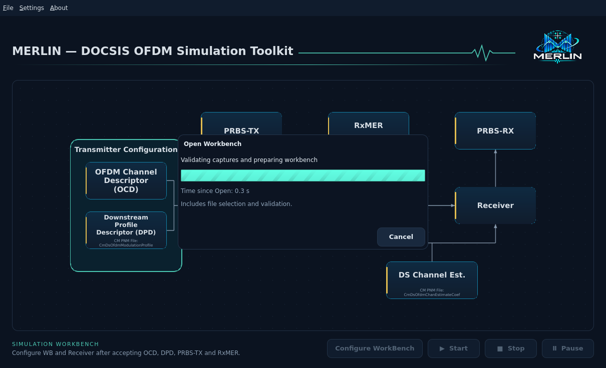

# Desktop debug controls

This is the maintained inventory of desktop diagnostics. Add an entry whenever
a debug switch, logging target or troubleshooting command is introduced or
changed. Normal operation keeps loading details concise; diagnostics are opt-in.

| Control | Behavior | Owner |
| --- | --- | --- |
| `scripts/qt-desktop.sh run` / `build` | Optimized release mode by default; not a logging switch. | `scripts/qt-desktop.sh` |
| `scripts/qt-desktop.sh run-debug` / `build-debug` | Explicit unoptimized development build; does not enable debug printing. | `scripts/qt-desktop.sh` |
| `--debug-ui` | Shows Time since Open in the loading dialog and enables desktop debug logs unless RUST_LOG overrides it. | `platform/startup.rs`, `platform/logging.rs`, `shell/WorkbenchLoadingDialog.qml` |
| `RUST_LOG=warn` | Default desktop logging: warnings and errors on stderr. | `platform/logging.rs` |
| `RUST_LOG=warn,merlin_qt::workbench::project_load=debug` | Workbench loading start, completion, cancellation and elapsed milliseconds. | `workbench/project_load.rs` |
| `RUST_LOG=warn,merlin_qt::bridge::rxmer_designer=debug` | Designer stage start/completion/cancellation with capture counts, no source arrays or paths. | `bridge/rxmer_designer.rs` |
| `RUST_LOG=off` | Suppresses application log records; UI errors and validation still apply. | Standard log backend |
| `--check-workbench FILE` | Validates a saved workbench without opening the desktop or running a simulation. | `main.rs`, `workbench/project_file.rs` |
| `--version`, `--help` | Prints identity or startup usage without needing a display. | `main.rs` |

Example from a configured VM desktop terminal:

```bash
cd /home/dev01/Projects/merlin &&
QT_QUICK_CONTROLS_STYLE=Fusion \
LD_LIBRARY_PATH=/home/dev01/Projects/PNM-Viewer-Toolkit/local/qt/6.8.3/gcc_64/lib${LD_LIBRARY_PATH:+:$LD_LIBRARY_PATH} \
./apps/qt/target/release/merlin-qt --debug-ui \
  --workbench examples/workbench/multi-rxmer-2/workbench.merlin.json \
  2>>merlin-debug.log
```

The application does not create log files itself. Shell redirection above
appends stderr to the chosen file. Workbench lifecycle records contain events
and timing, not capture bytes, source arrays or capture paths. Full validation
errors remain in the UI. Logs do not change accepted inputs or simulation results.

Time since Open is real elapsed time, including file selection for ordinary
Open, input reading and validation. It is not simulated duration, measured
completion percentage or an estimate of remaining time.

`--debug-ui` controls the diagnostic UI; RUST_LOG independently controls logging.
For example, `RUST_LOG=off` with `--debug-ui` keeps the timer visible without
application logs. Engine logging uses its existing module targets; see
[logging](logging.md). Qt platform/plugin diagnostics are separate from these
application records; see [Qt setup](qt.md).

Startup workbench usage, standard-input semantics and Save behavior are in the
[user guide](../user/workbench.md#open-a-workbench-from-the-command-line).
No automatic simulation starts from command-line Open.



Windows MSI diagnostics: run Windows Installer with `/L*V` as described in the
[Windows install guide](../user/install/windows.md). Disposable native CI retains
`dist/windows-installer-logs/` and the desktop byte-size report; no application
log file is silently created. The existing `--smoke-test` now leaves the window
open for 750 ms and suppresses startup update lookup for offline runtime checks.
It prints `MERLIN_QT_STYLE=Fusion` after selecting controls through Qt's startup
API. The Windows packaged smoke clears inherited `QT_QUICK_CONTROLS_STYLE` and
requires this marker so shell defaults cannot mask an installed-style failure.

Windows in-app update diagnostics: the helper retains
`%LOCALAPPDATA%\merlin\updates\last-install.log` and a bounded `last-result.json`.
The next startup consumes the result and displays it; `--restore-update` restores
the accepted WB from `%LOCALAPPDATA%\merlin\update-recovery`. The native helper
is embedded, has no user CLI, and does not change execution policy. Its ready/
commit files live only in per-attempt staging and are removed after installation.
A missing ready acknowledgement keeps the original process open. Native contracts
run with `scripts/windows/test-update.ps1` without downloading or installing.


## Session presentation admission probe

For development validation, `--session-presentation-probe
--session-presentation-image /absolute/fresh/path.png` runs the fixed bundled
probe against the actual native receiver Apply and FAQ actions. Use an ignored,
new output path; it captures the current dark desktop before releasing logical
presentation pressure, prints `MERLIN_SESSION_PRESENTATION_PROBE` with its result
and exits. Validation must require the successful JSON record and fresh image,
not just the process exit code. No arbitrary QML is loaded. The probe is opt-in;
normal startup creates no probe owner. Automatic update lookup is suppressed
for this offline check. It does not run a simulation or change scientific limits.
See the [SESSION evidence](features/unified-qt-workbench/validation.md#uiu-session-01-persistent-presentation-admission).

## Direction shell probe

`--direction-shell-probe --direction-shell-downstream-image /absolute/fresh/ds.png
--direction-shell-upstream-image /absolute/fresh/us.png` runs the fixed bundled
Main shell probe. Supply the existing single workbench with `--workbench` and
two distinct new ignored output paths. The probe opens the actual Configure,
Settings and About actions, switches the persistent tabs while idle and running,
pauses a real downstream run and switches again, rejects foreign controls/files,
captures both dark views
and stops its own worker through terminal acknowledgement. Normal startup does
not instantiate it; automatic update lookup is suppressed during the probe.
It changes only its loaded test session and writes the two requested images.
There is no arbitrary external QML loader or scientific implementation.

Require one successful `MERLIN_DIRECTION_SHELL_PROBE` JSON record and both fresh
images; process exit alone is insufficient evidence. The overall and phase
watchdogs are finite. Failed runs request cancellation only after this probe
started its own worker. Target-specific native execution, rather than source
parsing or fixture tests, establishes this acceptance evidence.

## Upstream configuration probe

`--upstream-configuration-probe --upstream-configuration-image
/absolute/fresh/receiver.png` runs the fixed bundled Main configuration probe.
Supply the existing single downstream workbench with `--workbench`. An external
native-input runner must respond to `MERLIN_UPSTREAM_PICKER cancel` and then
`MERLIN_UPSTREAM_PICKER load` using the application's real file chooser and a
valid upstream configuration document. The probe checks all seven editors'
Cancel, accepted Apply, rejected Apply and reopening, exact draft identities,
independent downstream state and tab switching. It does not start a simulation.

The fixture must use the existing 50 kHz upstream example with an explicit
synthetic unity Pre-Eq plan; it is not a measured capture. The probe captures the
accepted receiver's QML content to the requested fresh path. At
`MERLIN_UPSTREAM_CAPTURE ready`, the external runner can also capture the actual
Main window during the finite capture grace period. Label these two image scopes
separately. Require a successful `MERLIN_UPSTREAM_CONFIGURATION_PROBE` JSON
record, both native chooser responses and a fresh image; process exit alone is
insufficient. Phase and overall watchdogs are finite. Normal startup creates no
probe owner; automatic update lookup is suppressed for this offline check.
