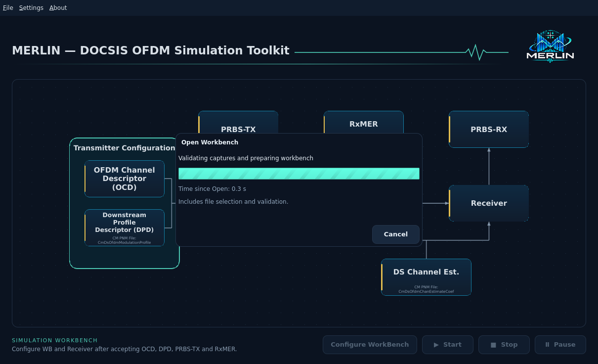

# Desktop debug controls

This is the maintained inventory of desktop diagnostics. Add an entry whenever
a debug switch, logging target or troubleshooting command is introduced or
changed. Normal operation keeps loading details concise; diagnostics are opt-in.

| Control | Behavior | Owner |
| --- | --- | --- |
| `--debug-ui` | Shows Time since Open in the loading dialog and enables desktop debug logs unless RUST_LOG overrides it. | `platform/startup.rs`, `platform/logging.rs`, `shell/WorkbenchLoadingDialog.qml` |
| `RUST_LOG=warn` | Default desktop logging: warnings and errors on stderr. | `platform/logging.rs` |
| `RUST_LOG=warn,merlin_qt::workbench::project_load=debug` | Workbench loading start, completion, cancellation and elapsed milliseconds. | `workbench/project_load.rs` |
| `RUST_LOG=warn,merlin_qt::bridge::rxmer_designer=debug` | Designer stage start/completion/cancellation with capture counts, no source arrays or paths. | `bridge/rxmer_designer.rs` |
| `RUST_LOG=off` | Suppresses application log records; UI errors and validation still apply. | Standard log backend |
| `--check-workbench FILE` | Validates a saved workbench without opening the desktop or running a simulation. | `main.rs`, `workbench/project_file.rs` |
| `--version`, `--help` | Prints identity or startup usage without needing a display. | `main.rs` |

Example from a configured VM desktop terminal:

```bash
cd /home/dev01/Projects/merlin &&
QT_QUICK_CONTROLS_STYLE=Fusion \
LD_LIBRARY_PATH=/home/dev01/Projects/PNM-Viewer-Toolkit/local/qt/6.8.3/gcc_64/lib${LD_LIBRARY_PATH:+:$LD_LIBRARY_PATH} \
./apps/qt/target/debug/merlin-qt --debug-ui \
  --workbench examples/workbench/multi-rxmer-2/workbench.merlin.json \
  2>>merlin-debug.log
```

The application does not create log files itself. Shell redirection above
appends stderr to the chosen file. Workbench lifecycle records contain events
and timing, not capture bytes, source arrays or capture paths. Full validation
errors remain in the UI. Logs do not change accepted inputs or simulation results.

Time since Open is real elapsed time, including file selection for ordinary
Open, input reading and validation. It is not simulated duration, measured
completion percentage or an estimate of remaining time.

`--debug-ui` controls the diagnostic UI; RUST_LOG independently controls logging.
For example, `RUST_LOG=off` with `--debug-ui` keeps the timer visible without
application logs. Engine logging uses its existing module targets; see
[logging](logging.md). Qt platform/plugin diagnostics are separate from these
application records; see [Qt setup](qt.md).

Startup workbench usage, standard-input semantics and Save behavior are in the
[user guide](../user/workbench.md#open-a-workbench-from-the-command-line).
No automatic simulation starts from command-line Open.



Windows MSI diagnostics: run Windows Installer with `/L*V` as described in the
[Windows install guide](../user/install/windows.md). Disposable native CI retains
`dist/windows-installer-logs/` and the desktop byte-size report; no application
log file is silently created. The existing `--smoke-test` now leaves the window
open for 750 ms and suppresses startup update lookup for offline runtime checks.
