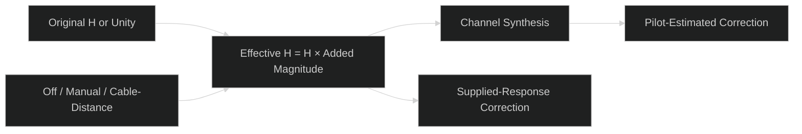

# WAVE-CH-TILT-01: Additional channel tilt and cable loss

Status: implemented and validated on the Ubuntu 22.04 x64 VM with Qt6.8.3.

The core `signal_processing::channel::additional_loss` module owns a typed
`AdditionalLoss` enum. `ChannelImpairments.additional_loss` defaults to Off for
existing JSON and callers using defaults. The planner composes this real positive
magnitude multiplier with measured H without rewriting capture bytes, provenance,
null values or the original frequency grid. Excluded physical bins stay unchanged.

Manual mode sets signed high-edge minus low-edge gain T, in dB, at the lowest
and highest active physical carrier centers. It anchors low-edge gain at zero:

\[
G(f)=T\frac{f-f_L}{f_H-f_L},\qquad H_\text{additional}(f)=10^{G(f)/20}.
\]

Cable-distance mode implements the accepted **full additional cable loss** decision:

\[
A(f)=a(f)L/(100\text{ ft}),\quad G(f)=-A(f),\quad
H_\text{additional}(f)=10^{-A(f)/20}.
\]

Length units are explicit feet or metres (1 ft = 0.3048 m). Low-edge insertion
loss is included; it is not normalized away. The pinned `belden1694a_v1` preset
uses nominal attenuation from [Belden 1694A](https://www.belden.com/products/cable/coax-triax-cable/75-ohm-coax-cable/1694a),
manufacturer revision 0.716, 2026-05-27, reviewed 2026-11-10. The source table
lists dB/100 ft by frequency separately from velocity factor. MERLIN uses
piecewise linear interpolation in frequency and dB between listed points over
1–3000 MHz. No extrapolation or substitution of VF-only echo presets occurs.
The manufacturer data is implementation evidence, not a DOCSIS normative model.

Application bounds: manual ±30 dB; cable 0–1000 ft / 0–304.8 m; additional loss
no greater than60 dB on any active bin. Invalid parameters, bands, source coverage
or unsupported sample-AWGN combinations fail before acceptance/run admission.
Off preserves the original path; zero manual slope/zero cable length give unity
additional magnitude. Only the existing noiseless/RxMER frequency-domain model
supports the additional response; no new sample-AWGN plus response mode is added.

## Noise and correction policy

Preserve the existing Y = H_effective (X + E) reference plane. RxMER fixes
post-equalization residual variance; additional cable loss does not silently
reduce RxMER or create a second noise source. Reference RX uses effective H;
pilot RX estimates the received pilots through its existing estimator. Playback
updates residual powers without resetting the composed response or RNG history.
Matched compensation can restore attenuation/tilt without worse BER. A separate
receiver-noise-floor/distance-to-SNR model remains future work.

This model adds no cable phase, group delay, echoes, ISI/ICI, continuous convolution
or calibrated RF power. Those are not implied by its cable-length control.

## Editor, state and persistence

`ChannelLossDialog.qml` presents Off, Manual Tilt and Cable / Distance. Rust
validates drafts and provides bounded additional/effective gain preview coordinates,
physical band and endpoint/tilt labels. QML draws those values. Apply validates
before publishing; X/Close discards drafts. Apply is disabled while a run is busy.
Accepted edits invalidate retained results and revalidate receiver readiness.

WB schema1 has an optional `channel_model` section with its own `schema_version:1`
and typed `additional_loss` parameters. Absence means Off, so older examples load
unchanged. Unknown versions, fields, cable presets and invalid parameters reject
atomically. Restoring all parameters does not fabricate compatible measurement
inputs; mismatches remain editable readiness errors. Original capture sections
are unchanged. Workers receive frozen typed settings, never live editor drafts.

## Validation

Independent tests cover manufacturer endpoints/interpolation, feet/metres,
full low-edge insertion loss, doubling/zero length, manual endpoints, finite bounds,
extrapolation rejection and serialization. Actual waveform checks cover added loss
without imported H and tilt composed with measured complex H, payload recovery,
preserved source response and fixed post-EQ RxMER. Adapter tests cover legacy Off,
version rejection and save/restore through real example workbenches. Final native
checks and counts are recorded after the build.

See the [user guide](../../../user/impairments/additional-loss.md).

## Completed validation

- Targeted core tests: 14 passed (additional-loss, waveform impairments and
  measurement playback); formatting and scoped Clippy passed.
- Qt adapter tests: 23 passed; QML navigation checks: 28 passed. Qt formatting,
  Clippy and native executable build passed using retained build artifacts.
- Native dark staging/loss/QAM layouts inspected on the VM. An actual run with
  100 ft of additional cable completed with 1,223,952 compared bits and0 errors.
  For the example 640–826.975 MHz band, the preview shows −4.94 / −5.68 dB
  additional edge gains and −0.73 dB tilt.
- Native Open and Save As preserved a100 ft cable model and original measurement
  sections in a self-contained workbench file.
- User guide screenshots and relative links updated; diff whitespace checked.
  Other Ubuntu versions and installed-package behavior were not exercised here.

## Absolute power follow-up

[RF-POWER-01](../rf-power-budget/design.md) records the missing TX launch level,
CM input budget and receiver noise/front-end model. A1000 ft relative-loss run
cannot establish acceptable absolute input power. The user's ±12 dBmV target
requires a6 MHz equivalent reference; total integrated channel power is separate.
