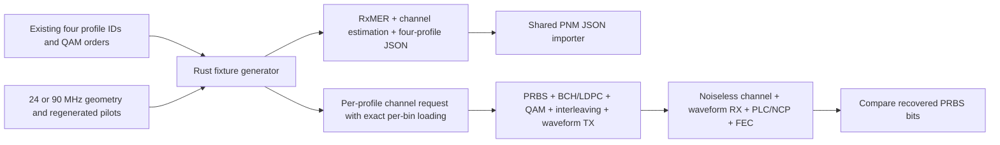

# Synthetic minimum and mid-width validation

## Design

Exercise occupied widths of 24 MHz and 90 MHz without requiring another field
capture. Keep all synthesis in the Rust example `prepare_channel_widths`, with
geometry and pilot placement delegated to existing transmission modules.
Source profile IDs/data QAM orders come from the existing single-channel JSON.
The generated datasets are explicitly synthetic; flat 48 dB RxMER, unity complex
channel correction and aligned synthetic epochs avoid accidental measurement claims.
Keep decoder ancillary bandwidth/analysis fields absent rather than copying stale
wide-channel calculations. Provenance records occupied versus active widths.

Minimum width is from pinned PHY3.1 I20 section 7.3.1/Table 6, pp.47–48.
Section 7.5.9 distinguishes occupied bandwidth from encompassed spectrum.
A selected 1 MHz allowance at each edge gives 22/88 MHz active envelopes;
with 25 kHz spacing these contain 880/3520 indexed carriers including controls.
The sampling clock/8192 FFT stay fixed; carriers outside the envelope are zero.

## Scope and validation

- Import all three JSON types at both widths; retain four IDs and exact coverage.
- Compare committed fixtures against deterministic regeneration.
- Verify each QAM loading matches the imported profile at every data carrier.
- Run all eight width/profile combinations through actual samples and FEC;
  require positive tested bit counts, finished state and zero post-FEC errors.
- Exercise actual CLI import and channel commands for both widths/all profiles.
- Reject bandwidths below minimum, above maximum and off the 6 MHz step.

Measured selection remains Profile A only. Other captured profiles are exercised
through the existing public per-bin loading path and announced internally as A.
No production selector restriction is silently removed. No new acquisition or
external-interoperability checklist item is marked complete by these synthetic tests.

See [example commands and inputs](../../../../examples/measurements/channel-widths/README.md).

## Local evidence

Host: Ubuntu22.04 x64, pinned Rust1.85.1. The focused Rust width tests passed
all eight width/profile combinations with positive compared bits and zero errors.
The actual CLI import/channel test passed all eight one-millisecond runs, with
positive compared bits and zero errors. Workspace Clippy with warnings denied,
formatting, analysis-only tests, the complete workspace test suite and
changed-document path checks passed. Native Windows/macOS execution and external
interoperability evidence are outside this validation.
