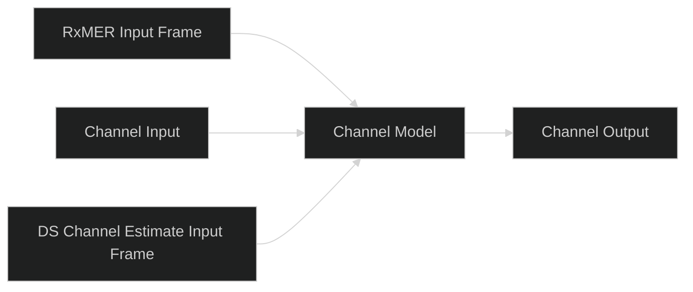

# UI-CH-01: Basic Channel Simulator staging

Status: implemented and validated on the Ubuntu 22.04 x64 VM with Qt6.8.3.

The separate `ChannelWorkbenchDialog.qml` uses shared chip, connector and dialog
components already adapted into MERLIN from the authorized Qt framework. No
additional upstream UI code is copied. The main execution/readiness rules remain.

RxMER and DS Channel Estimate open their existing measurement input frames
directly. Both feed the combined Channel Model, which offers accepted-state
summaries and a separate Additional Loss editor. There is no separate SA block.

Input/output open `ChannelInstrumentDialog.qml` with Spectrum or QAM choices:

| Boundary | Spectrum | QAM |
| --- | --- | --- |
| Channel Input | Retained TX overlap-add samples | Actual retained physical FFT bins, with inclusive bin filters and original symbol/frequency coordinates |
| Channel Output | Retained Channel Output / RX Input samples | Shared receiver QAM, locked to raw FFT before equalization; received Data/NCP/PLC/pilot selectors and bin/symbol filters |

Input QAM retains one TX physical symbol, not a historical source-symbol browser.
It does not infer Data/NCP labels from point positions; physical-bin points have
neutral coloring. Output roles come from the existing receiver observations.
Neither route substitutes ideal TX points for missing received data. Empty and
invalid selections show unavailable results. Result-token changes refresh open
instruments; accepted edits invalidate old results through the existing run path.

Each new popup lives in its own QML file, with shared X and footer Close controls.
`ChannelLossDialog.qml` applies through the existing measurement adapter and the
[WAVE-CH-TILT-01 model](../channel-tilt/design.md). The main Start/Stop/Pause owns
execution; opening a stage does not run the channel independently. Channel Model
still represents the symbol-diagonal combined response/residual, not a new
sample-domain sequence of channel effects.

## Validation

Scoped QML tests cover stage navigation, input SA/output raw QAM routes, hidden
output equalized selector, model draft cancellation and Apply. Adapter tests cover
real retained input bins, bounded selectors, original I/Q and unavailable ranges.
The existing full-loop adapter check exercises receiver output data. Native dark
captures and validation counts are recorded after the final build.

## Visuals

[Native channel staging](../../../images/workbench/channel-inputs-ready-dark.png)
and [loss editor](../../../images/workbench/channel-loss-dark.png) show the actual
application. The earlier [proposed PNG](../../../images/workbench/channel-workbench-proposal-dark.png)
and [SVG](../../../images/workbench/channel-workbench-proposal-dark.svg) remain
explicitly labeled design mockups, not runtime evidence.

## Completed validation

- Targeted core tests: 14 passed (additional-loss, waveform impairments and
  measurement playback); formatting and scoped Clippy passed.
- Qt adapter tests: 23 passed; QML navigation checks: 28 passed. Qt formatting,
  Clippy and native executable build passed using retained build artifacts.
- Native dark staging/loss/QAM layouts inspected on the VM. An actual run with
  100 ft of additional cable completed with 1,223,952 compared bits and0 errors.
  For the example 640–826.975 MHz band, the preview shows −4.94 / −5.68 dB
  additional edge gains and −0.73 dB tilt.
- Native Open and Save As preserved a100 ft cable model and original measurement
  sections in a self-contained workbench file.
- User guide screenshots and relative links updated; diff whitespace checked.
  Other Ubuntu versions and installed-package behavior were not exercised here.

UI-RF-01 subsequently extends this basic workspace with clickable amplifier and
attenuator symbols, inline TP selectors, shared raw QAM, calculated Channel Power,
optional calibration/noise and versioned WB persistence. Current runtime captures
and instructions are in the [channel guide](../../../user/channel-measurements.md#launch-amplifier-attenuator-and-tappoints);
see the [implementation record](../rf-power-budget/design.md).

## UI-CH-ICON-01 — Graphical instrument choices

Use one reusable graphical tile for spectrum and constellation choices, with
matching dimensions, icons above one-line labels, balanced spacing and keyboard
focus. All Channel Input/Output and before/after-amplifier TapPoints use the same
chooser, preserving their actual instrument data routes. The icons are navigation
symbols, not measured previews. No new samples, settings or computations.
QML owns this presentation in `instruments/selection/InstrumentChoice.qml`;
validate all existing tap routes plus layout, keyboard access, both palettes and
a native screenshot. Existing live transmitter preview cards remain live graphs.

Validation: 53 QML checks pass, including current labels, compact table values,
bounded widths and instrument keyboard routing. The native build passes. Actual
Ubuntu dark screenshots confirm the updated layout; the transmitter cards also
retain light-theme verification. Earlier in this same change, Qt formatting,
Clippy and all 54 Rust adapter tests passed. No simulation or persisted settings
were changed; installed packages and other platforms were not exercised.

### Graph-card icon refinement — 2026-11-11

Use the supplied transmitter spectrum-card visual for instrument selection:
rounded themed card, one-line analyzer title above the framed graph, flat-topped
OFDM spectrum glyph and a matching constellation card. Omit TX Output and other
signal-boundary captions; the chooser title already identifies the selected tap.
Keep both glyphs illustrative navigation symbols, with existing data routing.

Refinement validation: all 53 QML checks and the native build pass. Reviewed
the actual native dark chooser and updated the channel guide screenshot.

## UI-CH-02 / WAVE-CH-COMPOSE-01: Graphic model controls and composition

Implement the approved two-card layout: Tilt / Cable Loss and Echo / Delay feed
a bounded Combined Channel Response preview. Remove duplicate RxMER and DS
channel-estimate controls from this configuration dialog; keep their existing
workbench blocks. Cards open existing draft editors, preserving Apply/Cancel,
keyboard access and accepted settings. Combined preview is accepted configuration,
not a retained received measurement, and works before Start when DPD is present.

Shared Rust `channel/composition` prepares admission, execution and previews.
For synthetic echoes, apply diagonal magnitude loss and scalar conditioning once
before stateful convolution; total H = H_loss * H_echo. This engineering model
adds no new normative DOCSIS behavior and does not convert magnitude-only cable
loss into a measured phase or propagation delay. Keep sample-AWGN restrictions,
imported-H/echo exclusivity, captured-FIR fit checks and finite tail bounds.
Preserve the RxMER residual reference plane before total channel response.

Test analytic complex frequency products, actual chunked waveform samples,
reference/MCE payload recovery, unchanged default paths, preview consistency,
invalid combinations and settings persistence. Run full Rust validation and Qt
checks; inspect actual dark native views and refresh linked user guides.

### UI-CH-02 / WAVE-CH-COMPOSE-01 validation

Implemented and locally verified on Ubuntu22.04 x64, Rust1.85.1 and Qt6.8.3.
Full validation passes: 382 workspace tests (236.261s nextest execution), 4 example
tests, 132 analysis-only tests, doctests, formatting and warnings-denied Clippy.
Qt check passes 67 adapter tests, 58 QML checks, Clippy and the native build.
New tests independently anchor manual/cable attenuation and complex echo response,
check real raw FFT samples against TX-reference products, and recover original
payloads with reference/MCE correction. The scalar gain is applied exactly once.
Preview tests cover bounded data, original imported-H rejection with known-code
help, and unavailable DPD without guessed advice. UI tests exercise equal cards,
mouse/keyboard entry, expanded plotting and draft Cancel/Apply.

Actual native dark captures verify both cards, editors and expanded graph. A
separate native cable100ft/echo8samples/RxMER/MCE run completes23 observation
symbols and1,223,952 globally compared payload bits with zero errors. These totals
include completion/drain, not just the observation window. Source WB/capture bytes
remain untouched; the experiment uses an ignored local clone. This is MERLIN
closed-loop evidence, not external modem or other-platform validation.

Original sample-AWGN restrictions, imported-H/echo exclusivity, static-filter
policy, fit tolerances and echo memory bounds remain enforced. No calibrated
cable phase, inferred physical delay or automatic additional noise is introduced.
