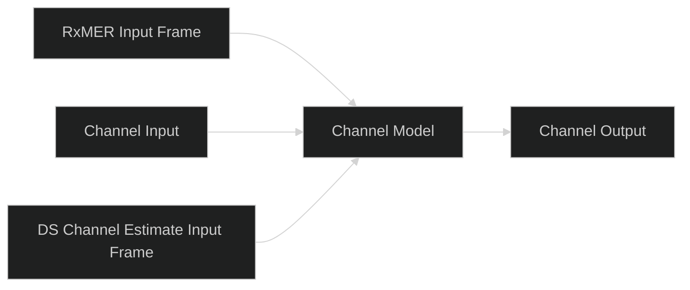

# UI-CH-01: Basic Channel Simulator staging

Status: implemented and validated on the Ubuntu 22.04 x64 VM with Qt6.8.3.

The separate `ChannelWorkbenchDialog.qml` uses shared chip, connector and dialog
components already adapted into MERLIN from the authorized Qt framework. No
additional upstream UI code is copied. The main execution/readiness rules remain.

RxMER and DS Channel Estimate open their existing measurement input frames
directly. Both feed the combined Channel Model, which offers accepted-state
summaries and a separate Additional Loss editor. There is no separate SA block.

Input/output open `ChannelInstrumentDialog.qml` with Spectrum or QAM choices:

| Boundary | Spectrum | QAM |
| --- | --- | --- |
| Channel Input | Retained TX overlap-add samples | Actual retained physical FFT bins, with inclusive bin filters and original symbol/frequency coordinates |
| Channel Output | Retained Channel Output / RX Input samples | Shared receiver QAM, locked to raw FFT before equalization; received Data/NCP/PLC/pilot selectors and bin/symbol filters |

Input QAM retains one TX physical symbol, not a historical source-symbol browser.
It does not infer Data/NCP labels from point positions; physical-bin points have
neutral coloring. Output roles come from the existing receiver observations.
Neither route substitutes ideal TX points for missing received data. Empty and
invalid selections show unavailable results. Result-token changes refresh open
instruments; accepted edits invalidate old results through the existing run path.

Each new popup lives in its own QML file, with shared X and footer Close controls.
`ChannelLossDialog.qml` applies through the existing measurement adapter and the
[WAVE-CH-TILT-01 model](../channel-tilt/design.md). The main Start/Stop/Pause owns
execution; opening a stage does not run the channel independently. Channel Model
still represents the symbol-diagonal combined response/residual, not a new
sample-domain sequence of channel effects.

## Validation

Scoped QML tests cover stage navigation, input SA/output raw QAM routes, hidden
output equalized selector, model draft cancellation and Apply. Adapter tests cover
real retained input bins, bounded selectors, original I/Q and unavailable ranges.
The existing full-loop adapter check exercises receiver output data. Native dark
captures and validation counts are recorded after the final build.

## Visuals

[Native channel staging](../../../images/workbench/channel-inputs-ready-dark.png)
and [loss editor](../../../images/workbench/channel-loss-dark.png) show the actual
application. The earlier [proposed PNG](../../../images/workbench/channel-workbench-proposal-dark.png)
and [SVG](../../../images/workbench/channel-workbench-proposal-dark.svg) remain
explicitly labeled design mockups, not runtime evidence.

## Completed validation

- Targeted core tests: 14 passed (additional-loss, waveform impairments and
  measurement playback); formatting and scoped Clippy passed.
- Qt adapter tests: 23 passed; QML navigation checks: 28 passed. Qt formatting,
  Clippy and native executable build passed using retained build artifacts.
- Native dark staging/loss/QAM layouts inspected on the VM. An actual run with
  100 ft of additional cable completed with 1,223,952 compared bits and0 errors.
  For the example 640–826.975 MHz band, the preview shows −4.94 / −5.68 dB
  additional edge gains and −0.73 dB tilt.
- Native Open and Save As preserved a100 ft cable model and original measurement
  sections in a self-contained workbench file.
- User guide screenshots and relative links updated; diff whitespace checked.
  Other Ubuntu versions and installed-package behavior were not exercised here.
