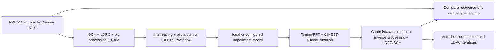

# MERLIN closed-loop minimum acceptance

## Scope decision — 2026-11-09

MERLIN's minimum downstream engine is a self-contained, single-channel simulator.
The user explicitly clarified that another DOCSIS implementation is not needed.
Acceptance uses MERLIN TX, the selected channel model, MERLIN RX and comparison
against the original source. External instrument/CMTS/reference-tool vectors are
outside this minimum scope. This replaces the former external-data blockers for
QAM-04 and QA-05; it does not claim those external comparisons were performed.

The expected payload comes from the original source, never reconstructed from RX
output. Decoder flags, corrected/error counts and source comparison remain separate.
In an ideal/noiseless case require positive compared bits and zero errors; in an
impaired case retain actual convergence/failure and bit errors. Incomplete, cancelled
or failed runs must not be reported as a completed zero-error experiment.

## Minimum task closure

| Task | Acceptance and existing evidence |
| --- | --- |
| WAVE-RX-05 | Bounded bootstrap numerology/integer/fractional CFO acquisition, pilots, reflected paths, chunk invariance and coded-block recovery; [receiver validation](../receiver-acquisition/validation.md) |
| QAM-04 | Source-table label/scale preservation, uniform/full/shortened/mixed transport, zero loading and actual inverse/FEC recovery; [QAM validation](../qam-completion/validation.md) |
| QA-05 | End-to-end closed-loop source/control/payload comparisons, impairments, explicit partial outcomes, API/CLI consistency and full local regressions; [acceptance evidence](validation.md) |

These three items are complete for their documented supported configurations.
This is a scope clarification backed by already passing tests, not a new decoder
implementation or a report of tests against another product. The APIs retain
finite search/work limits; acquired bootstrap reception and synchronized duration
jobs have separate documented entry points. No unsupported full cross-product of
all settings is implied by the separate test matrices.

## Later work

Windows/macOS execution, installer lifecycle/release automation, Qt, Python,
OFDMA and multiple channels remain separate tasks. External interoperability
references are optional future work if the user requests that scope. Retain their
existing plans and admission tool without making them minimum acceptance gates.
