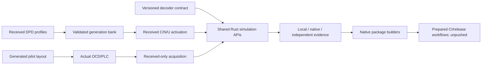

# Remaining downstream core and delivery group

Status: implementation and local validation; external/native execution gaps remain. QAM-04 is excluded at the user's request. Workflow files
will be prepared locally; no Git commit, push, publication or remote CI execution
is authorized. Preserve the pending cell/QAM-symbol terminology documentation.

## NCP-03: dynamic profile signaling

Use local PHY I20 §8.3.4.1 Table53, PDF180–182: C/N select the DPD generation's
LSB; U announces an NCP change using the exact128-symbol MSB-first pattern
BCB240898BAD833539ED0ABE946E3F85. Separate validated received profile-bank state,
TX announcement scheduling, RX transition recognition and data codeword state.
Configurations come from received DPD packets and stable OCD identity, never TX
profile objects. Preserve codeword and randomizer/interleaver continuity. Reject
unknown generations, CRC failures and unannounced NCP changes atomically.
Do not close the task from a standalone flag setter without payload integration.

## LAYOUT-03: additional continuous-pilot generator

Use PHY I20 §7.5.15.2.2, PDF169–171: count clamped8..120 with M48..120;
merge eligible spectrum excluding the PLC6MHz neighborhood and explicit bad
locations, choose mid-quantile frequencies, restore physical coordinates, move
from spectral edges, cover isolated regions, cap total and disturb periodicity.
Return a typed plan and a new validated layout without modifying caller input.
Keep the eight predefined PLC pilots separate. Reuse normal OCD serialization.

## WAVE-RX-05: nonideal receiver acquisition

Extend bounded received-only CP acquisition with fractional CFO estimation and
correction, then discover the scattered-pilot/PLC symbol phase from independent
continuous-pilot estimates. Test noisy samples, smooth complex channel response,
unknown offset/phase and invalid/ambiguous observations. Keep engineering bounds
explicit; do not claim arbitrary carrier/numerology discovery or complete field
receiver equivalence from synthetic tests. Retain parent gaps where not verified.

## INPUT-02: decoder JSON compatibility

Pin the local pnm-decode producer version and its actual JSON fields. Define an
explicit decoder-contract revision, supported producer versions and additive-field
policy. Preserve existing legacy imports explicitly; add strict versioned admission
through the same Rust importer and CLI. Keep file-format versions distinct from
producer/contract versions, original JSON hashes/nulls/grids and schema rejection.
Tests need real decoder fixture exports plus malformed/drifted contract cases.

## QA-05: independent full-channel validation

External known-truth channel vectors are an input dependency, not output that
MERLIN can manufacture. Add bounded manifest/admission and comparison tooling
with provenance/hash/units/configuration requirements. Document missing artifacts
and distinguish published control-code checks, transcribed arithmetic, local
simulation and independently produced channel vectors. Keep QA-05 open without
actual independent evidence. QAM-04 remains untouched/excluded.

## QA-06: native checks

Prepare Linux/Windows/macOS native workflows with a mandatory lean core preflight,
fail-fast disabled, pinned Rust, cache keys and full science tests on native
runners. Test CLI success/failure and process/file semantics on each platform.
No Qt or Python runtime dependency belongs in the engine. Local checks establish
Linux evidence only. Remote results remain pending until the user pushes later.

## QA-07: packaging and release automation

VERSION remains canonical. Package the CLI and documentation/examples with
checksums and licenses using focused tools; prepare native package builders and
tag-triggered release workflow that consumes successful test outputs. Preserve
no-clobber output behavior and archive path safety. No GUI installer, version bump,
tag or publication is performed now. Test the Linux artifact and generated layouts;
leave other native execution pending with explicit install/uninstall instructions.

## Component boundaries and validation

Every numerical algorithm remains safe Rust. APIs accept typed data, not filesystem
paths, Qt or Python objects. Tooling owns files/archives/manifests only. New stage
outputs are direct test points unless registered observation/export is explicitly
implemented and tested. Run focused tests before the full gate; validate links,
workflow syntax and native package contents, retaining honest unchecked statuses.

## Implemented boundaries

- NCP-03: data profiles0..15, two admitted parity slots per profile, positive uniform
  NCP generations, real PLC update routing and source-order full-word payload
  transport. No implicit same-parity replacement, dynamic shortened words or OPT.
  The duration CLI is unchanged. Actual C/N/U fields are test points, not merely
  a scheduling flag; tests exercise crossing words through continuous cell state.
- LAYOUT-03: generated settings share geometry validation and existing OCD inputs.
  Predefined pilots count for isolated-region coverage; edge-excluded envelope bins
  do not inflate the density span. Exact repeating gap patterns are checked after
  jitter and disturbed within the same allowed region, or rejected if impossible.
- WAVE-RX-05: known numerology/layout, bounded sample-offset search and unaliased
  fractional CFO. Continuous pilots fit H while scattered pilots are held out for
  phase selection. Recovered phase is not an absolute frame epoch. Synthetic noisy
  smooth-channel tests establish this model, not unrestricted acquisition. Keep
  the broader WAVE-RX-05 parent unchecked until its remaining scope is verified.
- INPUT-02: request schema2 requires explicit decoder contract revision1 and producer
  pnm-decode0.3.6. Legacy schema1/import remains explicit. Scenario schema and
  exact-byte hashes are unchanged; the request retains the producer declaration.
- QA-05: file/provenance admission only. An independent dataset and its Rust replay
  comparison remain missing; never mark admitted_unexecuted as interoperability.
- QA-06/07: local workflows, smoke tests and native CLI package builders. Local
  Linux archive/DEB generation can be tested without installing. Remote native
  execution, package lifecycles and publication stay unchecked until run later.

Implementation evidence and final test results: [validation](validation.md).
