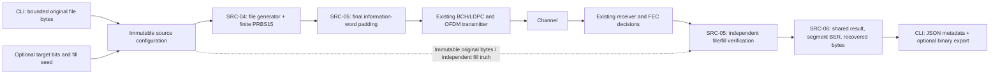

# SRC-04..06 design: file payloads and optional PRBS15 fill

Status: implemented and validated in Rust and CLI. The Qt Source panel remains
planned. This record explains the implemented choices; the
[implementation report](implementation.md) records tests and measured outcomes.

## SRC-04: exact-byte source

`simulation/source/file/config.rs` owns validated immutable original bytes and
optional fill policy. Reference-counted storage shares the original input across
configuration, generation and truth without sharing mutable state. Neither raw
bytes nor filesystem paths enter serialized simulation settings/results.

`file/generator.rs` owns the source cursor. File bytes are emitted MSB-first;
text and binary inputs use the same path, preserving BOM, line endings, zeros and
invalid UTF-8. Optional PRBS15 starts at the first bit after the original file
using its own declared seed and continues across codeword boundaries. It never
shares noise state or replaces PHY data randomization.

Each call emits at most one14232-bit BCH information payload. EOF stops new word
generation; it does not stop control/idle symbols or reset the channel stages.
The existing `source.payload` probe observes the emitted information word,
including its explicitly accounted padding tail. See the
[generation design and equations](../../../user/simulation/file-source/generation.md).

## SRC-05: meaningful lengths, padding and independent verification

The source has three distinct segments: original file, optional appended PRBS15,
and final information-word padding. Only the first two contribute meaningful
bits. Zero padding fills the final BCH information payload; this adds no new PHY
shortening mode and remains separate from coded last-cell padding.

`file/verification.rs` compares actual post-FEC decisions against immutable file
truth and a separately owned fill verifier. It never changes decoder decisions
or substitutes expected bytes on failure. Separate file/fill counters retain
actual errors, BER and first-error offsets. Recovered output contains original
bytes only; partial jobs retain the recovered whole-byte prefix.

The channel runner selects the source through `source/selection.rs`, breaks its
enqueue loop at finite EOF, and uses the existing completion/interleaver drain.
Duration completion and full-file completion remain distinct. Source-generated,
file-compared and total-compared flags explicitly describe partial work. See
[verification design and equations](../../../user/simulation/file-source/verification.md).

## SRC-06: reusable configuration, CLI and validation

Core APIs consume immutable bytes without paths. The CLI's focused `source_io/`
adapter loads a bounded regular file and exports recovered bytes with create-new
semantics; generation, fill, verification and result calculations stay in Rust
source modules. `--payload-file` selects original bytes, while the JSON request
selects file mode and optional fill. `--recovered-file` is an optional separate
output. Existing PRBS-only callers retain their default behavior.

Application bounds are16MiB original input and134,217,728 total meaningful bits.
These are resource policies, not DOCSIS file-size requirements. Empty input and
equal-to-file fill targets are allowed; smaller/excessive targets and invalid
fill seeds reject before simulation work. Automatic minimum/alignment or a target
inferred from channel/profile/duration is deferred. Qt selection/editing remains
under UI-02 and must consume these same Rust decisions.

Ten new tests cover byte order/preservation, independent PRBS recurrence,
segment errors, padding exclusion, EOF/bounds/rejection, both waveform spacings,
short-duration/cancelled runs, observation invariance, actual CLI/core agreement
and non-overwriting outputs. The pre-push gate includes a release byte-for-byte
file round trip. Full validation and the97-byte/20,000-bit demonstration are
recorded in the [implementation report](implementation.md).
