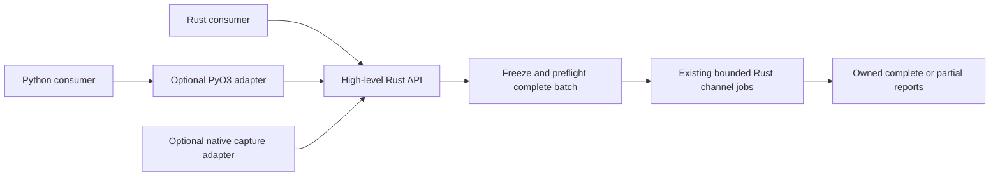

# API-RUST-01 / API-PY-01: Canonical high-level simulation API

Implement the handoff requirements in dependency order: checked Rust inputs and
OCD, independent collections and static selections, complete batch preflight,
existing bounded channel jobs and owned scoped reports, then optional Python.
The original six-document handoff is extracted without overwrites under ignored
`docs/development/local/api-handoff/`. The supplied ZIP remains untouched.
Requirements govern behavior; the baseline commit does not replace current HEAD.

The Apache core owns `crates/ofdm/src/api/`. A separate Apache `pnm-input`
adapter calls pinned Apache `pnm` 0.3.6 directly; GPL Qt orchestration is not
copied. A separate PyO3 adapter delegates all validation/science to this high-level API.
Core and CLI have no Qt/Python dependency. Existing low-level APIs remain.

Loading retains original bytes and separate decoded provenance and never runs
simulation. Controller IDs are scoped and opaque. Each run prepares the complete
batch before dispatch, with fresh PRBS15 and noise seeds per experiment. Static
average/interpolation uses residual power and exact original grids, never a
synthetic playback clock. Cancellation stops dispatch and preserves partial and
not-started entries. Window FEC and profile metrics share scope; whole-run
statistics are separately labeled.

Imported decoder profiles establish grid/roles but do not establish occupied
bandwidth: derive it only when the full captured span fits exactly one supported
width; otherwise require an explicit bandwidth unless typed input establishes it.
Never treat data-carrier span as occupied bandwidth. CP/RP/depth defaults are
512/128/16, marked as application assumptions. Profile timestamp tolerance is
independent of explicit channel reuse. Input and report objects are immutable.

Validation follows REQ-080..088 and REQ-114..116: fixture-backed binary/JSON
imports, selection/power/null/grid/time/scoped-ID boundaries, defaults/overrides,
engine parity, cancellation/runtime/ownership, then Rust/Python parity and local
wheel installation. Keep platform evidence and remaining gaps explicit.

## Status and evidence

The Rust API and optional Python adapter are implemented. The Rust repository
runner passed before Python implementation began. Final checks cover the renamed
`pnm-input` crate and the installed, patched Python wheel. See the
[validation record](validation.md) for executed commands, counts, durations,
artifact integrity and platform boundaries.

Current HEAD at implementation start matched the reference baseline:
`3f23be1b3f9848dab73cf27239f3f2ed8409559e`. No reset/downgrade was performed.
Handoff ZIP SHA-256:
`7b65187c77282ad8c033e6b4219ac212ae16cf4f89f718d6b8e4c7ca9ca73652`.
The pinned decoder's Cargo manifest and parser source declare Apache-2.0.
Binary/JSON fixture pairs for all three capture kinds passed native imports.

An initial full build exhausted disk capacity and was interrupted; that attempt
is not validation evidence. Cargo removed stale core development outputs
(31.8 GiB) and, following user cleanup authorization, old release outputs
(577.5 MiB). Qt outputs, captures, toolchains and dependency caches were preserved.
The restarted Rust runner passed in 15 min 48 s before Python work began.

## API-PY-01: optional native adapter

`bindings/python` is a separate optional Cargo workspace and maturin package.
Python unit wrappers convert through checked Rust constructors. Inputs remain
immutable and controllers take copied request snapshots. Native report views
retain Arc-owned batches independently of controller lifetime. Defensive JSON
dictionaries are transport snapshots, not mutable scientific state.

A native worker calls `Merlin::run_with_control`; the waiting interpreter releases
its lock and polls signals. Ctrl-C cancels cooperatively and returns partial
science. Other controller accesses receive Busy. RunLimits request clones share
request state for normal nested edits; acceptance/report getters create separate
Rust snapshots. There are no Python algorithms or CLI subprocesses.

The first PyO3 0.27.2 build passed functional tests but audit identified
RUSTSEC-2026-0176/0177. It was replaced by pinned PyO3 0.30.1 (MSRV 1.85), with
explicit `from_py_object` clone conversion at the language boundary. No advisory
suppression is used. Delivery validation uses the patched wheel; the earlier local build is not
a delivery artifact. Native wheels include the existing notice collector's complete
locked graph, project NOTICE and embedded QAM/BCH licenses.

## API-RUST-01 capture loader naming

The optional capture-loading crate is named `pnm-input` under
`crates/pnm-input`; Rust imports use `pnm_input`. It retains binary/JSON
decoding, bounded file access and provenance responsibilities. The high-level
API remains in `docsis_ofdm_fec::api`. This naming change preserves behavior.

## API-EXAMPLES-01: central Rust and Python examples

Keep runnable API source under `examples/api/rust` and `examples/api/python`,
indexed from `examples/README.md`. Cargo registers the Rust files as
`pnm-input` example targets; Python calls the installed native extension. Move
the existing examples rather than maintaining copies. Both workflows retain
the shared measurement/workbench fixtures and explicit `run()` boundary. The
Rust policy example also provides the reference generator for parity tests.
Check Cargo example targets, run both language workflows, and validate links.

Validation: Cargo checked both relocated Rust example targets; the Rust and
installed native Python `high_level` workflows completed successfully from
the new locations. Rustfmt, changed-document links and `git diff --check`
passed. No simulation code or fixture bytes changed.

## API-INTEGRATION-01: downstream Python installation

Document consuming the native wheel from another Python project, with separate
package/import names, exact version/asset pins, optional dependency resolution,
source-tag builds and current unpublished status. Keep all instructions in
MERLIN. Validate the concrete local pinned-wheel install in
a fresh project-local environment. Published URLs, registry availability and
cross-platform wheels remain future delivery work until verified.

Validation: a fresh local `api-consumer` environment installed the exact
`merlin-ofdm==0.2.9` wheel using offline binary-only wheelhouse resolution.
Import and distribution-version checks passed. Document links and diff
whitespace checks passed; no external project files or release assets were changed.

## API-INTEGRATION-02: mandatory push-time guide refresh

Generate the downstream installation guide from a tracked template and validated
VERSION/Python metadata using a separate `tools/python/update_integration_doc.py`
script. Save and branch-push helpers invoke it; release bumps refresh and include
the guide in the validated release commit. Existing-tag retries check without
changing their immutable commit. Dry runs check without writing. Exact interrupted
bump recovery includes the generated guide, rejects tampering/unrelated changes,
and reconstructs expected content from committed template/metadata. Generation
is deterministic and does not invent published assets, hashes or platform tests.
Branch refreshes that change a clean checkout stop for review/commit; no hidden
branch commits or weakened guards. Test with temporary checkouts/local origins.

Validation: 55 Git helper tests passed in 29.134s using disposable checkouts
and local-only origins; four generator tests passed in 0.016s. Coverage
includes release-commit inclusion, save-time inclusion, ordinary/docs-only
push invocation, stale/error failure, dry-run/tag immutability, exact resume
and altered-guide rejection. No real checkout commit/tag/push was executed.
No archive files were tracked; ignore checks cover supplied ZIPs, compressed
tar files, wheels and 7z files without deleting local inputs.

Final follow-up verification after the template naming/documentation changes:
55 Git workflow tests passed in 27.198s, four generator tests in 0.032s and
five release/version tests in 0.242s. ShellCheck, syntax, generated-doc checks,
665 Markdown relative links, skill validation and diff checks passed.

## API-EXAMPLES-02: developer walkthrough comments

Add filename headers and detailed numbered explanations to both `high_level`
examples. Explain native Rust ownership, fixture paths, profile/OCD setup,
independent measurements and scoped IDs, units/tolerances, the explicit run
boundary, optional scoped reports and primitive output conversions. Move
numeric configuration and fixture paths into named constants at the top,
with explicit units and fixture-specific explanations. Preserve the executable
workflow; verify syntax/formatting and constant-substitution equivalence. No
engine or binding change is required.

Validation: Rust example check passed in 0.27s; the installed Python example
completed with 82 codewords, zero corrected/uncorrectable and BER 0. Python
AST and Rust executable-token comparisons against HEAD matched after resolving
the named constants and removing documentation/optional trailing commas.
Rustfmt and diff whitespace checks passed. The architecture was reviewed;
no engine ownership or behavior changed.

## API-EXAMPLES-03: channel-193 Python collection example

Update the Python high-level walkthrough to consume the 132 RxMER binaries and
companion DPD in examples/workbench/multi-rxmer-2. Select Profile A, 192 MHz,
AverageAll in Rust residual power, explicit unity H, 7200-second DPD tolerance
and 1 ms observation with a 300-second execution bound. Retain named constants,
numbered explanations and actual FEC/BER reporting. Loading stays separate from
run. At this stage pilot-estimated receiver selection was not exposed;
API-RECEIVER-01 below subsequently adds it and matches the curated WB.
Do not parse desktop WB JSON in Python. Keep the Rust
single-capture example unchanged and explain the differing inputs in the index.
Validate by executing the installed native Python extension on these originals;
no engine/binding changes or wheel rebuild are needed.

Validation: the installed Ubuntu x86_64 / CPython 3.10 native extension loaded
all 132 original RxMER binaries and the companion DPD. The explicit run returned
Complete with 83 codewords, 0 corrected, 0 uncorrectable and post-FEC BER 0.0.
The load message precedes run. Syntax and import-only checks passed; importing
the walkthrough does not invoke main. Documentation links and whitespace checks
passed. Reviewed the architecture: existing Rust/adapter ownership is unchanged;
no Rust, Qt or binding code changed and no full-suite rebuild was required.

## API-EXAMPLES-04: keep collection walkthrough separate

Restore high_level.py byte-for-byte from before API-EXAMPLES-03. Preserve the
verified collection workflow as multi_rxmer.py with its own filename header and
run command. Update example/setup links so users can choose either workflow.
No API or simulation change. Validate both native scripts, import-only behavior
and documentation links; review architecture and checklist for final scope.

Validation: high_level.py exactly matches its pre-collection version and
completed with 82 codewords in 2.56s. multi_rxmer.py loaded 132 captures and
completed with 83 codewords in 1.02s. Both reported zero corrected and
uncorrectable words and BER 0.0. Syntax, import-only behavior, changed links
and diff checks passed. Architecture ownership is unchanged; no wheel rebuild
or full Rust/Qt checks were required for this examples/documentation change.

## API-EXAMPLES-05: independent collection runs per captured profile

The channel-193 file contains captured IDs 0, 3 and 4, verified through the
existing Rust-backed DPD loader. Declare that fixture-specific selection as a
named constant, without implying automatic catalog discovery. Load all selected
profiles and original RxMER files before any run. Use a fresh Rust controller
and profile-derived OCD for each independent experiment, reusing immutable
observations and common options/seeds. Keep AverageAll, unity H and the explicit
1 ms observation. Label actual FEC outputs by captured ID and report wall time
separately using Python's monotonic clock. No science or counter calculation in
Python and no artificial delay. Document one averaged experiment per profile,
not one per capture, and preserve high_level.py. Validate all three native runs.

Validation: native Ubuntu CPython 3.10 runs all completed. Profile 0: 83 total,
0 corrected, 0 uncorrectable, BER 0.0 (0.698s). Profile 3: 114 total, 5 corrected,
0 uncorrectable, BER 0.0 (2.256s). Profile 4: 124 total, 19 corrected,
0 uncorrectable, BER 0.0 (0.878s). The three experiments took 3.873s; process
wall time including loading was 4.10s. These are actual engine reports, not
interoperability evidence or an expectation for other settings. Syntax/import,
unchanged high_level.py and documentation checks pass. Reviewed architecture:
no ownership or engine behavior changed, so no full Rust/Qt rebuild was needed.

## API-INPUT-02: discover captured profile identities in Rust

Add Dpd::profile_ids_from_bytes for bounded decoded JSON using the existing
Rust profile importer and validated ProfileId values, sorted by captured ID.
Add CaptureLoader::profile_ids for binary/JSON named captures with existing
decoder dispatch. Python DPD.profile_ids_from_file/from_bytes delegates to that
Rust loader; no Python parsing, range probing or hardcoded profile inventory.
Reject malformed/empty/duplicate/out-of-domain catalogs through existing
structured errors. Discovery never creates a controller or runs simulation.
Preserve originals and existing explicit single-profile selection. Replace the
collection example's PROFILE_IDS constant with discovery, then run all returned
identities independently. Test JSON/binary/error parity in Rust first, then
Python conversion and the real collection example after rebuilding the wheel.
Document the permanent Rust-first rule for shared Python capabilities.

Validation: 16 Rust API tests passed (56.64s test execution, 61.74s command
including compilation). Both new discovery cases cover core JSON/native
binary agreement, sorting, absent/duplicate/out-of-domain catalogs, truncation
and unchanged source bytes. Workspace Clippy passed (20.60s), adapter Clippy
passed (5.45s), and 136 analysis-only Rust tests passed (17.01s command).
The native CPython 3.10 Linux wheel rebuilt with complete notices (39.40s) and
was installed only in local/api-python-test. Seven native API tests passed
(1.152s execution, 1.21s command), including owned discovery lists and
structured errors. A fresh Rust baseline (82.23s) and Python parity check
(3.91s command) agree for Each, Individual, AverageAll and InterpolateAt.
The discovered-profile example completed with original profile totals
83/114/124 and corrected counts 0/5/19, all UFEC/BER zero (4.29s process).
Rust formatting, Python syntax/import-only behavior, unchanged high_level.py,
guide links and whitespace checks passed. No Qt/scientific algorithm change
or publication. The verified wheel remains Ubuntu x86_64 / CPython 3.10 only;
other Python/platform targets are unverified.

## API-INPUT-03: retained profile-ID member on loaded DPD

Keep static discovery unchanged. During DPD import, retain the complete validated
sorted source catalog beside the selected profile. Expose Dpd::profile_ids() in
Rust and read-only dpd.profile_ids in Python. Reading the member performs no I/O,
JSON parsing or simulation. Created profiles expose their one ID; edited inputs
retain the source catalog, independently of their selected-profile hypothesis.
Include the member in DPD serialization and preserve clone/result ownership.
Test the instance after its file is removed, list-copy isolation, created/edited
behavior, and agreement with static binary/JSON discovery. No engine change.

Validation: all 17 Rust API tests passed (43.78s tests; 60.81s command with
compilation), including source-file deletion, serialization, static agreement
and created/edited catalogs. Workspace Clippy passed (14.75s), adapter Clippy
passed (7.08s), and the local CPython 3.10 Linux wheel rebuilt (36.79s) with
notices and was installed only in the existing project-local environment.
All 8 Python API tests passed (0.374s tests; 0.44s command), including source
removal, read-only property, independent lists and created/edited members.
All four Python selection modes match the preserved Rust engine baseline
(3.98s command); scientific behavior is unchanged. The collection example
completed all three original profiles in 4.43s with previous counters intact.
A loaded channel-193 Profile 3 exposes catalog [0, 3, 4] without selecting a
different profile. Formatting, syntax, import-only, links and whitespace checks
pass. Other Python/platform targets remain unverified; no publication occurred.

### API-EXAMPLE-BER-01: readable Python BER output

Both Python walkthroughs format available post-FEC BER using scientific
notation (`.3e`, for example `1.234e-06`). A named `BER_FORMAT` constant near
the configuration allows display precision changes. Unavailable BER remains
explicitly unavailable. This changes presentation only: Rust still owns the
numeric BER result and the Python API continues returning its numeric domain
value. Validate by running both fixture-backed examples with the native wheel.

### API-RECEIVER-01: match receiver correction across Rust, Python and Qt

Expose the existing engine `ReceiverMode` in Rust `EvaluationOptions` with a
`with_receiver_mode` builder, retaining CmChannelEstimated as the default. Preparation
copies the selected mode into the existing `ChannelRunSettings`; reports preserve
it in owned options and use accurate receiver-specific assumptions. ChannelSelection
still chooses applied H independently of receiver correction. PilotEstimated never
receives supplied H as its correction; MerlinChannelEstimated uses existing default MCE
policies. No second estimator, Python calculations or Qt dependency is introduced.

Mirror the typed mode and copied options in PyO3. Configure the multi-RxMER example
with PilotEstimated to match its saved workbench, including the same OCD, source,
noise seed, iterations, average policy and observation. Keep the original
single-capture example's default mode. Validate static-mode forwarding and owned
snapshots, direct-engine FEC parity, all selection modes through native Python,
then compare each profile's actual UI/Python FEC counts. Preserve partial results,
cancellation and strict source association. Record remaining discrepancies rather
than changing counters to force agreement.

Implemented and verified: the corrected-codeword delta is caused solely by
supplied-channel versus received-pilot correction. All three matched Python
profiles agree with the rebuilt native Qt UI. See the
[validation table and checks](validation.md#api-receiver-01-receiver-settings-and-ui-parity).

### API-RECEIVER-02: expand MCE in typed receiver names

Rename the Rust variant to ReceiverMode::MerlinChannelEstimated and the native
Python variant to MerlinChannelEstimated with MERLIN_CHANNEL_ESTIMATED alias.
This names the channel-estimation role explicitly without changing algorithms,
defaults or settings. Keep serialized merlin_estimated for compatibility with
existing WB/CLI files and Qt's wire contract; accept merlin_channel_estimated as
an additional input spelling. No Qt layout or orchestration changes are needed.
Update typed callers, examples, guides and tests together. Verify serde round
trips, native Python option/report ownership and all selection-mode parity,
then rebuild the Qt release executable to keep native callers current.

### API-EXAMPLES-06: use MCE in the collection walkthrough

Select MERLIN_CHANNEL_ESTIMATED in multi_rxmer.py. Keep the saved workbench
unchanged and explicitly document its PilotEstimated difference. Preserve the
pilot UI regression comparison by overriding only the example receiver in that
test; separately execute the default MCE example through the native extension.
Other seeds, timing, profiles and input policies remain unchanged. No Rust API
or receiver algorithm changes are needed: the shared mode is already exposed.

### API-EXAMPLES-07: separate saved-UI comparison entry point

Add multi_rxmer_ui.py as a documented runnable companion to the MCE walkthrough.
Reuse its loading, Rust options and reporting through an explicit receiver_mode
argument to main; do not duplicate the workflow or mutate module globals.
The new entry point selects PilotEstimated to match the unchanged curated WB.
Keep all other constants shared, test them against the WB and run the actual UI
entry point against the independently observed UI FEC counters. This is a
curated-fixture comparison, not arbitrary WB JSON import. Rust still owns all
scientific behavior; no core/binding capability changes are needed.

### API-WB-01: native saved-workbench import

The Apache pnm-input adapter owns bounded WB schema 1/2 decoding, embedded
original hash/length verification and conversion to existing high-level Rust
controllers. Workbench loading prepares every selected profile without running
simulation. Saved receiver selection, OCD, seeds, limits, static RxMER mode,
selected hashes and physical H are authoritative; absent H means explicit unity.
Expose typed ProcessingOptions in the core for existing MCE/filter/loss/power
settings and preserve them through Python option snapshots. No Qt code or new
engine is imported. PRBS15 static single/average configurations are supported;
unsupported source/playback modes fail rather than being silently changed.

Workbench owns original WB bytes and independent profile controllers. Rust run
returns one owned BatchReport per saved profile, preserving controller scopes;
shared cancellation preserves partial/not-started outcomes across controllers.
Python Workbench uses those same Rust-loaded controllers and the existing GIL-
releasing run adapter. File/byte loaders validate complete input before returning.
Add a command-line Python example accepting a WB path with no scientific constants.
Verify embedded integrity, limits, unsupported modes, schema/profile precedence,
original ownership, no-run loading, actual engine/WB parity, Python cancellation
and results. Record support boundaries and any unverified platforms explicitly.

### API-WB-02: align bundled workbenches with the default receiver

Set CmChannelEstimated explicitly in all three runnable WB files. Leave their
embedded captures and other settings intact. Match the saved-UI Python companion
and current user documentation to that choice; preserve the separate MCE example.
Historical pilot measurements remain historical. Reverify actual WB/script FEC
against the native UI, update current fixture anchors, and guard the packaged
bundle inventory against future receiver-mode drift. No engine/API default or
algorithm changes are needed; no wheel or Qt rebuild is required for JSON input.

### API-EXAMPLES-08: descriptive Python entry-point names

Rename the four Python walkthroughs to identify single-capture, MCE collection,
supplied CM channel-estimate collection and saved CMCE workbench workflows.
Update sibling imports, receiver regression tests, current guides and generated
integration documentation. Preserve algorithms, settings and historical validation
names; the saved-WB script still honors the input file's receiver selection.
Validate all four entry points against the installed local native extension,
receiver regression tests, syntax and documentation links. No Rust API, wheel
or Qt rebuild is required for these filename-only changes.

| Previous filename | Current filename |
| --- | --- |
| `high_level.py` | `run_single_capture.py` |
| `multi_rxmer.py` | `run_multi_rxmer_mce.py` |
| `multi_rxmer_ui.py` | `run_multi_rxmer_cm_chan_est.py` |
| `workbench.py` | `run_multi_rxmer_cmce_workbench.py` |

Earlier sections retain the filenames used during their recorded validation.

### API-EXAMPLES-09: matching descriptive Rust entry points

Rename the Rust single-capture, selection-parity and saved-WB examples and
matching pnm-input Cargo example targets. Update current commands and guide
links, leaving earlier validation filenames historical. Use run_single_capture,
run_rxmer_selection_parity and run_multi_rxmer_cmce_workbench; the WB continues
to honor its saved receiver mode. No algorithms, Rust public APIs or scientific
settings change. Validate formatting, example Clippy/builds and actual execution
of all three workflows using the existing fixtures and a fresh parity directory.

### API-EXAMPLES-10: equivalent Rust and Python collection workflows

Add run_multi_rxmer_mce.rs and run_multi_rxmer_cm_chan_est.rs alongside the
existing single-capture and saved-WB examples. Share one documented Rust
example helper under rust/support, with named fixture/settings constants and
an explicit receiver-mode argument. Decode the captured profile catalog through
CaptureLoader, sort/load original RxMER binaries and run every discovered profile
independently. Match Python's AverageAll residual-power policy, unity physical
channel, seeds, timing, observation and execution bounds. Retain owned actual
reports and print status, FEC, BER and timing; do not duplicate engine operations.
Register Cargo targets and link a side-by-side example inventory. Validate
formatting/Clippy and execute both languages in both modes, comparing per-profile
status, FEC counts and BER. No new public API or Qt changes are required.

### API-EXAMPLES-11: custom designed RxMER capture

Add matching run_designed_rxmer Rust/Python examples using the user-supplied
examples/measurements/designed-rxmer/merlin_rxmer_designed.bin. Preserve its
original bytes and adjacent
.merlin.json recipe/provenance. This is synthetic designer output, not a modem
measurement; the binary alone does not carry that provenance declaration.
Use the matching examples/workbench/single/modulation-profile.bin identified
by its exact grid and the sidecar's decoded profile hash. Discover all captured
profiles through Rust, run each independently with Individual selection, explicit
unity physical channel and CmChannelEstimated correction. Do not import an unrelated
channel response or apply the designer recipe twice. Use named settings matching
both languages, explicit 90,000-second fixture association tolerance and finite
1ms observation/300s execution budgets. Validate independent language runs for
per-profile status/FEC/BER parity, original hashes, formatting and example Clippy.

### API-EXAMPLES-12: place designed input with shared capture examples

Move the custom binary and unchanged adjacent provenance sidecar into
examples/measurements/designed-rxmer/. Keep API source under examples/api and
reuse the existing compatible single-workbench profile. Update path constants,
current documentation links and measurement indexes. Add a focused collection
README describing synthetic origin, export quantization and paired-example use.
Verify original hashes, links and actual Rust/Python runs from the new location;
no binary conversion, recipe edits or engine changes are required.

### API-DOC-01: generated high-level Rust and Python references

Build Rust reference pages with rustdoc for the high-level API and pnm-input;
use warnings-as-errors and repair literal-bracket doc links. Build searchable
Python class/method/property pages with pinned Sphinx autodoc against the actual
installed native extension, with no mocks, CLI subprocess or simulation. Discover
all exported classes dynamically, retain canonical names/aliases, and validate
that no public exported type is omitted. Use the extension signatures and Rust-
owned docstrings rather than maintaining a competing API implementation.
Clean Python-facing docstrings of hidden interpreter arguments and describe
important defaults, units, ownership, cancellation and structured errors.
A development-only helper owns generated output under ignored local/api-reference
and supplies a shared landing page linking Rust/Python, guides and examples.
Refuse version mismatch and build offline after local dependency setup.
Validate strict native builds, method/index coverage, documentation transforms,
local links, no-run import and focused Python smoke tests after wheel rebuild.
No hosting, publishing, Qt changes or system installations are authorized.

### API-WHEEL-01: release-only native wheel build and installed-example gate

Add a release-only matrix in the shared validation workflow for Ubuntu 22.04
x64 and Windows 2022 x64 with CPython 3.10 and Rust 1.85.1/MSVC. Build through
the existing notice-preserving maturin helper, extended to native Windows.
Fetch the locked binding graph before offline notice collection. Install each
wheel without dependencies/network into a fresh isolated venv, verify native
module/version/platform tags and notices, then execute the actual
examples/api/python/run_single_capture.py from outside the checkout. Require
Complete and the known fixture's real FEC/BER counters; retain diagnostics.
Only tested wheels are staged as merlin-assets-python-* artifacts with SHA256SUMS.
Release collection requires both exact matrix artifacts and accepts checksummed
wheels alongside existing CLI/DEB/MSI assets. Preserve CodeQL/RustSec/native gates.
No wheel job runs on ordinary branch/PR builds. Keep Python release filenames,
compatibility, installation/checksums and evidence limitations in a separate
docs/user/python/releases.md linked from installation/integration guides and
release notes. Validate Linux end to end and rejection tests; configured Windows
workflow remains unverified until its native hosted job succeeds. No local
push, publication or system-wide installation is part of this task.

### API-WHEEL-02: native Windows shell and linker

Release v0.3.0 run 43696778449 failed in Windows wheel compilation: Git Bash
prepended Git's usr/bin/link.exe ahead of MSVC. Ubuntu's installed-wheel example
passed. Use an explicit shell per wheel matrix row (bash for Ubuntu, pwsh for
Windows), preserving the MSVC developer environment. Fold the shared smoke
command in YAML so neither Bash continuation nor PowerShell backticks leak into
the other platform. Keep all build, installed-example and publication gates.
Validate the parsed shell matrix and command arguments locally; native Windows
verification requires a fresh patch release. No scientific changes are needed.

### API-DOC-02: Basic Python API terminology and language separation

Use Basic Python API in Python guide/reference titles and navigation; retain
Rust API names, package/import names, paths and Cargo features. Python examples
use the binding's real keyword arguments and domain constructors, with `None`
for unset overrides and exceptions for errors. Rust syntax belongs only in
explicitly labeled Rust examples. The canonical coding-style and public-api
skills enforce this distinction. The Rust guide title now explicitly names Rust.
Validation: documentation tooling tests, Python example syntax, skill frontmatter
and discovery links; no simulation behavior or binding signatures changed.

Use **Basic Rust API** for the Rust-facing guide, navigation and reference labels,
paired with **Basic Python API**. The Python introduction links to the Basic Rust
API as the engine interface. Keep the `high-level-api` Cargo feature and existing
paths unchanged; this terminology change does not alter binding signatures.

### Ubuntu 22.04+ released-package compatibility

Keep Ubuntu 22.04 as the release build baseline and preserve artifact names.
The release-only `ubuntu-compatibility` job depends on the desktop and Python
wheel builders and tests their checksummed artifacts on Ubuntu 24.04 and 26.04.
It runs the real Python example and desktop installed lifecycle checks without
building replacement artifacts. Reusable-workflow completion gates publication;
existing three-version core tests and Windows/security checks remain mandatory.
New hosted compatibility execution is pending; no local installation is required.

### API-OCD-01: unambiguous captured bandwidth

Resolve omitted bandwidth in Rust from the unchanged profile grid only when
exactly one supported 24–192 MHz / 6 MHz-step bandwidth contains the full span.
Do not round an ambiguous span to the smallest fitting bandwidth. Established
bandwidth and explicit overrides retain existing validation/precedence. Record
inferred values as Derived. Manual OCD construction still requires bandwidth.
Python forwards to this same operation; remove redundant fixture bandwidth
constants from both languages while preserving intentional timing settings.
Test the 186 MHz ambiguity boundary, unique 187/192 MHz spans, oversize input,
explicit/derived equivalence and existing simulation parity. Hosted checks are
separate from local validation.

### API-PROFILES-01: controller-owned profile collection

Retain a bounded validated profile collection in the Rust controller. A native
loader creates the controller directly from a capture, selecting its first ID
without simulation. Expose loaded IDs, lookup and selection as instance methods.
`run_all_profiles()` preflights all loaded profiles before execution, then uses
the same engine dispatch and cancellation path as `run()`. Keep profile identity
on every result, including not-started entries. Bound combined experiments to
256 and total retained capture storage to 64 MiB. Preserve `set_profile()` and
existing loaders. Python only adapts inputs and exposes the Rust operations.

## API-PROTOCOL-01 — Default capture interpretation

Use DOCSIS 3.1 as the Rust-owned default protocol, not as an inference from
PNM file versions. Add a default capture-controller loader; preserve the
explicit protocol/override loader. Python accepts an omitted protocol and
uses the same Rust default. Loading remains idle. Update both language guides
and fixture examples; compare default and explicit loading in tests.

## API-SIMULATION-01 — Create, load, configure, run

Add a Rust Simulation session holding an optional existing Merlin controller.
Creation is idle and has no fabricated OCD. Loading decoded profiles creates the
validated controller; subsequent loads atomically validate retained measurements
and preserve scoped IDs, options and run numbering. Missing profile configuration
returns a structured error. Existing Merlin APIs remain compatible. Python exposes
Simulation with an optional OCD constructor and a Merlin compatibility alias,
using the existing worker, cancellation and GIL-release path. File I/O remains in
pnm-input. Update examples and generated references in both languages. Report
example-only elapsed time separately from wheel validation/build time, including
failures, in native release evidence; Rust local/shared CI checks run timed API
examples. Test empty state, failed replacement, identity and engine parity.

## API-CMCE-EXAMPLE-01 — Explicit channel and receiver response

Add matching run_single_capture_cm_chan_est examples using the bundled single
profile, RxMER and CM channel-estimate captures. Explicit channel selection
applies the captured complex response to the channel; CmChannelEstimated uses it
for receiver correction. Load the response once, preserve provenance, and keep
this known-reference case distinct from pilot/MCE estimation. Use named constants,
inline explanations, actual FEC reports and bounded runs. Include the Rust case
in timed example checks and the Python case in isolated release-wheel checks.
Verify identical Rust/Python window FEC results and maintain the user guides.

## API-CMCE-NAME-01 — Explicit CM receiver naming

Use ReceiverMode::CmChannelEstimated in Rust and
ReceiverMode.CM_CHANNEL_ESTIMATED in Python. Preserve the old Rust associated
constant and Python uppercase/PascalCase aliases. Keep serialized supplied_channel
for existing workbenches/reports and accept cm_channel_estimated on input.
The mode remains supplied-reference correction; it does not enable MCE or change
signal processing. Update examples and guides; test enum defaults, both persisted
spellings, compatibility aliases and receiver/Workbench outcomes.

## API-CPA-01 — Common Path Attenuator controls

Expose matching Simulation and controller setters/getters for launch gain and
Common Path Attenuator (CPA) attenuation, in dB. Rust owns finite 0..60 dB
validation and atomic acceptance; Python delegates without numerical logic.
Setters preserve other options and do not run simulation. Explicit launch gain
clears an existing amplifier target; its getter returns effective gain.
Rename the core field to cpa_attenuation_db while retaining attenuation_db as
the serialized key and accepting cpa_attenuation_db as an input alias.
Test bounds, rejection atomicity, serialized compatibility and Python parity.
The channel diagram uses CPA; its editor and accessibility label spell out
Common Path Attenuator (CPA). The terminology page is the shared acronym index.

## API-INSTALL-01 — Standalone Python API installer

Provide scripts/python-api/install.py with no third-party bootstrap dependencies.
Check host OS/x64, CPython 3.10 and venv/pip bootstrap, and reject unrelated
existing destinations. Resolve a requested stable release tag through GitHub
metadata, verify the exact platform wheel against SHA256SUMS, then install into
an isolated environment and check import/version. Keep downloads and work bounded.
Check/dry-run must not download or install. Ubuntu 22.04 prerequisites may be
installed only with an explicit --install-prerequisites option; other systems
receive actionable guidance. Never install the desktop, CLI or Qt. Mock network
and subprocess boundaries in tests; native Windows execution remains unverified.

`install.sh --install-pymerlin` delegates to `scripts/python-api/install-local.sh`
and source mode in the shared installer. It checks the pinned Rust toolchain and
linker, builds with pinned maturin through the existing notice-aware helper and
installs into a private environment. Release mode remains compiler-free. Consumer
documentation names no external application; borrowed-resource provenance stays.
