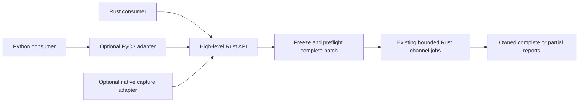

# API-RUST-01 / API-PY-01: Canonical high-level simulation API

Implement the handoff requirements in dependency order: checked Rust inputs and
OCD, independent collections and static selections, complete batch preflight,
existing bounded channel jobs and owned scoped reports, then optional Python.
The original six-document handoff is extracted without overwrites under ignored
`docs/development/local/api-handoff/`. The supplied ZIP remains untouched.
Requirements govern behavior; the baseline commit does not replace current HEAD.

The Apache core owns `crates/ofdm/src/api/`. A separate Apache `pnm-input`
adapter calls pinned Apache `pnm` 0.3.6 directly; GPL Qt orchestration is not
copied. A separate PyO3 adapter delegates all validation/science to this high-level API.
Core and CLI have no Qt/Python dependency. Existing low-level APIs remain.

Loading retains original bytes and separate decoded provenance and never runs
simulation. Controller IDs are scoped and opaque. Each run prepares the complete
batch before dispatch, with fresh PRBS15 and noise seeds per experiment. Static
average/interpolation uses residual power and exact original grids, never a
synthetic playback clock. Cancellation stops dispatch and preserves partial and
not-started entries. Window FEC and profile metrics share scope; whole-run
statistics are separately labeled.

Imported decoder profiles establish grid/roles but do not establish occupied
bandwidth: require an explicit bandwidth unless typed input establishes it.
Never treat data-carrier span as occupied bandwidth. CP/RP/depth defaults are
512/128/16, marked as application assumptions. Profile timestamp tolerance is
independent of explicit channel reuse. Input and report objects are immutable.

Validation follows REQ-080..088 and REQ-114..116: fixture-backed binary/JSON
imports, selection/power/null/grid/time/scoped-ID boundaries, defaults/overrides,
engine parity, cancellation/runtime/ownership, then Rust/Python parity and local
wheel installation. Keep platform evidence and remaining gaps explicit.

## Status and evidence

The Rust API and optional Python adapter are implemented. The Rust repository
runner passed before Python implementation began. Final checks cover the renamed
`pnm-input` crate and the installed, patched Python wheel. See the
[validation record](validation.md) for executed commands, counts, durations,
artifact integrity and platform boundaries.

Current HEAD at implementation start matched the reference baseline:
`3f23be1b3f9848dab73cf27239f3f2ed8409559e`. No reset/downgrade was performed.
Handoff ZIP SHA-256:
`7b65187c77282ad8c033e6b4219ac212ae16cf4f89f718d6b8e4c7ca9ca73652`.
The pinned decoder's Cargo manifest and parser source declare Apache-2.0.
Binary/JSON fixture pairs for all three capture kinds passed native imports.

An initial full build exhausted disk capacity and was interrupted; that attempt
is not validation evidence. Cargo removed stale core development outputs
(31.8 GiB) and, following user cleanup authorization, old release outputs
(577.5 MiB). Qt outputs, captures, toolchains and dependency caches were preserved.
The restarted Rust runner passed in 15 min 48 s before Python work began.

## API-PY-01: optional native adapter

`bindings/python` is a separate optional Cargo workspace and maturin package.
Python unit wrappers convert through checked Rust constructors. Inputs remain
immutable and controllers take copied request snapshots. Native report views
retain Arc-owned batches independently of controller lifetime. Defensive JSON
dictionaries are transport snapshots, not mutable scientific state.

A native worker calls `Merlin::run_with_control`; the waiting interpreter releases
its lock and polls signals. Ctrl-C cancels cooperatively and returns partial
science. Other controller accesses receive Busy. RunLimits request clones share
request state for normal nested edits; acceptance/report getters create separate
Rust snapshots. There are no Python algorithms or CLI subprocesses.

The first PyO3 0.27.2 build passed functional tests but audit identified
RUSTSEC-2026-0176/0177. It was replaced by pinned PyO3 0.30.1 (MSRV 1.85), with
explicit `from_py_object` clone conversion at the language boundary. No advisory
suppression is used. Delivery validation uses the patched wheel; the earlier local build is not
a delivery artifact. Native wheels include the existing notice collector's complete
locked graph, project NOTICE and embedded QAM/BCH licenses.

## API-RUST-01 capture loader naming

The optional capture-loading crate is named `pnm-input` under
`crates/pnm-input`; Rust imports use `pnm_input`. It retains binary/JSON
decoding, bounded file access and provenance responsibilities. The high-level
API remains in `docsis_ofdm_fec::api`. This naming change preserves behavior.

## API-EXAMPLES-01: central Rust and Python examples

Keep runnable API source under `examples/api/rust` and `examples/api/python`,
indexed from `examples/README.md`. Cargo registers the Rust files as
`pnm-input` example targets; Python calls the installed native extension. Move
the existing examples rather than maintaining copies. Both workflows retain
the shared measurement/workbench fixtures and explicit `run()` boundary. The
Rust policy example also provides the reference generator for parity tests.
Check Cargo example targets, run both language workflows, and validate links.

Validation: Cargo checked both relocated Rust example targets; the Rust and
installed native Python `high_level` workflows completed successfully from
the new locations. Rustfmt, changed-document links and `git diff --check`
passed. No simulation code or fixture bytes changed.

## API-INTEGRATION-01: downstream Python installation

Document consuming the native wheel from a project such as PyPNM, with separate
package/import names, exact version/asset pins, optional dependency resolution,
source-tag builds and current unpublished status. Keep all instructions in
MERLIN; do not modify PyPNM. Validate the concrete local pinned-wheel install in
a fresh project-local environment. Published URLs, registry availability and
cross-platform wheels remain future delivery work until verified.

Validation: a fresh local `api-consumer` environment installed the exact
`merlin-ofdm==0.2.9` wheel using offline binary-only wheelhouse resolution.
Import and distribution-version checks passed. Document links and diff
whitespace checks passed; no PyPNM files or release assets were changed.

## API-INTEGRATION-02: mandatory push-time guide refresh

Generate the downstream installation guide from a tracked template and validated
VERSION/Python metadata using a separate `tools/python/update_integration_doc.py`
script. Save and branch-push helpers invoke it; release bumps refresh and include
the guide in the validated release commit. Existing-tag retries check without
changing their immutable commit. Dry runs check without writing. Exact interrupted
bump recovery includes the generated guide, rejects tampering/unrelated changes,
and reconstructs expected content from committed template/metadata. Generation
is deterministic and does not invent published assets, hashes or platform tests.
Branch refreshes that change a clean checkout stop for review/commit; no hidden
branch commits or weakened guards. Test with temporary checkouts/local origins.

Validation: 55 Git helper tests passed in 29.134s using disposable checkouts
and local-only origins; four generator tests passed in 0.016s. Coverage
includes release-commit inclusion, save-time inclusion, ordinary/docs-only
push invocation, stale/error failure, dry-run/tag immutability, exact resume
and altered-guide rejection. No real checkout commit/tag/push was executed.
No archive files were tracked; ignore checks cover supplied ZIPs, compressed
tar files, wheels and 7z files without deleting local inputs.

Final follow-up verification after the template naming/documentation changes:
55 Git workflow tests passed in 27.198s, four generator tests in 0.032s and
five release/version tests in 0.242s. ShellCheck, syntax, generated-doc checks,
665 Markdown relative links, skill validation and diff checks passed.

## API-EXAMPLES-02: developer walkthrough comments

Add filename headers and detailed numbered explanations to both `high_level`
examples. Explain native Rust ownership, fixture paths, profile/OCD setup,
independent measurements and scoped IDs, units/tolerances, the explicit run
boundary, optional scoped reports and primitive output conversions. Move
numeric configuration and fixture paths into named constants at the top,
with explicit units and fixture-specific explanations. Preserve the executable
workflow; verify syntax/formatting and constant-substitution equivalence. No
engine or binding change is required.

Validation: Rust example check passed in 0.27s; the installed Python example
completed with 82 codewords, zero corrected/uncorrectable and BER 0. Python
AST and Rust executable-token comparisons against HEAD matched after resolving
the named constants and removing documentation/optional trailing commas.
Rustfmt and diff whitespace checks passed. The architecture was reviewed;
no engine ownership or behavior changed.

## API-EXAMPLES-03: channel-193 Python collection example

Update the Python high-level walkthrough to consume the 132 RxMER binaries and
companion DPD in examples/workbench/multi-rxmer-2. Select Profile A, 192 MHz,
AverageAll in Rust residual power, explicit unity H, 7200-second DPD tolerance
and 1 ms observation with a 300-second execution bound. Retain named constants,
numbered explanations and actual FEC/BER reporting. Loading stays separate from
run. Do not parse the desktop WB JSON in Python or claim pilot-estimated receiver
parity: that setting is not exposed by the current high-level API. Keep the Rust
single-capture example unchanged and explain the differing inputs in the index.
Validate by executing the installed native Python extension on these originals;
no engine/binding changes or wheel rebuild are needed.

Validation: the installed Ubuntu x86_64 / CPython 3.10 native extension loaded
all 132 original RxMER binaries and the companion DPD. The explicit run returned
Complete with 83 codewords, 0 corrected, 0 uncorrectable and post-FEC BER 0.0.
The load message precedes run. Syntax and import-only checks passed; importing
the walkthrough does not invoke main. Documentation links and whitespace checks
passed. Reviewed the architecture: existing Rust/adapter ownership is unchanged;
no Rust, Qt or binding code changed and no full-suite rebuild was required.

## API-EXAMPLES-04: keep collection walkthrough separate

Restore high_level.py byte-for-byte from before API-EXAMPLES-03. Preserve the
verified collection workflow as multi_rxmer.py with its own filename header and
run command. Update example/setup links so users can choose either workflow.
No API or simulation change. Validate both native scripts, import-only behavior
and documentation links; review architecture and checklist for final scope.

Validation: high_level.py exactly matches its pre-collection version and
completed with 82 codewords in 2.56s. multi_rxmer.py loaded 132 captures and
completed with 83 codewords in 1.02s. Both reported zero corrected and
uncorrectable words and BER 0.0. Syntax, import-only behavior, changed links
and diff checks passed. Architecture ownership is unchanged; no wheel rebuild
or full Rust/Qt checks were required for this examples/documentation change.

## API-EXAMPLES-05: independent collection runs per captured profile

The channel-193 file contains captured IDs 0, 3 and 4, verified through the
existing Rust-backed DPD loader. Declare that fixture-specific selection as a
named constant, without implying automatic catalog discovery. Load all selected
profiles and original RxMER files before any run. Use a fresh Rust controller
and profile-derived OCD for each independent experiment, reusing immutable
observations and common options/seeds. Keep AverageAll, unity H and the explicit
1 ms observation. Label actual FEC outputs by captured ID and report wall time
separately using Python's monotonic clock. No science or counter calculation in
Python and no artificial delay. Document one averaged experiment per profile,
not one per capture, and preserve high_level.py. Validate all three native runs.

Validation: native Ubuntu CPython 3.10 runs all completed. Profile 0: 83 total,
0 corrected, 0 uncorrectable, BER 0.0 (0.698s). Profile 3: 114 total, 5 corrected,
0 uncorrectable, BER 0.0 (2.256s). Profile 4: 124 total, 19 corrected,
0 uncorrectable, BER 0.0 (0.878s). The three experiments took 3.873s; process
wall time including loading was 4.10s. These are actual engine reports, not
interoperability evidence or an expectation for other settings. Syntax/import,
unchanged high_level.py and documentation checks pass. Reviewed architecture:
no ownership or engine behavior changed, so no full Rust/Qt rebuild was needed.

## API-INPUT-02: discover captured profile identities in Rust

Add Dpd::profile_ids_from_bytes for bounded decoded JSON using the existing
Rust profile importer and validated ProfileId values, sorted by captured ID.
Add CaptureLoader::profile_ids for binary/JSON named captures with existing
decoder dispatch. Python DPD.profile_ids_from_file/from_bytes delegates to that
Rust loader; no Python parsing, range probing or hardcoded profile inventory.
Reject malformed/empty/duplicate/out-of-domain catalogs through existing
structured errors. Discovery never creates a controller or runs simulation.
Preserve originals and existing explicit single-profile selection. Replace the
collection example's PROFILE_IDS constant with discovery, then run all returned
identities independently. Test JSON/binary/error parity in Rust first, then
Python conversion and the real collection example after rebuilding the wheel.
Document the permanent Rust-first rule for shared Python capabilities.

Validation: 16 Rust API tests passed (56.64s test execution, 61.74s command
including compilation). Both new discovery cases cover core JSON/native
binary agreement, sorting, absent/duplicate/out-of-domain catalogs, truncation
and unchanged source bytes. Workspace Clippy passed (20.60s), adapter Clippy
passed (5.45s), and 136 analysis-only Rust tests passed (17.01s command).
The native CPython 3.10 Linux wheel rebuilt with complete notices (39.40s) and
was installed only in local/api-python-test. Seven native API tests passed
(1.152s execution, 1.21s command), including owned discovery lists and
structured errors. A fresh Rust baseline (82.23s) and Python parity check
(3.91s command) agree for Each, Individual, AverageAll and InterpolateAt.
The discovered-profile example completed with original profile totals
83/114/124 and corrected counts 0/5/19, all UFEC/BER zero (4.29s process).
Rust formatting, Python syntax/import-only behavior, unchanged high_level.py,
guide links and whitespace checks passed. No Qt/scientific algorithm change
or publication. The verified wheel remains Ubuntu x86_64 / CPython 3.10 only;
other Python/platform targets are unverified.

## API-INPUT-03: retained profile-ID member on loaded DPD

Keep static discovery unchanged. During DPD import, retain the complete validated
sorted source catalog beside the selected profile. Expose Dpd::profile_ids() in
Rust and read-only dpd.profile_ids in Python. Reading the member performs no I/O,
JSON parsing or simulation. Created profiles expose their one ID; edited inputs
retain the source catalog, independently of their selected-profile hypothesis.
Include the member in DPD serialization and preserve clone/result ownership.
Test the instance after its file is removed, list-copy isolation, created/edited
behavior, and agreement with static binary/JSON discovery. No engine change.

Validation: all 17 Rust API tests passed (43.78s tests; 60.81s command with
compilation), including source-file deletion, serialization, static agreement
and created/edited catalogs. Workspace Clippy passed (14.75s), adapter Clippy
passed (7.08s), and the local CPython 3.10 Linux wheel rebuilt (36.79s) with
notices and was installed only in the existing project-local environment.
All 8 Python API tests passed (0.374s tests; 0.44s command), including source
removal, read-only property, independent lists and created/edited members.
All four Python selection modes match the preserved Rust engine baseline
(3.98s command); scientific behavior is unchanged. The collection example
completed all three original profiles in 4.43s with previous counters intact.
A loaded channel-193 Profile 3 exposes catalog [0, 3, 4] without selecting a
different profile. Formatting, syntax, import-only, links and whitespace checks
pass. Other Python/platform targets remain unverified; no publication occurred.

### API-EXAMPLE-BER-01: readable Python BER output

Both Python walkthroughs format available post-FEC BER using scientific
notation (`.3e`, for example `1.234e-06`). A named `BER_FORMAT` constant near
the configuration allows display precision changes. Unavailable BER remains
explicitly unavailable. This changes presentation only: Rust still owns the
numeric BER result and the Python API continues returning its numeric domain
value. Validate by running both fixture-backed examples with the native wheel.
