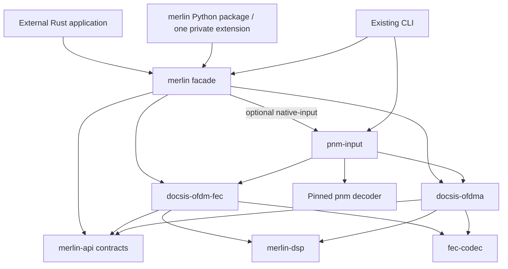

# Unified Rust root and native Python namespaces

Decision owner: [API architecture](../../../architecture.md#unified-rust-python-and-cli-apis).
Requirements: [REQ-COM-API-07](../../../requirements.md#req-com-api-07),
[REQ-COM-API-08](../../../requirements.md#req-com-api-08),
[REQ-COM-API-09](../../../requirements.md#req-com-api-09),
[REQ-DS-API-01](../../../requirements.md#req-ds-api-01).
Delivery: [INT-API-MAP-01](../../checklist.md#int-api-map-01) documents this decision;
[INT-RUST-01](../../checklist.md#int-rust-01) and [INT-PY-01](../../checklist.md#int-py-01)
accept actual exports and native execution after the real upstream loop. The
[single operation matrix](compatibility-matrix.md) retains signature/parity authority.

## Selected mapping

The user requires the literal public root `merlin`, with independent PHY crates.
Select a minimal facade. Re-exporting upstream from the existing downstream crate
would make one PHY depend on the other; renaming that crate or its library target
would break current imports. A Cargo dependency alias changes one consumer's
crate name and cannot assemble two independent PHY crates under one public root.
The facade is therefore technically justified. It contains module declarations,
rustdoc and `pub use` declarations only: no science, controllers, input decoding,
conversion, validation, lifecycle implementation or result reshaping.

The Rust facade and common contract leaf are now implemented after accepted
upstream and measured prerequisites. Python package paths below are implemented and pass the installed namespace
unit; INT-PY-01 now records [complete native operation acceptance](python-operation-evidence.json). The implementation unit and validation record below identify
current exports; complete Rust operation coverage is recorded in the matrix acceptance below.

| Cargo package | Library name / directory | Ownership and permitted dependencies |
| --- | --- | --- |
| `merlin` (implemented) | `merlin`, `crates/merlin` | Thin public re-exports; depends on `docsis-ofdm-fec`, `docsis-ofdma`, `merlin-api`; no dependency on native PNM, CLI, PyO3 or Qt. |
| `docsis-ofdm-fec` (existing) | `docsis_ofdm_fec`, `crates/ofdm` | Current downstream engine and API remain in place; common DSP/FEC and common contract leaf only. Preserve current package/library names and feature behavior. |
| `docsis-ofdma` (implemented) | `docsis_ofdma`, `crates/ofdma` | Upstream engine and typed `api` module; DSP/FEC and common contract leaf only. No dependency on downstream or facade. |
| `merlin-api` (implemented) | `merlin_api`, `crates/phy-api` | Small dependency leaf for genuinely common cancellation/error categories. Safe Rust plus existing pinned serde only; no DSP, engine, FEC, input, adapter or facade dependencies. |
| `merlin-dsp` (INT-DSP-01 delivery) | `merlin_dsp`, `crates/dsp` | Bounded shared numerical primitives; no API/PHY/adapter dependency. This is separate from the public namespace facade. |
| `fec-codec` (existing) | `fec_codec`, `crates/fec-codec` | Existing shared mechanisms and separate normative code families. No new facade/API dependency. |
| `pnm-input` (existing) | `pnm_input`, `crates/pnm-input` | Native file/capture adapter; existing downstream and pinned parser, implemented upstream; neither PHY points back here. |
| `ofdm-fec-cli` (existing) | Existing `ofdm-fec` binary, `crates/cli` | Adapter uses public direction APIs/facade and native input; retains syntax/output/exit statuses. |
| `merlin-python` (existing) | Implemented private extension `_native`, `bindings/python` | One PyO3 extension, depends on facade plus native input. Distribution metadata remains `merlin-ofdm`; public Python import root remains `merlin`. Internal library/module rename is tested as a packaging change, not a second extension/distribution. |

All new project packages use canonical VERSION, currently 0.4.0, edition 2021,
Rust 1.85 and Apache-2.0. Keep scientific crates `forbid(unsafe_code)`. Explicit
facade features `downstream` and `upstream` enable optional PHY dependencies;
both default on once implemented. `merlin-api` is unconditional. Downstream
facade activation enables existing `high-level-api` on its dependency, with
`default-features = false`; this does not alter that package's own defaults.
`cargo check -p merlin --no-default-features --features upstream` must not compile
downstream, and vice versa. Existing direct analysis-only OFDM builds remain valid.

Implemented [facade manifest](../../../../crates/merlin/Cargo.toml):

```toml
[package]
name = "merlin"
version = "0.4.0" # synchronized from VERSION when implemented
edition = "2021"
rust-version = "1.85"
license = "Apache-2.0"
publish = false

[lib]
name = "merlin"

[features]
default = ["downstream", "upstream"]
downstream = ["dep:docsis-ofdm-fec"]
upstream = ["dep:docsis-ofdma"]
native-input = ["downstream", "upstream", "dep:pnm-input"]

[dependencies]
docsis-ofdm-fec = { path = "../ofdm", default-features = false, features = ["high-level-api"], optional = true }
docsis-ofdma = { path = "../ofdma", default-features = false, optional = true }
merlin-api = { path = "../phy-api" }
pnm-input = { path = "../pnm-input", optional = true }
```

The upstream crate exports its typed `api` without a separate runtime
feature; optionality is the facade's dependency switch. The contract leaf uses
the existing pinned serde `=1.0.228` with derive for `ErrorCode`. The facade
adds no direct serde, DSP, codec or native-runtime dependency. Internal path
dependencies follow existing version-bump behavior; no stale inline version
constraint may prevent synchronized local package bumps. Installed native
bindings currently centralize Rust access in `bindings/python/src/lib.rs` through
the `api` import; that alias can point to `merlin::downstream` without replacing
conversion/domain code or adding a second downstream engine.

## Dependency graph

Arrows mean caller/package depends on owner, not scientific data flow. Dashed
paths remain planned; solid core/input edges already exist.



The facade never becomes a dependency of either PHY, shared leaf or PNM adapter.
The CLI retains direct input access; native Python now enables facade
`native-input` and uses directional input re-exports. This optional feature brings
both existing PHY adapters without changing base/default direction builds.
[Typed passive admission](../../../user/api/input-admission.md) adds no engine or
scientific facade implementation.
Qt retains its existing direct downstream dependencies and receives no upstream UI
or dependency migration in this phase. Direct consumers may continue importing
either engine without installing/linking a facade, Python or Qt.

## Exact public re-exports

Implemented declarations from [the facade](../../../../crates/merlin/src/lib.rs):

```rust
// crates/merlin/src/lib.rs: re-exports only
#![forbid(unsafe_code)]

#[cfg(feature = "downstream")]
pub mod downstream {
    pub use docsis_ofdm_fec::api::*;
}
#[cfg(feature = "upstream")]
pub mod upstream {
    pub use docsis_ofdma::api::*;
}
pub mod common {
    pub use merlin_api::{Cancellation, ErrorCode, RunControl};
}
```

`merlin::downstream::Simulation` and `Merlin` are exact type re-exports of existing
`docsis_ofdm_fec::api::{Simulation,Merlin}`. Retain every old path, signature,
error/result/default and saved-workbench meaning. No extra downstream wrapper,
renaming, rescaling or engine instance is introduced. Existing feature gating of
`docsis_ofdm_fec::api` remains unchanged; the facade explicitly opts into it.
`merlin::upstream::Simulation` re-exports the real typed upstream `api::Simulation`;
never export an empty/FEC-only substitute while the waveform loop is unavailable.

The common leaf initially owns only contracts proven direction-neutral:

- `ErrorCode`: the existing fifteen downstream categories, variant spelling/order
  and serde representation retained exactly. `ApiError` stays directional because
  downstream retains an optional original `SimulationError` diagnostic.
- `RunControl`: existing cloneable Arc/AtomicBool cancellation semantics, `new()`
  and `cancel()`, with additive `is_cancelled(&self) -> bool`. Existing downstream
  `api::RunControl` is re-exported from the leaf; callers keep that path and exact
  cancellation behavior. Clones retain one flag; cancellation does not reset.
- `Cancellation`: read-only `fn is_cancelled(&self) -> bool` trait, implemented for
  `RunControl` and `AtomicBool` using the existing relaxed load semantics. Do not
  expose a mutable atomic/flag handle through the public controller API.

The common leaf contains no scientific algorithm. To preserve the old public
engine functions accepting `&AtomicBool`, keep those signatures and delegate to
an internal generic cancellation-query path. The high-level controller can use
that internal path with the shared control. This adaptation now passes the
INT-RUST-01 namespace implementation cases and downstream API/lifecycle regressions.
No mutable flag escape hatch or reinterpretation of completed partial results.

Keep `RunLimits`, progress, reports, engine errors, OCD/DPD and UCD/IUC models
directional until exact defaults/units/fields support a genuinely common nominal
type. In particular downstream limits use specific checked quantity types;
upstream grant/sample/retention budgets need not share that representation. Do
not falsely export `common::Report`, `common::ApiError` or universal configuration.
Any later common export is additive and must gain a matrix row and parity tests.

## Python package implementation

Select real Python packages/modules, not runtime-only attributes. Preserve one
PyPI distribution (`merlin-ofdm` metadata) and one public `merlin` import package:

```text
bindings/python/python/merlin/           # planned
  __init__.py                           # explicit legacy root re-exports
  __init__.pyi                          # matching legacy declarations
  _native.<platform-extension>           # one PyO3 native binary
  downstream.py / downstream.pyi        # same native downstream objects
  upstream.py / upstream.pyi            # distinct real upstream objects
  common.py / common.pyi                # shared native contracts only
  py.typed                              # included in installed wheel
```

Use maturin `module-name = "merlin._native"`, `python-source = "python"`; native
Cargo library and `#[pymodule]` entry point become `_native` consistently.
`__init__.py` re-exports the complete existing root object inventory, including
`__version__`, `ApiError`, every current class and the `Merlin`/`Simulation` aliases.
`downstream.py` re-exports those same downstream objects, so
`merlin.Simulation is merlin.downstream.Simulation` and legacy `merlin.Merlin`
identity hold. `upstream.py` re-exports native upstream classes registered under
a distinct native submodule, without adding a second native engine or wheel.
`common.py` re-exports `RunControl`/`ErrorCode` from their single native registration.
The Rust-only `Cancellation` trait is not a Python class; it remains a documented
intentional language distinction. Pure Python files only import/re-export objects.

Keep existing native downstream classes' public `__module__ = "merlin"`; private
binary relocation does not rename their public identities. Preserve signatures
and repr/pickle behavior where supported; do not invent pickle support. New
upstream native classes use `module = "merlin.upstream"` and short Python names
such as `Simulation`; registration must avoid overwriting the downstream class.
New common/native submodule registrations must use qualified module names and
remain reachable through real package imports. No Python subclass or scientific
calculation is needed. Direct imports, `importlib`, `find_spec`, `pkgutil`, stubs,
platform extension loading and installed-wheel notice/package inventories are
explicit acceptance gates. Test fresh processes outside the checkout, not just
source-tree imports or `sys.path` injection.

## Operations and compatibility acceptance

All current downstream method signatures remain exactly those in the
[operation matrix](compatibility-matrix.md#downstream-session-operation-rows).
This namespace decision adds re-exports, not new downstream methods. The common
additive `RunControl::is_cancelled` and trait signatures above are implemented in Rust; Python
may expose the read-only status through a documented method in its matrix row.
Upstream operation signatures accompany typed stage API development and are
finalized only against real stage models. Do not interpret the namespace mapping
as approval of hypothetical universal `Configuration`/`Report` types or pause support.

| Original design test owner / case (Python rows were planned) | Required assertion | Requirement / gate |
| --- | --- | --- |
| `crates/merlin/tests/namespaces.rs::every_downstream_export_retains_legacy_type_identity` | Pass one `Simulation`, `Merlin`, configuration, options, error and report through both old/new Rust paths without conversion. | REQ-COM-API-07, REQ-DS-API-01; INT-RUST-01. |
| `crates/merlin/tests/namespaces.rs::upstream_namespace_executes_real_loop_and_preserves_structured_errors` | Imports reach real upstream session/domain owners; no downstream nominal types in upstream configuration. | REQ-COM-API-07, REQ-US-API-01; INT-RUST-01. |
| `crates/phy-api/tests/contracts.rs::clones_threads_and_legacy_atomic_queries_share_one_way_cancellation` | Original constructor/default/clone/cancel behavior, pre-cancellation and relaxed query; no exposed reset. | REQ-COM-API-07; INT-RUST-01. |
| `crates/merlin/tests/namespaces.rs::shared_precancellation_reaches_both_directions_and_retains_source_context` | Same common control cancels actual bounded native Rust loops and preserves their completed science. | REQ-COM-LIFE-02, REQ-COM-API-07; INT-RUST-01. |
| `bindings/python/tests/test_namespaces.py::NamespaceImports.test_installed_imports_and_legacy_identity` | All three real modules import outside checkout; root and downstream class identity and every original export/signature/default/error match. | REQ-COM-API-08/09, REQ-DS-API-01; INT-PY-01. |
| `bindings/python/tests/test_namespaces.py::NamespaceImports.test_discovery_and_typing_payload` | `importlib.util.find_spec`, `pkgutil`, `.pyi`, `py.typed` and one extension are present in installed wheel. | REQ-COM-API-08; INT-PY-01. |
| `bindings/python/tests/test_upstream_experiment.py::NativeTests.test_independently_executed_rust_and_python_scientific_parity` | Native upstream values/errors/results/provenance/lifetime/control agree with direct Rust; no PyO3/stub-only acceptance. | REQ-US-API-02, REQ-COM-API-05; INT-PY-01. |
| Existing downstream suites / examples | Retain all old Rust public paths, direct engine parity, native imports, saved workbenches/Designer recipes and current interpreter-lock/Busy/owned partial results. | REQ-DS-API-01; INT-RUST-01/INT-PY-01/INT-REG-01. |

Run feature-isolation Cargo checks for each facade direction, common-only mode,
independent PHY builds and downstream analysis-only mode. Validate cargo metadata
has no PHY→facade, PHY→other-PHY or core→adapter edge, no new native DSP dependency,
and exactly one serde/shared contract owner. Installed wheels need actual Linux/
Windows declared-target execution before those platform claims; no platform is
accepted by this planning record. Every new operation gets the full seventeen-cell
matrix entry and fourteen-field evidence record before its delivery task closes.

## File dispositions and decision status

Added: `crates/merlin/{Cargo.toml,src/lib.rs,tests/namespaces.rs}` and
`crates/phy-api/{Cargo.toml,src/lib.rs,src/control.rs,src/error.rs,tests/contracts.rs}`.
Python package/type files shown above and `bindings/python/tests/test_namespaces.py`
remain planned. Existing Python/Qt locks gain only new local package/edge records;
every prior package identity/version/checksum is preserved.
Reuse the existing downstream API and source-derived upstream owners. Edit at
implementation: root workspace/version/license/package inventories, PHY manifests
and API re-exports, downstream controller/error/internal channel cancellation
adapter, native registration/pyproject/library target and build/reference tooling.
Remove no existing public export, record, test, scientific implementation or fixture.

The selected mapping remains approved, with namespace implementation evidence
below. Planning/FEC remain completed. INT-RUST-01 now has complete Rust
operation coverage; Python namespace execution now passes the [installed unit](python-evidence.json); [complete native operation traceability](python-operation-evidence.json) now passes INT-PY-01. Changes to the
selected package names/common export set require a compatible design update.
No upstream Qt implementation or release/publication is authorized.

Design verification: the declared package graph was checked with the existing
dependency-cycle validator and contains no cycle, PHY-to-PHY or PHY-to-facade edge.
The current documentation validator resolves all requirement/task/architecture
links and the 30-node task graph. The existing 35 documentation/traceability tool
cases pass; this does not execute the planned facade import or wheel namespace
tests above. Actual DSP consumer/native acceptance is recorded separately in
[DSP validation](../signal-processing/validation.md).

## INT-RUST-01 implementation unit

Historical implementation checkpoint `c6e3065`: the following text preserves its
then-pending native gates. Subsequent Rust and installed native operation
acceptance is recorded in [the API integration record](upstream.md).

Prerequisites now accepted: synthetic core plus native measured admission at
`0557423`. Implement the selected facade and common contract leaf with the exact
manifest/export design above; both real direction APIs now exist.

| Inspected owner / symbol | Contract and gap | Decision / concrete files |
| --- | --- | --- |
| `crates/ofdm/src/api/error.rs::ErrorCode` | Fifteen public categories with serde names/order; common nominal type needed. | SHARE into new `crates/phy-api/src/error.rs`; preserve old API re-export and every variant. |
| `crates/ofdm/src/api/controller.rs::RunControl` | Cloneable one-way relaxed AtomicBool cancellation; private flag accessed by controller. | SHARE into new `crates/phy-api/src/control.rs`; replace private flag access with query trait, preserve new/cancel and add is_cancelled. |
| `crates/ofdm/src/simulation/channel/job.rs::run_channel_controlled` | Public AtomicBool signatures and bounded scientific step ordering are established. | ADAPT internal cancellation-query helper only; keep old functions/signatures and delegate to the same job loop. No atomic handle is exposed. |
| `crates/ofdma/src/simulation/control.rs::RunControl` | Rich pause/progress/Busy state is directional and cannot be collapsed into the simple common token. | SEPARATE rich state; implement common Cancellation and additive with_cancellation bridge. Existing controls retain their original wake/flag behavior. |
| `crates/ofdma/src/api/error.rs::ApiError` | Original structured domain/capture/serialization causes plus legacy string code. | SEPARATE error objects; add category returning shared ErrorCode, retaining code() and original causes. |
| Real `docsis_ofdm_fec::api::*` and `docsis_ofdma::api::*` | Existing export owners now callable independently. | REUSE by pub use only in new `crates/merlin/src/lib.rs`; facade owns no implementation. |

The optional upstream `RunControl::with_cancellation(common::RunControl)` keeps
pause/progress/Busy state in the upstream owner and observes the shared one-way
request. Cancelling either bridged handle sets the common request. A paused
bridged worker waits on its existing condvar with a 10ms timeout, so cancellation
through the common handle remains reachable without callbacks or a helper thread.
Unbridged controls preserve their existing notification-based wait. This bounded
waiting does not advance source, noise, waveform or decoder state. Test both
pre-cancel and cancellation after an acknowledged pause, plus retained outcomes.

Acceptance files: new `crates/merlin/tests/namespaces.rs` for exact legacy/common
identity, both real direction sessions and shared cancellation; new
`crates/phy-api/tests/contracts.rs` for clone/thread/AtomicBool queries and literal
category serialization; existing downstream high-level/loop and upstream lifecycle
cases for behavior. Direction-only Cargo dependency trees/builds must exclude the
opposite PHY. Preserve independent analysis-only builds and record exact candidate,
commands/cases, public operation signatures and remaining native Python gates.

### Namespace implementation validation

The real facade has no executable library logic. All 71 documented downstream
exported types/aliases are checked for exact legacy identity, including generic
Resolved/ApiResult representatives. Tests execute a real upstream loop and verify
structured error categories/causes/offsets, cancellation propagation, acknowledged
pause cancellation and owned source context. The common fifteen-category spellings
and order have independent literal checks. Existing public AtomicBool job
signatures remain unchanged, with the same loop and relaxed query semantics.

Passing checks: 8 facade/common cases, 26 downstream high-level API cases,
6 downstream channel lifecycle cases, 83 upstream engine cases, direction-only
and common-only builds, downstream analysis-only tests, Clippy and formatting.
Direction-only dependency trees exclude the opposite PHY. One ignored transform
benchmark remains intentionally separate from these regressions and was already
executed at DSP/TX acceptance. Native namespace/wheel acceptance remains pending.

Compiler-generated public export discovery now uses
`tools/validation/rust_api_inventory.py`, with independent wildcard/module,
macro/trait and stale-target cases in `test_rust_api_inventory.py`. It inventories
fresh rustdoc, never stale directory contents; source/export facts do not claim
scientific execution. The operation matrix now contains all individual
Rust operation rows and passing export/execution checks. No accepted planning/FEC task reopens.

Exact evidence: [candidate](namespace-candidate.json), [executed cases](namespace-test-results.json)
and [requirement slices](namespace-evidence.json). These accept the namespace unit
only; complete Rust operation mapping is now accepted in [the active API record](upstream.md#rust-api-acceptance).
