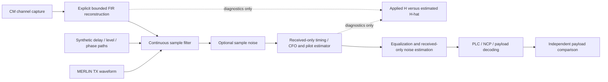

# Independent receiver estimation through a channel with memory

Status: **planned; no implementation or receiver validation in this change**.
Tasks: CH-EST-RX-07 through CH-EST-RX-12. Existing CH-EST-RX-01..06 remain
implemented for their documented synchronized, frequency-diagonal channel scope.

## Purpose and existing foundation

Use a CM downstream channel-estimation capture to impair the transmitted waveform,
then recover payloads with MERLIN's receiver estimating its own channel. Imported
coefficients, configured echo taps and original payloads must not enter receiver
decisions. Known DOCSIS pilots are allowed: this is **pilot-assisted estimation**,
not a claim of fully blind RF discovery or a production cable-modem receiver.

Reuse the Rust pilot estimator, bounded history, delay-aware interpolation,
timing/CFO search and real PLC/NCP/payload FEC. Current channel response application
is per-symbol frequency-diagonal synthesis. It does not reproduce arbitrary
continuous channel memory or interference across OFDM symbols. Current calibrated
demapper noise is also simulation assistance; removing supplied H alone does not
make the whole receiver independent.

See the [existing estimator](../../../user/receiver-estimation/README.md),
[channel limitations](../../../user/impairments/channel-response.md) and
[current implementation](../pilot-channel-estimation/implementation.md).

## Boundaries and contracts

- Channel configuration chooses the existing diagonal model or the new sample
  filter explicitly. Preserve old saved WBs and reference behavior by default.
- Sample-filter source chooses synthetic paths or reconstructed CM response.
  Do not silently combine both or apply the capture twice.
- Receiver input consists of received samples, sample rate, explicit bootstrap
  hypotheses/settings and independent standards-derived pilot references. Layout
  and received signaling requirements remain explicit; imported capture metadata
  must not masquerade as receiver-discovered information.
- Exclude applied H, tap delays, exact channel/noise powers, TX bins, payload bits
  and codeword IDs from the independent RX configuration. Keep truth only in the
  channel and a separate diagnostic comparator. Test this boundary structurally
  and by holding received samples fixed while changing diagnostic truth.
- Relative CM coefficients are not calibrated absolute loss. Preserve source
  bytes/hash, frequency grid, gaps, units and any reconstruction/normalization.
- Reusable models and streaming operations live in Apache-2.0 Rust crates with
  no Qt dependencies. CLI and Qt consume the same typed settings/results. Plan
  serializable versioned contracts and getters for configuration, status and
  scalar summaries; future Python bindings wrap Rust, with no Python DSP.

## Ordered implementation

### CH-EST-RX-07: Freeze independence and acceptance contracts

Audit receiver construction, bootstrap, gain normalization, noise/LLR inputs,
PLC reprocessing and diagnostic paths. Identify each assisted input explicitly.
Separate independent reception from the supplied-H/calibrated reference baseline.
Define typed channel/filter settings, RX noise policy, estimate validity and
structured unsupported/insufficient-data diagnostics before wiring a new mode.

### CH-EST-RX-08: Continuous synthetic delay channel

Implement a stateful complex FIR on actual TX sample blocks:

\[
y[n]=\sum_{\ell=0}^{L-1}h[\ell]x[n-\ell]+w[n].
\]

Start with direct path plus integer-sample echoes specified by relative level
and phase. Retain history across block, symbol, PLC-frame and payload boundaries;
transfer the final filter tail exactly once without inventing source payloads.
Keep interleaver drain, waveform-window tail and channel-filter tail separately
accounted. Add fractional delays only after an independently tested fractional
delay kernel and approximation/error policy exist.

Use sparse delay-line evaluation for a few taps. For dense imported filters use
bounded FFT overlap-save/add, avoiding an unrestricted samples-times-taps loop.
Benchmark crossover and stream memory before selecting the production backend.
The RX must not receive the filter delay as a timing correction hint.

### CH-EST-RX-09: Reconstruct a filter from CM coefficients

Validate the capture's complex response semantics, sample clock and frequency-bin
mapping. A finite band-limited capture does not uniquely determine a causal
full-band physical channel or absolute propagation delay. Do not simply IFFT it
and label every peak a measured echo.

Specify how unsupported/excluded bins, band edges, phase reference, causal shift,
windowing, truncation and normalization are treated. Fail unsupported or ambiguous
inputs rather than silently filling gaps. Record the selected policy and compare
the filter's realized frequency response with the original valid bins: RMS and
maximum complex error, delay support and truncation residual. Set and document
acceptance tolerances from analytic fixtures before admitting measured inputs.
For static filters select the policy explicitly; time-varying filter transitions
and capture playback are deferred until their state/transition model is designed.

### CH-EST-RX-10: Strengthen received-only estimation and correction

Run the existing pilot estimator on the filtered samples. Verify initial timing,
pilot coverage/age, common gain/phase and phase-slope handling rather than assuming
old diagonal-channel tests establish performance with memory. Separate training,
tracking, stale/insufficient coverage and loss of lock. A ready history alone is
not an accuracy guarantee. Keep fitting and validation pilot sets disjoint.

Retain bounded complex interpolation first. Add alternative interpolation or
regularized equalization only when independent tests demonstrate a need. Design
deep-null erasure/rejection and LLR policies without unbounded reciprocal gain.
Estimate noise/reliability from received pilots or held-out residuals with bias,
units, sample counts and uncertainty documented. Do not use actual simulator
variance or fitted-pilot residuals as independent evidence of correctness.

Start with static delay spread inside the usable guard interval, accounting for
window roll-off and receiver timing margin. Test excessive delay separately and
report actual failure/degradation; one-tap frequency equalization is not a promise
to correct interference from echoes beyond that interval. Adaptive time-domain
equalization and decision-directed tracking are later extensions.

### CH-EST-RX-11: Shared orchestration, configuration and diagnostics

Integrate continuous filtering across acquisition, observation, completion and
drain. Validate settings before changing an accepted WB. Keep cancellation and
runtime checks between bounded blocks and preserve partial results on failure.
Rust owns bounded filter/estimator state; Qt renders it.

Expose Channel Model source/settings separately from receiver correction mode.
Show three aligned graphs: applied/estimated magnitude, phase, and impulse
response. Truth comparison is optional diagnostics only. Mark delay reference,
band-limited resolution, invalid bins and provisional estimates. Add held-out
pilot error, true TX-reference data MER, BER and TotalCW/CCW/UFEC using existing
FEC counters. Include lock state and a specific actionable diagnostic on failure.
Save explicit model/policy versions in WB/CLI settings; keep large arrays behind
bounded Rust queries and leave Python bindings deferred.

### CH-EST-RX-12: Independent validation and handoff

Use analytic impulse/two-path fixtures for expected delays, coefficients and
frequency response, separate from the implementation under test. Cover:

- Unity, gain, pure integer delay and two/multiple echoes; both FFT spacings.
- Delays inside, near and beyond the usable guard; deep nulls and noisy pilots.
- Arbitrary block splits, filter startup/tail, PLC acquisition, FEC recovery,
  interleaver drain, cancellation, invalid inputs and explicit memory/work caps.
- Identical received inputs produce identical RX decisions despite changed or
  absent diagnostic truth. No exact channel-noise calibration reaches RX.
- Original source-bit comparison and actual MER/FEC outcomes; demapper estimates
  are not ground truth. Failed and partial runs retain honest outcomes.
- Old diagonal/reference requests and saved WBs preserve their existing results.
- Selected real CM captures meet declared reconstruction tolerances; report
  measurement-conditioned simulation, not original field-noise replay.

Define enforceable limits for tap count, delay samples, FFT/block size, search
candidates, retained snapshots and total bytes in CH-EST-RX-07 before allocation.
Choose numerical caps using measured host/runtime budgets, not capture size alone.
Never accept an unbounded tap list or a filter reconstructed without a support cap.

Run core formatting, warnings-denied Clippy, targeted analytic/integration tests,
the full Rust suite and no-default-features coverage as appropriate. Qt changes
also require adapter/QML checks, current native build and visual validation.
Record host/toolchain, tolerances, resource measurements and unverified platforms.
No external interoperability or arbitrary blind acquisition claim follows from
MERLIN-only closed-loop success.

## Evidence and completion gates

Reuse pinned pilot, waveform and acquisition evidence through existing guides.
Channel reconstruction, interpolation and noise-estimation choices are engineering
policies, not claimed mandatory CableLabs algorithms. Implementation must consult
the applicable versioned PHY evidence before altering pilot/timing semantics.
This planning change performs no new specification lookup or rendered-PDF check.

Deliver in dependency order: independence contracts → synthetic sample channel →
CM filter reconstruction → receiver validation/refinement → UI/CLI integration →
full acceptance. Mark checklist tasks complete only with their supporting tests.
For this change only documentation links, diff hygiene and existing ownership
alignment are checked; all six implementation tasks remain unchecked.
