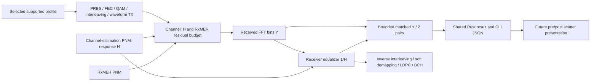

# Paired constellation before and after equalization

**Status: core collector and shared API/CLI export implemented; see the
[implementation and validation record](implementation.md). Qt presentation remains deferred.**

## Accepted experiment and priority

The accepted feature is a measurement-conditioned single-channel experiment showing
what the supplied channel response does to received QAM and what its matching
receiver correction removes. Use the existing transmission, channel, FFT and
FEC path. Do this before independent pilot-based channel/timing estimation.
The official checklist owns implementation under CONST-01 through CONST-05;
MODEL-05 and WAVE-RX-05 remain open for nonideal estimation/acquisition.

Inputs remain the current decoded RxMER, DS channel-estimation and modulation-
profile JSON. Match CM/channel/exact frequency grid, preserve timestamps/nulls
and require explicit capture-time tolerance. The supplied demonstration captures
are not synchronized; describe their combination as a demonstration scenario.
Initial waveform support remains the existing uniform 256-QAM profile mode.

## Coefficients and reference planes

Standard DS channel-estimation PNM reports complex response H, not equalizer
coefficients. CM-OSSI 3.1 I27 Annex D.2.6 and PHY 3.1 I20 section 9.3.4 are the
pinned references already documented in the [channel-response guide](../../../user/impairments/channel-response.md).

| Meaning of supplied coefficients | Channel multiplier | RX correction |
| --- | --- | --- |
| Response H: existing PNM input contract | H | 1/H |
| Correction C: explanation only; not an accepted new input mode | 1/C | C |

For a complex correction C = I + jQ, its reciprocal is

\[
 C^{-1}=\frac{I-jQ}{I^2+Q^2}.
\]

Do not invert I and Q separately, use only the conjugate, or silently reinterpret
an H input as C. If correction-coefficient input is added later, require explicit
semantics and a separate validated adapter; it is not needed for this feature.
Zero, unavailable and nonrepresentable active coefficients retain existing
rejection behavior rather than receiving an invented gain.

With X the ideal transmitted cell and E the synthetic post-equalization residual:

\[
 Y_{k,t}=H_k(X_{k,t}+E_{k,t}),\qquad
 Z_{k,t}=H_k^{-1}Y_{k,t}=X_{k,t}+E_{k,t}.
\]

RxMER supplies the per-carrier residual-power budget at the equalized reference
plane. Keep the existing Gaussian residual model and apply it once; no extra
thermal noise or independently applied second RxMER impairment. This reproduces
measured relative channel shape and residual power, not the original field noise
samples, burst timing, absolute path loss or the modem's exact implementation.
Using matching H and 1/H is an ideal known-coefficient baseline, not a claim of
independent channel estimation. The existing channel is synchronized and diagonal
per OFDM symbol, not arbitrary time-domain FIR multipath.



## Confirmed reuse and integration gap

| Existing source under crates/ofdm/src/ | Disposition | Confirmed contract / missing behavior |
| --- | --- | --- |
| `scenario/pnm_json/` | Reuse | Existing three-file import, exact identity/grid and provenance; no new binary parser |
| `signal_processing/channel/impairments.rs` | Reuse | Supplied H and per-carrier residual planning/application; do not duplicate math |
| `simulation/channel/impairment.rs` | Reuse | Existing independent channel waveform synthesis |
| `simulation/waveform/receiver.rs` | Reuse | ReceivedSymbol owns raw `bins` and `equalized` arrays from the same received symbol |
| `simulation/waveform/observation.rs` | Reuse / extend | Existing `rx.fft.bins` and `rx.equalized.iq` producers; separate probe events do not guarantee pairwise selection or payload-only classification |
| `simulation/channel/runner.rs` and `simulation/payload/receiver.rs` | Extend after tracing | Need to associate valid source-observation payload cells with physical receive coordinates across interleaving and NCP placement |
| `simulation/test_points/` | Reuse | Existing directional grids, phases and finite budgets; no parallel generic probe framework |

The key gap is payload eligibility. A static Data carrier can carry NCP, filler,
a scattered pilot or startup history at a particular time. Do not treat all
static data bins as payload samples. Trace received NCP spans and inverse-
interleaving provenance before choosing a collector integration boundary.

## Sample selection and result contract

- Default target: **8,192 paired QAM observations total for the selection**, not
  8,192 complete OFDM symbols, codewords or points per constellation location.
  Make the requested count explicit and bounded; proposed initial cap: 65,536.
- Select a supported profile and optionally one carrier or an inclusive
  carrier-center frequency interval. Validate actual grid bounds without relabeling
  or resampling. Reject unsupported waveform profile modes rather than downgrade.
- Collect only actual payload observations attributable to the configured source
  observation window after acquisition and interleaver warm-up. Exclude pilots,
  PLC, NCP, filler, excluded/zero-loaded bins and unavailable history. Do not
  exclude a sample simply because its payload later fails FEC; that would bias
  the plot toward successful decisions.
- Preserve each pair's physical carrier index/frequency, channel-symbol index,
  source-symbol coordinate where recovered, profile ID, modulation order and
  exact before/after I/Q. Pair by the same physical bin and receive time.
- Receive samples may arrive during drain while belonging to the source
  observation interval. Preserve the existing source-window accounting rather
  than counting all drain bins as observation data.
- Select deterministically in receive-symbol order, then physical-bin order.
  The first eligible points satisfy the target; this is not claimed to be random
  or statistically representative sampling. A future sampling policy is separate.
- Stop retaining pairs at the configured limit without stopping/reseeding the run.
  Keep source generation, channel-noise draws, decoder inputs, BER and iterations
  unchanged with collection disabled, enabled or exhausted.
- Keep arrays equal length by admitting a complete pair atomically. Retain a
  bounded pending-coordinate map only if interleaver attribution requires it;
  prove a finite bound before implementation, not a whole-run cache.
- Return requested/collected counts, selection/units, coefficient meaning and
  provenance, with explicit complete/partial/unavailable capture status. Preserve
  the enclosing job's independent complete/cancelled/runtime-exceeded/failed status.
- A short run or single-carrier selection may yield fewer than 8,192 points.
  Report that honestly; never repeat/pad points or silently extend run duration.
  Existing captured pairs remain available when a run is interrupted or fails.
- Raw H can rotate/scale different carriers differently. A pooled full-channel
  constellation will therefore differ from a single-carrier view. Retain the
  coordinates so consumers can distinguish these cases.
- Keep shared reference scaling and units for before/after arrays. Do not
  independently normalize either plot and hide the channel distortion.
- Use one typed Rust result for library callers and CLI serialization. Do not
  finalize new JSON field names in this plan; implement/validate the shared model
  first. Existing generic probe export remains available independently.

No transmitter truth or diagnostic IDs may become receiver input to select,
decode or equalize cells. Independent TX reference points may be used only for
post-reception validation. Existing soft LLRs remain the decoder input; no hard
slicer or scatter-derived value replaces them.

## Proposed component ownership

Refine these candidate paths after tracing the eligibility gap; do not create
empty modules solely to match this tree.

```text
crates/ofdm/src/simulation/channel/constellation/
    mod.rs          Selection, paired result and bounded collector facade
    selection.rs    Validated profile/carrier/window eligibility
    collector.rs    Atomic pairs and finite attribution/pending state
crates/cli/src/commands/
    channel.rs      Extend the existing channel-command JSON/result adapter
crates/ofdm/tests/
    paired_constellation.rs
```

The current command adapter is `crates/cli/src/commands/channel.rs`. Keep it as
orchestration; move new substantial implementation into a focused subfolder
only if its responsibility requires that split.
Numerical helpers, if actually needed beyond the existing reciprocal/equalizer,
belong under `signal_processing/`, not in collector or CLI code. No new noise,
QAM, parser or equalizer implementation is planned.

The future optional Qt presentation would consume the two Rust-generated point
sets with shared axes. This task plans the core/library/CLI data first; it adds
no UI, binding, installer or new platform claim.

## Implementation order and acceptance

1. **CONST-01: provenance and selection.** Trace cell placement back to received
   physical coordinates. Define typed selection/pair metadata and independent
   vectors proving payload eligibility through frequency/time interleaving.
2. **CONST-02: bounded paired collector.** Reuse FFT/equalized outputs, implement
   pairwise admission, requested count, finite pending storage and partial results.
3. **CONST-03: shared API and CLI export.** Opt-in channel capture, bounded JSON
   output and no-clobber behavior; direct Rust consumers receive the same data.
4. **CONST-04: simulation/invariance validation.** Known H-only distortion/correction,
   measured residuals, failure unbiasedness and unchanged decoder outcomes.
5. **CONST-05: user guide and reproducible demo.** Generate actual 8,192-pair
   artifacts with exact input settings/provenance and CLI instructions; update
   stage guides, architecture and checklist only after evidence is present.

Planned checks:

- Identity H, constant complex gain, frequency-varying H and exact reciprocal
  arithmetic. With E=0, Y=HX and Z=X within established transform tolerances.
- Fixed synthetic label/role vectors through interleaving, NCP boundaries,
  randomizer resets, startup and drain; select payload even when FEC fails.
- Both supported spacings, single-carrier and interval selections, invalid
  profiles/bounds/counts, exact target, exhaustion and short-run partial status.
- Seeded RxMER cases preserve the residual after equalization; compare pair
  coordinates and raw values with direct receiver-stage outputs. No automatic
  scaling or fabricated field-noise sample claim.
- Disabled/enabled/exhausted/failed collection leaves channel and PRBS draws,
  decoding decisions, BER, LDPC/BCH totals and future samples unchanged, except
  explicit existing job termination policy when an export sink fails.
- Runtime/cancellation/control rejection retain completed pairs and FEC results;
  output-byte limits, invalid JSON and existing-destination rejection remain explicit.
- Rust API and actual release CLI agree. Run the appropriate full gate after
  implementation; Linux testing alone does not establish Windows/macOS support.

The original planning task ran no implementation checks. The subsequent
implementation and its actual validation are recorded in [implementation.md](implementation.md).

## Planning validation

Reviewed the actual imported-response, waveform receiver, probe producers and
channel/CLI module layout. Checked public Markdown target paths, balanced fences,
control characters, unique pending CONST IDs and retained open MODEL-05/WAVE-RX-05
status. Checked whitespace. No Rust source, CLI behavior or simulation results
changed; no numerical tests or Mermaid rendering were run for this plan.
