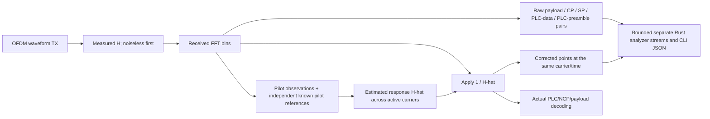

# Receiver Channel Estimation (CH-EST-RX) with pilot and PLC analyzers

**Accepted design, now implemented for the supported bootstrap scope.**
See the [implementation record](implementation.md) for current behavior, evidence
and limitations. Requirements below preserve the original plan; full blind
acquisition and posterior estimator-uncertainty calibration are not claimed.
This is the receiver group under MODEL-05. It extends the completed
[payload-pair capture](../paired-constellation/implementation.md), rather than
replacing that collector or claiming MODEL-05/WAVE-RX-05 are already complete.

Channel Estimation (CH-EST) includes its direction in task IDs: CH-EST-RX
for receiver processing; CH-EST-TX for transmitter-side work.

## Accepted scope

Estimate the channel response from received pilots, apply its reciprocal to the
receiver, and inspect payload, pilot and PLC constellations before/after correction.
Start with no injected noise and known timing/PLC phase. Follow with controlled
noise and measurement-conditioned cases. Unknown-timing acquisition remains a
separate WAVE-RX-05 step.

| Analyzer stream | Modulation/reference | Separation |
| --- | --- | --- |
| Payload | Existing supported uniform256-QAM profile | Reuse received NCP payload attribution; retain failed payloads |
| Continuous pilots | BPSK with actual configured sign and boost | Keep distinct from scattered pilots and data |
| Scattered pilots | BPSK with phase-dependent positions/signs and boost | Preserve symbol phase and physical coordinates |
| PLC data | Actual16-QAM PLC data cells | Separate from preamble, pilots and payload/NCP |
| PLC preamble | Known BPSK preamble columns/signs | Separate stream; never label it PLC16-QAM |

These are I/Q scatter analyzers. Pilot/preamble plots are BPSK constellations,
not payload-QAM plots. Do not combine boosted pilots with unit-reference payload
samples or combine PLC preamble and data into one apparent modulation cloud.
The existing pilot/PLC guides own exact normative sequences and scaling.

## Flow and coefficient semantics

Standard DS CE PNM continues to supply H for the simulated physical channel.
The receiver-estimated H-hat is separate. The reference supplied-H equalizer
remains selectable as a validation baseline. For known pilot reference P:

\[
 \widehat H_{k,t}=Y_{k,t}/P_{k,t},\qquad
 Z_{k,t}=Y_{k,t}/\widehat H_{k,t}.
\]

Generate P independently from receiver-known pilot sequence/phase and boost,
not from transmitted sample arrays or payload truth. Reuse pinned sequence/math
owners, while keeping separate receiver state and explicit bootstrap assumptions.
Interpolation, temporal averaging, initialization and near-zero handling need
specific algorithms, numerical tests and reference-plane decisions before coding.

An estimator evaluated on a pilot used to fit itself can appear artificially
perfect. Separate in-fit pilot diagnostics from independent/held-out pilot and
data-bin estimation checks; do not use a clean training scatter as proof of
receiver reliability. Noise/reference variance after estimated equalization must
be validated independently; do not silently reuse perfect-H calibration when its
meaning no longer fits. Preserve the current apply-once RxMER residual budget.

## Confirmed reuse and integration gaps

- Existing `ReceivedSymbol.bins` is the raw physical receive plane; existing
  corrected outputs/probes supply the reference-H baseline.
- `signal_processing/receiver/extraction.rs` already retains actual pilot roles
  and physical bins separately from PLC and reduced payload cells.
- `simulation/waveform/observation.rs` already exposes `rx.fft.bins`,
  `rx.equalized.iq`, `rx.pilots.iq` and `rx.plc.iq`. Generic probes alone do not
  provide the new matched stream filtering/phase metadata.
- Reuse the existing pilot sequences, PLC geometry/preamble classifier and bounded
  capture conventions. Do not replace the payload eligibility rules with static
  carrier masks or pass transmitter diagnostic IDs into RX.
- Current waveform reception always uses `KnownReferenceEqualizer`; an optional
  estimated-response mode and a separate Rust estimation owner are needed.
- PLC decoding participates in receiver configuration. The first experiment must
  retain explicit known bootstrap geometry/timing/phase, obtain estimates before
  PLC correction/decoding, then validate acquired descriptors. Do not require
  successful PLC decoding to discover the very correction needed to decode PLC,
  or hide that circular dependency by handing the RX the TX configuration.
- PLC/pilot capture must operate before payload readiness so acquisition signals
  are observable. Their capture window/phase differs from the payload source
  observation window; export that distinction explicitly.

## Analyzer and lifecycle contract

Collect raw/corrected pairs at exactly matching physical carrier and receive
symbol coordinates. Each stream has its own selected/requested/collected count,
modulation/role, frame phase, units, reference power/boost and completion status.
Use the existing8192-point default concept per explicitly requested stream, with
finite per-stream and combined memory/output budgets verified before allocation.
Do not silently multiply unlimited buffers by enabling all analyzer streams.

Retain raw amplitudes for truthful pre/post plots. An optional reference overlay
may show the expected boosted BPSK/PLC points; any later unit-energy display
conversion must be labeled and must not modify exported raw observations.
The receiver's correction source must be explicit: supplied H or pilot-estimated
H-hat. Both before/after panels use a shared display reference and axis policy.

PLC data must be classified from the physical PLC map and actual frame phase,
not guessed from observed I/Q. Separate preamble columns and PLC data phase.
Do not retain only CRC/LDPC-successful PLC frames: failed observations remain
available with corresponding scientific outcomes. PLC uses its own LDPC/CRC and
packet checks; it is not the payload BCH/LDPC path. Pilots have no FEC iterations.

Missing observations, startup estimates, incomplete pilot coverage, short runs,
cancellation, runtime expiry and control rejection need explicit partial/unavailable
results. No padding, repeated samples or implicit run extension to reach8192.
Collection on/off/exhaustion must preserve source/noise draws and decoder inputs
for the selected receiver mode. Compare reference versus estimated modes as
separate experiments; their decoding outcomes are allowed to differ.

All estimation, interpolation, correction, eligibility and scientific metrics
remain Rust. CLI and future Qt only consume the shared typed outputs. Extend
scientific modules by responsibility; do not put estimator math in the runner,
CLI or plotting helper. A Qt application is still deferred.

## Implementation group and validation

1. **CH-EST-RX-01:** Receiver-owned pilot references and per-pilot response estimates;
   known timing/phase, noiseless independent amplitude/phase anchors first.
2. **CH-EST-RX-02:** Tested data/PLC-band interpolation and estimated equalizer mode;
   quantify coverage/startup and response error without supplied H as RX input.
3. **CH-EST-RX-03:** Bounded separate continuous/scattered-pilot raw/corrected analyzers;
   include boost, physical locations, source phase and in-fit/held-out meaning.
4. **CH-EST-RX-04:** Bounded separate PLC16-QAM and BPSK-preamble paired analyzers,
   including acquisition and failed frames without payload-readiness gating.
5. **CH-EST-RX-05:** Noiseless and noisy comparisons with reference-H reception:
   estimation error, payload BER/LDPC iterations, PLC/control outcomes and collector
   invariance. Cover both spacings, pilot phase changes and explicit coverage gaps.
6. **CH-EST-RX-06:** Shared public Rust API/CLI export, user guides, actual pre/post
   plots per stream, reproduction commands and full validation gate.

Before selecting interpolation, trace exact continuous/scattered-pilot frequency
coverage across the protected PLC neighborhood and active edges. The spec does
not automatically prescribe a unique engineering estimator. Record the chosen
method, extrapolation policy, frequency/time assumptions and independent numerical
vectors. Treat known timing as the initial boundary, not completed blind acquisition.

The original planning update made no implementation claim; the linked
implementation record now documents the completed supported scope.

## Supplied-H demonstration evidence

A [bounded reference example](../../../user/impairments/pilot-plc-constellation.md)
now pairs the existing raw/equalized test points during one128-symbol acquisition
frame. It separates continuous pilots, scattered pilots, PLC16-QAM and the BPSK
preamble. Measured H is preserved and noise is explicitly disabled. Rust checks
each corrected point against independent modulation geometry and checks Y=HZ.
Actual before/after figures are linked from the guide. The measured case retains
1280/502/1920/128 pairs respectively and decodes one PLC frame with zero bit errors.

This is an example-owned observer, not a new production collector or CLI schema.
That demonstration alone did not implement pilot-derived estimation,
interpolation, independent held-out validation or the shared analyzer contract.

Reference-demo validation:10 pilot/PLC/receiver/probe integration tests pass;
the example passes warnings-denied Clippy and rustfmt. Repeated noiseless runs
produce identical paired I/Q streams. Existing-output rejection preserves bytes;
missing-H requests reject without creating output. Both rendered figures were
visually inspected.130 local documentation links resolve across the reviewed
guides, architecture, checklist and plan. This is scoped validation of the demo,
not completion of the future estimator acceptance suite.
