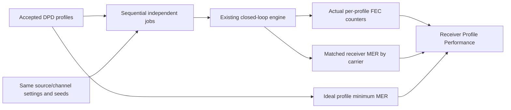

# Receiver profile performance and independent profile runs

Status: implemented and validated on the Ubuntu VM.
The user selected separate runs per imported profile, rather than transitions
within a continuous run. The prior GUI prepared one applied profile and kept one result. The new mode
retains per-profile performance with one latest detailed instrument snapshot.

## RX-PERF-01: Independent profile sweep

Retain all profiles from the accepted DPD capture in the Rust input snapshot.
Run them sequentially by captured profile ID through the existing Rust
closed-loop job API. Each profile gets the configured observation duration and
fresh source, receiver, FEC, noise and measurement-playback state, using the same
source/noise seeds, OCD, channel response, amplifier, attenuation and cable loss.
This makes the run conditions reproducible; different profile capacities can
still consume different numbers of bits and codewords. Never reuse previous
profile decoder/interleaver state. Keep the applied DPD selection unchanged.

Validate every profile's layout/coding support before beginning. Report rejected
profiles explicitly; do not substitute another profile or silently omit them.
Distinguish incompatibility from an actual completed run with decoding failures.
Run one worker at a time. Start begins the sweep; Pause gates the current run;
Stop cancels it and prevents queued profiles from starting. Preserve completed
results and label the current result partial on cancellation or runtime expiry.
Show progress as profile ID, profile ordinal/count and observation progress.

Bound retained results and instrument observations per sweep, not merely per
profile. Keep full scalar summaries per profile and bounded plot projections;
do not retain every existing multi-megabyte instrument snapshot for 256 profiles.
Use at most 32 profiles and 262144 source assignments per sweep, with a shared
active host runtime of at most 300000 ms. Disclose instrument retention limits. Selecting a completed performance profile selects its matching curves and
counters only. Other instruments explicitly identify the latest completed
profile, avoiding mismatched or stale detailed snapshots.

Persist the accepted run mode and relevant limits in receiver WB settings;
restore legacy workbenches compatibly. Results and transient chart filters remain
outside configuration persistence. Update native user guides/screenshots when
implemented.

## FEC-COUNTS-01: Payload codeword accounting

Add reusable typed cumulative counters to the simulation core, including the
existing observation-window accounting. The initial instrument counts completed
payload decode attempts wholly inside the observation window, including those
completed during drain. Keep crossing/outside words and generated-but-unfinished
words separately reported; they must not become fabricated UFEC results.

- TotalCW: completed payload codeword decode attempts in the selected scope.
- CCW: decoder-successful words for which LDPC or BCH actually applied a
  correction. Count each word once, even if both stages corrected it.
- UFEC: words with LDPC or BCH failure, counting the union once.
- CleanCW: successful words requiring no correction.

Maintain TotalCW = CleanCW + CCW + UFEC. These are simulator decoder outcome
counters, not imported modem management counters. Source comparison remains
independent: a decoder-successful but wrong payload is an undetected integrity
error, not silently relabeled decoder failure. Expose that separately.

The previous core exposed LDPC/BCH success, iterations, BCH-corrected bits and
source-comparison errors. Those could not establish CCW. The implementation now
observes LDPC changes at the decoder boundary by comparing applicable received
hard decisions with decoded bits, excluding synthetic shortening positions. Never infer CCW
from iteration count or BCH corrected-bit totals. Retain bounded per-word
outcome fields and constant-size aggregate counters, independent of the first
64 word-detail records. Keep PLC/NCP counters separate from payload codewords.

## UI-RX-PERF-01: Receiver Profile Performance instrument

Add Profile Performance beside existing Receiver Diagnostic Instruments and
link detailed counters to FEC Monitor. A dedicated dialog/chart composes bounded
Rust projections; preserve one file per window, X/Close, dark documentation,
mouse zoom and Full Span. Use shared spacing and stable trace colors.

Header: Channel, Profile selector, run/partial status. Counter cards: TotalCW,
CCW, UFEC (and clean count in detail). Plot: frequency in MHz and MER in dB.
Blue is actual post-equalization receiver MER by carrier for that profile;
green is the captured profile's ideal Shannon minimum MER, using existing
shared Rust math. Label the green line as ideal, not a normative receiver MER
requirement. Offer bit loading separately rather than plotting bits on a dB
axis. The existing DPD viewer retains bit-loading and carrier-role inspection;
this instrument focuses on MER/reference overlays and FEC counters.

An optional dashed Configured RxMER reference may overlay the accepted channel
noise input. Distinguish it from measured receiver MER: the latter reflects the
actual waveform, equalization and additional impairments. Average signal/error
powers before converting to dB; never average dB or infer MER from slicer
success. Use matched diagnostic reference/received cells without feeding TX
truth into receiver decoding. Preserve exact physical bins, profile identity,
time scope, invalid samples and gaps; show unavailable where retention provides
no data. Plot and FEC counters must label their observation scopes; a bounded
MER snapshot is not automatically the full codeword interval.

FEC counters are profile/channel-wide. Do not imply per-subcarrier FEC counts
by coloring individual frequency bins as failed codewords.

Owners: core codec outcomes and simulation channel accounting; Qt simulation
admission/worker and accepted WB options; receiver instrument provider; dedicated
QML under instruments/profile_performance. Keep DSP and accounting in Rust.

Validation: independent clean/LDPC-only/BCH-only/combined/failed outcome vectors;
union accounting, undetected errors and retained-detail exhaustion; observation
window/drain/cancellation boundaries; profile IDs/order/rejection and deterministic
fresh job setup; aggregate retention/runtime bounds; WB round trip/legacy restore;
per-bin MER power averaging, units, nulls/grids and observation invariance; QML
selection/toggle/zoom/partial results; native VM dark captures. Full core checks
are required for the accounting changes, not only Qt presentation checks.

## Captured identity and wire profile

Independent experiments map each captured profile's loading to the existing
bootstrap Profile A (wire ID0). Captured IDs remain in playback provenance,
performance entries and result selection; no on-wire profile-switch claim is
made. MeasurementSelection and transmitter preview now accept captured data
IDs0..15 for this explicitly documented mapping. Live dynamic profile transport
remains a separate API. Unsupported/protected assignments still reject.

FecCounters is a public core type under fec-codec/statistics with private fields,
getters, record and copyable snapshots. It is re-exported by the OFDM channel API.
Neither Qt nor Python owns accounting. Future Python bindings can wrap these
same typed APIs; no Python runtime/bindings are added. CarrierMer similarly
exposes accumulated power/count getters and checked finite dB conversion.

Performance retains full physical-grid scalar MER values and profile reference
values up to the aggregate assignment bound; viewport queries reduce these to
at most1024 extrema groups per trace. Only the latest detailed job/probe samples
remain retained. Not Started entries remain visible after cancellation/budget
expiry and never receive fabricated FEC results. The optional configured-RxMER
reference trace and performance carrier filters/export remain outside this
initial view; the existing DPD viewer provides bit-loading/role inspection.

## Validation evidence

The full root validation ran347 workspace tests, four measurement-example tests
and113 analysis-only tests (464 total), all passing, with doctest commands kept.
Workspace and analysis-only Clippy pass with warnings denied. Six channel-job
checks additionally verify observation-window counter membership, retained-detail
limits and MER sample totals, alongside existing cancellation/pause/probe checks.

Codec tests independently cover clean, LDPC-only, BCH-only, combined and rejected
outcomes, undetected source mismatches, partition invariants and copied snapshots.
Actual encoded/decoded words exercise correction counts. Carrier MER tests verify
linear power sums, invalid pairs and unavailable finite zero-error values.

Qt validation passes29 adapter tests and33 QML checks. The new worker integration
runs all four original captured IDs/loadings on an explicitly narrowed48MHz test
grid with five decoder iterations; original production captures are unchanged.
This avoids repeating a full192MHz high-order decoder soak in every UI check.
The test checks independent retained profiles, real counters and MER, bounded
viewports, saved/legacy run mode, duplicate rejection and stale-result cleanup.
The existing wide-channel and high-order root checks remain enabled and passed.
An earlier wide-grid integration attempt exceeded its test deadline; it is not
reported as passing. Native full-size example verification follows separately.

The native Ubuntu VM also ran the full-size192MHz example in all-profile mode.
It reached Profile3 Complete with122 observation TotalCW,122 CCW,0 UFEC and
zero source comparison errors. The Receiver title identifies the latest captured
profile. Native startup/run diagnostics were empty. The final graph reference
includes pilot/PLC dips and is covered by the adapter integration check; its
updated dark screenshot is captured separately using Applied Profile Only.

Final validation after the reference-dip adjustment:29 adapter tests and33 QML
checks pass, with warnings-denied Qt Clippy and formatting. The built native
window was inspected using the unchanged full-size capture in Applied Profile
Only mode: Profile0 completed with82 TotalCW,81 CleanCW,1 CCW,0 UFEC and zero
undetected errors. The current dark screenshot is in the linked
[user guide](../../../user/receiver-profile-performance.md). Native diagnostics
were empty. The latest Qt executable is built. No commit, tag, push, installer
publication or installed-package update was performed.
