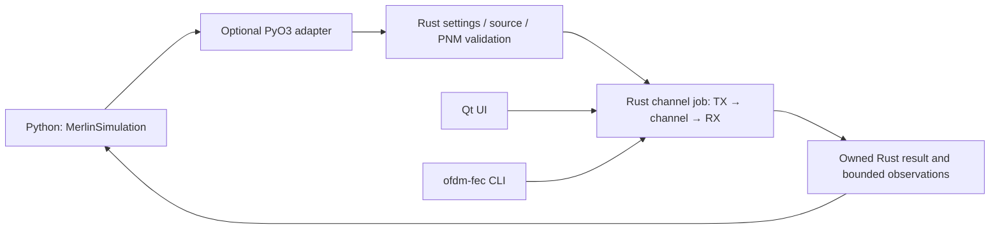

# API-01: simple Python adapter after Qt

**TODO — proposed only. Begin after the Qt UI work (UI-01 through UI-04).**
There is no Python simulation package or binding implementation today. This plan
adds Python access to the existing Rust engine, not a Python DSP implementation.

## Initial interface

Start with one public class, `MerlinSimulation`. A separate optional PyO3 adapter
crate exposes the existing Rust APIs; maturin is the proposed wheel/build tool.
Keep installation, package naming and supported Python versions for later design.
Python users must not need the Qt application or a CLI subprocess for this API.
Rust and CLI builds remain independent of Python and Qt.

| Member | Purpose |
| --- | --- |
| `settings` | Single-channel transmission and run settings with explicit units |
| `source` | PRBS15 by default, or supplied text/binary bytes with an explicit fill policy |
| `measurements` | Optional decoded RxMER, channel-estimation and modulation-profile inputs |
| `limits` | Bounded runtime, work and retained observations |
| `result` | Latest owned Rust-derived result; initially `None` |

Keep these as simple Python-facing snapshots initially. Validate input in Rust;
copy/freeze the settings, source and measurements at the start of each run.
Changes apply to the next run and never mutate previous results. Avoid exposing
Rust memory layout, borrowed buffers or a separate object for every DSP stage.

This is a conceptual signature sketch, **not an available import or finalized
request schema**. Dictionary keys and exact method arguments will be settled
against the validated Rust interfaces after UI development:

```python
class MerlinSimulation:
    def __init__(self, settings: dict, *, limits: dict | None = None):
        self.settings = settings
        self.source = {"kind": "prbs15"}
        self.measurements = None
        self.limits = limits
        self.result = None

    def load_measurements(self, *, rxmer=None, channel_estimation=None,
                          modulation_profile=None):
        """Validate and retain supported pnm-decode JSON inputs through Rust."""
        ...

    def set_source(self, data: bytes, *, append_prbs15: bool = False):
        """Use supplied payload bytes with an explicit fill policy."""
        ...

    def run(self) -> dict:
        """Run the Rust engine and retain/return an owned result snapshot."""
        ...
```

Text is explicitly encoded to bytes by the caller (for example UTF-8); Rust
preserves the transmitted payload/fill distinction and compares recovered bits.
Without measurements, use the configured ideal/reference channel. Supplying
measurements uses the existing association, grid, provenance and decoder-contract
validation; this adapter does not introduce binary PNM decoding. Missing samples
stay missing rather than becoming zero.

The first result should expose the Rust-derived status, compared bits/BER,
codeword failures, LDPC iterations and selected bounded observations through a
plain dictionary. Distinguish complete, partial/cancelled and failed outcomes;
never turn an incomplete run into a successful zero-BER result. Keep returned
results independent of later runs.

## Reuse and ownership



Reuse `TransmissionSettings`, `ChannelDocument`, validated scenario/PNM imports,
`ChannelRunSettings`, `run_channel`, `ChannelJobLimits` and `ChannelJobResult`.
The binding maps structured `SimulationError` categories to Python exceptions,
releases the interpreter lock during execution and owns conversions/lifetimes.
No scientific calculation moves to Python. Start with synchronous execution;
plan progress/cancellation delivery against the Rust job contract before adding
Python callbacks, threads or a persistent session. NumPy/zero-copy APIs are later
work and require lifetime/layout evidence.

## Follow-up checklist

- [ ] Complete the Qt UI milestone before implementing API-01.
- [ ] Confirm the small class interface against the final shared Rust operations.
- [ ] Add the optional adapter crate and wheel packaging without core dependencies.
- [ ] Test Python/Rust result parity for ideal and measurement-driven runs.
- [ ] Test exact payload/fill recovery, errors, limits and repeated-run ownership.
- [ ] Define and test partial outcomes, cancellation and interpreter-lock handling.
- [ ] Add installation and class-usage documentation when the package exists.

Documentation validation: links resolve and API-01 remains unchecked. No binding,
Python runtime dependency, packaging or simulation behavior is implemented here.
