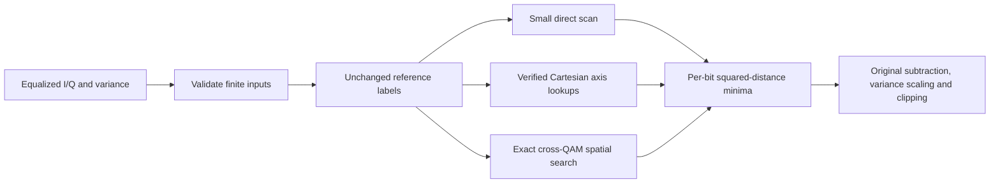

# QAM-PERF-01: Exact indexed max-log soft demapping

The existing demapper scans M stored points and updates log2(M) bit hypotheses
for every received cell: O(M log M). All profile runs also pay this cost during
receiver drain. Constellation order, not profile ordinal, determines this work.

Keep the existing PHY I20 Annex A label-ordered normalized tables unchanged.
For a complete Cartesian grid, verify from those actual labels that each label
bit depends on exactly one coordinate. Build per-bit predecessor/successor
lookups once. Two axis binary searches and O(log M) constant-time bit lookups
then compute exact constrained Euclidean minima. Preserve I-squared plus
Q-squared arithmetic before subtraction, variance scaling, clipping and errors.
Do not cancel the opposite-axis term algebraically: that changes floating-point
results. Do not assume generic Gray labels or treat cross-QAM as square.

For irregular/nonseparable references, build balanced two-dimensional nearest
searches per bit hypothesis. Queries remain exact with geometric pruning;
expected cost is much smaller but worst-case search can still visit all points.
BPSK/QPSK/16-QAM and the small cross-128 table retain direct scans to avoid index/search
overhead observed in the initial kernel check. Caches are thread-safe, initialized once per supported order and bounded by the
existing maximum14-bit tables. No caller API, dependencies, tables, PHY support,
FEC rules, seeds or persistence changes. Retain the old full scan only for rare
extreme-coordinate overflow validation where a rectangular bound is inconclusive.

Validation: bitwise compare against an independent full-scan test oracle across
all supported orders, noisy/edge/tie/outside points and extreme/invalid inputs.
Preserve existing normative label/energy tests, control/payload coding loops,
receiver closed-loop results and analysis-only support. Measure release-mode
old/new kernels with equivalent batches and checksums; do not assert wall-time
thresholds in tests. Verify the existing Qt profile sweep and leave a new native
executable. Clearly separate kernel speedup from end-to-end timing evidence.

## Data flow

## Kernel measurement

Ubuntu x64, pinned Rust1.85.1, release profile. Each row uses4096 identical cells
through old/new implementations; warm columns are medians of three batches.
Checksums match exactly. First-use index construction is measured separately.
No other build/test job was running during this kernel measurement.

| Order | Old scan (ms) | Indexed (ms) | Kernel speedup | Cold first call (ms) |
| --- | ---: | ---: | ---: | ---: |
| 256 | 8.323 | 0.376 | 22.1x | 0.035 |
| 1024 | 43.442 | 0.386 | 112.4x | 0.187 |
| 2048 | 97.179 | 25.278 | 3.84x | 2.941 |
| 4096 | 199.475 | 0.506 | 394.2x | 0.276 |
| 8192 | 445.160 | 49.151 | 9.06x | 11.567 |
| 16384 | 945.311 | 0.648 | 1458.2x | 1.074 |

Results depend on CPU/compiler/load and sample distribution. These ratios do not
include full receiver/FEC/FFT work and do not establish whole-run speedup. Small
direct-scan orders preserve their prior algorithm; the indexed fast path is not
forced on them merely to remove a loop.

## Numerical and integration checks

The independent full-scan oracle covers all12 orders, exact points, deterministic
perturbations, midpoints/ties, outside points, large coordinates, subnormal/noisy
variances, invalid inputs and concurrent first use. Output LLR bits match exactly.
Existing PHY table label/energy checks remain unchanged; mapping source files and
hashes were not regenerated. These checks establish numerical preservation and
MERLIN-only recovery, not external interoperability or rendered-PDF verification.

All304 affected core tests pass with no skips (141.5s test execution), including
live PLC/NCP, uniform/mixed/shortened codewords and both waveform spacings. All127
analysis-only tests pass with no skips. Warnings-denied core Clippy and formatting
pass; doctests have no cases. The standalone benchmark has no timing pass/fail
threshold. Unchanged codec/CLI crate suites were not rerun.

## Native workbench and compiled artifact

Qt formatting, warnings-denied Clippy,40 adapter tests and39 QML checks pass.
The unchanged adapter suite, including the independent four-profile sweep,
finished in20.92s in this run (earlier local pre-optimization run78.72s). These
are observed local durations, not a controlled whole-suite speedup guarantee.

Native Ubuntu/Qt check: same curated single-WB captures, selected profile3 only,
1ms observation,50-iteration decoder limit and a60s active budget. The debug
application completed normally: elapsed display17s, external automation17.85s,
125/125 whole-run payloads recovered,1,779,000 compared bits and zero bit errors.
Observation counters are TotalCW122/CCW122/UFEC0; mean LDPC iterations1.032
(121 words at1 iteration,4 at2), matching the user's earlier FEC screenshot.
Native logs contain no Qt/QML diagnostics. Running/completed/FEC proof captures
and process timing are ignored local artifacts under this feature's local folder.

The earlier bounded pre-optimization5s native sample stopped during acquisition;
it did not measure a complete run. Do not divide that partial duration by this
completed duration or present the394x kernel ratio as a full-run ratio. Other
receiver/FFT/FEC work remains. No competing build/test ran during the native
measurement. The current compiled Qt executable is ready; hosted and other-OS
runtime validation were not performed.
