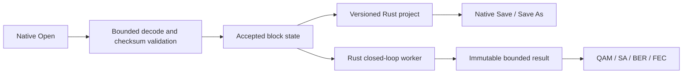

Current receiver instrument follow-up: [completed views and selectors](../receiver-instruments/design.md). Earlier pending statements record the original task stage.

# Qt closed-loop execution

Active tasks: UI-RUN-01, UI-RX-CONFIG-01, UI-VERIFY-01, UI-SA-05 data and
UI-QAM-01 data. Swap RxMER/Channel Estimate in the main diagram first; both still
feed Channel Simulator, and a dashed Channel Estimate → Receiver path labels
supplied-H reference correction. Pilot-estimated H-hat remains independent.

Reuse ChannelRunSettings, MeasurementSelection, ChannelRun and the bounded channel
job API. Publish only accepted measurement/source/profile snapshots in the GUI
session. A focused worker owns the frozen request, cancellation/pause gates and
bounded probes. Settings edits invalidate old result identities, never mutate an
active job. Receiver options select supplied H or pilot estimation and finite
observation/iteration/runtime bounds. PRBS-RX confirms independent source compare.
Green means a fully validated next-run request, not visiting analyzer tabs.

Start/Stop and Pause/Resume act on one worker. Pause is cooperative at completed
OFDM-step boundaries; source, RNG, overlap/interleaver/receiver state remain alive.
Exclude paused host time from runtime budget; Stop works while paused. Preserve
partial results and actual FEC/BER counts. No new DSP implementation belongs in Qt.

Connect the existing bounded payload/PLC collectors and RX sample probes to Rust
viewports. NCP constellation classification remains a separate collector task;
never fabricate it from LLRs. Frequency-domain FFT-bin power is not time PSD.
Retain at most finite sample snapshots/paired points and share one result per run.

MeasurementPlayback must drive all supported single/average/hold/interpolated
policies in core orchestration, retaining original epochs and one continuous RNG.
New optional core configuration is explicit and validated; existing CLI behavior
stays unchanged when absent. Validate affected core contracts and Qt integration,
including real noiseless/measurement runs, cancellation, pause and invalidation.
Refresh architecture, both checklists, task validation and dark VM user guides.

## UI-RUN-01 / UI-RX-CONFIG-01 / UI-VERIFY-01

`closed_loop/model.rs` freezes a validated `ChannelRunSettings` from accepted
source/profile/measurement snapshots. One worker owns the core run and bounded
observers; the GUI polls scalars and adopts one immutable result. Configuration
changes cancel stale work and clear instrument identity. Profile A ID 0 is the
supported live UI path; other captured IDs remain viewable without substitution.
Core `run_channel_controlled` cooperates with atomic pause/cancellation gates.

`PlaybackConfiguration` prepares the existing measurement playback policy in the
core runner. Each observation step updates residual powers and matching LLR
variance without replacing channel response, RNG, waveform or receiver history.
The final state continues through completion/drain. The phase-filtered probe
reserves retention for observation samples, excluding acquisition warm-up.

## UI-SA-05 / UI-QAM-01 data

`receiver_instruments/views.rs` queries the same immutable result. Payload/PLC
pairs and four RX test points are bounded; simulation PSD/FFT power and axes use
existing Rust APIs. QML draws returned points only. NCP matched I/Q, arbitrary
carrier/time selection, channel-response/echo and slicer detail renderers remain
pending; their windows do not fabricate results.

## UI-WB-JSON-01: Open / Save / Save As

`project_file.rs` owns the version-1 schema and validation; `workbench_file.rs`
coordinates native GTK chooser subprocesses and accepted-session replacement.
Each editor exports its accepted state and exact original input bytes. Base64,
byte count and SHA-256 preserve binary/JSON/file sources without path dependencies.
One JSON also stores OCD, playback policies, receiver/run options, comparison
acceptance and theme. Drafts, run outputs and transient viewport state are omitted.

Open validates every section before adoption, then reloads editors; it never runs
the engine. Failure/cancellation preserves the current session. Cross-input
readiness is re-evaluated after restoration. Save prompts initially; subsequent
Save atomically replaces the same project through a synced sibling temporary
file. Save As selects another destination with native overwrite confirmation.
Imported original paths are protected. Workbench files are capped at 144 MiB;
original/combined input limits remain in force. File operations are disabled
while a worker is active. No Qt file browser or Python runtime is introduced.

See [validation](validation.md) and [user workflow](../../../user/closed-loop-workbench.md).

## UI-WB-OPEN-01: Main Open file filter

File → Open (including Ctrl+O) must use the OS-native workbench chooser with
an active `*.merlin.json` filter. Keep directory navigation and the existing
installed/development examples root. Use a distinct internal chooser mode,
not a title-string heuristic, so DPD, source, RxMER and channel-estimate pickers
keep their current behavior. GTK owns the filter; Rust still validates selected
bytes and preserves accepted state on cancellation/rejection. The filter is a
navigation aid, not a replacement for content/schema/checksum validation.

Own changes in native_file_picker and WorkbenchFile, with helper dispatch in
main. No DSP or WB schema changes. Verify the actual native main Open on this VM,
including a single-example directory containing PNM/metadata alongside its WB,
and update the user guide with a dark screenshot. Build/check only Qt.

Implemented and verified on the Ubuntu VM: actual main Ctrl+O launches the
distinct native workbench mode. In `examples/workbench/single`, the chooser
shows only `workbench.merlin.json`, hiding its seven other PNM/metadata/license
files. Folder navigation works and Cancel returns to the same parent window.
The updated dark native screenshot is linked from the example guide. All 27
adapter tests and 32 QML checks pass, alongside Qt Clippy, formatting and
whitespace checks. The current development executable is built. No core suite
was repeated, and the installed package was not replaced.
