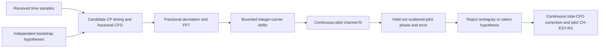

# WAVE-RX-05: bounded receiver acquisition

## Scope

Select the receiver numerology from independently supplied bootstrap hypotheses
rather than a transmitter object. Each hypothesis carries spacing, CP/RP and a
physical pilot/PLC layout; the received samples choose which is supported.
This is a finite hypothesis search, not automatic RF spectrum discovery. Fixed
204.8 Msamples/s sampling, one channel, positive unit reference RMS and an
unwrapped sample clock remain explicit. Search integer CFO around the fractional
CP estimate; preserve both components and the selected hypothesis as test points.

Pinned PHY3.1 I20 section7.3.1/Table6 defines25/50kHz spacing and FFT sizes.
Sections7.5.7 and7.5.15 define waveform/pilots. The acquisition scoring, rejection
thresholds and search budgets are engineering policies, not normative algorithms.
PHY4.0 I07 section7.3.5.5 delegates the FDD mapping basis to PHY3.1.

For FFT length N and sample rate Fs, CP correlation estimates the fractional
frequency offset modulo Fs/N:

\[
\widehat{\Delta f}_{frac}=\frac{F_s}{2\pi N}\arg\sum_n y_n^*y_{n+N}.
\]

For integer hypothesis m, align physical bins as
\(Z_k=Y_{(k+m)\bmod N}\), then score pilots independently of data decisions.
The selected total offset is
\(\widehat{\Delta f}=\widehat{\Delta f}_{frac}+mF_s/N\).
Apply \(y'_n=y_n e^{-j2\pi\widehat{\Delta f}(n-n_0)/F_s}\)
with one sample origin across all later blocks.

## Validation plan

Cover both spacings and24/90/192MHz occupied widths. Use independent received
sample perturbations, integer offsets of both signs, fractional offsets, prefix
search offsets and unknown pilot phase. Verify chosen numerology, total CFO,
pilot phase, equalized symbol errors and split-block invariance. Include reflected
multipath/ripple, amplitude/phase variation, weak/ambiguous signals, insufficient
samples, invalid hypotheses, exceeded budgets and offsets outside the search.
Document successful parameter bounds and explicit rejection instead of claiming
arbitrary-channel or full RF acquisition. The user-defined minimum QAM-04/QA-05 acceptance is MERLIN-only closed-loop
verification; external interoperability is optional future work.

## Implementation and focused evidence

Implemented `channel_estimation/search.rs` with at most8 bootstrap hypotheses,
1024 timing offsets and an integer CFO radius at most16. Acquisition requires
two complete symbol periods plus the timing window for every hypothesis, scores
two consecutive symbols and rejects insufficient/ambiguous evidence. The same
continuous derotator handles full and split raw blocks. Existing fractional-only
constructors remain compatible and retain their narrower bounds.

`receiver_search.rs` passes all12 spacing/width/channel cases, six actual
BCH/LDPC-coded waveform recoveries, split-block continuation and policy/silence/
unsupported-offset/duplicate/physically-indistinguishable rejection checks.
Reflections are actual time-domain delayed paths at4/12samples, with gains0.15
and-0.07, plus seeded sample perturbations and complex direct gain. Both spacings
are unknown to the selection operation, but CP/RP and layouts are candidate inputs.

The coded-block experiment transports one known14232-bit block after BCH/LDPC and
bit processing, then verifies recovered truth. It isolates acquired WAVE-RX and
CH-EST-RX; it does not present synthetic PLC placeholders as decoded live control.
The existing full control/payload integration tests remain separate evidence.
Direct outputs expose every acquisition decision and normal receiver stage buffer.
No new CLI schema, Python/Qt dependency, publication or external-data claim is added.
