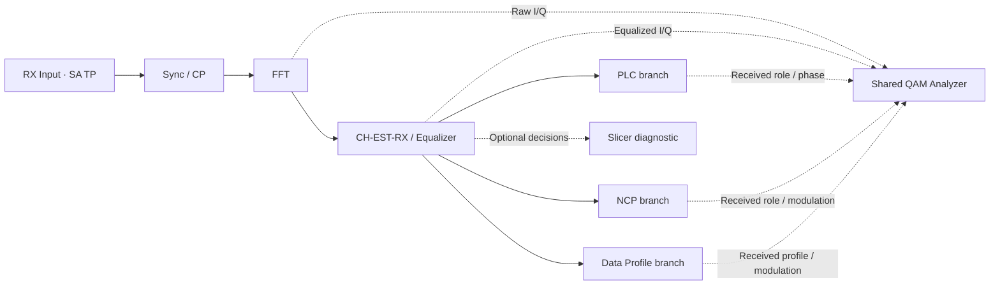

Current follow-up: [Qt closed-loop and persistence](../qt-closed-loop/design.md)
connects supported receiver results, pause/run dispatch and project files. Older
pending statements below describe the original implementation stage. NCP matched
I/Q and generalized observation selection remain pending.

# Receiver workbench and analyzer selection

Status: UI-RX-WB-01 navigation, QAM selectors and UI-SA-05 selector/routing are
implemented. Receiver charts, full-loop dispatch, retained-result integration and
matched NCP I/Q collection remain pending. See [validation](validation.md).

## UI-RX-WB-01: Receiver workbench

Clicking Receiver opens its own Receiver Workbench dialog. Keep the processing
path across the top, selectable test-point markers below it, and diagnostic
instrument actions at the bottom. Use separate QML files for the workspace and
analyzer dialogs; reuse the shared Spectrum Analyzer and Rust core APIs.

The sketch is navigation, not a new serial DSP architecture. Show synchronization /
prefix removal → FFT → Channel Estimation / Equalizer, then received-role branches
for PLC, NCP and data profiles. Slicing is an optional diagnostic branch: production
soft demapping consumes noisy I/Q before hard decisions. Each branch owns its
appropriate demapping, coding and decode statistics; do not imply every signal
passes through the payload BCH/PRBS chain. PRBS comparison applies to configured
payload recovery, not PLC or NCP control messages.

## UI-QAM-01 / UI-QAM-02: One analyzer, independent selectors

The shared constellation analyzer has:

- Signal: **Data Profile | NCP | PLC**. Continuous/scattered pilots remain separate
  supported diagnostic groups when their existing observations are connected.
- QAM View: **Raw | Equalized | Paired**. Default Equalized, before slicing.
- Data Profile: received profile ID/generation, carrier or compatible same-order
  group, and symbol/time range. Never combine different QAM orders in one cloud.
- NCP: actual received NCP role and modulation for the selected interval. Do not
  treat NCP as a payload profile, infer eligibility from transmitter truth, or
  plot LLRs/decoded labels as if they were received I/Q.
- PLC: separate data and preamble selections; preserve their actual modulation,
  phase and normalization. Do not pool the preamble into a data constellation.

Raw/equalized comparisons use matching run, carrier and receive-symbol identities,
shared axes and explicit correction mode (supplied H versus estimated H-hat).
Keep failed-decode observations eligible where the collector supports them.
Changing selectors queries retained bounded Rust observations; it neither reruns
nor reconfigures the simulation. Missing observations show a precise reason and
require an explicit new run if they were not retained. An old chart cannot remain
visible under a new selection label. If failure prevents received-role admission,
report unavailable classification instead of assigning a profile using TX truth.

## UI-SA-05: Spectrum Analyzer test points

SA selection is independent of the QAM Signal selector. PLC/NCP/data selection
must not filter or synthesize an isolated full-channel spectrum implicitly.
Clicking an SA marker opens the shared SA on that explicit reference plane;
its own Test Point dropdown lets the user switch among retained compatible taps.

| Display label | Existing Rust test point | Instrument meaning |
| --- | --- | --- |
| RX Input / Channel Output | `channel.output` | Complex baseband time samples after channel impairments; first receiver SA target. |
| RX Framed Samples | `rx.framed.samples` | Framed time samples including prefix; boundaries/gaps explicit. |
| RX Useful Samples | `rx.cp.samples` | Time samples after prefix removal; preserve symbol boundaries rather than joining disjoint windows into a continuous trace. |
| RX FFT Bin Power | `rx.fft.bins` | Separate frequency-domain bin-power view, with its own units/normalization; no second FFT or unsupported PSD label. |

`rx.equalized.iq` is a constellation tap, and
`rx.channel_estimation.response` is a channel-response/echo input. Neither is
implicitly a continuous time-sample SA tap. A new transformed spectrum would
require an explicit Rust operation, provenance and tests. Spectrum / Channel
Response may share instrument navigation, but response H and spectral power
retain distinct units and reference planes.

## Existing code and required integration

Inspection evidence: `simulation/test_points/model.rs` registers the listed taps,
`rx.plc.iq`, `rx.pilots.iq`, `rx.reduced.iq`, `rx.ncp.llrs` and `rx.ncp.accepted`.
The payload paired collector under `simulation/channel/constellation/` currently
restricts selection to its supported profile; a profile dropdown must reflect
real support, not promise arbitrary profile IDs. The protected collector supplies
existing pilot/PLC observations. NCP soft/control events do not themselves provide
a matched NCP constellation: add received NCP I/Q classification and bounded
paired collection in Rust before enabling that view. Preserve public APIs.

Full-loop UI dispatch and a common bounded retained-result session are prerequisites
for actual RX charts. Rust owns scientific coordinates, frequency/carrier mapping,
classification, decimation, normalization and resource accounting. QML owns layout
and transient instrument selection. All open instruments share finite retention
budgets and an immutable result identity. No fake scatter points or fallback TX
samples under an RX label. Opening instruments must not advance RNG/receiver state.

## Implementation and validation sequence

1. UI-RX-WB-01: build the receiver navigation shell and selectors, with honest
   unavailable states; keep Receiver readiness separate from having old results.
2. Connect full-loop dispatch/retained RX Input samples, then UI-SA-05 using the
   existing Rust spectrum calculation. Validate tap units and discontinuities.
3. UI-QAM-01: connect the supported payload and PLC paired collectors; select only
   supported profiles/roles and label incomplete support explicitly.
4. UI-QAM-02: implement bounded received NCP I/Q classification/matched collection,
   then connect NCP selection. Do not reuse payload eligibility blindly.
5. Add real slicer/LLR/FEC/channel-response instruments in their owning tasks.

Use scoped Rust tests only for changed collectors/contracts; Qt tests cover
selectors, unsupported state, stale-result clearing and navigation. Verify actual
dark/light rendering on the VM and publish dark screenshots when UI exists.
Check observation invariance and finite retention across simultaneous instruments.
Implementation validation is recorded separately; preserve non-Qt caches and use
Qt checks for navigation-only changes.

See the [architecture](../../../architecture.md#receiver-workbench),
[UI checklist](../../ui-checklist.md), [user guide](../../../user/receiver-workbench.md)
and [existing matched payload collector](../../../user/impairments/paired-constellation.md).

## Implemented navigation and ownership

`ReceiverWorkbenchDialog.qml` owns processing-stage navigation and instrument
composition. `ReceiverQamDialog.qml` owns independent signal/view/PLC-part controls;
it has no observation renderer yet and shows an explicit empty result state.
`ReceiverDiagnosticDialog.qml` presents pending response/echo, slicer/LLR and FEC
instrument explanations. The existing `SpectrumAnalyzerDialog.qml` now accepts a
test-point model, independent selection callback, generation policy and optional
TX timing panel. Its existing transmitter behavior remains the default.

`receiver_instruments.rs` is the focused Rust admission adapter. It maps spectrum
choices to registered core `TestPointId` values and reports unavailable data,
including specific NCP/collector support gaps. It starts no worker and owns no
RNG/scientific state. Receiver SA generation stays disabled and cannot call the
TX preview; changing taps clears old viewport state. Profile and carrier/time
queries stay unavailable until received metadata exists. Receiver readiness and
Start gating are unchanged. UI-RX-WB-01 is complete as navigation, not receiver
configuration or processing implementation.

## UI-RX-WB-02: Aligned rounded stage chips

Use one reusable `ReceiverChip.qml` for the receiver's stage, test-point and
instrument buttons. Stage columns have equal widths, matching 64-pixel bodies
and aligned 28-pixel annotation rows. Arrows align with the chip bodies; labels
must not shift the last two stages relative to the others. Rounded 12-pixel stage
bodies have subtle pin accents and an inset border; these accents convey no
readiness status. Smaller instrument chips share rounded corners and equal
widths within their row. Keep keyboard focus visible, preserve light/dark theme
colors and do not change navigation or scientific state. Refresh native dark
screenshots and check minimum-size layout using the existing QML suite and Qt
build only; no new DSP tests are needed for this presentation change.
