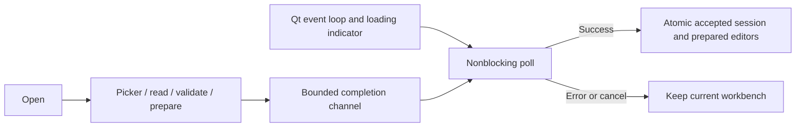

# UI-WB-OPEN-02 — Responsive workbench loading

Large embedded capture collections must not stop the Qt event loop and trigger
Ubuntu's not-responding prompt. Changing the desktop timeout hides the problem.

Use one Rust background loader for the native picker, bounded file read, JSON
decoding, original-byte/hash validation, editor reconstruction and run admission.
Return owned prepared models through a bounded channel. Qt polls without waiting,
shows loading stage and elapsed time, and adopts the complete result atomically.
Reuse prepared editors and requests rather than decoding and validating the same
captures again on the UI thread. Never start a simulation during Open.

Keep the existing file, section, capture and playback limits. Invalid files and
cancellation preserve the current workbench, observations and Save destination.
Cancellation is cooperative between preparation stages; retain the one-worker
guard until completion. No worker may mutate the GUI thread's accepted session.
Disable conflicting operations while the modal loading window is open.

Ownership: `workbench/project_load` owns worker lifecycle and prepared state;
`project_file` owns format validation; existing Rust input/run models own domain
preparation; `bridge/workbench_file` publishes success on Qt's thread. QML owns
only the modal presentation, polling and editor adoption.

Validation: controlled worker lifecycle tests, real multi-capture preparation,
malformed input and cancellation preservation, QML loading/keyboard tests, Qt
format/Clippy/tests/build and a native large-workbench load with window-event
responsiveness evidence. No installer or OS-timeout changes are required.

## Implemented and validated — 2026-11-11

Main Open and update recovery now use the background loader. Project preparation
reconstructs originals once and supplies the accepted snapshot and editable
models together. Receiver and transmitter admission and scalar readiness are
prepared off-thread; GUI adoption consumes those models without repeating the
refresh/configure chain. Save and individual input-file import remain separate
existing operations; this change addresses workbench Open/recovery.

Qt formatting, Clippy with warnings denied, 51 Rust adapter tests and the native
build pass. Controlled worker tests prove nonblocking polling, one-worker
cancellation, failure preservation and real 132-capture preparation. The full QML
suite passes 51 checks, including modal loading and cancellation preservation.
Native Ubuntu 22.04 verification opened the 132-capture channel-193 example;
elapsed text and the busy indicator kept updating while the chooser and capture
validation were active. The live loading screenshot is in the workbench guide.
No OS timeout settings, simulation outputs or installed package were changed.

Local-only logs, intermediate screenshots and the owned-process native helper
are under `docs/development/local/responsive-workbench-open/`; they are absent
from fresh clones. [User guide](../../../user/workbench.md#workbench-configuration-files).
