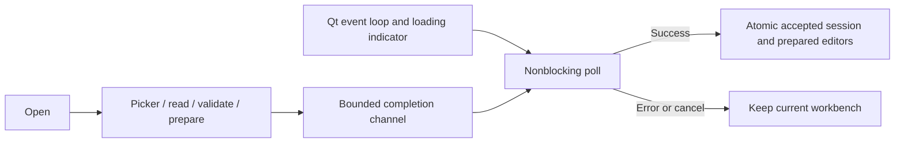

# UI-WB-OPEN-02 — Responsive workbench loading

Large embedded capture collections must not stop the Qt event loop and trigger
Ubuntu's not-responding prompt. Changing the desktop timeout hides the problem.

Use one Rust background loader for the native picker, bounded file read, JSON
decoding, original-byte/hash validation, editor reconstruction and run admission.
Return owned prepared models through a bounded channel. Qt polls without waiting,
shows loading stage and elapsed time, and adopts the complete result atomically.
Reuse prepared editors and requests rather than decoding and validating the same
captures again on the UI thread. Never start a simulation during Open.

Keep the existing file, section, capture and playback limits. Invalid files and
cancellation preserve the current workbench, observations and Save destination.
Cancellation is cooperative between preparation stages; retain the one-worker
guard until completion. No worker may mutate the GUI thread's accepted session.
Disable conflicting operations while the modal loading window is open.

Ownership: `workbench/project_load` owns worker lifecycle and prepared state;
`project_file` owns format validation; existing Rust input/run models own domain
preparation; `bridge/workbench_file` publishes success on Qt's thread. QML owns
only the modal presentation, polling and editor adoption.

Validation: controlled worker lifecycle tests, real multi-capture preparation,
malformed input and cancellation preservation, QML loading/keyboard tests, Qt
format/Clippy/tests/build and a native large-workbench load with window-event
responsiveness evidence. No installer or OS-timeout changes are required.

## Implemented and validated — 2026-11-11

Main Open and update recovery now use the background loader. Project preparation
reconstructs originals once and supplies the accepted snapshot and editable
models together. Receiver and transmitter admission and scalar readiness are
prepared off-thread; GUI adoption consumes those models without repeating the
refresh/configure chain. Save and individual input-file import remain separate
existing operations; this change addresses workbench Open/recovery.

Qt formatting, Clippy with warnings denied, 51 Rust adapter tests and the native
build pass. Controlled worker tests prove nonblocking polling, one-worker
cancellation, failure preservation and real 132-capture preparation. The full QML
suite passes 51 checks, including modal loading and cancellation preservation.
Native Ubuntu 22.04 verification opened the 132-capture channel-193 example;
elapsed text and the busy indicator kept updating while the chooser and capture
validation were active. The live loading screenshot is in the workbench guide.
No OS timeout settings, simulation outputs or installed package were changed.

Local-only logs, intermediate screenshots and the owned-process native helper
are under `docs/development/local/responsive-workbench-open/`; they are absent
from fresh clones. [User guide](../../../user/workbench.md#workbench-configuration-files).

## Prepared channel readiness follow-up — 2026-11-11

Native transmitter-graph verification found channel readiness was prepared
using a helper that consulted GUI thread-local input state. That state is empty
on the loader worker, so a valid workbench could be adopted with Start disabled.
`channel_model::preview_inputs` now validates the explicitly supplied immutable
input model; GUI preview delegates to the same helper with its current inputs.
The real 132-capture worker test asserts complete channel readiness. A fresh
native workbench Open followed by Start and completed profile-0 simulation
passes without reapplying an input. The complete Qt suite passes 54 Rust tests
and 53 QML checks. This changes readiness preparation, not persisted settings
or simulation semantics.

## UI-WB-OPEN-03 — Clear loading activity

Replace the spinner with a full-width indeterminate progress bar and retain the
actual loader phase. The bar conveys activity, not a measured percentage or
remaining time: current preparation has no reliable total-work counter. Label
the existing timer Time since Open, explicitly including file selection and
validation. Keep modal cancellation and worker ownership unchanged. QML owns
presentation only; no settings, JSON or simulation changes. Verify the loading
bar, phase and elapsed labels, cancellation, native rendering and build.

Validation: 53 QML checks pass, including current labels, compact table values,
bounded widths and instrument keyboard routing. The native build passes. Actual
Ubuntu dark screenshots confirm the updated layout; the transmitter cards also
retain light-theme verification. Earlier in this same change, Qt formatting,
Clippy and all 54 Rust adapter tests passed. No simulation or persisted settings
were changed; installed packages and other platforms were not exercised.

## UI-WB-OPEN-04 — Quiet loading and command-line workbenches

Normal loading keeps the phase and activity bar; elapsed time and its explanation
are visible only with `--debug-ui`. Add `--workbench FILE` and `--workbench -`
for redirected stdin. Startup schedules the existing bounded background loader
after the window is ready; no picker or automatic simulation. File input becomes
the Save destination, while stdin has no destination and prompts on first Save.
Retain existing schema/hash validation, input-size bounds, one worker and atomic
adoption. Preserve update-recovery precedence by rejecting conflicting requests.
Test argument validation, file/stdin preparation, size and malformed-input errors,
normal/debug visibility and native startup. Document CLI help and launch examples.

Implemented and validated: Qt formatting, warnings-denied Clippy, all 58 Rust
adapter tests, 53 QML checks and native build pass. Native Ubuntu launches of
the 132-capture example through both `--workbench FILE` and redirected stdin
complete without a chooser or simulation. Normal loading hides the timer;
`--debug-ui` shows it and emits start/completion timing. Invalid stdin shows
a validation error and one error record. Headless help and missing-argument
checks pass. RUST_LOG independently overrides the debug default.

The desktop owns the stderr logger; its defaults and controls are recorded in
`docs/development/debugging.md`, linked from the docs index. Existing CLI logging
is unchanged. No installed-package or other-platform validation is claimed.
