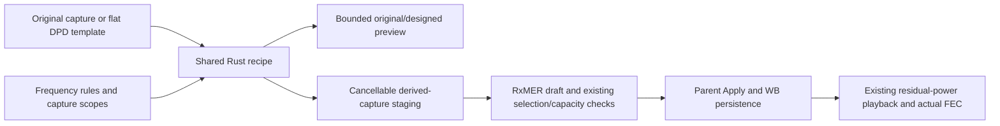

# RXMER-DESIGN-01: RxMER Designer

Status: implemented and locally validated on 2026-11-12.
See [validation](validation.md) and the [user guide](../../../user/measurement-inputs/rxmer-designer.md).

Add RxMER Designer to Capture Configuration. Imported originals are immutable.
Each designed capture is a versioned MERLIN JSON envelope containing its original
baseline (or a synthetic flat template), recipe and collection position. It is
not a PNM binary layout. Its derived hash/name/kind identify designed data; original
bytes, identity, grid and capture timestamps remain available inside the envelope.
WB persistence reuses the existing bounded original-file sections. Reopening the
Designer recovers baselines and a coherent recipe, never compounds prior Apply.
Designer Apply stages a parent draft; the parent Apply accepts playback normally.
Cancel/X at either level preserves the corresponding previous state.

Rust `signal_processing/rxmer_designer` owns signed MER tilt, magnitude ripple,
notch shapes, capture scopes, point/range replacement and distance/velocity spacing.
Edits are deliberate dB profile modifiers, not a physical echo or cellular waveform.
No phase input or VSWR-to-MER inference. Crest anchored at the first source-grid
frequency. Tilt then ripple then notch then explicit value edits is deterministic.
Each effect has independent one-based inclusive capture scope; frequency ranges
remain a separate physical-Hz domain. Missing/excluded samples remain missing.

Application limits: 256 captures, 4 million values, 32 value-edit ranges, ±60 dB tilt,
0–60 dB ripple/notch depth, and finite designed MER from −30 to 120 dB. No silent
clipping. Native envelopes and original payloads retain existing 16 MiB per-file /
64 MiB collection limits. Recipes and viewport requests are bounded. Batch staging
runs on a cancellable worker with actual completed-capture progress and atomic
adoption; original/session changes invalidate stale completion.

Source distinction: PHY 3.1 I20 §9.3.6 defines RxMER from equalized error power.
CableLabs CM-GL-PNM-3.1-V01-200506 pp78–80 describes noise-placement-dependent
RxMER ripple and echo-cavity spacing. Distance helper uses the SI light speed and
an explicit round-trip cavity assumption; depth remains a user-selected profile
edit. These are engineering controls, not a prescribed DOCSIS impairment model.

PLC overlay: one continuous shaded frequency region from the first to the last
PLC carrier in the accepted modulation profile, rather than separate carrier
marks. Shared Rust annotation clips it to zoom and omits incompatible sources.
The main RxMER chart, capture animation and Designer all use that helper.

Validation: independent numerical anchors; scope boundaries 10–20 of 50;
missing/gap preservation; invalid ranges and bounded work; repeatability; original
and derived provenance; cancellation/stale-result safety; WB roundtrip; actual
residual playback/FEC; Qt checks, native dark/light interaction and guide captures.

## RXMER-DESIGN-02: zoom and visible PLC context

Add shared wheel/drag/keyboard navigation to Designer previews, Full Span and
Zoom to PLC actions to both RxMER views, and a Rust-formatted first/last PLC
frequency readout. Rust clips and decimates both original/designed curves onto
one requested source window and shared vertical scale. Capture/effect changes
retain zoom; reopening resets it. The PLC shortcut frames the actual profile
region with bounded context; shading retains its true width. Slightly stronger
fill and endpoint borders improve visibility at full span without widening data.
Validate clipped curves, out-of-range requests, shortcut bounds, persistent zoom,
Full Span and native narrow-PLC rendering. No scientific recipe changes.
