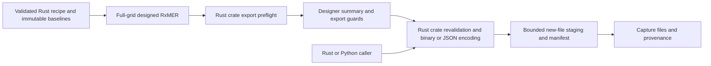

# RXMER-DESIGN-11: RxMER binary and JSON save design

Status: implemented; validation results are recorded in [design](design.md).
Designer/WB persistence remains an editable MERLIN envelope, separate from these
capture exports. The approved binary plan was extended with **Save → PNM binary
/ JSON → native file manager**. JSON uses the existing decoded PNM contract and
retains full-precision finite values and nulls; binary retains the policy below.

## Workflow

Provide **Save** as a secondary action in RxMER Designer, separate from the
existing Apply/Cancel footer. Export uses an immutable snapshot of the current
validated recipe and baselines, without starting simulation, accepting the
parent draft or closing the Designer. Choose Preview capture, All captures or
an inclusive capture range. Effect capture scopes remain independent of export
scope. Export always includes the complete original subcarrier grid; chart zoom
is only a view and does not crop the exported data.

- Preview capture: a native Save picker chooses one `.bin` or `.json` destination.
- All/range: choose an output directory; create a new export subdirectory with
  one `.bin` or `.json` per capture and stable sequence numbers preventing name collisions.
- Show a Rust-generated summary before writing: capture/sample counts, format,
  valid range, missing readings, rounding impact and any clipping count.
- Show bounded progress and allow cancellation for a collection. Publish the
  collection only when all requested files and its manifest are complete.
- Never overwrite source captures or existing destinations. Failure/cancellation
  leaves accepted measurements and the WB untouched; remove only owned staging
  outputs. Native picker cancellation writes nothing.

## Ownership: crate conversion, Qt presentation

The user's requirement is that conversion belongs in a crate. Implement the
reusable Apache-2.0 Rust encoder under `crates/pnm-input`, adjacent to the
existing native binary/JSON adapter. Keep the current crate name; no repository
or crate rename is part of this feature. Use a focused output module rather than
expanding Qt orchestration or copying PNM Viewer source into the application.
The pinned PNM dependency supplies a decoder. MERLIN implements its own bounded
encoder and existing-contract JSON serializer in `pnm-input::rxmer_export`.

The crate owns typed export requests, metadata/domain validation, range policy,
quantization, sentinel handling, PNM bytes and an owned conversion summary.
Reuse MERLIN's existing domain types and complete derived RxMER samples. Export
preflight and encoding must share validation rules so the summary and bytes agree.
A byte encoder remains independent of Qt, filesystem pickers and Python. Bounded
create-new file helpers belong in the Rust I/O adapter; a UI worker coordinates
capture batches and cancellation through the crate API.

Qt owns scope controls, displaying the returned summary, native pickers and
progress. QML must not calculate encoded samples, clip values, construct headers
or write files. The existing Rust recipe produces designed data before encoding.
The optional Python adapter exposes the same validated crate operations with
matching policies and structured errors; no Python encoder or CLI subprocess.
Implemented method names are listed below.

## Two independent guard layers

The user explicitly requires both Designer and crate guards.

1. **Designer:** query Rust preflight for the selected captures and current
   recipe. Disable the affected format when metadata, bounds or samples are invalid.
   Show the first affected capture/carrier and an actionable explanation. A
   changed recipe, source, profile, capture scope or policy invalidates the
   preflight result. Guard actual resulting samples, not just tilt/ripple/notch
   parameter ranges. The UI uses the returned admission state rather than
   duplicating scientific validation in JavaScript.
2. **Rust crate:** independently validate every encoding request and immutable
   snapshot at the export boundary. Reject invalid metadata, grids, counts,
   arithmetic overflow, nonfinite present values and disallowed out-of-range
   values with structured diagnostics. A caller cannot bypass this guard by
   skipping Qt, using Python, editing an export request or calling encode directly.
   File helpers validate before publishing bytes and retain create-new guards.

These guards apply to PNM export. Existing full-precision Designer/WB values keep
their documented internal domain; a recipe can be valid for simulation while its
results require a deliberate conversion policy for PNM export.

## Representation and conversion policy

RxMER file format 1.0 is the initial output target. The available versioned
DOCSIS 3.1 text defines one byte per subcarrier, 0–63.5 dB in 0.25 dB steps,
with 0xFF representing unavailable data. Existing Designer calculations allow
−30 to 120 dB, so binary export is a representation conversion, not a lossless
replacement for WB persistence.

Recommended policy for review:

- Preserve missing readings as 0xFF; never substitute zero for a missing sample.
- Quantize finite in-range samples to the nearest 0.25 dB. Define half-step ties
  deterministically toward the higher representable level; maximum in-range
  rounding error is 0.125 dB. Report rounded-sample counts and maximum change.
- Default to rejecting out-of-range present samples. The Designer blocks export
  and identifies the offending capture/carrier.
- Offer an explicit **Clamp to PNM range** option, off by default. When selected,
  Rust clamps to 0–63.5 dB before quantization and reports clipping separately
  from ordinary rounding. Direct crate/Python callers must opt into the same
  policy. Nonfinite present values remain errors under every policy.
- Never change the Designer's source values or WB recipe as a side effect of
  rounding/clamping for export. Decode the produced representation for any
  optional export preview so the user sees what another reader will obtain.

## Metadata and provenance

For imported baselines, preserve the original MAC, channel ID, capture epoch,
subcarrier-zero frequency, first carrier, spacing, sample count and missing-value
positions. Validate every field against the selected binary layout. For a new
flat sequence, use the accepted profile's explicit identity/grid and existing
profile-time anchor. Report this as synthetic, not as a modem measurement.

Keep capture time separate from export creation time. Do not invent distinct
capture epochs or infer timestamps from sequence filenames. Multiple synthetic
frames can share the anchor epoch; symbol playback intervals cannot generally be
represented by whole-second PNM timestamps. Preserve ordering/playback context in
provenance rather than pretending it is encoded in the binary header.

Propose a companion MERLIN JSON manifest: source/current hashes, original
identity/times, designed/synthetic label, recipe, capture positions, output
names/hashes, export policy and per-file conversion summary. A single-file save
uses a companion sidecar; a collection uses one manifest. The PNM itself stays a
standard binary without private header extensions. Separating the `.bin` from
its manifest loses recipe/provenance context; the WB remains the editable record.
The manifest stores provenance, not copied private source PDFs or extra captures.

## Evidence

- `CM-SP-CM-OSSIv3.1-I27-250219`, Annex D.2.8, PDF page 172: sample range,
  quarter-dB scale, missing sentinel and CM measurement clipping behavior.
- Same document, D.2.8.10 / Table 68, PDF page 176: RxMER file fields and
  format version. These references were inspected as clear versioned text
  extracts under the read-only PNM Viewer specification skill, not as rendered
  PDF verification. The CM's specified clipping behavior does not require
  MERLIN to silently alter designed values; strict export admission is an
  application policy yielding representable output.
- Implementation evidence: pinned Apache-2.0 PNM commit
  `5fbd5561f3e06b73486546b5ffa520279080a5eb`,
  `crates/core/src/pnm/parser/cm_ds_ofdm_rx_mer.rs` and `pnm_header.rs`.
  The decoder uses format 1.0 and big-endian multibyte fields. This is pinned
  implementation evidence, distinct from normative field provenance.

A complete writer field-evidence matrix was recorded covering common
header identity/version, widths, order, endianness, lengths, bounds and payload
semantics in `docs/development/local/rxmer-pnm-export/field-evidence.md` (ignored and absent
from fresh clones). The text was reconciled with the
pinned reader. Do not
infer DOCSIS 4.0 equivalence or advertise other file-format versions from this
review. Preserve applicable licenses/notices. All changes stay in MERLIN; PNM
Viewer and PyPNM remain read-only references.

## Delivery and acceptance

1. Complete the field-evidence matrix and define typed Rust export policy,
   request, conversion summary and structured errors.
2. Implement/test the crate encoder and create-new I/O helpers before wiring Qt.
3. Add Designer scope, preflight summary, explicit clipping choice, export guard,
   progress/cancellation and native pickers using existing UI conventions.
4. Mirror the validated crate operation in optional Python if included in the
   approved implementation scope; keep Rust/Python semantics identical.
5. Update architecture, checklist and user documentation, and capture actual
   dark UI images once implemented. Planning alone needs no GUI rebuild.

Acceptance checks:

- Independently anchored golden bytes for headers, lengths, scale and sentinel;
  tests must do more than feed the writer to its matching reader.
- Known samples at 0, a quarter-dB step, 63.5 and missing; half-step rounding,
  negative/above-range rejection, explicit clipping and nonfinite errors.
- Exact metadata, carrier count, frequency grid and null preservation; supported
  25/50 kHz grids, overflow, invalid counts, truncation and bounded output sizes.
- Pinned Rust decoder roundtrip of every encoded capture; ordinary RxMER import
  in MERLIN and read-only PNM Viewer validation of actual exported fixtures.
- Single/all/range selection, effect scopes and full-grid export despite zoom.
  Original capture hashes, recipe and accepted WB state remain unchanged.
- Create-new destinations, collisions, cancellation and filesystem failures
  leave no published partial batch or overwritten files.
- Direct crate calls reject requests the Designer blocks; explicit clamp policy
  behaves identically through crate/Qt/Python. Test stale UI preflight rejection.
- Applicable Rust formatting/Clippy/tests; Qt adapter/QML/native dark/light
  checks after UI changes; Python native tests/wheel evidence if bound.
- Report actual timings and verified platforms. Decoder roundtrip and Viewer
  import are software compatibility evidence, not physical-modem validation.

The user subsequently authorized implementation, including JSON save. Commits,
pushes and publication remain separately authorized actions.

## Implemented API and publication details

`encode`, `encode_json`, `preflight`, `preflight_format`, `save` and
`save_with_format` accept existing `RxMerFrame` values. `ExportFormat` selects
PNM/JSON; `RangePolicy` applies only to PNM. Errors retain stable code and optional
capture/subcarrier context. `RxMer::frame()` exposes an immutable validated frame
for these adapters. No Qt or Python dependency enters the crates.

Single-file publication creates the sidecar first, then the data using no-clobber
hard links on the destination volume. Failure removes only the created sidecar.
This pair is not a portable two-path atomic transaction. Collections publish in
one no-replace directory rename (safe rustix on Linux, native rename on Windows).
Other platforms return unsupported for collection publication. Owned temporary
staging is removed on ordinary failure/cancellation. Process termination or power
loss may leave staging/a sidecar; original and existing files remain protected.

The Qt worker validates an immutable full-grid recipe snapshot, retaining separate
PNM and JSON admission and summaries. PNM range failure leaves JSON available.
Native pickers use format-specific filters/default names; collection exports pick
a parent folder and create a unique named child. Rust validates again at save.
Cancel is checked before files/publication; an already-open native picker must
also be dismissed. No selection changes or save errors apply or run the draft.

Python `RxMer.to_pnm_bytes`, `pnm_export_summary`, `save_pnm`, `to_json_bytes` and
`save_json` call the same Rust code with the interpreter lock released. Structured
`ApiError` adds `export_code`, `capture` and `subcarrier`; output bytes/results own
their data. Byte-only conversion does not create an external recipe manifest.
