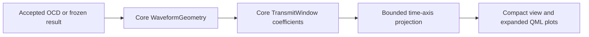

# UI-SA-TIMING-02 — Full symbol timing popup

Make the SA timing plot clickable and keyboard accessible. Open a larger
resizable Symbol Timing dialog with two complete adjacent transmit windows,
CP/FFT regions and a magnified overlap view. Use real µs scales, with a fixed
full-span domain per FFT size, so CP/RP changes alter geometry visibly.

Rust `instruments/spectrum/symbol_timing` projects bounded points from the core
TransmitWindow coefficients, preserving the half-sample taper. QML shares one
renderer between the compact overview and popup. No RF waveform is invented.
Select completed-run geometry first, transmitter-preview geometry second, or
accepted current OCD geometry before a run. Clearly label the source; draft
edits do not apply. Applying settings invalidates old results and refreshes the
current timing projection without requiring payload simulation. VF changes only
the cable-distance estimate. Keep timing and cable configuration read-only here.

Return bounded overview/detail curves, labels, ticks and overlap/usable-guard
bands; no changes to simulation, core public APIs or WB JSON. Test all supported CP/RP pairs and both
FFTs, overlap complementarity from independent expectations, actual core sample
identity, domains, configuration refresh, origin labels and VF invariance. Check
QML navigation, keyboard, resize bounds and empty states, then native dark/light
captures and the latest build. Update user guides, architecture and checklists.

## Implementation and validation

The existing compact plot is now a full two-window overview and opens the
resizable popup by click, Space or Enter. Separate graph and popup QML files
share the same bounded Rust data. The overview domain is 100 µs for 8192 FFT
samples and 60 µs for 4096; changing CP/RP does not rescale it. Overlap detail
uses a fixed 1280-sample span relative to the second-symbol start, including
the full maximum CP and a margin after FFT start. Amber marks overlap, teal
marks usable flat guard (CP minus roll-off), and CP end / FFT start is labeled.
The plot edge never represents an implicit CP boundary.

Implementation evidence is the existing
`crates/ofdm/src/signal_processing/waveform/windowing.rs`: the rising weights
are `(1 − cos(π(n + 1/2)/R))/2` for R roll-off samples, with a mirrored falling
tail. The adapter samples those actual coefficients, not a reconstructed RF
waveform. Complementary adjacent weights sum to one during their shared tail;
zero roll-off remains a rectangular evaluation window without an overlap sum.

Qt formatting, warnings-denied Clippy, 61 Rust adapter tests, 54 QML checks and
the latest native build pass. Numerical checks cover both FFTs and every valid
CP/RP pair, bounds, half-sample weights and overlap sums. Configuration-only
updates change the graph without running the transmitter; VF changes leave
the graph unchanged. QML checks include keyboard opening and real grip resizing.

Actual Ubuntu dark/light review verifies the full view, CP/FFT labels, wider
1024/256 timing, and configuration-only use. The resize guard avoids clamping
to a not-yet-sized overlay during construction. Fresh screenshots are in the
SA guide. Local native scripts/fixtures remain under ignored
`docs/development/local/symbol-window-preview/`. Core simulation code and WB
JSON are unchanged; installed packages and other platforms were not tested.

A completed CP1024/RP256 payload run also produced the expected 45 µs spacing
and 1.25 µs overlap; the guide shows its explicitly labeled Completed run view.
