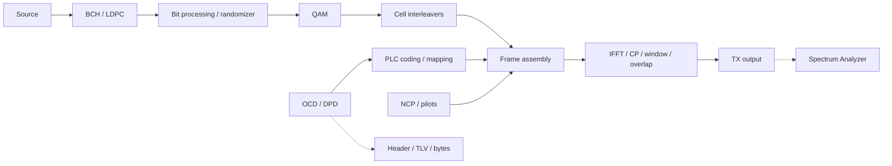

# UI-TX-03: Transmitter workbench and message inspection

## Approved implementation scope

The user approved implementation, placing the shared SA immediately below the
final TX Output test point and removing the small MERLIN eyebrow from the main
header. The full toolkit title and logo remain. Replace Transmitter's direct SA
entry with a staged dialog; retain the existing transmit-only SA preview fallback.

Collect bounded actual TX snapshots in the existing closed-loop observer. Reuse
registered payload/waveform producers; add the missing PLC-frame and physical-bin
observation calls to the channel link without modifying stage calculations.
Allow a per-stage probe phase override so PLC acquisition messages can be observed
without spending RX observation-only budgets on acquisition. Reassemble actual
observed PLC information blocks using the existing reassembler and packet/TLV
parser. Label completed versus incomplete scheduled PLC frames from the actual
transmitted-sample total, not from configured duration. No PNM bytes are substituted.

Use separate workbench, stage, QAM and message dialogs with shared chip/SA controls.
The new adapter remains bounded and reads immutable results. The bit inspector
exposes the supported LDPC boundary; do not claim a separately retained BCH word.
The QAM inspector preserves actual cell roles and unavailable history. Cancellation
or input invalidation must not leak stale results. Scoped adapter/QML tests plus
focused core observer/channel tests cover the necessary integration changes.

## Implementation

`TransmitterWorkbenchDialog.qml` replaces the direct SA entry and reuses shared
chip/SA controls. Stage, QAM, scatter and message views are separate QML files.
The existing TransmitterAnalyzer bridge adds bounded query methods; focused
`instruments/transmitter/{capture,views,messages}.rs` modules own presentation
admission and finite copied data. `simulation/closed_loop.rs` composes TX capture into
the existing immutable result, discarded on input changes or a new run.

The core channel link now invokes the existing physical-bin and PLC observation
functions after stage calculations. The nonbreaking per-stage phase-filter API
allows acquisition PLC frames while other snapshots remain observation-only.
Existing global filters and budgets retain their behavior. There are no new
DSP algorithms, wire formats or packet serializers.

Capture limits: one16K-element snapshot per selected bit/cell/bin boundary,
one symbol for IFFT/prefix/window,32768 contiguous overlap-add samples,64 complete
generated PLC information frames and32 inspected management packets. Presentation
pages contain64 rows (32bits per row for bit streams); QAM has at most2048 actual
points. Missing cells remain null/placeholder values. Profile-mode labels may be
unavailable because that path emits interleaved bits rather than uniform labels.

The core observer's `tx.plc.message` contains complete generated TS+MC frames.
Their MAC packets are independently reassembled and validated by existing APIs.
Generated frame bytes do not alone establish emission: a packet is labeled carried
only when the actual transmitted-sample total covers the last sample of its
completion frame. Partial frame/packet and capture-limit notes remain visible.
OCD and both data/NCP DPDs retain separate profile identity and TLV offsets into
the complete packet. Field labels follow the existing fixed-subset implementation
in `transmission/plc/descriptors.rs`; raw values remain exact hex, not a newly
invented semantic decoder or claim of expanded MULPI support.

Mixed Data/NCP/filler QAM is labeled explicitly; PLC data/preamble are separate.
The coding chip groups BCH/LDPC processing but its retained boundary is LDPC.
NCP/pilots share physical-bin inspection; independent NCP-only QAM and separate
BCH/individual permutation snapshots are not claimed. SA defaults to closed-loop
TX output after Start, with IFFT/prefix/window choices. Before any completed run,
TX Output retains the existing independent preview with timing/echo display.
Opening the workbench never starts that preview. Closing an inspector does not
stop the main worker or alter accepted settings.

## Historical proposal

The initial proposal requested layout review before implementation. Clicking Transmitter would
open a staged workbench matching the Receiver, with rounded processing chips,
selectable test points and shared instruments. Existing green readiness remains
derived from accepted OCD, DPD and source; instrument selection does not gate Start.

Payload path: source → BCH/LDPC → bit processing/randomization → QAM → time/frequency
cell interleaving → physical frame assembly → IFFT/CP/window/overlap-add.
PLC message coding, NCP generation/coding and pilot generation are separate paths
feeding frame assembly; they do not pass through the payload coding chain.

Reuse the existing stage APIs and test points listed in architecture. Proposed
instruments: bits/codewords, QAM by signal role, physical bins and shared SA at
waveform boundaries. Bits and bins must not be presented as time-domain I/Q.
Stage availability needs an adapter audit: a core direct output does not imply
it is already retained by the desktop run. Bound snapshots and report unavailable
data rather than manufacturing observations or silently rerunning a simulation.

Message Inspector would expose actual generated/scheduled OCD and DPD management
packets carried by PLC: message tree, header, TLV type/length/value/offset and exact
bytes. Do not confuse imported modulation-profile PNM bytes with transmitted DPD
MAC bytes. Distinguish configured, generated/scheduled and actually emitted data;
a short run may not emit the complete descriptor cycle. Preserve message profile
identity, change counts, timing and packet integrity results where available.
Do not invent TLV numbers or values. Use existing packet serializers/decoders and
pinned MULPI evidence when field interpretation needs extending.

Presentation would live in separate TransmitterWorkbenchDialog and message/bit
inspector dialogs, sharing chip, QAM and SA controls where applicable. Observation
adapters own typed bounded data; QML only presents it. No DSP changes are planned.
Applied input changes invalidate stale observations; opening inspectors is read-only.

The dark interactive proposal is
`docs/images/workbench/transmitter-workbench-proposal.html`, linked in the user
guide. It contains field labels, no captured values or invented hex. It is a design
preview, not runtime evidence. The initial proposal changed no application code.
Implementation validation will cover tap identity, limits, message-byte round trips,
read-only behavior, short-run availability and actual dark VM screenshots.

Proposal validation: JavaScript syntax and all stage/test-point/message controls
checked with a local DOM harness; documentation links and diff whitespace pass.
No Qt build or processing tests are needed for this documentation-only preview.

A static PNG of the same proposal was rendered with headless Chrome and visually
inspected for chat and the user guide. It remains a mockup, not a Qt screenshot.

## Implementation validation

UI-TX-03 is complete within the bounded stage set above. Formatting, warnings-denied
Clippy,17 Qt adapter tests and27 QML checks pass. The adapter's real closed-loop
case verifies TX source/coded/cell/bin pages, all four waveform spectra, actual OCD
and both DPDs, exact packet-byte round trips through CRC validation, TLV offsets,
invalid selections and stale-result clearing. A focused partial-frame test checks
the last-sample emission threshold and checked arithmetic.

Thirteen focused core tests pass (`channel_job` and `run_infrastructure`). Enabled
PLC/frame-bin observation preserves the complete channel summary and recovered
words versus disabled observation. Per-stage phase overrides preserve other-stage
filters, budgets and rejection rules. No full non-Qt workspace suite was run.
Final QML checks also cover the SA's output connection, dialogs/X controls,
page navigation, message/byte selection, control-path widths and prevention of a
separate preview while the main worker is busy. Retained Cargo artifacts are kept.

Actual Ubuntu22.04/Qt6.8.3 VM review: the single bundled WB restores all green
inputs; a1ms run compares1,223,952 bits with zero errors. Native inspection shows
actual mapped I/Q,16200 LDPC bits, source/channel identity, OCD TLV/hex and NCP DPD
profile255/type50. TX output SA shows a real8192-point baseband spectrum and symbol
timing. The staged workbench fits both1210x736 and960x640; the redundant header
eyebrow is absent. Dark screenshots in the user guide are actual Qt captures,
separate from the historical mockup. Native logs contain no QML warnings.
The latest executable is built and restarted in the VM; other OS runtime and
installer validation remain unverified. Local logs use the `tx-staging-*` prefix
under ignored `docs/development/local/visual-workspace/`.

## UI-TX-04: Folding descriptor tree grid

Replace the message inspector's full-width TLV buttons with a reusable virtualized
QML tree grid: Field, Value, Type, Length and Offset columns; indented expandable
children; keyboard navigation; Expand All/Collapse All and exact packet bytes.
Qt6.8 TreeView requires QAbstractItemModel and does not decode TLVs. The existing
bounded Rust JSON interface stays; the shared component flattens only visible rows
and holds transient selection/folding state. Do not claim a native TreeView model
or use text-editor code folding to interpret binary records.

Rust owns interpreted values and byte ranges. A bundled display registry at
resources/registry/plc-descriptor-tlvs.json names the existing OCD0–6/DPD5 subset,
with source paths and MULPI I25 Table69/70 references. Interpretation is traced to
current descriptors.rs and receiver_configuration/{channel,profile}.rs, not a new
specification decoder. Reuse CP/roll-off tables and spacing types. Unsupported or
reserved forms remain raw and marked unsupported; folding never parses bytes.
Assignment children expose assignment byte, first/last subcarrier and DPD default
flag/loading without inventing nested TLVs. All offsets are absolute packet-byte
positions; parent offset points at the TLV type and child values start after its
two-byte header. Preserve packet integrity/emission status and bounded capture.

Own presentation in TlvTreeGrid.qml, composition in TransmitterMessageDialog.qml,
and decoded rows in instruments/transmitter/tlv_fields.rs. Reuse the tree-grid
pattern for later structured inspectors when their Rust models expose children;
this task does not rewrite unrelated input editors or graphs. The read-only
PNM Viewer RxMerCollectionTree.qml was inspected; it uses a different collection
navigation model, so no viewer source is copied for this component.

Validate scoped Rust decoding/offset tests, adapter checks, QML folding/selection/
packet-change/bytes behavior, native dark/minimum-width rendering and updated
user screenshots. Build only the Qt workspace with retained artifacts. Update the
canonical coding-style UI guidance and verify both skill discovery links.

Qt reference: [Qt6.8 TreeView](https://doc.qt.io/qt-6.8/qml-qtquick-treeview.html)
documents the QAbstractItemModel boundary; it is not a binary TLV decoder.
The JSON projection is a presentation implementation choice for the existing
adapter, not an assertion that Qt lacks native tree controls.

Implemented and validated: all20 Qt-adapter Rust tests pass, including three
new registry/field tests covering core timing tables, exact byte ranges, DPD
default flags/loading, unsupported forms and registry key uniqueness. Formatting
and Clippy pass. All27 QML checks pass, including disclosure clicks with retained
focus, keyboard folding, Expand/Collapse All, bytes-view state preservation and
selection/folding reset on packet changes. Native review found and corrected a
delegate-lifetime focus error; focus is now established before replacing visible
rows. Final native logs contain no QML warnings.

The latest Qt executable is built with retained artifacts and running in the VM.
Actual dark captures show expanded OCD and Profile0 DPD fields; the existing
bytes view is preserved. Reviewed960x640 and1210x736 layouts and restored the
larger window for handoff. The accepted single example completed with actual
PLC messages and1,223,952 compared bits; no source captures or WB files were
modified. No simulation-library source changed or non-Qt workspace suite ran.
The canonical UI guidance and both discovery links validate; relative links,
registry JSON, screenshot integrity and diff whitespace pass.

## UI-TX-05: QAM symbol-role colors and legend

Use green Data, red NCP and a visible legend in mixed TX QAM views. Filler remains
separate and unknown roles are not guessed from constellation coordinates. The
current TransportCell sample does not retain its packing role, so add bounded,
TX-only source-role metadata to the existing mapped-cell observation context,
derived from actual PackedCell variants. Preserve signal data and receiver inputs.
Retain that metadata in the Qt capture; align the first interleaved snapshot using
the existing generic Rust SymbolInterleaver and matching source/grid origin. If
history or a full source map is unavailable, mark role unknown. No QML decoding
or new interleaving math. Stratify display reduction so rare NCP points survive
the shared2048-point cap. Draw NCP last and use distinct marker shapes as well as
colors, with palette variants for dark/light backgrounds.

Update the shared theme, TransmitterScatter/TransmitterQamDialog, role display
adapter, UI guidance, architecture and guides together. Validate core observation
invariance/metadata, Rust role transport and bounded selection, QML legend/colors,
native captures and current Qt build. Core tests are scoped to changed observation
contracts; no unrelated full workspace suite is needed.

Implemented and validated: mapped/interleaved QAM now uses green Data squares and
red NCP circles with a legend, optional amber filler diamonds and neutral unknown
markers. Role-aware reduction retains rare control points and all points when
below the shared cap. The snapshot keeps the actual source packing roles and
matching source/grid context; the adapter uses the existing SymbolInterleaver
for the first retained aligned channel symbol. Later/unavailable history is
explicitly unclassified rather than inferred. The full metadata vector is bounded
to8192 source cells and independent of an event's selected element slice.

Validation: five scoped core observation tests pass, including unchanged decoded
payloads with disabled/enabled/failing/exhausted observers and actual packing-role
checks. Core Clippy and formatting pass. All22 Qt-adapter Rust tests and27 QML
checks pass, covering rare NCP retention, interleaver alignment, unknown roles,
legend visibility and both theme palettes. Native dark Ubuntu review confirms
red/green markers in mapped and interleaved views at1210x736 and960x640; updated
user/README screenshots are actual captures. Native logs have no QML warnings.
The completed single-example run still compares1,223,952 bits with zero errors.
The latest Qt build is running in the VM. No full workspace suite was run; only
the affected core observation contracts and Qt workspace were checked.

## UI-TX-06: Source-stage origin label

Label the source chip Source / PRBS-TX and its inspector selector Source Bits ·
PRBS-TX. The label identifies the owning configuration block, not a fixed PRBS
mode: accepted input may be PRBS15 or a file with optional fill. This is UI-only
copy in the existing separate dialogs. Update user guides and actual native
captures; verify chip/selector text in QML and leave a current built executable.

UI-TX-06 is implemented: Source now identifies PRBS-TX in the stage chip and
inspector selector. All27 QML checks pass, including the exact chip/selector
labels. Native captures show the source label and actual PRBS15 bits before
coding; existing TX guide images were refreshed where their parent diagram
changed. The latest executable is built/running; no non-Qt build or additional
simulation tests were needed for these label-only changes.
