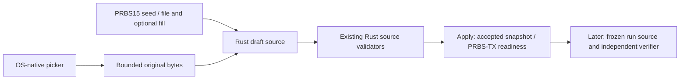

# Qt workbench task design

Status: UI-01 shell implemented; section editors, file import, analyzers and
simulation job integration remain pending.
The [UI architecture](../../../architecture.md#ui-merlin-simulation-workbench)
owns the layout and signal-flow diagrams. The [UI checklist](../../ui-checklist.md)
expands the main milestones. The [earlier plan](plan.md) retains detailed simulation
input and observation boundaries.

## UI-01: Shell, dialogs and lifecycle

### UI-SHELL-07: Measurement input placement

Remove the top dashed original/recovered comparison connector and its caption.
Independent PRBS-RX verification stays enabled through its existing dialog; this
is a layout change only. Center RxMER above Channel Simulator with a downward
input arrow. Center DS Channel Estimate below the gap between Channel Simulator
and Receiver, with one visible split feeding both blocks. Preserve the main
left-to-right signal path, input dialogs, readiness and Rust job settings.

`Workbench.qml` owns placement and connections; `Connection.qml` supports plain
segments for the split junction. Validate with existing QML interaction tests,
build the Qt executable using retained artifacts and review the actual dark VM
layout at normal and minimum window sizes. Update the workbench user guide and
architecture diagram; no signal-processing rebuild or tests are needed.

Implemented in the two owning QML files. All 25 existing QML checks pass, and the
native Qt executable was rebuilt with retained Cargo artifacts. Actual dark VM
review at 1210×736 and 960×640 confirms the downward RxMER arrow, split
channel-estimate input and absence of the top comparison line. The [workbench guide](../../../user/workbench.md)
contains the updated native screenshot. Logs remain local under
`docs/development/local/visual-workspace/input-layout-*`.

Use the name MERLIN Simulation Workbench. Implement native Qt Quick/QML with a
separate Rust adapter, proposed under apps/qt/, consuming the existing public
simulation APIs. Keep Qt dependencies out of the signal-processing libraries and all
DSP, modulation, FEC and derived simulation values in Rust.

Follow the user's diagram left to right: OFDM Settings first, then PRBS-TX /
Transmitter and profile input, Channel Simulator and measurement inputs, and
Receiver / PRBS-RX. Each block opens a focused pop-up for editing its section,
selecting an applicable input or viewing status. Keep the path visible behind it.
The PRBS comparison is independent verification, not a feedback link.

Place persistent Start, Stop and Pause/Resume icons in the lower-right corner.
Adapt TransmissionSettings, ChannelRunSettings, ChannelJobLimits, run_channel,
ChannelProgress and ChannelJobResult rather than recreating orchestration or
calculations in QML. Freeze requests at Start, run away from the UI thread,
and deliver bounded progress/results. Stop preserves completed partial results.
Borrowed probe events must be copied within their callback into bounded owned
snapshots before delivery to the UI; never retain their borrowed buffers.

Pause is not implemented by the existing job API. Design its safe step boundary,
paused-time treatment in the host-runtime budget, Stop/close handling and worker
cleanup before coding it. Resume must continue the same simulation state, not
restart or reseed. Settings edits apply only to the next run.

### Qt framework reuse

Inspect PNM Viewer Toolkit read-only for reusable shell, theme, dialogs,
navigation, adapter and build infrastructure. Adapt selected components only
inside MERLIN, preserving the standalone simulator and Rust simulation ownership.
The Qt application incorporating viewer code uses GPL-3.0-only; preserve copied
copyrights, third-party licenses and NOTICE content. Independent simulation
libraries stay Apache-2.0. Record each copied source path/revision and adaptation
here during implementation. The initial reuse record is below.

## UI-02: Input ownership

Use OS pickers for applicable files. Payloads are exact bytes with explicit fill;
measurement files initially use supported decoded PNM JSON. Reuse source and
scenario validation, including bounds, provenance, grids and explicit epoch
schedules. File replacement must not mutate an active job. Rust supplies size,
fill and validation feedback; QML presents it.

## UI-03: Test points and results

Expose existing bounded Rust observations through separate LDPC, BER, payload
pre/post-CE, continuous/scattered pilot and PLC data/preamble views. Preserve
units, reference planes, missing values and honest partial outcomes. Distinguish
supplied-H correction from pilot-derived H-hat. An open panel must not change
RNG draws, source bits or decoding decisions. Share observation retention budgets.

## UI-04: Acceptance

Initial native targets are Ubuntu 22.04, 24.04 and 26.04 x64. Verify navigation,
input rejection, Rust/UI simulation result parity, responsive progress, cancel,
pause/resume, runtime accounting, shutdown and repeated-run cleanup. Test
observation invariance independently of host timing. Check dark/light readability
and accessible controls; capture actual screenshots after implementation.
Keep platform validation and UI milestones unchecked until evidence exists.

Initial planning was documentation-only. Shell build, QML rendering and test
evidence are now recorded in [validation.md](validation.md); no new simulation
lifecycle support is claimed.

## UI-01 initial increment: workbench shell

Implement the diagram and navigable section dialogs first, with a reusable block
component, scalable connectors and lower-right controls. Controls remain disabled
until real Rust lifecycle integration exists; no simulated progress or results.
Dialogs explain each section and clearly identify pending editors/file pickers.
Use Qt 6.8.3 and the viewer's pinned CXX-Qt 0.7.3 bootstrap in an independent
apps/qt Cargo workspace. Reuse its theme palette; keep simulation crates unchanged.
The VM is the interactive rendering/review target. Verify the native build and
QML navigation tests, then inspect actual rendering. This increment does not
complete UI-01 or UI-04.

### Reuse provenance for the initial shell

Read-only reference HEAD: `5fbd5561f3e06b73486546b5ffa520279080a5eb`.
The selected source files came from the local working tree; these SHA256 values
identify inspected bytes rather than asserting they match that commit.

| Reference path | SHA256 |
| --- | --- |
| `apps/qt/Cargo.toml` | `442a69c8ae281abe71856aba46a796a9d90527fde64ff19ac21dd5e1999a57d7` |
| `apps/qt/build.rs` | `7f7a8ef0a19d26ee2defe71c423c41087ca1259cfcb3b17e53ff62cfbca2b6fd` |
| `apps/qt/src/main.rs` | `9199af55ed2993cccc24280529ffa191e6605c4420863646eba721cb37ca858f` |
| `apps/qt/src/branding.h` | `9d0ae4946c884d0c12f12db9a36f24455b2266d5f21024d43a4df654a58204f3` |
| `apps/qt/qml/Theme.qml` | `035fa925eb5b73a925ad190f56d5523e5ece61ec3821043bb67b93b74e83f680` |
| `apps/qt/qml/ThemePalette.qml` | `a4a694c742bbf2a3894d0df34ea3a87699523538937fbb33ad0b9fc37fd040ad` |
| `scripts/qt-desktop.sh` | `7241e3566a07e5bec3696c109a5b6d5d532f897d07782a5b3dc5c8864cd10958` |

Adaptations: independent Cargo workspace and pinned Qt bridge dependencies;
minimal MERLIN bootstrap/resource module; extracted dark/light palette; unchanged
ThemePalette bindings; renamed embedded-icon wrapper; simplified Apache-2.0
build/run helper with independent Cargo cache. New workbench components own only
layout/navigation. GPL notices and full license are retained under apps/qt.
The native icon wrapper contains Qt calls only, no DSP or simulation code.

The approved light icon now matches the dark design. Dark icon bytes were
preserved. Desktop entry generation is checkout-local; no system installation
or application-menu registration was performed. See [Qt development](../../qt.md)
and the [user guide](../../../user/workbench.md).

## OFDM editor and planned navigation

The OCD block opens the Parameter/Value tree editor described below. Selecting
a field shows its description, units, supported choices, application default and
pinned specification source. Apply validates staged changes in Rust and stores
them in memory; Cancel leaves the accepted configuration unchanged.

Use `resources/registry/ofdm-settings.json` for the bundled field-description
registry. Follow the OSCAR registry concept, not its TLV wire semantics. Entries
carry stable IDs, groups, labels, choices with display units, descriptions,
application defaults where applicable and versioned section/table provenance. Mark
paraphrases explicitly. Do not invent MULPI provenance or normative defaults.
Rust validation remains authoritative; verify registry choices against Rust.

Propose separate versioned `*.merlin.json` files for workbench values and input
references. Registry metadata is not duplicated in saved workbenches. File
persistence and registry loading belong in Rust; QML owns editing presentation.

Top-level Open selects a workbench; Settings opens application preferences
(including theme); About shows the expanded MERLIN name, version, licensing and
acknowledgements. Input capture selection stays with the owning diagram block.
Application navigation and workbench persistence remain unimplemented.

## UI-01 implementation: transmission editor

Implement three registry-driven dropdown fields with expandable groups and a
selected-field description. A Qt Rust object owns accepted TransmissionSettings;
QML holds only a draft. Apply deserializes and validates using the existing core
model before replacing accepted state. Rejection preserves previous state. Escape
and Cancel discard the draft. Reopening reads accepted values. The adapter also exposes core timing; the current tree does not display it. Link the core without simulation features; no DSP changes.
Test invalid CP/RP, spacing-dependent depth, malformed input, rejection atomicity,
registry choices/default consistency, and QML reopen/cancel interactions. Capture
the native dark popup on the VM and update the user guide. Persistence, other
editors and execution remain pending.

Implemented editor boundary: `OfdmSettingsDialog.qml` owns transient draft
presentation; `src/ofdm_settings.rs` owns accepted in-memory settings and delegates
to core validation/timing. `SectionPreviewDialog.qml` owns remaining generic
previews. The registry is embedded by Rust with `include_str!`; no runtime source
checkout or registry filesystem access is required. Other navigation, persistence,
carrier/pilot editors and job integration remain pending.

## UI-01 revision: selected tree layout

Replace the side-by-side form with the approved Parameter/Value tree layout and
a selected-field description below. Edit cyclic prefix, roll-off and interleaver
depth only. Replace the invented Channel context branch with Modulation Profile;
its Profile ID, Source file and Subcarrier assignments values remain blank until
profile selection is implemented. Do not derive a selected profile from core
application defaults. The accepted core configuration retains bandwidth/spacing
internally; profile loading must reconcile channel settings separately.

Pinned terminology: PHY I20 §7.5.13.4 distinguishes OFDM Channel Descriptor and
Downstream Profile Descriptor. MULPI I25 §6.4.40 (PDF 197–199) describes static
channel parameters common to profiles; §6.4.41 (PDF 199 onward) describes downstream
profiles and subcarrier assignments. Evidence is a local text extraction under
ignored docs/development/local/plc-completion/, absent from fresh clones; no
rendered-PDF verification is claimed. A modulation profile does not itself define
the sample clock/FFT. Blank profile rows are presentation of unavailable input,
not a valid channel configuration or evidence of profile-import support.

## UI-01 revision: block labels and readiness stripes

Remove secondary text from every diagram block. Preserve the heading, centered
within the box, and the left stripe. A common presentation component maps complete
(green), attention (yellow), and error (red) to palette colors. Require an explicit
status and reason for each block; expose both through tooltip/accessibility.

The architecture owns the readiness rules. In this preview all blocks need
attention because their inputs, run integration or results are unavailable.
OFDM Settings specifically requires valid accepted settings AND an accepted,
compatible modulation-profile PNM input. Its current values alone cannot make it
green. Profile import is pending, so OFDM remains yellow even after Apply.
Simulation readiness and error classification must come from Rust when connected;
QML renders status and must not infer successful import from a selected filename.
An invalid draft keeps the previous accepted state and shows its error locally.
No new synthetic errors or implicit requirements for optional inputs are added.

Verify common stripe colors/reasons, initial yellow status, unchanged yellow
OFDM status after Apply, native rendering and current block interactions. Use
Qt-only checks; update the dark native overview and dialog screenshots.

## UI-01 revision: Start readiness gate

WB-RULE-03 requires every diagram block to be green before Start can be enabled.
Aggregate the shared block statuses reactively; any yellow/red block closes the
gate. This is a presentation prerequisite, not a substitute for Rust validating
and freezing a run request. Keep Start disabled while the run action is not
connected, even if a presentation test marks every block complete. Before a run,
green means ready/configured, including the PRBS-RX comparison setup; it must not
require results from that run. Explicit valid optional-input bypass/default modes
can satisfy their block without a measurement file. Test each block independently
blocking the gate, recovery to all-green, and the pending-integration guard.

## UI-01 naming: OFDM Channel Descriptor (OCD)

The user selected the specification's full OFDM Channel Descriptor (OCD) name
for the block and popup. Wrap the heading across lines to fit the diagram.
Keep stable internal IDs and source filenames to avoid unrelated renames. This
is an editor label, not a claim that the dialog imports/exports complete OCD
messages; the modulation-profile summary remains separate from OCD semantics.

## UI-02 proposal: downstream profile input tree

Use Downstream Profile Descriptor (DPD) as the workbench workflow name, while
identifying imported files as downstream OFDM modulation-profile PNM captures,
not raw DPD MAC messages. The approved graphic terminology is Range 1, Range 2,
etc. for contiguous assignment schemes; actual skip schemes retain their type.
The dark mockup is linked from the user guide and uses existing demo values.

Plan a dedicated dialog with Open File, detected input type, File information,
Channel information and expandable Profiles/assignment schemes, profile choice,
Cancel and Apply. Keep captured data immutable. A shared Rust content detector
must distinguish recognized binary PNM from JSON text, unsupported text/binary
and empty inputs; extensions are picker hints only. Reuse existing JSON importer
and viewer binary-decoder coverage rather than duplicating numerical tests.
Standalone binary-decoder integration, UI state and readiness transitions remain
pending; the graphic is not evidence of implemented file loading.

## UI-02: PRBS-TX source editor

Implementation approach: add the optional `source-input` core feature to expose
existing PRBS/file configuration validation without compiling the runner or FEC.
Payload-sized generation and file verification retain their simulation-feature paths.
Use a shared GTK native picker bridge on the initial Ubuntu targets for PRBS-TX
and DPD; unavailable GTK returns an explicit diagnostic with no Qt browser fallback.
The bridge handles presentation only; Rust owns reads and all input interpretation.
The same executable runs an internal native-picker process before constructing
Qt, isolating GTK event dispatch from Qt. This avoids mixed-toolkit event warnings;
the helper exchanges only a selected URI or cancellation/error, never capture
bytes or numerical calculations. No external picker executable is required.

Implemented: expose the existing Rust source choices through a dedicated
`Transmit source (PRBS-TX)` tree dialog. The canonical option/default/limit table
is in the [architecture](../../../architecture.md#prbs-tx-source-configuration).
The PRBS-TX block label is retained; run integration remains pending.
The [dark design preview](../../../images/workbench/prbs-tx-design.html) shows
PRBS15 and File modes in the same Parameter/Value tree. Expandable sections,
conditional fill fields, descriptions and draft acceptance are illustrative only;
runtime screenshots and validation are recorded separately from this mockup.

Use a separate QML dialog and focused Rust source adapter. Rust owns bounded OS
file input, immutable bytes/provenance, draft/accepted configuration and validation
through existing `Prbs15`, `FilePayload`, `PrbsFill` and `PayloadSourceConfig` APIs.
QML renders bounded summaries and transient selection only. File paths/bytes do
not enter the simulation request JSON. Keep source configuration independent of
DPD compatibility; complete-job validation remains the run adapter's responsibility.

Cancel/rejected loads preserve accepted input. Start stays subject to all block
and run-integration gates. Active sources are never reseeded by editing settings.
Test points: accepted configuration, exact-byte hash/counts, bounded fill summary,
validation diagnostics and readiness. Reuse existing PRBS/file numerical tests;
add scoped adapter/QML lifecycle checks for modes, invalid seeds/targets, empty
files, equal targets, partial-byte fill and Cancel/rejection invariance. Verify the
OS-native picker on the VM, then update the user guide with dark runtime captures.
The implemented editor uses SourceInputDialog.qml and source_input/model.rs with
a source_input.rs Qt bridge. input_file.rs shares bounded reads with DPD, and
native_file_picker.{rs,h} invokes GTK directly. GTK is presentation-only; no
signal-processing code crosses CXX. Existing GTK development prerequisites are required
at compile time through pkg-config. No additional system packages were installed.

## UI-02 implementation: DPD capture input

Use a standalone Rust content detector in the core, independent of paths and file
extensions. Reuse the existing profile JSON validation by exposing import_profiles;
the three-capture CLI importer calls the same function. The optional pnm-input
feature enables input contracts without FEC/simulation dependencies in Qt.

Binary conversion calls the unchanged Apache-2.0 pnm 0.3.6 Rust library from
PNM Viewer Toolkit, pinned by Git revision 5fbd5561f3e06b73486546b5ffa520279080a5eb
in the Qt manifest/lockfile. Cargo fetches its source into an ignored local cache;
no decoder source is vendored in MERLIN. Original notices are preserved under
apps/qt/third-party/. There is no runtime viewer checkout dependency. The sanitized binary demo matches the hash already recorded
in examples/measurements/single-channel/provenance.json. Never overwrite inputs.

A dedicated Rust Qt adapter bounds file reads (16 MiB) and retains original bytes
for accepted/draft input. Loading stages a capture and profile ID; Apply validates
against accepted OCD spacing/FFT/bandwidth, Cancel preserves accepted input, and
Remove input is staged until Apply. Rejected loads preserve the previous draft.
Profile tree queries return bounded compact scheme rows, not expanded carriers.
A maximum of 256 scheme rows for the selected profile are shown with explicit
truncation. Other profiles are selectable for inspection. Accepted capture hashes,
profile identity and exact grids remain in Rust; no UI modulation calculations.
The accepted DPD and compatible OCD become green; other stages remain pending.
No job dispatch, persistence, capture editing or speculative profile overrides.

## UI-SHELL-02: Application actions and global appearance

Remove the instruction banner and standalone theme action. Present File,
Settings and About in a left-aligned top row. SettingsDialog owns Global →
Light/Dark mode, applying the shared session theme immediately. AboutDialog
provides project identity and license information. Each window has its own QML
file. File contains disabled Open WB configuration / Save WB configuration actions
until Rust workbench persistence/loading exists;
individual capture pickers remain in their block dialogs. No persistence or
simulation state changes are introduced. Validate navigation/theme controls with
Qt checks and actual dark VM screenshots; update the workbench guide.

### UI-WB-JSON-01: Planned complete configuration

Use versioned JSON for all accepted block settings and every associated PNM
input, not merely path references. Define content encoding, bounds and schema
migrations before implementation. Rust owns save/load and validates a complete
load before replacing state. OS-native pickers select paths; load never runs
a job and failed loads preserve accepted input. Source captures remain untouched.
Serialization and persistence are pending; the File menu exposes disabled actions.

UI-SHELL-02 validation: Qt Clippy/format checks and 9 Rust tests passed. The
updated QML suite passes all 21 cases, including File action availability,
Settings theme changes and About navigation. A timing-tree interaction test
now waits for rendering before clicking after dialog layout. Native Ubuntu
22.04 VM review captured the updated action row and Global appearance dialog.
Saved workbench JSON remains pending. Read-only comparison used the viewer's
AboutDialog.qml shell pattern; no viewer update/retrieval logic was copied.

### UI-SHELL-03: Standard top application menu

Replace the content-area navigation buttons/separators with a standard Qt
MenuBar in ApplicationWindow.menuBar, above branding and the workbench. A focused
WorkbenchMenuBar.qml owns File Open/Save (disabled pending persistence),
Settings → Global and About → About MERLIN menu actions. Signals open the
existing separate dialogs. Preserve shared palette and keyboard menu mnemonics.
Read-only reference inspection: PNM Viewer apps/qt/qml/Main.qml uses a top shell
header for its actions; MERLIN uses the user's requested standard MenuBar.
No viewer file/retrieval behavior is imported. Validate menu navigation and
update actual dark VM screenshots and guides.

UI-SHELL-03 validation: all 21 QML cases pass after switching tests to real
menu actions. Rebuilt the native Qt executable, verified the top menu and
Settings → Global navigation on the Ubuntu 22.04 VM, and refreshed the actual
dark workbench, settings and SA screenshots. No signal-processing code changed for
this menu correction; earlier scoped UI-SA-04 Rust validation remains applicable.
