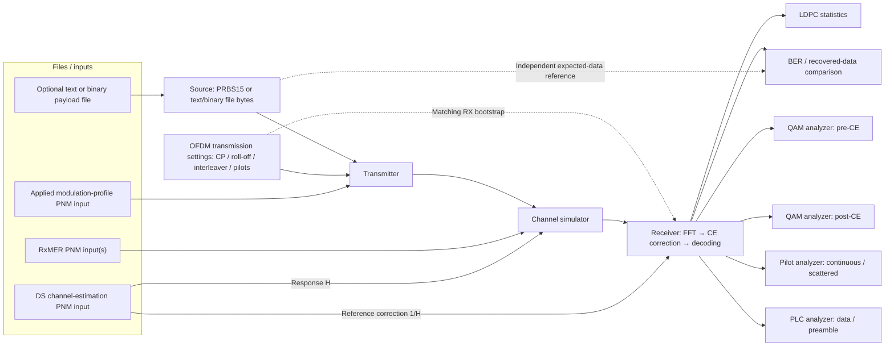

# MERLIN Simulation Workbench and selectable payload source

**Qt workbench planned; Rust/CLI text and binary file sources are implemented.**

The latest agreed layout and lower-right Start/Stop/Pause controls are recorded
in the [UI architecture](../../../architecture.md#ui-merlin-simulation-workbench),
[task design](design.md) and [UI checklist](../../ui-checklist.md). Each block opens
a focused pop-up dialog; implementation proceeds left to right from OFDM Settings.
The user's updated system sketch, including the OFDM transmission settings panel,
is the starting layout, rather than a final screen
specification. The application remains a standalone MERLIN simulator. Existing
Rust scientific stages and test points own all computation; Qt presents them.

## Workspace concept

The main area displays the signal path as clickable blocks. A file panel lists
loaded inputs and their roles. Selecting a block opens its settings, design
explanation, status and available observations. Selecting an analyzer opens its
plot or statistics view. Panels can be opened without changing the running
experiment or enabling an unbounded diagnostic capture.

The source-to-BER connection represents an independent truth comparator, not a
return channel or receiver-driven source reseeding. Analyzer arrows mean read-only
observations of the appropriate internal receiver boundary. Pre-CE taps the FFT
before correction even though it is drawn beside the receiver's other outputs.
The reference correction uses supplied H; implemented pilot-derived H-hat is a
separate receiver mode and must be labeled as such. The settings panel uses the
[updated architecture diagram](../../../architecture.md#updated-workspace-diagram-guide)
and its setting descriptions as the guide. Validate changes for the next run;
do not silently modify a running transmitter or receiver.

### Clickable blocks

| Block | Proposed contents |
| --- | --- |
| Source | Click to edit PRBS15 or text/binary file selection; OS picker, seed, original/target sizes, optional append-PRBS15 fill, progress and EOF policy. |
| OFDM transmission settings | Cyclic prefix, roll-off/windowing, time-interleaver depth and supported pilot configuration/scaling; show purpose and trade-offs, validate through Rust and apply to the next run. |
| Transmitter | Applied transmission settings, profile, coding/mapping/interleaving and waveform stage breakdown. |
| Channel simulator | Selected RxMER frame(s), supplied H, noise/reference mode, frequency grid and impairment settings. |
| Receiver | Acquisition/readiness, correction source and FFT/equalization/decoding stages. |
| LDPC statistics | Actual iterations, convergence and failure counts, separated by payload/NCP/PLC. |
| BER | Compared bits, errors, alignment/completion and recovered-data status. |
| QAM analyzers | Matched payload pre/post-CE points, profile/carrier/time selection and bounded capture status. |
| Pilot analyzer | Separate continuous/scattered BPSK views with preserved boost and paired pre/post points. |
| PLC analyzer | Separate16-QAM data and BPSK preamble views, including acquisition observations. |

Each block should explain what it does in plain language and link to its model
user guide. A transmitter or receiver block can expand into its existing
encapsulated stages rather than presenting a single opaque operation.

### File panel

List loaded files by purpose: payload, RxMER, channel response and applied profile.
Show filenames, validation status and relevant capture identity/grid/time metadata.
Associate each entry with its block; selecting an entry opens details or focuses
the consuming block. Provide an OS file picker; drag/drop may be added later.
Loading/replacing inputs must not silently mutate an active run: validate them
first and apply changes to the next explicit run.

PNM describes the measurements' origin. The current supported input is decoded
`pnm-decode` JSON through the shared Rust importer, or an already validated typed
scenario. The workspace must not imply that native binary PNM parsing exists in
this repo. Any future binary-file convenience must use an explicit decoder
adapter. Text/binary payload files are a separate data-source input, not PNM measurements.

Multiple RxMER files can be listed. The simulation core supports explicit validated
measurement epochs and frame association; listing files alone does not activate
playback. The UI must configure that schedule through the existing Rust contract.

## Implemented text and binary file source

SRC-04..06 now provide the shared Rust/CLI source underlying the planned Source
panel. See the [file-source guide](../../../user/simulation/file-source/README.md)
and [implementation record](../file-payload-source/implementation.md) for the
current contract and validation. The Qt controls themselves remain planned.

Click Source to edit PRBS15 or file selection and open an OS file picker. Text
and binary files preserve exact bytes, independent of extension or text encoding.
Present original size, finite target/fill count, seed and completion information
from the Rust model; keep input bytes out of logs and JSON results.

The implemented application bounds are16MiB original bytes and134,217,728 total
meaningful bits. Optional **Append PRBS15 to fill** uses an explicit total-bit
target and independent nonzero15-bit seed. Fill starts after the original file,
continues across words and stops at the target. Empty files and equal-to-file
length targets are supported. Targets below original size or beyond the work
bound reject before starting. No original bytes are silently repeated/truncated.

Minimum/alignment and automatic channel/profile/duration-derived target rules
remain deferred. The UI must not invent them or recompute source math.
Without fill, send once then idle. Final BCH information padding is distinct
from file/fill bits and excluded from meaningful BER and recovered-file output.
File/fill comparisons are independent; exports contain actual decoded original
bytes only and preserve honest partial status. Source state is independent of
noise. Configuration changes apply to a new run, never an active session.

## Implementation boundaries and acceptance

- Keep generation, byte-to-bit conversion, source accounting, verification and
  simulation lifecycle in Rust source/runner owners. Preserve separate independent
  source/channel RNG state and existing PRBS results.
- Keep Qt view state and file dialogs outside scientific modules. Run bounded jobs
  away from the UI thread; preserve cancellation and partial-result semantics.
- Bind analyzers to shared result/probe contracts. Opening, closing or refreshing
  a panel must not alter noise draws, transmitted bits or decoder decisions.
- Honor combined memory/export limits across all open analyzers. Report unavailable
  points rather than repeating/padding observations to fill a display.
- Keep visible direction and reference-plane labels: TX → channel → RX;
  pre-CE / post-CE; supplied H / estimated H-hat; noise disabled / enabled.
- Before the future UI implementation, add per-component user guides and actual
  screenshots. The Mermaid sketch is a navigational design, not a UI prototype.

Track implemented file-source work as SRC-04..06 and planned workspace work as UI-01..04 in the
[official checklist](../../checklist.md). Planning this screen does not reorder
other checklist dependencies or mark Qt items complete.
