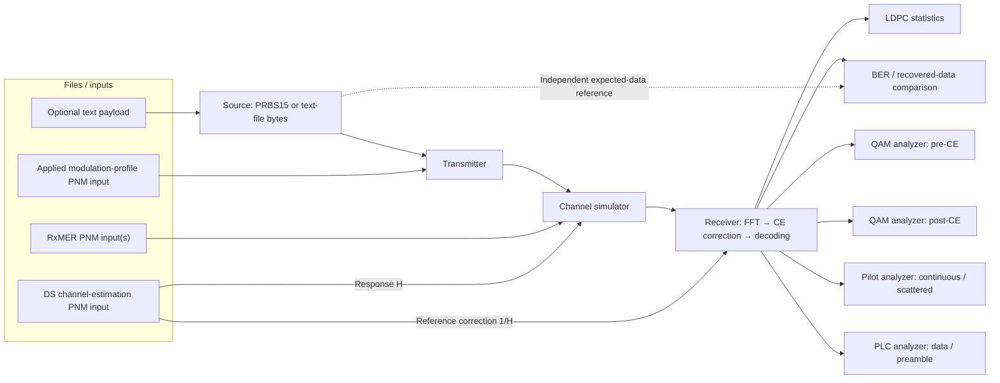

# Visual system workspace and selectable payload source

**Planned design; no Qt workspace or text-file source is implemented.**
The user's system sketch is the starting layout, rather than a final screen
specification. The application remains a standalone MERLIN simulator. Existing
Rust scientific stages and test points own all computation; Qt presents them.

## Workspace concept

The main area displays the signal path as clickable blocks. A file panel lists
loaded inputs and their roles. Selecting a block opens its settings, design
explanation, status and available observations. Selecting an analyzer opens its
plot or statistics view. Panels can be opened without changing the running
experiment or enabling an unbounded diagnostic capture.

The source-to-BER connection represents an independent truth comparator, not a
return channel or receiver-driven source reseeding. Analyzer arrows mean read-only
observations of the appropriate internal receiver boundary. Pre-CE taps the FFT
before correction even though it is drawn beside the receiver's other outputs.
The reference correction uses supplied H; future pilot-derived H-hat is a
separate receiver mode and must be labeled as such.

### Clickable blocks

| Block | Proposed contents |
| --- | --- |
| Source | PRBS15 or text-file selection; seed or byte count; progress and EOF policy. |
| Transmitter | Fixed transmission settings, applied profile, coding/mapping/interleaving and waveform stage breakdown. |
| Channel simulator | Selected RxMER frame(s), supplied H, noise/reference mode, frequency grid and impairment settings. |
| Receiver | Acquisition/readiness, correction source and FFT/equalization/decoding stages. |
| LDPC statistics | Actual iterations, convergence and failure counts, separated by payload/NCP/PLC. |
| BER | Compared bits, errors, alignment/completion and recovered-data status. |
| QAM analyzers | Matched payload pre/post-CE points, profile/carrier/time selection and bounded capture status. |
| Pilot analyzer | Separate continuous/scattered BPSK views with preserved boost and paired pre/post points. |
| PLC analyzer | Separate16-QAM data and BPSK preamble views, including acquisition observations. |

Each block should explain what it does in plain language and link to its model
user guide. A transmitter or receiver block can expand into its existing
encapsulated stages rather than presenting a single opaque operation.

### File panel

List loaded files by purpose: payload, RxMER, channel response and applied profile.
Show filenames, validation status and relevant capture identity/grid/time metadata.
Associate each entry with its block; selecting an entry opens details or focuses
the consuming block. Provide an OS file picker; drag/drop may be added later.
Loading/replacing inputs must not silently mutate an active run: validate them
first and apply changes to the next explicit run.

PNM describes the measurements' origin. The current supported input is decoded
`pnm-decode` JSON through the shared Rust importer, or an already validated typed
scenario. The workspace must not imply that native binary PNM parsing exists in
this repo. Any future binary-file convenience must use an explicit decoder
adapter. Text payload files are a separate data-source input, not PNM measurements.

Multiple RxMER files can be listed, but the existing engine selects a validated
frame. Temporal transitions and frame association remain MODEL-06 work; the UI
must not imply that listing several files already simulates a changing channel.

## Planned text-file source

Add a Rust-owned source beside PRBS15, feeding the same payload/FEC path. A text
file supplies its exact bytes, including line endings and any UTF-8 multibyte
sequences. Do not normalize text, remove a BOM or convert it to numeric strings.
The proposed bit order is most-significant bit first within each byte; declare it
in the source configuration and test it independently. This is a proposed source
contract, not a change to the existing PRBS15 recurrence or its seed ordering.

The adapter loads a bounded file and supplies bytes to a path-independent public
Rust model. The source owns its byte/bit cursor and original payload length.
A separate verifier compares recovered meaningful bits with the original bytes;
LDPC convergence alone is not proof of correct recovered data. BER excludes
padding and unsent/incomplete data. Any recovered-text preview is presentation
only; do not discard invalid bytes when errors produce invalid UTF-8.

Proposed initial EOF behavior is **send once**, without implicit repeat. The
last FEC payload uses explicit padding; its meaningful-bit count is retained so
padding is excluded from recovered-file output and BER. A longer configured
run continues with existing idle/filler behavior after EOF. A shorter run reports
partial transmission/comparison, not a successful full-file recovery. A repeat
option, if added later, must be explicit and preserve absolute source offsets.
Empty files, source-size limits, padding, cancellation and partial final bytes
need defined results and tests before implementation. No source bytes or full
text contents should be written to diagnostic logs.

The core/source API and CLI must support this choice before Qt adds the control.
PRBS15 remains the default for current runs. A file source is test traffic, not a
claim to generate DOCSIS MAC frames or provide a network file-transfer service.

## Implementation boundaries and acceptance

- Keep generation, byte-to-bit conversion, source accounting, verification and
  simulation lifecycle in Rust source/runner owners. Preserve separate independent
  source/channel RNG state and existing PRBS results.
- Keep Qt view state and file dialogs outside scientific modules. Run bounded jobs
  away from the UI thread; preserve cancellation and partial-result semantics.
- Bind analyzers to shared result/probe contracts. Opening, closing or refreshing
  a panel must not alter noise draws, transmitted bits or decoder decisions.
- Honor combined memory/export limits across all open analyzers. Report unavailable
  points rather than repeating/padding observations to fill a display.
- Keep visible direction and reference-plane labels: TX → channel → RX;
  pre-CE / post-CE; supplied H / estimated H-hat; noise disabled / enabled.
- Before the future UI implementation, add per-component user guides and actual
  screenshots. The Mermaid sketch is a navigational design, not a UI prototype.

Track text-source work as SRC-04..06 and workspace work as UI-01..04 in the
[official checklist](../../checklist.md). Planning this screen does not reorder
current receiver-estimation dependencies or mark those items complete.
