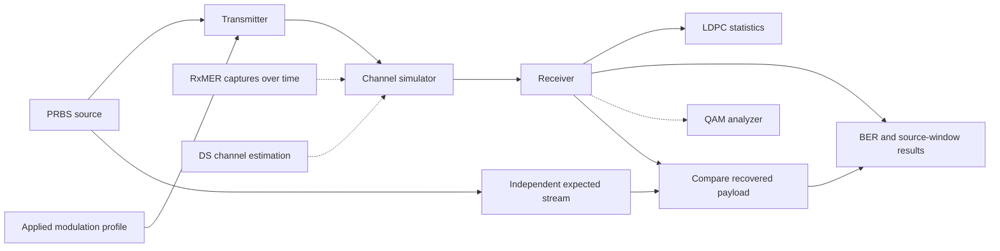

# Reference for the later impairment stage

The user-provided block diagram is the reference for work after the noiseless
RUN/infrastructure milestone. This page records its intended ownership; it does
not implement the measurement-driven channel or a UI.

The feedback line to the PRBS box means reference comparison/regeneration of the
expected source stream, not receiver decisions modifying transmitted PRBS data.
The current milestone supplies the fixed-profile TX, unity reference channel,
known-reference RX, real payload/control FEC, actual LDPC iterations, independent
PRBS truth, window accounting and bounded inspection/export.

The later stage will define how measured RxMER and channel estimates enter the
channel, establish reference planes and avoid counting residual noise twice.
Profile expansion/mixed loading, nonideal estimation, time correlation and QAM
analyzer presentation need their own validated scope. The current hard-slicer
and broader QAM/FEC TODOs remain explicit in the [checklist](checklist.md).
Impairment implementation begins in a separate later stage.
