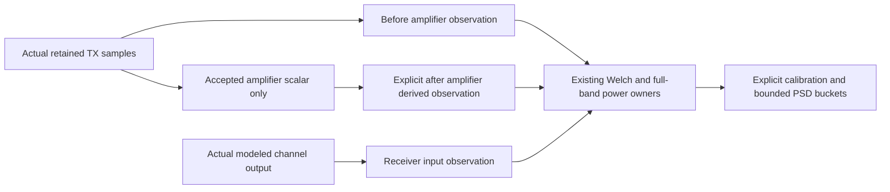

# Channel spectrum and electrical power

The Basic Rust API and Basic Python API inspect actual retained spectra with
explicit electrical units. Calibration uses the accepted input data reference;
it does not run another transmitter, channel or receiver. The original normalized
`spectrum` operations remain available with their existing behavior.

`FullLoopResult.calibrated_spectrum` selects an actual contiguous time boundary.
`channel_spectrum` offers before-amplifier, after-amplifier and receiver-input
views. Before and after use the same retained TX overlap samples. After applies
the accepted amplifier gain alone, before CPA, physical response, additional loss
and receiver noise. It is labelled as a scalar-derived view with its exact
amplitude ratio and original source context. Receiver input uses actual retained
channel output, including its admitted channel effects. It never substitutes
transmitter samples for receiver observations.

In Rust, `FullLoopChannelTap` and `FullLoopSpectrumQuery` select the tap and finite
window; amplifier taps require TxOverlap and ReceiverInput requires ChannelOutput.
Python selects these source stages from `before_amplifier`, `after_amplifier` or
`receiver_input`. Both retain the same work and viewport validation. The
[observation guide](full-loop-observations.md) explains retention, original sample
coordinates, contiguous versus ordered-frame diagnostics and missing coverage.

`amplifier_bins` supplies actual TX physical-bin I/Q and roles before or after
that same amplifier-only scalar. Rust uses AmplifierBoundary; Python accepts
`before` or `after`. Missing history stays missing, known zero stays zero, and
bin power is instantaneous squared magnitude rather than PSD per Hz. The result
retains its original TX context separately from the selected amplifier boundary.
Actual receiver QAM continues through the
[received-cell operations](full-loop-cells.md).

An idle TransmitterPreview also has `calibrated_spectrum`, taking an explicit
ChannelConfiguration. It calibrates the already generated TX PSD before the
amplifier. Configured gain, attenuation and noise are not applied. Reading a
preview starts no channel operation and does not advance source state.

With no electrical input reference, density stays in normalized sample units
squared/Hz and integrated dBmV values are absent. With an explicit reference,
density is millivolts squared/Hz and bucket extrema use dBmV/Hz. The result names
both references and reports the calibration factor. Zero density has no finite
logarithmic reading; the API does not invent a display floor.

Full-band ChannelPower integrates the complete original linear PSD between the
first and last nonexcluded physical carriers, including internal excluded holes.
It is independent of the selected plot viewport and its at-most-2048 extrema
buckets. The existing owner reports normalized integrated power, optional dBmV,
the equivalent band-average dBmV per 6 MHz, physical band edges and bandwidth.
These are modeled observations, not a claim about measured RF port compliance.

The existing complex-envelope normalization is preserved:

\[
P_{\mathrm{band}}=\sum_{k=k_\mathrm{first}}^{k_\mathrm{last}} S_k\,\Delta f,
\qquad
K=10^{L_\mathrm{input}/10}\frac{F_s}{6\,\mathrm{MHz}}.
\]

Here S is normalized complex-sample PSD, K converts sample power to rms millivolts
squared, and the explicit input level is in dBmV per 6 MHz. There is no additional
real-carrier factor of two. Original sample rate, FFT size, physical frequency
grid, Welch averaging and equivalent noise bandwidth remain in the result.

All queries return owned values, release the Python GIL during numerical work
and preserve the retained source and completed simulation. Missing observations,
unsupported stages, invalid windows, inconsistent grids and nonfinite/overflowing
values fail explicitly. Scientific ownership remains in Rust, independently of Qt.
