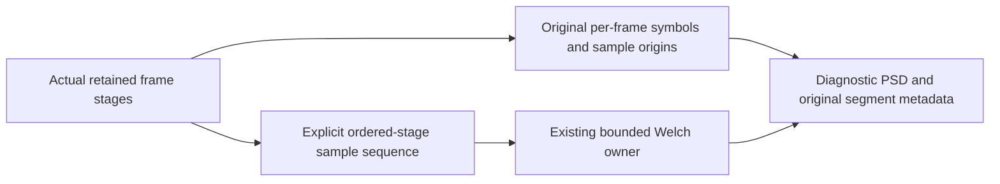

# Retained downstream stage observations

The public downstream API can retain bounded copies of actual core test-point
values. Capture is opt-in: prepare an ordinary FullLoopRequest, then create a fresh
request with `with_observations`. Accepted scientific settings and the original
request remain unchanged. Capture never starts until explicit `run`.

| Rust operation | Python operation | Contract |
| --- | --- | --- |
| `FullLoopObservationPolicy::new(FullLoopObservationInput)` | `FullLoopObservationPolicy()` for defaults | Validated immutable supported-stage/event/element/byte policy; construction runs no science. |
| `FullLoopObservationPolicy::from_json(bytes)` | `FullLoopObservationPolicy.from_json(data)` | Same strict policy admission, at most 64 KiB JSON. |
| `policy.settings()`; serde | `.settings`; `.to_json()` | Exact accepted selections and limits; native dictionaries are independent copies. |
| `request.with_observations(policy)` | `request.with_observations(policy)` | Fresh request with validated passive capture; original request stays capture-disabled unless already configured. |
| `request.observation_policy()`; `result.observation_policy()` | `.observation_policy` on request/result | Frozen original retention policy, or None; results retain it after request disposal. |
| `result.stage_inventory()` | `result.stage_inventory()` | Registered retained IDs with actual event/element counts. |
| `result.observation_stats()` | `result.observation_stats()` | Owner-accounted bytes/events/elements and byte-budget dropped-copy counts, distinct from core dispatcher statistics. |
| `result.stage(FullLoopStage, snapshot, FullLoopStageViewport)` | `result.stage(stage, snapshot=0, start=0, count=0)` | Owned actual contiguous data/context window with original offsets/totals; at most 4096 copied values. |

For aggregate admission in a Rust application, each individual `stage_inventory`
or `stage` return has exact final owned capacities. Its payload is no larger than
`result.retained_footprint().payload_bytes`, with no ordered entries or shared
roots. Keep the source charged and reserve each simultaneously live query copy
separately. This conservative envelope covers these two Rust returns; paged
concatenation, plotting containers, JSON transport and native Python dictionaries
have independent storage. Temporary construction follows the existing finite
query/retention limits; this is not a process-memory bound.

Rust exposes the existing registered IDs through `FullLoopStage`; Python uses
their original serde strings. Discover configured IDs from policy settings and
available events from the result inventory. The default policy selects 22 existing
TX source/coded/interleaved/label/mapped/physical/PLC/pilot/waveform and channel/RX/
LDPC-input stages. Some are mode-dependent; an unproduced stage stays unavailable.
No ideal values or reconstructed placeholder data fill missing observations.

Default selections preserve existing workbench caps: one event per ordinary stage,
64 PLC messages, 12 channel-output blocks, and four TX overlap/RX framed/H events.
Most retain observation phase only; PLC message/IQ/preamble retain their original
warmup/observation/drain tags. Each selected stage permits 1..64 events, with at
most 32 unique supported IDs. Global limits are 1..10000 events, 1..16384 selected
elements per event, 1..1048576 total selected elements and 1..96 MiB owner-accounted
payload/context retention. These are application bounds, separate from PHY limits,
original input storage and engine/allocator overhead.

Original dispatcher selection/phase/global/per-stage budgets remain authoritative.
A copy that exceeds remaining owner bytes is dropped, increments dropped-event
statistics and sets `byte_budget_exhausted`; smaller later copies can still fit.
The flag records at least one rejected copy, rather than an exactly full allocation.
Scientific processing and completed FEC trials continue. A dispatcher cap can also stop events before the collector is called.
The reported dropped-copy count covers the byte owner only. Retention is finite
and does not promise a complete run history.

Each stage snapshot retains the original direction/domain/units, phase, source/
channel/sample/codeword/profile coordinates, reference, full grid metadata and
available transmit roles. `element_start` is the original offset, and
`total_elements` is the original producer extent. Query zero count selects up to
4096 remaining retained elements; out-of-range/overflow/count violations reject.
Unavailable stages return MissingCoverage; absent retained event indices return
InvalidIdentifier. The query never reruns a transmitter, receiver or source.

`FullLoopStageData` is a typed Rust enum; native output has `kind` and `values`.
Kinds are bits, bytes, IQ, optional IQ, QAM labels, transport cells, pilot records
and LLRs. Output models are non-exhaustive Rust contracts. Optional history and
known zeros remain distinct: frame assembly defines excluded FFT bins as explicit
zero I/Q, while None denotes unavailable history. No conversion merges them.
Pilot records come from the exact vectors computed by frame assembly and inserted
into that physical symbol; the capture hook does not regenerate pilots. Actual
pilot bins/IQ agree with the retained physical symbol and keep the original RMS
reference. A scheduled PLC message observed at construction does not by itself
prove that its entire waveform was transmitted.

Results and query windows own their data and remain valid after inputs, requests
and controls are disposed. Native queries release the interpreter lock for copying/
serialization and return independent dictionaries/lists. Original science/FEC/
source outcomes are unchanged with capture enabled or disabled within host budgets.
Original public low-level frame assembly retains its signature and no-op path.

```python
from merlin.downstream import FullLoopObservationPolicy

# base is an already prepared immutable FullLoopRequest.
observed = base.with_observations(FullLoopObservationPolicy())
result = observed.run()
print(result.stage_inventory())
window = result.stage('tx.overlap_add.samples', start=7, count=256)
print(window['element_start'], window['context']['sample_start_index'])
```

The passive numerical operations below reuse those actual observations and existing
scientific owners. [Selected receiver cells](full-loop-cells.md) add actual paired
QAM/MER and bounded physical decisions; [reference and soft-value views](slicer-views.md)
provide finite geometry and actual likelihood summaries. [Physical views](physical-views.md)
preserve original FFT roles/power and typed transmitted-cell provenance. Calibrated
channel-spectrum, scalar amplifier-boundary and full source-catalog/sweep
compatibility remain UIU-API-02 gates before Qt adoption.

## Passive numerical observations

| Rust operation | Python operation | Result and limits |
| --- | --- | --- |
| `result.spectrum(FullLoopSpectrumQuery { ..Default::default() })` | `result.spectrum()` | Original time samples, periodic Hann Welch PSD, at most 32 overlapping windows and 2048 min/max buckets. |
| `result.response(FullLoopResponseQuery::default())` | `result.response()` | Configured transfer, original 4K/8K grid with excluded gaps and band-limited impulse diagnostics. |
| `result.response(FullLoopResponseQuery { source: FullLoopResponseSource::ReceiverEstimate { snapshot: 0 }, ..Default::default() })` | `result.response("receiver_estimate", snapshot=0)` | Actual retained receiver H-hat; absent or incomplete estimates reject. |
| `result.llr_statistics(0)` | `result.llr_statistics(snapshot=0)` | Actual retained payload LDPC-input statistics and 41-bin histogram, original coding-order context, offset and total. |

PSD `stage` selects a registered time boundary; the default is
`tx.overlap_add.samples`. `snapshot` selects its first retained event. Only actual
adjacent overlap-output, channel or framed events with matching phase, geometry,
reference, identities and exact absolute sample origin may join. Missing samples
stop accumulation. Fewer than one FFT window rejects. `max_averages` is 1..32;
`start`/`count` address original centered FFT bins, with count zero selecting the
remaining span. Frequency-domain stages reject; no FFT is applied to FFT bins.
`available_samples` counts the bounded contiguous samples collected,
`used_samples` excludes an incomplete trailing window, and `snapshots_used`
counts actual contributing events. Powers remain normalized sample units squared
per Hz; zero-power buckets retain unavailable dB extrema. The existing
`TransmitterSpectrum` DTO also carries this waveform PSD metadata for receiver
boundaries, whose `reference_plane` explicitly names the selected source.

Configured transfer reuses the accepted channel composition plan before receiver
correction. It remains separate from the original captured H and is not a measured
continuous-filter output. Both response sources return dimensionless H curves;
impulse power is relative to its peak. `velocity_factor` defaults to the existing
0.87 convention and must be finite in (0,1]. Path distances assume uniform cable;
the result does not establish reach or guaranteed echo protection. Python accepts
exactly `configured` (snapshot zero) or `receiver_estimate`.

LLR statistics preserve `log P(0)/P(1)`: positive favors zero. The retained count
may be smaller than `total_elements` when the explicit retention policy truncated
an event. These statistics describe that retained window, not all words or the
run's decoder performance. No query changes inputs, retention counts, source
state or completed science. Rust returns owned typed results; Python returns
independent dictionaries and releases the GIL during numerical preparation.

See [channel spectrum and electrical power](channel-spectrum.md) for calibrated
actual spectra, full-band integration and explicit amplifier-only derived views.

## Ordered frame-stage spectrum

An IFFT/useful-frame display may inspect successive frames with their prefixes
omitted. A windowed-frame display may inspect frames that overlap in physical
time. `spectrum_sequence` provides an explicit diagnostic sequence for these
retained stages, with matching Rust and native Python behavior. The normal
`spectrum` operation above retains its physical sample-contiguity rules.



Only IFFT, prefix, window and receiver useful-frame stages are admitted. Callers
explicitly retain multiple frames through the existing observation policy; its
default event limits are unchanged. The query never starts another run or fills
missing history. It collects consecutive channel symbols with matching identity,
phase, geometry and reference, checking the original physical symbol stride.
A missing prefix in a later retained frame or an incomplete earlier frame stops
collection, with an explicit reason. A final frame can be clipped by the finite
analysis-work limit. Original gaps and overlaps remain visible in segment metadata.

The result labels its sampling basis `ordered_frame_stage_samples`. It preserves
each segment's original symbol, sample origin, retained offset/extent and total,
alongside its diagnostic sequence position/count. `physically_contiguous` reports
whether the contributing original intervals actually touch; one segment can be
contiguous even when later history was unavailable. The result does not claim
that concatenating useful/windowed frames reconstructs a transmitted or received
continuous waveform.

PSD uses the existing nominal 204.8 MHz analysis clock, original FFT-bin grid,
periodic Hann window and 50% overlap. Values are normalized sample units squared
per diagnostic Hz. For discontinuous physical segments this is a stage diagnostic,
not the continuous RF waveform's PSD. Work remains bounded to 32 averages,
N + 31*N/2 copied samples, 64 contributing frames and 2048 viewport buckets.
`available_samples` counts collected values; `used_samples` counts values consumed
by complete Welch windows. Each segment reports its analyzed share, so an unused
partial tail is explicit. A truncated prefix frame can supply one complete FFT
window while still reporting `incomplete_frame`; it cannot be stitched to the
next retained frame as though its missing suffix existed.

Python defaults to `tx.ifft.samples`. Rust explicitly selects an admitted stage
in FullLoopSpectrumQuery; that existing query type's Default continues to select
TX overlap samples for the original `spectrum` operation. Returned dictionaries
own their values, and queries preserve retention counts, source/RNG and results.

## Retained TX PLC messages

Rust `result.plc_messages()?` and Python `result.plc_messages()` return an owned
report from actual retained `tx.plc.message` events. Enable that stage explicitly
or use `FullLoopObservationPolicy` defaults before running. No retained stage
raises a missing-coverage error. The query parses at most 64 original frames and
returns at most 32 complete CRC-validated MAC packets, with exact packet bytes,
source addresses, descriptor identities and typed decoded TLVs. Each TLV retains
its encoded value and absolute type-byte offset inside the complete MAC packet.
OCD timing/geometry meanings reuse received-channel decoding. DPD zero loading
has no constellation; NCP QPSK remains distinct from downstream data-QAM support.
Recognized modulation metadata does not establish a supported coding chain.

The reference plane is `tx_plc_message_construction`. A constructed frame can be
retained before any of its samples are emitted. Each packet records its last
carrying original context and checked frame-end sample. `completely_transmitted`
is true only when actual transmitted samples reach that boundary. These records
are TX observations; they do not assert received MAC-message acceptance.

Nonconsecutive, truncated or invalid frames stop reassembly. Earlier complete
packets remain available with a structured `issue` identifying the failing
retained-frame index; `pending_bytes` describes the current incomplete MAC packet.
`processed_frames` counts successfully parsed/reassembled frames, even if a later
descriptor in that frame is rejected. Query frame/packet limits are reported
separately; the original observation policy/stats still describe earlier capture
limits or dropped copies. Missing bytes and descriptors are never synthesized.

```python
messages = result.plc_messages()
for packet in messages['messages']:
    print(packet['descriptor']['profile_id'], packet['completely_transmitted'])
    for field in packet['descriptor']['fields']:
        print(field['offset'], field['meaning'])
```

Traceability: [architecture](../../architecture.md#unified-qt-public-api-boundary),
[requirements](../../requirements.md#req-uiu-16),
[design](../../development/features/unified-qt-workbench/design.md#uiu-api-02-retained-test-point-ownership-unit)
and [task](../../development/checklist.md#task-uiu-api-02).
