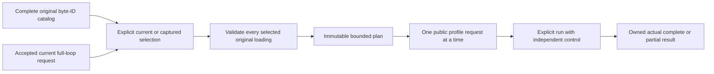

# Original profile catalogs and serial run plans

The Basic Rust API and Basic Python API prepare a finite selection of independent
downstream full-loop requests from the complete original profile catalog. The
plan validates every selected loading before returning. Reading a catalog or
preparing a plan never starts a source, transmitter, channel or receiver.



ProfileCapture preserves every encoded source identity, original scheme, grid
and exact original bytes. Simulation ProfileId retains its established 0–15
domain. `capture.simulation_profile` selects a checked identity and returns its
original captured Dpd loading and provenance. Its legacy `profile_ids` inventory
contains only the catalog identities that pass that simulation validator; use
the ProfileCapture inventory for every raw source ID. Existing Dpd loaders keep
their original behavior, including their catalog validation.

FullLoopSweepPlan starts from an already accepted FullLoopRequest and a catalog
with the same original ScenarioKey. Choose one explicit mode:

- **Current** preserves the exact accepted request, including an edited hypothesis.
- **AllCaptured** selects every original catalog profile in increasing ID order.
- **Selected** selects an explicit nonempty list, validates identity membership
  and uniqueness, then sorts by original ID.

AllCaptured rejects an unsupported run identity rather than silently omitting it.
A mixed catalog can still supply an explicit supported selection without losing
the other read-only source entries. Captured modes use original loading; choosing
them does not silently substitute the current edited profile.

Admission keeps the existing application ceilings of 32 selected profiles and
262144 total selected assignments, separate from the simulation ID domain.
Every selected profile goes through the existing full-loop preparation owners,
including source, measurement playback, epoch/grid, channel, receiver and coding
admission. A failure identifies its original profile and returns no accepted plan.

The plan shares the original catalog and base request. Preflight constructs and
drops one temporary request at a time, avoiding a retained copy of all measurement
frames for every profile. `request(index)` uses a sorted-selection position,
preserves the accepted options and observation policy, and returns one immutable
public request. No source or RNG advances until its explicit `run` call.

In Rust, after admitting `request` and `catalog`:

```rust,ignore
let plan = FullLoopSweepPlan::new(
    &request,
    &catalog,
    FullLoopProfileSelection::AllCaptured,
)?;
for index in 0..plan.info().selected_profile_ids.len() {
    let control = FullLoopControl::new();
    let result = plan.request(index)?.run(&control)?;
}
```

The corresponding Python fragment uses the installed `merlin.downstream` module:

```python
import merlin.downstream as m

plan = m.FullLoopSweepPlan(request, catalog, selection="all_captured")
for index in range(len(plan.info["selected_profile_ids"])):
    control = m.FullLoopControl()
    result = plan.request(index).run(control)
```

For Python's `selected` mode, supply `profile_ids` as an explicit sequence of
original integer IDs. Other modes reject an extraneous ID list. Rust uses
FullLoopProfileSelection::Selected with checked ProfileId values.

`info` reports every raw source ID, selected run IDs, total selected assignments,
the sum of requested source-observation durations, summed per-profile active
runtime budgets and the finite retained-word-detail ceiling. Observation duration
excludes acquisition and drain; it is not elapsed wall time. Runtime budgets keep
the existing acknowledged-pause contract. This metadata lets a dispatcher apply
its own aggregate retained-result policy without changing scientific admission.

Each request uses the existing independently controlled lifecycle. A completed
control cannot be reused; a later cancelled or failed request does not mutate
earlier owned results. The plan owns no worker or aggregate result archive.
Qt's direction/session dispatcher remains responsible for its one-active-run
policy and UI result budgets. Python releases the GIL during native preparation
and execution, and returns independent metadata dictionaries.

See [full-loop execution](full-loop.md),
[actual retained observations](full-loop-observations.md) and
[original profile inspection](profile-inspection.md) for the underlying contracts.
