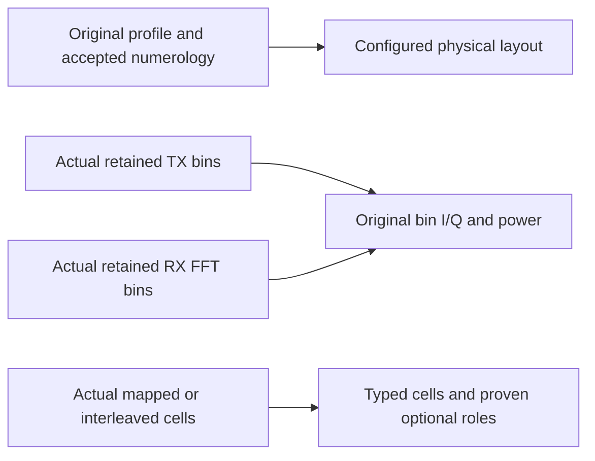

# Physical bins and transmitted-cell roles

MERLIN can inspect configured physical carrier geometry without starting a
transmitter. After an explicitly observed full-loop run, it can also inspect the
actual transmitted FFT bins, raw receiver FFT bins and transmitted transport
cells. Rust owns these projections; Python returns independent owned dictionaries.
The [API reference](../../reference/public-api.md) owns signatures.

The layout spans the original 4096- or 8192-bin FFT grid. A source capture may
cover fewer carriers, starting at a nonzero physical index. Its identity, grid
and provenance remain separate from this full FFT geometry. Windows keep original
physical indices, absolute frequencies and the backend's channel-symbol phase.
Scattered pilots, continuous pilots, PLC and exclusions come from the accepted
layout owner. A physical **Data** location can transport payload, NCP or filler;
it does not prove which cell occupied that location. Up to 1024 role spans are
returned, with an explicit omitted-span count and all requested per-bin roles.

Catalog inspection can select an original byte-sized encoded profile ID. This
does not widen the legacy runnable ProfileId range or establish a supported
coding chain. Inspection can reject incompatible geometry or unknown static
assignments even when the original catalog itself was decoded successfully.

Actual bin power is the squared complex magnitude:

\[
P_k = I_k^2 + Q_k^2, \qquad P_{k,\mathrm{dB}}=10\log_{10}(P_k).
\]

This is instantaneous normalized bin power. It is not Welch spectral density,
has no per-Hz normalization and does not perform another FFT. Known zero I/Q has
linear power zero and no finite dB value. Unavailable transmitted history has
neither I/Q nor power; it must remain a gap. Nonfinite or overflowing power is
rejected. Original observation context distinguishes TX from the raw RX plane.

Mapped cells retain packing roles from the actual transmitter. Interleaved roles
are projected through the existing Rust interleaver only for the first source
symbol whose retained geometry, identities and origin prove alignment. This
diagnostic uses a separate metadata-only interleaver; it does not advance the
live source or transport. Later or insufficient role history remains unavailable.
An explicit pilot placeholder and unavailable delay history are different typed
values. No role is inferred from the constellation position.

Each query copies at most 8192 bins or cells and preserves original offsets,
totals and retained extents. Zero count selects the remaining retained window;
out-of-range windows reject. Missing observations are never regenerated. The
existing [4096-element raw-stage query](full-loop-observations.md) keeps its
original bounds, and [normalized spectrum queries](full-loop-observations.md)
keep their separate sample-contiguity contract.

Qt adoption remains a subsequent migration task. These public operations do not
change existing downstream simulation behavior or expose private engines to Qt.
