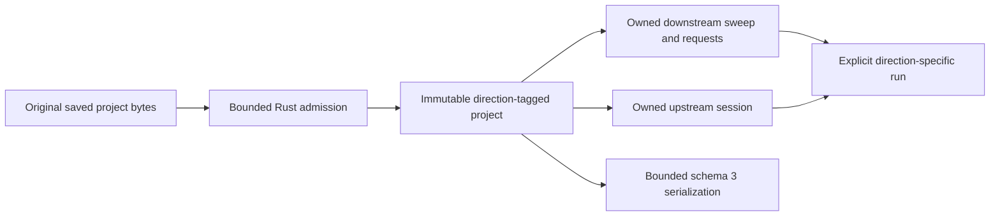

# Direction-specific saved projects

Rust's `merlin::common::Project` and Python's `merlin.common.Project` admit one
independently owned downstream OFDM or upstream OFDMA project. Enable the Rust
facade's `native-input` feature. Both languages use the same native Rust input,
integrity, configuration and resource owners. Loading stays idle.



Schema 1 and 2 retain downstream interpretation and their original bytes.
Schema 3 has `schema_version`, `application`, `direction` and `contents` fields.
Downstream contents retain the complete original workbench string and an optional
public observation policy. Upstream contents retain an original configuration or
measured-plan string, explicit run options and receiver/soft observation budgets.
Unknown fields, duplicate fields, unsupported versions and wrong-direction
contents fail before an accepted project is returned.

Rust loads and dispatches through the facade:

```rust,ignore
use merlin::common::{Project, ProjectDirection};
use merlin::downstream::FullLoopControl;

let project = Project::from_file(project_path)?;
match project.direction() {
    ProjectDirection::Downstream => {
        let plan = project.downstream_plan()?;
        let request = plan.request(0)?;
        let result = request.run(&FullLoopControl::new())?;
    }
    ProjectDirection::Upstream => {
        let mut session = project.upstream_simulation()?;
        let result = session.run()?;
    }
}
let serialized = project.to_json()?;
```

Python uses the same admitted requests and sessions:

```python
from merlin.common import Project

project = Project.from_file("saved.merlin.json")
if project.direction == "downstream":
    plan = project.downstream_plan()
    result = plan.request(0).run()
else:
    session = project.upstream_simulation()
    result = session.run()
serialized = project.to_json()
```

Inspect the downstream plan's selected profile inventory before dispatching
additional requests. Each returned request or upstream session owns its accepted
inputs independently of the project. Separate calls create separate sessions.
Project loading and serialization do not advance source, noise, playback or FEC
state. Wrong-direction access raises the shared `InvalidInput` category; other
failures retain their original Rust categories and available diagnostics.

Downstream file/fill, Designer, temporal playback, receiver/channel configuration
and independent response/RxMER timestamp policies use the
[saved full-loop admission owner](saved-full-loop.md). Upstream configuration,
captured bytes and measured associations retain their original source lineage.
Saved run overrides are applied explicitly after source admission; normal
upstream receiver operations use channel observations through the existing engine.

`original_document` returns exact complete original bytes. `to_json()` emits
schema 3 without changing embedded original document strings, inputs or settings.
It returns an owned string and opens no destination. Callers own safe file writes,
destination selection and dirty-state changes. Live controls, RNG state and
simulation results are not saved into a project.

The complete document limit is 144 MiB. Downstream embedded originals are limited
to 16 MiB each and 96 MiB together; the upstream configuration/measured input has
its own 16 MiB admission limit. `Project.collection_info` checks at most two
distinct directions, 288 MiB of original serialized project bytes and 96 MiB of
combined original input storage. Downstream accounting includes dormant and
unselected originals. Upstream accounting includes its original input document
plus every embedded captured source once. Runtime and retained results have their
own direction-specific budgets. Collection admission does not start simulations.

A legacy document near the complete-file ceiling remains readable even if adding
the schema-3 wrapper would exceed the export ceiling. Export fails without
truncating or modifying that original.

The current Qt Open/Save consumer retains its legacy format until the separate
direction-aware file task is integrated. This public backend operation does not
change existing Qt file behavior. See the
[schema and ownership design](../../development/features/unified-qt-workbench/design.md#uiu-api-05-direction-aware-public-project-admission),
[operation matrix](../../development/features/high-level-api/compatibility-matrix.md)
and [standalone Rust reference](../../../examples/api/rust/run_project.rs).
