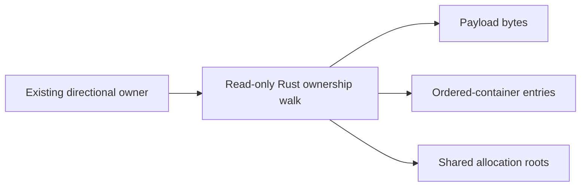

# Retained resource metadata

Downstream requests, sweep plans, results and detached receiver archives, and
upstream sessions and reports expose passive Rust-owned retention metadata through
`retained_footprint()`. Rust returns the shared `merlin::common::RetainedFootprint`;
native Python returns an immutable `merlin.common.RetainedFootprint`. The operation
does not run simulation, serialize a report or allocate copies of its payload.

This metadata describes one existing Rust owner. It helps an application account
for accepted inputs, retained results and replaced or queued owners that remain
alive. It does not reserve resources or provide a bound for a future result.
Unified Qt aggregate admission remains under implementation.

| Quantity | Meaning |
| --- | --- |
| `payload_bytes` | Fixed owned values and reachable payload storage, including unused Vec/String capacity, cached data and shared pointees. |
| `ordered_entries` | Ordered-container entries, counted independently of the standard library's private tree-node layout. |
| `shared_roots` | Shared allocation owner edges; repeated aliases conservatively repeat their pointee payloads and root counts. |

Payload bytes exclude allocator, private tree-node and reference-count bookkeeping.
They are neither total heap allocation bytes nor process RSS. Quantities depend on
the compiled target's layout. They exclude temporary execution storage, the Python
interpreter/wrapper and independently copied consumer projections. Do not use JSON
length, a process-memory reading or another platform's measurements as a substitute.

Rust users can query an already configured `merlin::upstream::Simulation` or an
owned `BatchReport`. The independent `docsis_ofdma::api` entry points expose the
same operations. The report includes retained provenance, configuration, grant
decisions and private observation caches, including data omitted from serialization.
Session metadata includes accepted configuration/document and cached playback data.

Downstream users query `FullLoopRequest`, `FullLoopSweepPlan`, `FullLoopResult`
or `FullLoopReceiverArchive` through `merlin::downstream` or the preserved
`docsis_ofdm_fec::api` exports. The same native classes are available through
`merlin.downstream` and their existing root aliases. Metadata includes original
input/provenance ownership, cached measurement powers, retained stage contexts
and the private protected pilot cache. Complete and cancelled results retain
their actual quantities; an absent observation is not fabricated.

Receiver archive metadata is separate from the existing
`archive.info().retained_bytes` statistic (Python `archive.info['retained_bytes']`).
That historical statistic and its copy policy retain their length-based scope.
Cloning an owner may shrink Vec/String spare capacity, so equal scientific
contents do not guarantee equal resource quantities after an arbitrary clone.

Python users call `simulation.retained_footprint()` or
`report.retained_footprint()` and read the three properties. These are copies of
Rust-computed quantities; Python performs no sizing. Native measurement releases
the interpreter lock. A session executing in another thread raises the existing
structured `Busy` error; its immutable reports remain independently measurable.
Checked arithmetic overflow raises the existing `ResourceLimit` category instead
of returning an underestimated footprint. A returned metadata value remains valid
after its source session/report is released.

Existing downstream exports, root Python `merlin.Simulation`, saved project bytes,
scientific limits and historical archive statistics retain their meaning.
Pre-production result/copy bounds and actual aggregate admission remain
integration work. See the [API guide](README.md),
[upstream sessions](../upstream/session.md) and
[approved retention contract](../../development/features/unified-qt-workbench/retention-contract-decision.md).
