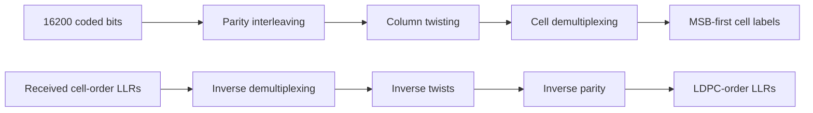

# Independent codeword bit-processing boundaries

Parity interleaving, column twisting and cell demultiplexing each have a separate
Rust module with a public permutation, binary forward operation and finite soft
inverse. The existing `BitInterleaver` facade composes those same mapping owners;
there is no second numerical implementation. Original public imports remain valid.

Each returned intermediate is directly inspectable without adding observers or
accessing mutable internals. This closes the separate-stage boundary requirement;
the existing composed observer boundaries are unchanged.

| Stage | Design |
| --- | --- |
| Parity | [Parity interleaver](parity.md) |
| Twists | [Column rotation](twist.md) |
| Demultiplexing | [Cell-bit ordering](demultiplexing.md) |

QAM-03 now extends full uniform short8/9 processing through16384-QAM using each
order's pinned table. Some orders need zero extension after parity and before
twisting; direct twist/demux inputs then use the padded count. Their inverse
returns the padded count, so discard extension positions before inverse parity.
The facade owns that composition. See [uniform ordering](../qam-processing/uniform.md)
and the separate [shortened24-column stage](../qam-processing/shortened.md).
Independent matrices, original16/256 index anchors and soft-value preservation
checks distinguish table correctness from invertibility alone.
