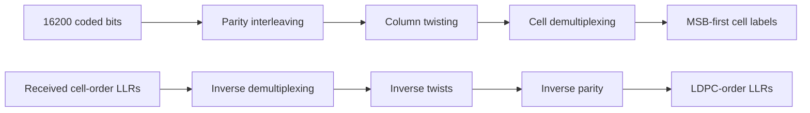

# Independent codeword bit-processing boundaries

Parity interleaving, column twisting and cell demultiplexing each have a separate
Rust module with a public permutation, binary forward operation and finite soft
inverse. The existing `BitInterleaver` facade composes those same mapping owners;
there is no second numerical implementation. Original public imports remain valid.

Each returned intermediate is directly inspectable without adding observers or
accessing mutable internals. This closes the separate-stage boundary requirement;
the existing composed observer boundaries are unchanged.

| Stage | Design |
| --- | --- |
| Parity | [Parity interleaver](parity.md) |
| Twists | [Column rotation](twist.md) |
| Demultiplexing | [Cell-bit ordering](demultiplexing.md) |

Support remains unshortened short8/9 uniform16/256-QAM. Splitting the boundaries
does not implement other coding modes, mixed profiles or non-square placement.
Existing pinned evidence in [the coding-loop guide](../qam256-coding-loop.md)
remains authoritative for tables/order. This refactor preserves those tables;
new tests add independent stage-index anchors, composition compatibility, inverse
soft-value preservation and malformed-input rejection.
