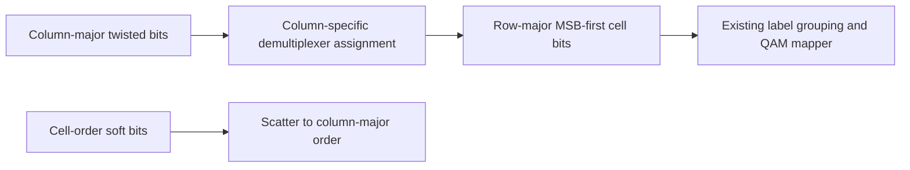

# Cell-bit demultiplexing

This stage converts the twisted column-major array into the verified row-major
cell-bit ordering. Its output is then grouped into MSB-first QAM labels by the
existing facade. It does not map I/Q or change the constellation resources.

For2025 rows, eight columns and the selected table permutation \(d_c\), input
index \(2025c+r\) moves to output index \(8r+d_c\). The first256-QAM output
row reads original column-major indices14175,4050,8100,2025,12150,6075,10125,0.
Uniform16-QAM uses its separate verified demultiplexer assignment.
All ten full uniform downstream orders now select their own assignments and
padded sizes; see [uniform ordering](../qam-processing/uniform.md).

The inverse preserves soft values exactly. Unknown coding orders, wrong word
length and nonbinary/nonfinite inputs reject. The complete receiver reverses
this stage, then [twists](twist.md), then [parity](parity.md). All stage permutations
are owned by their respective modules and reused by the composed interface.
