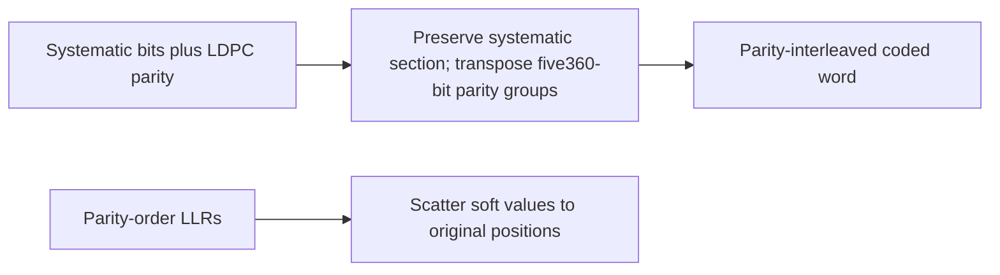

# Parity interleaver

This stage leaves the14400 systematic BCH-output bits in place and reorders the
1800 LDPC parity bits. It owns no QAM geometry or symbol-time state.

For group \(g\in[0,5)\) and offset \(r\in[0,360)\), the output-to-input
mapping is \(14400+360g+r\mapsto14400+5r+g\). For example, the first parity
output positions map to14400,14405,14410,14415; the next group's first output maps
to14401. Systematic positions are identity.

Forward input is exactly16200 binary values. The inverse accepts exactly16200
finite LLRs and changes neither sign nor magnitude. Output arrays expose the
boundary directly. Wrong lengths/nonbinary/nonfinite inputs reject without
modifying caller data. The [twist](twist.md) stage consumes this output next.
