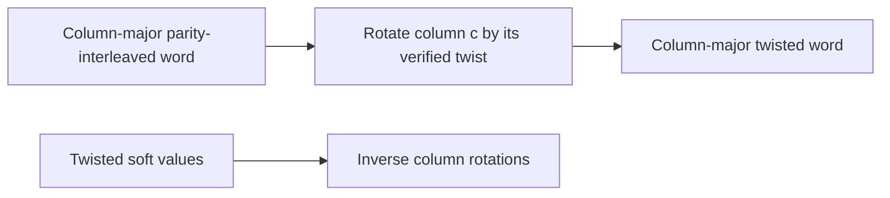

# Column twisting

This stage circularly rotates each column according to the existing verified
short8/9 table. Both input and output remain column-major, making the intermediate
boundary explicit before row-major demultiplexing.

With2025 rows and twist \(t_c\), input \((c,r)\) moves to
\((c,(r+t_c)\bmod2025)\). Column3 has a one-row shift, so its output row0
comes from input row2024. The public permutation reports output-to-input indices.

The supported uniform16/256-QAM modes share the existing eight-column twist table.
Other coding orders reject explicitly. Forward binary and reverse soft inputs
are validated for full16200-bit size and numeric constraints. The operation is
stateless and keeps no codeword, PRBS or symbol history. Continue with
[demultiplexing](demultiplexing.md); receive processing reverses that stage first.
