# Generating continuous-pilot positions

The Rust generator applies PHY I20 §7.5.15.2.2, pp.169–171. Supply the physical
layout and choose density $M$ from48..120, usually48. Existing additional-pilot
positions are replaced in the returned copy; the eight predefined PLC pilots stay
separate. The original settings remain unchanged.

$$
N_{CP}=\min\left(120,\max\left(8,
\left\lceil M\frac{F_{max}-F_{min}}{190\times10^6}\right\rceil\right)\right).
$$

Use the actual lowest/highest active carrier frequencies. Merge the spectrum after
removing exclusions, the PLC6MHz neighborhood and caller-specified poor/interfered
bins. In that merged domain, select nearest bins to

$$F_i=\frac{(2i+1)F_{merged,max}}{2N_{CP}},\quad i=0,\ldots,N_{CP}-1.$$

```mermaid
flowchart LR
    MAP["Validate geometry"] --> MERGE["Remove exclusions, PLC neighborhood and poor bins"]
    MERGE --> QUANT["Uniform merged-frequency targets"] --> RESTORE["Restore physical bins"]
    RESTORE --> EDGE["1MHz edge guard / narrow-region center"]
    EDGE --> COVER["Cover isolated active regions; cap120"]
    COVER --> JITTER["Bounded seeded ±5-bin disturbance"] --> OCD["Validated positions → existing OCD/PLC encoder"]
```

Actual exclusion bands define isolated regions. Moving a pilot avoids poor bins;
narrow regions use their center without jitter. Refill colliding edge-relocated
targets at the largest uncovered gap. If isolated-region coverage exceeds120,
reduce the initial count and recalculate. Reject physically impossible assignments.
Seeded integer mixing perturbs allowed positions by up to five bins and never
uses the payload/noise RNG. This is a reproducible engineering choice for the
PHY's permitted disturbance procedure, not a prescribed pilot random sequence.

The generator returns positions, not PLC messages or waveforms. Pass the returned
layout into the normal layout validator and descriptor builder so the receiver
learns the same positions through OCD. Tests cover both FFT sizes, density/count,
edge protection, PLC avoidance, isolated narrow regions, poor bins and repeatability.
