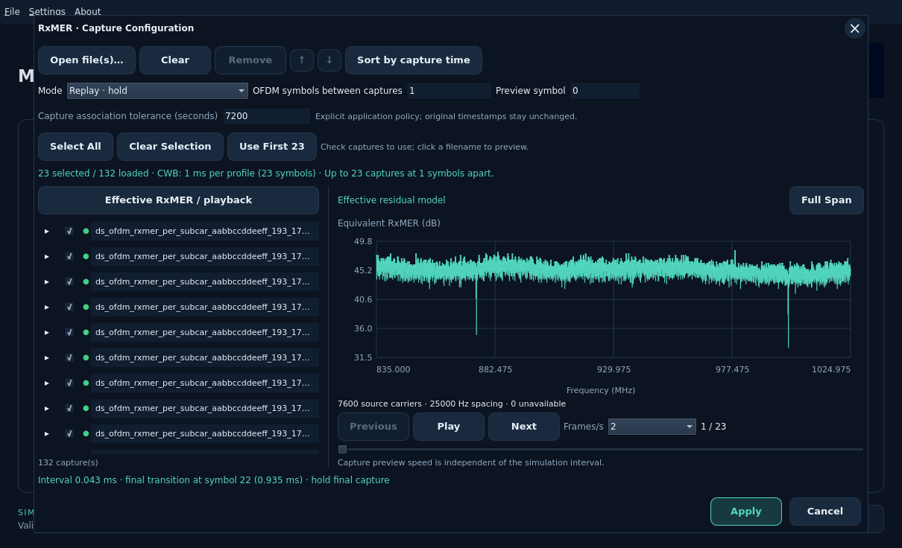
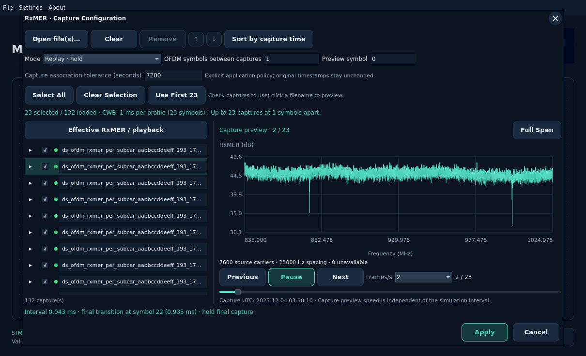
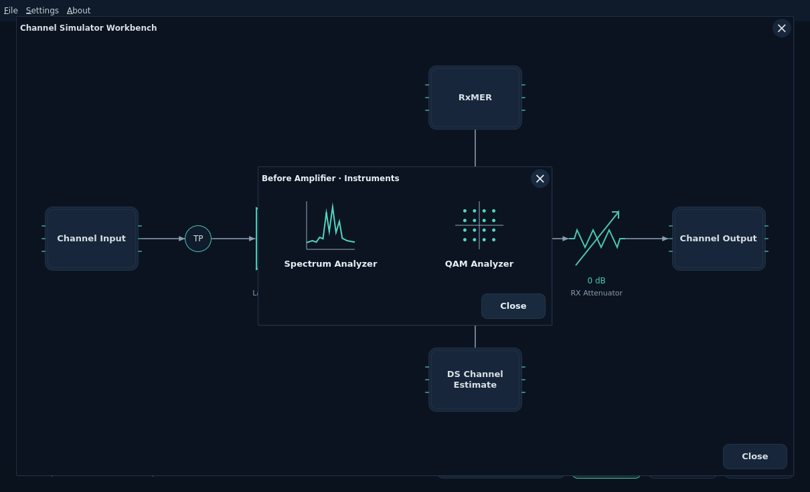
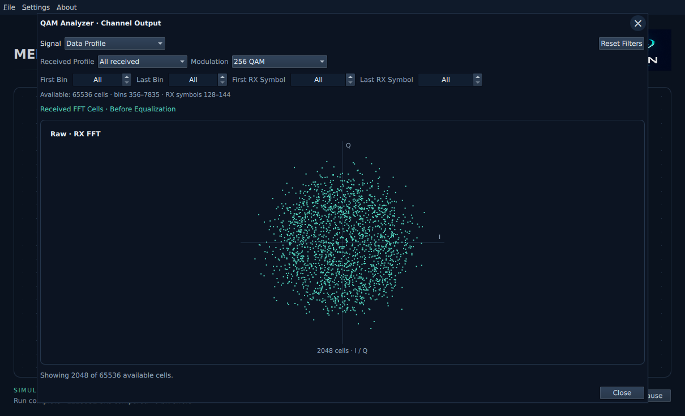
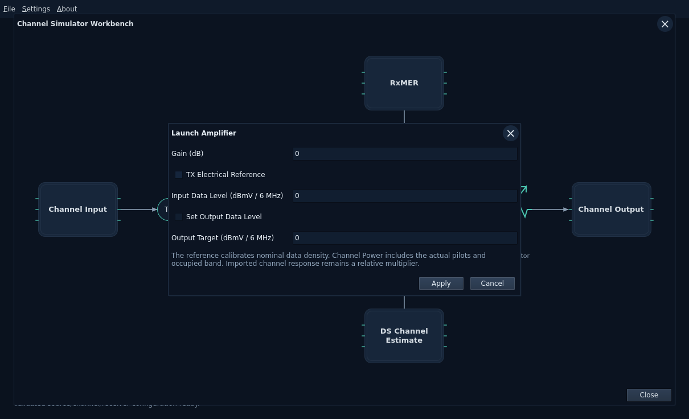
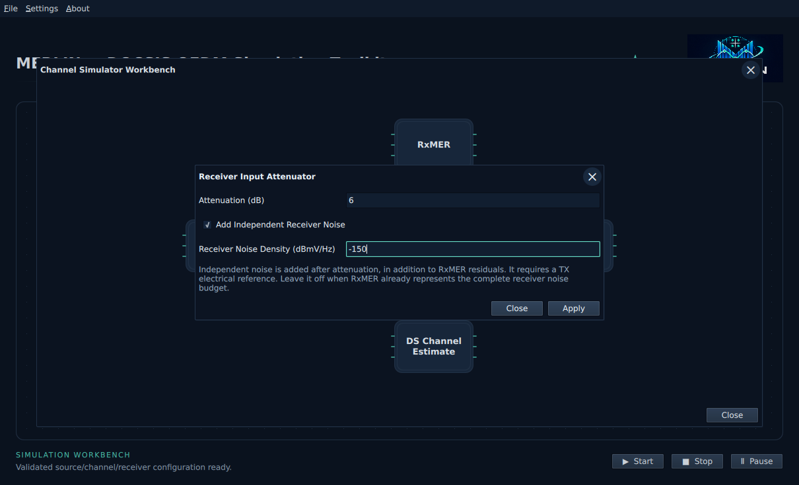
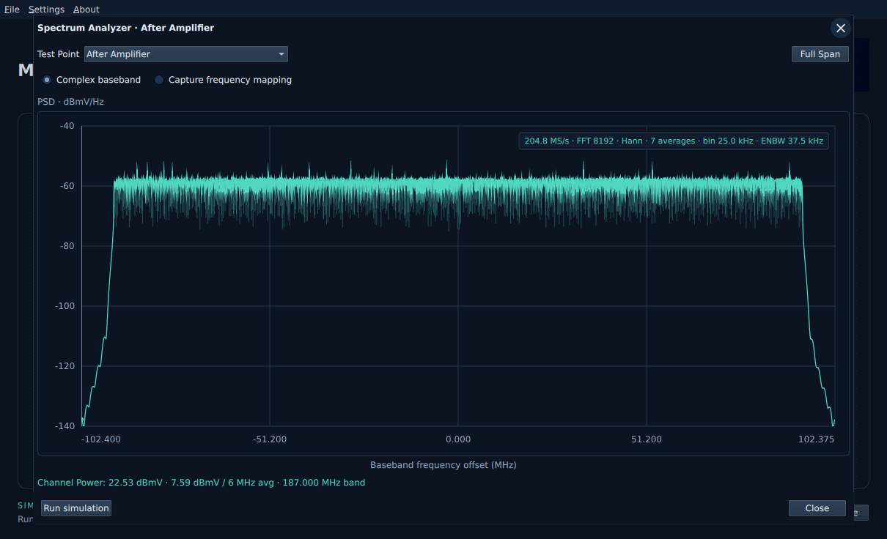
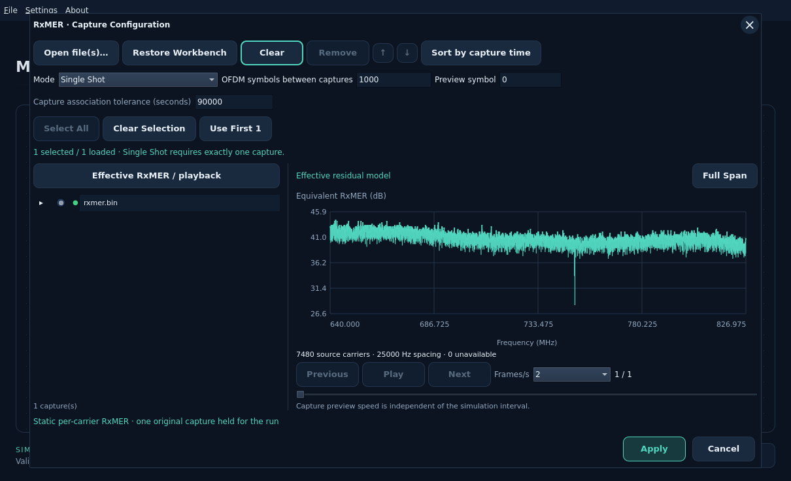
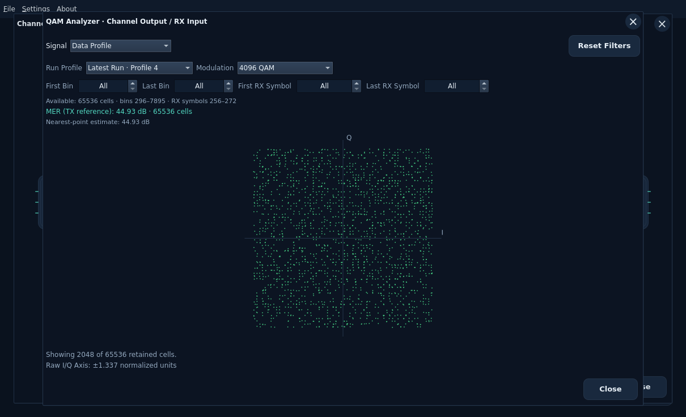

# Channel Estimate and RxMER inputs

The **DS Channel Est.** and **RxMER** blocks open separate dialogs built around
one shared measurement viewer. A capture tree on the left retains original
file metadata; the chart on the right supports zoom, full span and hover
readouts. All parsing, calculations and chart reduction happen in Rust.

Scroll over the plot to zoom around the pointer, or left-drag horizontally to
select a range. **Full Span** resets the view. There are no +/- zoom buttons.
Click the plot for keyboard +/- zoom and Home reset. Changing a capture or metric
resets the range; zoom only queries retained input data.

Apply a DPD first. Inputs must match its device, channel, frequency origin,
subcarrier spacing and complete source grid. Merely overlapping frequencies do
not qualify. Active carrier coverage is checked before Apply. Missing/excluded
values remain distinguishable; no frequency resampling or replacement is hidden.
A configurable capture association tolerance defaults to 90000 seconds as an
application policy, not a specification requirement. Original timestamps stay
unchanged.

## Channel response

The default is **Flat / unity H = 1 + 0i**, equivalent to **0 dB gain / 0° phase**
per subcarrier. This synthetic configuration needs no file and becomes ready
once the DPD/OCD grid is valid. It is not a measured capture or receiver estimate.
A linear response of 0 + 0i would suppress the signal.

Use **Open file…** for binary channel-estimate PNM or supported decoded JSON.
**Restore Workbench** discards draft edits and restores the WB’s last applied
response and tolerance, including flat/unity or an input embedded in an opened
WB file. It does not reread the original source file. Select gain, wrapped phase,
real H or imaginary H in the shared viewer. Zero/missing active gains and
incompatible grids reject Apply. **Flat / unity** returns the draft to the
synthetic default; Cancel preserves the accepted configuration.

## RxMER captures

Use the OS-native **Open file(s)…** chooser for one or multiple binary RxMER PNM
or decoded JSON files. Detection uses contents rather than extensions. The pinned
PNM Viewer Rust library handles binary decoding; MERLIN owns simulation policy.
Expand a tree row for identity, frequency, capture time, format and original hash.
Select a row to inspect its original values, or **Effective RxMER / playback**
to inspect the proposed combination. Duplicate byte-identical files reject.

| Mode | Effective model |
| --- | --- |
| Single Shot | One checked capture held for the run; other loaded captures remain available. |
| Average | Equal-capture-weight mean of linear residual error power, held for the run. |
| Replay · hold | Hold each capture until the next explicit symbol boundary. |
| Replay · interpolate power | Linearly interpolate error power between adjacent captures at the selected symbol. |

The simulation uses normalized error power `v = 10^(-RxMER/10)`. Average and
interpolation operate on v; the chart converts back with `-10 log10(v)`. They
never average/interpolate frequency grids or silently discard missing required
values. This differs from the viewer's arithmetic-dB display statistic.

For a sequence, enter **OFDM symbols between captures**. At 25 kHz spacing and
CP512, 1000 symbols corresponds to 42.5 ms. **Preview symbol** selects the point
in the synthetic schedule to display. Move selected files earlier/later or
explicitly **Sort by capture time**; filenames never determine playback order.
The final capture is held after the last transition, with no extrapolation or
implicit looping. Recorded capture times are separate from this playback clock.

RxMER uses **Open file(s)…** for capture selection. **Restore Workbench** restores
the last applied capture list, selected captures, playback options and tolerance,
discarding pending edits. It is disabled when no RxMER input has been applied.
Reopening the editor also restores those accepted values. Use the input editor’s
Open action for example captures, or **File → Open** for a bundled WB. Editors
no longer insert hard-coded demos.
Checking multiple files requires Average or one of the Replay modes. The combined
chart always identifies the effective
residual model, not a new measured capture. RxMER does not establish real burst
correlation or reconstruct measured I/Q.

## Choose captures for the next run

The loaded collection stays available. In **Single Shot**, use the radio button
beside one capture. In **Replay**, check the captures to use; they play in the
listed order. Clicking a filename only previews its original values. **Select
All**, **Clear Selection** and **Use First N** change the draft selection.
Unchecking a capture does not delete it. Apply saves the selection in the WB;
Cancel preserves the accepted selection.

The capacity line shows selected/loaded counts, CWB duration per profile and how
many captures fit at the chosen OFDM-symbol interval. **Use First N** checks the
first captures that fit. If too many are selected, reduce the selection or
interval, or increase duration in **Configure WorkBench**. Apply is disabled
until the current selection fits. If CWB is unconfigured, configure it to obtain
a replay limit. Selecting more profiles repeats the experiment; it does not
extend each profile's observation window. Average combines selected captures
into one static residual model and has no temporal replay capacity limit beyond
the collection resource limits.

The last replay transition must occur before the last observation boundary.
For N complete observation symbols and interval I, the maximum is
`1 + floor((N - 1) / I)`, capped at 256 captures. For example, the 25 kHz/CP512
configuration has 23 complete symbols in 1 ms: an interval of 1000 symbols
allows one capture; an interval of 1 allows 23. The 64 MiB and four-million
carrier-value collection limits also remain.

## Animate the selected captures

Use **Play** under the chart to view the checked originals in sequence, as in
PNM Viewer. **Pause**, **Previous**, **Next** and the position slider let you
inspect a particular capture. Select 1, 2, 4 or 8 **Frames/s**; the counter shows
the current selected frame and total, and the capture UTC is displayed below.
Playback stops at the last capture; Play at the end starts again from the first.
The frequency zoom stays in place while frames advance.

This is a capture preview. Its display speed does not change the simulation's
OFDM-symbol interval, apply the draft or start a run. Average still supplies one
static effective model to the simulation; Play previews its selected originals.
Single Shot has only one selected frame. **Effective RxMER / playback** returns
to the configured static/hold/interpolated model at **Preview symbol**. Changing
selection/mode, inspecting a filename or closing the dialog pauses animation.

## Readiness and current scope

Apply validates the entire draft before replacing accepted state. Invalid edits
and Cancel preserve accepted inputs. Replacing DPD or OCD revalidates dependent
configuration; old incompatible inputs report an error instead of silently being
realigned. Channel Simulator is green when both accepted RxMER and channel
response and additional-loss configurations are valid. Opening Channel Model shows their summary
and links back to the editors.

Green means **configured**, not a running simulation. This task provides shared
viewers, accepted input state and reusable Rust combination/preview operations.
Main Start dispatches the frozen configuration through the closed-loop worker,
with actual payload/PLC QAM and channel-output SA observations. The TX SA's local
**Run simulation** remains a separate preview before these impairments.
The RxMER editor reports capacity against the current CWB duration. Changing CWB
duration later revalidates the accepted schedule before Start; shorten the
selection or interval if its final transition no longer fits.

The editor accepts at most 256 RxMER files, 64 MiB original RxMER bytes and four
million decoded carrier values. One response file has a separate 16 MiB ceiling;
each input file is at most 16 MiB. Originals/full arrays remain in Rust; each chart
returns at most 1024 min/max groups, preserving narrow extrema and missing-data
breaks. Workbench JSON Save/Open preserves accepted original files and settings; see the
[run/save guide](closed-loop-workbench.md).

See the [design and validation](../development/features/rxmer-workbench/design.md),
[existing engine playback](impairments/measurement-timeline.md) and
[paired receiver constellation](impairments/paired-constellation.md).

## Channel Simulator stages

Click **Channel Simulator** to open **Channel Input → Channel Model → Channel
Output**, with separate **RxMER** and **DS Channel Estimate** input blocks.
Click either measurement block to open its existing input frame.

Click **Channel Input** or **Channel Output** to choose the side-by-side
**Spectrum Analyzer** trace icon or **QAM Analyzer** constellation icon. The same
graphical chooser is used at both amplifier TapPoints. Each card shows its
analyzer name above the graph icon; the window title identifies the tap. Click an icon or focus
it and press Space to open the instrument.

Input Spectrum uses TX output samples; input QAM shows the retained physical TX
FFT symbol with bin-range filters. It does not identify Data/NCP roles from point
positions. Output Spectrum uses channel-output samples at RX input; output QAM
uses actual received FFT cells **before equalization**, with the existing received
role/profile/bin/symbol selectors. Empty selections stay unavailable.

Received I/Q uses circular dots at the actual retained coordinates, before hard
decisions. These are scatter markers, not intensity bins. Channel impairments
can shift, rotate or spread the points; changing their marker shape does not
change those samples. High-order QAM can still have a square overall footprint.
The display limit reports when only a subset of retained cells is shown.

There is no separate SA block. Opening an instrument does not run the simulation;
use the main workbench Start/Stop/Pause controls. After changing accepted settings,
run again to populate current observations.

Channel Model shows input summaries and opens the separate
[Additional Tilt / Cable Loss editor](impairments/additional-loss.md). The default
is Off. Manual tilt or full additional cable loss composes with the supplied
response, preserving the imported files. These settings save in the WB JSON.

See the [staging design](../development/features/channel-workbench/design.md)
and [additional-loss design](../development/features/channel-tilt/design.md).

## Launch amplifier, attenuator and TapPoints

Click the **amplifier triangle** to set gain, or the **variable attenuator** to
set receiver-input attenuation. Each opens its own editor. **Apply** accepts;
**X / Close** discards changes. Defaults are **0 dB gain**, **0 dB attenuation**
and **Tilt Off**, so no initial setup is required. Tilt and additional cable loss
remain under **Channel Model → Additional Loss**.

The channel workspace expands with the application window. Maximize MERLIN for
more space: the diagram uses the available width with balanced outer margins,
equal gaps and aligned connectors. RxMER and DS Channel Estimate remain centered
above and below Channel Model. Controls stay readable at the minimum window size.

The circles marked **TP** mean **TapPoint**. Click either to select **Spectrum**
or **QAM** before or after the amplifier. Channel Input also opens the first tap;
Channel Output opens instruments at receiver input, after attenuation. These
routes use the same SA and channel QAM windows with their selected boundary in
the title. Input QAM shows retained physical FFT bins; output QAM shows actual
received FFT cells before equalization, with received role/bin/symbol selectors.
After-amplifier points include the accepted gain; automatic axis scaling keeps
them visible and the displayed axis extent reports their actual scale.

### Electrical reference and amplifier target

Leave **TX Electrical Reference** unchecked for an ordinary relative experiment.
To obtain electrical readings, enable it in the amplifier editor and enter the
nominal **Input Data Level (dBmV / 6 MHz)** before amplification. This is an
explicit model reference, not a level inferred from a PNM capture. Imported
channel estimates remain relative multipliers.

Use **Gain (dB)**, or select **Set Output Data Level** for a target nominal DATA
level after amplification. The target requires a reference and must resolve to
0–60 dB gain. The reference/target range and gain bounds are model controls, not
a universal DOCSIS CMTS output-power specification. Receiver attenuation accepts
0–60 dB. Receiver AGC and physical overload/clipping are separate, unmodeled effects.

### Independent receiver noise

The attenuator editor optionally enables **Add Independent Receiver Noise** with
a density in **dBmV/Hz**. This requires the TX electrical reference. It adds a
fixed frequency-bin noise floor after attenuation, in addition to the supplied RxMER residual.
Account for noise already represented by RxMER; leave this option off when the
measured residual is the entire intended receiver budget. Removing calibration
while independent noise is enabled is rejected until noise is explicitly disabled.

With independent noise enabled, increasing cable loss or attenuation lowers SNR;
matched equalization cannot undo that loss. With it off, the existing post-EQ
RxMER model can retain the same MER despite cable attenuation. Actual samples
and decoding determine recovery; a level warning does not invent bit errors.

### Channel Power and saved workbenches

The SA reports **Channel Power** integrated over the fixed occupied channel band,
including actual pilot energy, internal gaps and noise. It separately shows the
band-average **dBmV / 6 MHz** level and integration bandwidth. Mouse zoom and
**Full Span** change the display, not that power integral. Without calibration,
power is explicitly relative; with a TX reference it is in **dBmV** and PSD is
in **dBmV/Hz**. The channel-output SA warns outside the−12…+12 dBmV/6 MHz
band-average operating target. This is not a per-subband or composite RF-port
compliance measurement.

**File → Save / Save As / Open** preserve accepted gain, attenuation, target,
TX reference, independent noise and existing tilt/cable choices along with the
original PNM inputs. Supported older workbenches default missing power controls
to0 dB gain/attenuation with no electrical reference or added noise, preserving
existing tilt/cable settings. Unsupported versions or invalid values reject the
load without changing the current WB. Derived power readings, zoom, tap selection
and unapplied drafts are not saved.

See the [model and implementation record](../development/features/rf-power-budget/design.md#ui-rf-01-implemented-scalar-conditioning-and-channel-instruments)
for normalization assumptions and remaining RF front-end work.

CLI users can use the same conditioning model with the
[standalone channel-power example](../../examples/channel-power.json).

**Preview symbol** is the zero-based OFDM symbol index for the effective
RxMER/playback preview. Hover the label or field, or focus the field with the
keyboard, for help. It changes the preview only, not simulation timing or
capture selection.

### Constellation MER

The Channel Output / RX Input QAM Analyzer shows **MER (TX reference)** over
all retained cells matching its Run Profile and cell filters. It shares the
Receiver Raw calculation; Receiver Equalized reports its corrected-plane result.
The separate nearest-point estimate can be too high under dense/noisy QAM.
Hover the readings for their purpose and limits. See
[calculated MER](receiver-workbench.md#calculated-mer). All channel QAM views
use smaller circular dots to show the spread.

